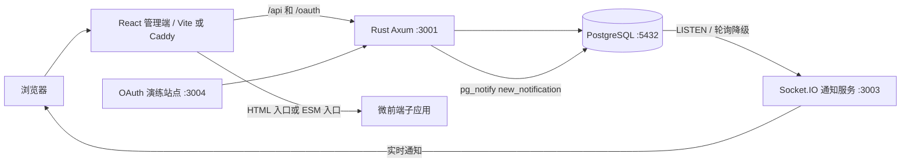

# Dante Cloud 项目文档

> 基于当前仓库代码整理（2026-09-29）。本文以实际入口、路由、迁移和构建文件为准；`docs/api-contract.md` 与 `docs/db-schema.md` 可作为接口和表结构的进一步参考。

## 1. 项目定位

Dante Cloud 是一个多租户、多层级组织、多应用的权限管理演示平台。它提供租户、组织、部门、用户、角色、菜单与应用的管理，按租户和组织逐层授权，并包含 OAuth 2.0、审计、监控、通知和微前端演示功能。

仓库由 **Rust/Axum 后端 + PostgreSQL 数据库 + React/TypeScript 管理端**组成。通知 WebSocket、OAuth 演练站点以及 Vue、jQuery 子应用位于 `mini-services/`，属于独立服务或演示应用。

## 2. 架构与数据流



后端启动时先连接数据库，执行 `backend/migrations/` 中的 SQLx 迁移，再运行 `backend/src/seed.rs` 的初始化数据逻辑。HTTP 入口在 `backend/src/main.rs`；`/api/*` 由业务路由提供，`/oauth/*` 提供授权协议端点。设置 `STATIC_DIR` 时，后端也能托管前端静态文件及 SPA 回退页面。

前端由 `frontend/src/App.tsx` 定义页面路由，`AppLayout` 处理已登录区域。API 请求统一经过 `frontend/src/lib/api.ts`，会话令牌由 Zustand store 保存到浏览器 `localStorage`。Vite 开发服务器默认监听 3000，并将 `/api`、`/oauth` 转发到后端。

## 3. 技术栈

| 层 | 主要技术 | 作用 |
| --- | --- | --- |
| 后端 | Rust 2021、Axum 0.8、Tokio、SQLx 0.8 | HTTP API、权限校验、OAuth、数据库访问 |
| 数据库 | PostgreSQL 17（Compose 镜像） | 业务数据、授权关系、OAuth 令牌、通知及审计 |
| 前端 | React 19、TypeScript、Vite 6、Tailwind CSS 4 | 管理界面与 SPA 路由 |
| 前端状态 | TanStack Query、Zustand | 服务端数据缓存与登录状态 |
| 通知 | Socket.IO、PostgreSQL LISTEN/NOTIFY | 实时通知推送 |
| 微前端 | `import-html-entry`、自定义沙箱、ESM 动态导入 | HTML 子应用和第一方模块接入 |
| 部署 | Docker Compose、Caddy | 前端静态托管及 API 反向代理 |

## 4. 主要业务模块

| 模块 | 当前实现 |
| --- | --- |
| 登录与个人中心 | 用户名密码登录、先选择租户再选择组织上下文、切换组织、个人资料、修改密码、登录历史与会话查看 |
| 租户与组织 | 租户管理、组织树、部门树、平台租户跨租户管理约束 |
| 用户与角色 | 用户状态、成员关系、组织范围角色、角色菜单和角色用户分配 |
| 应用与菜单 | 应用管理、目录/菜单/按钮、外链与微前端菜单 |
| 分层授权 | 租户应用/菜单授权、组织应用/菜单授权、角色菜单授权 |
| OAuth | 客户端管理、授权码与 PKCE、刷新令牌、客户端凭据、密码模式、设备授权、令牌管理与撤销 |
| 通知 | 站内通知、未读数、批量操作、偏好与免打扰、Socket.IO 实时提醒 |
| 运维 | 审计日志与 CSV 导出、平台监控、租户洞察与 CSV 导出、健康检查 |
| 平台设置 | 后台维护品牌名称、Logo、登录文案、页脚和平台租户名称；平台租户编码固定为 `admin-tenant` |
| 演示应用 | Athena 数据分析、Hermes 消息中心、Vue/jQuery HTML 子应用、报表中心 ESM 子应用 |

Athena 页面使用 `frontend/src/pages/athena/mock.tsx` 中的演示数据，不能据此判断已有真实分析数据链路。OAuth 演练站点位于 `mini-services/oauth-playground/`，是授权服务器的测试客户端。

### 权限模型

主要实体关系：`tenant → organization → department`；用户通过 `memberships` 加入组织，角色归属某个组织，用户与角色通过 `user_roles` 关联。应用和菜单先授权给租户，再授权给组织，角色只能分配授权范围内的菜单。

普通用户的有效权限由 **用户角色菜单 ∩ 当前组织菜单授权 ∩ 所属租户菜单授权** 得出；祖先组织的角色可在子组织上下文生效。后端逐请求读取当前授权，撤权后下一请求立即生效。所有组织（包括平台根组织、平台子组织）均受当前租户、当前组织的应用和菜单授权上限限制。全局超级管理员只可跳过用户角色层，不可跳过应用或菜单授权；仅实际平台租户的根组织上下文可在已授权管理权限范围内跨租户操作。前端菜单显示基于 `/api/auth/menus`，操作权限仍以服务端检查为准。

除平台根组织外，管理数据范围固定为当前登录组织及其下级组织，切换到子组织后不能查询或管理上级、平级组织的数据。组织、部门、用户、角色、搜索、审计、统计及 CSV 导出使用相同边界，列表总数与关联详情也受限制；祖先角色继承和全局超管标记不会扩大范围。成员关系或角色分配的替换只修改可管理范围内的记录，保留范围外记录；共享账号还存在范围外成员关系或角色时，其全局资料、状态、密码和删除操作仅平台根组织可维护。认证响应的 `platformContext` 表示当前会话是否具备平台管理上下文，`tenant.isPlatform` 仅表示租户身份。

登录流程为 `POST /api/auth/login` 获取短期 credential ticket，先选择租户，再选择该租户下的组织；组织页可返回重选租户。确认组织后调用 `POST /api/auth/context` 获取 session JWT 和 refreshToken，访问令牌到期时通过 `/oauth/token` 自动轮换刷新。请求携带 `Authorization: Bearer <token>`。前端的可用应用列表来自 `/api/auth/profile`。

## 5. 代码目录

```text
backend/
  src/main.rs             后端启动、迁移、种子、HTTP 服务
  src/config.rs           环境配置
  src/routes/            业务 API 与 OAuth 路由
  src/state.rs            权限计算、上下文隔离、OAuth 限流
  src/seed.rs             初始租户、应用、组织、用户和客户端
  migrations/            0001–0012 SQLx 迁移
frontend/
  src/App.tsx             页面路由
  src/pages/             各业务页面
  src/api/               各模块 API 调用
  src/components/micro/  HTML/ESM 微前端加载与沙箱
  src/stores/auth.ts      会话与当前应用状态
  public/sub-apps/       已放入 public 的 Vue、jQuery 静态子应用
mini-services/
  notification-ws/       通知 Socket.IO 服务
  oauth-playground/      OAuth 流程演练站点
  micro-vue/             Vue HTML 子应用源码/开发服务
  micro-jquery/          jQuery HTML 子应用源码/开发服务
docs/                   API 契约与数据库设计说明
deploy/Caddyfile        Compose 中的生产网关配置
docker-compose.yml      PostgreSQL、后端、Web 三服务编排
scripts/                开发环境辅助脚本
tests/                  现有 shell 运行时检查脚本
```

## 6. 本地开发

需要可用的 PostgreSQL、Rust/Cargo、Node.js 22 与 npm；开发 Vue/jQuery 子服务时还需 Bun。`mini-services/oauth-playground/` 和 `notification-ws/` 使用 `node --watch index.ts`，需要支持直接运行该 TypeScript 写法的 Node.js 版本。以下命令均在各自目录执行；PowerShell 可分别打开终端。

1. 创建 PostgreSQL 账号 `dante` 并确认服务器可连接。可手动创建数据库 `dante_cloud`；若账号拥有 `CREATEDB` 权限，也可设置 `AUTO_CREATE_DATABASE=true`，让后端首次启动时创建缺失的目标库。迁移不需要手动执行。
2. 在 `backend/` 目录提供环境变量或本地 `.env`，例如：

   ```dotenv
   DATABASE_URL=postgres://dante:<password>@127.0.0.1:5432/dante_cloud
   AUTO_CREATE_DATABASE=true
   JWT_SECRET=<自定义的长随机密钥>
   BIND_ADDR=0.0.0.0:3001
   ```

3. 启动后端：`cd backend; cargo run`。健康检查为 `http://localhost:3001/api/health`。
   Vite 的后端代理可通过 `BACKEND_PROXY_TARGET` 指定，默认 `http://127.0.0.1:3001`。若 Windows 本机 IPv4 连接超时而 IPv6 正常，可用 `BIND_ADDR=[::1]:3001` 启动后端，并在启动前端的 PowerShell 中设置 `$env:BACKEND_PROXY_TARGET='http://[::1]:3001'`。
4. 启动前端：`cd frontend; npm ci; npm run dev`，访问 `http://localhost:3000`。Vite 会代理 API；`npm run build` 执行 TypeScript 检查及生产构建。
   租户和组织的地图选点统一访问同源 `/api/maps/*`：本地 Vite 代理 OpenStreetMap 瓦片、Nominatim 搜索与反向地址解析、ipwho.is IP 估算，部署时由 Rust 后端代理固定上游。服务端须能访问这些 HTTPS 上游，受限网络可为后端配置标准 `HTTPS_PROXY`；浏览器不再直连地图服务。确认位置时反向解析省市区及详细地址；IP 估算在部署环境使用经过可信网关规范化的访问者公网 IP，结果通常只精确到城市，不自动写入门牌地址。本地 Vite 模式的 IP 估算使用开发机出口 IP。自有底图需修改后端固定上游及其授权说明。
   租户和组织的省、市、县（区）、乡镇（街道）、村（社区）五级选项使用地区管理目录，默认选择未删除且有数据的最新版本，也可在表单中切换版本。上级变更会清空全部下级；地图解析结果按相同版本匹配标准地区路径，未匹配的层级会留空并提示手动选择。东莞、中山等没有区县层级的城市可直接选择乡镇街道。已有地址会尝试匹配标准名称；无法匹配的原值保留并提示重新选择。乡镇、村社区字段由 `0033_tenant_organization_local_regions.sql` 迁移新增，后端启动时自动执行。地区回归检查可在 `frontend/` 执行 `npm run test:regions` 和 `npm run test:regions:browser`，浏览器检查使用隔离的 API 数据，需要现有 Chromium 或 Edge。
5. 如需实时通知，另行启动 `mini-services/notification-ws/`；如需 OAuth 流程演练，启动 `mini-services/oauth-playground/`；HTML 子应用可使用 `frontend/public/sub-apps/` 的静态副本，也可分别启动 3005/3006 开发服务并修改应用入口地址为 `/sub/vue/`、`/sub/jquery/`。

首次空库启动时，`seed.rs` 创建演示数据，包括超管 `admin`。其初始密码在源码中为 `admin123`，只适合本地演示；部署后应立即修改。种子主要在 `users` 表为空时执行，已存在用户的数据库不会重建整套演示数据。`backend/migrations/0002_seed.sql` 只是占位迁移，真正的种子逻辑在 Rust 代码中。

**环境变量**：后端读取 `DATABASE_URL`、`AUTO_CREATE_DATABASE`、`BIND_ADDR`、`JWT_SECRET`、`SESSION_TTL_HOURS`、`CREDENTIAL_TICKET_TTL_MINUTES`、`ACCESS_TOKEN_TTL_SECONDS`、`REFRESH_TOKEN_TTL_SECONDS`、`PUBLIC_APP_URL`、`STATIC_DIR`。`AUTO_CREATE_DATABASE` 默认关闭，建议仅在本地或受控初始化环境开启；已有数据库不会执行建库，账号无 `CREATEDB` 权限时会明确报错。默认值见 `backend/src/config.rs`。后端使用 `dotenv_override()`，从 `backend/` 运行时该目录 `.env` 会覆盖同名进程环境变量。

## 7. API 与数据库

租户支持个人、公司、事业单位、政府、其他类型；组织支持公司、子公司、分公司、事业单位、政府、其他类型。创建租户时根组织自动采用租户名称，租户和组织的新建表单不再填写管理员。新建时维护联系人姓名、电话、Email（姓名及至少一个登录标识），自动创建或匹配首位用户并授予对应管理员角色；新账号随机初始密码创建后展示一次。电话优先作为用户名，电话和 Email 都能登录。不同联系人共用电话或邮箱时拥有独立账号；除平台根组织外，同一联系人的账号仅在当前组织及下级组织成员中精确匹配复用，范围外账号不参与匹配。登录先验证密码，再选择租户与组织，选择项与已验证用户 ID 绑定。账号资料和后续授权仍可在用户管理、角色管理中维护。现有数据默认类型为公司，新增字段通过后端启动时的 SQLx 迁移自动补齐；联系人字段默认空，不批量创建历史用户。前端创建、联系人维护、类型回填及登录身份选择检查可在 `frontend/` 执行 `npm run test:entities:browser`。

部门管理默认展示当前登录组织的部门，可在组织选择器中切换到任意下级组织，切换后新增部门归属所选组织。组织选项使用部门专用接口，只需部门管理权限；切换登录组织后，页面自动重新选择新的登录组织。浏览器回归检查可在 `frontend/` 执行 `npm run test:departments:browser`。

- 健康检查：`GET /api/health`，含数据库可用性状态。
- 业务 API：`/api/auth`、`/api/tenants`、`/api/organizations`、`/api/departments`、`/api/users`、`/api/roles`、`/api/applications`、`/api/menus`、`/api/notifications`、`/api/oauth`、`/api/audit-logs`、`/api/monitor` 等。路由注册以 `backend/src/routes/mod.rs` 及各模块 `routes()` 为准。
- OAuth 协议 API：`/oauth/authorize`、`/oauth/token`、`/oauth/userinfo`、`/oauth/introspect`、`/oauth/revoke`、`/oauth/device/authorization` 和发现文档。
- 通用分页：`page` 从 1 起，`size` 有效范围为 1–200；列表响应通常为 `{records,total,page,size}`。普通业务错误以 `{code,message}` 返回；OAuth 协议端点使用自己的 OAuth 错误结构。
- 结构迁移：`backend/migrations/0001_init.sql` 建核心表，后续迁移加入通知、平台租户、外链、外部 API 和微前端入口等。迁移文件目前到 `0012_micro_esm.sql`。

详细字段和接口示例参见 [API 契约](docs/api-contract.md) 与 [数据库设计](docs/db-schema.md)。这两份早期说明未覆盖全部后续迁移与新增路由，修改代码时应同步更新。

平台名称及管理租户的后台配置、升级步骤和接口说明参见 [平台品牌与管理租户设置](docs/platform-settings.md)。

独立子应用的开发与上线步骤参见 [微前端接入与上线指南](docs/microfrontend-integration.md)。

面向真实多租户业务的改造目标、功能需求和验收标准参见 [SaaS 与微前端改造需求分析](docs/saas-microfrontend-requirements.md)。

## 8. 通知与微前端

通知写入 PostgreSQL `notifications` 表后，后端向 `new_notification` 通道发送 `pg_notify`。独立通知服务监听该通道并向已认证用户的 Socket.IO 房间推送；LISTEN 失败时尝试每 2 秒轮询。前端连接失败后仍有轮询兜底。通知偏好、免打扰和弹窗节流在前端处理，消息记录仍保留在库中。

微前端以 `applications.entry_type` / `entry_url` 配置入口，以 `/micro/:appCode/*` 路由挂载。HTML 通道通过 `import-html-entry` 加载脚本并交给自定义沙箱运行，示例为 Vue 与 jQuery；ESM 通道动态导入第一方模块，不经过 HTML 沙箱。容器仅从当前用户已授权应用中查找入口，向子应用传递用户、主题、菜单、路由及通知等属性。页面须匹配实际授权菜单路径；父菜单不自动授权全部子页面，动态地址需显式配置 `:参数` 或 `*` 菜单模式。入口执行前和上下文续期时均重新校验授权。

新建 HTML 微应用可使用“快速接入”：名称和编码确定 `/micro/{code}` 路由及 `/sub-apps/{code}/index.html` 入口，系统自动创建首页菜单。构建产物可用 `npm run micro:sync -- <code> <构建目录>` 同步到前端静态目录；租户、组织和角色授权仍需配置。

## 9. 部署现状与已知限制

`docker-compose.yml` 定义 PostgreSQL、Rust 后端、Caddy Web 三个服务。网关把 `/api/*`、`/oauth/*` 反代到 3001，其余路径作为前端 SPA 静态资源处理。Compose 并未编排 `notification-ws`、OAuth 演练站点或两个微前端开发服务，因此这些能力需要单独部署或使用静态资源。

当前代码有以下可直接确认的部署问题，生产交付前需处理：

1. 前端 Docker 构建现使用 `frontend/package-lock.json` 与 `npm ci`。本地前端构建已确认包含 `sub-apps/` 目录；发布前仍需实际构建并验证镜像。
2. `mini-services/notification-ws/index.ts` 的 PostgreSQL URL 固定为本机地址，JWT 密钥备用读取路径固定为 `/home/z/my-project/backend/.env`；离开原开发环境需调整配置实现，并保证其密钥与后端一致。
3. 微前端种子中 Vue/jQuery 入口为 `/sub/vue/`、`/sub/jquery/`，这依赖 Vite 开发代理和 3005/3006 服务；生产 Caddy 未配置对应反代。虽然 `frontend/public/sub-apps/` 有静态副本，数据库入口仍需改为静态路径才能使用。
4. `report-center` 的 ESM 入口种子为 `/src/micro-apps/report-center.tsx`，属于 Vite 开发路径，生产构建后的静态站点不提供该源码 URL。需改为构建产物可访问的模块入口。
5. 根目录 `scripts/start-all.sh` 写死 `/home/z/my-project`，`scripts/dev.sh` 依赖特定 Linux 下的 PostgreSQL 启动脚本；它们不是跨平台启动方案。当前 Windows 环境建议按第 6 节分别启动服务。
6. 后端配置和 Compose 含演示默认密钥/密码，且后端启用宽松 CORS。面向公网部署前必须替换密钥与账号，并复核跨域、外链和 OAuth 客户端配置。

## 10. 维护入口

新增业务模块时，通常需要同时修改 `backend/src/routes/`、`frontend/src/api/`、`frontend/src/pages/` 和 `frontend/src/App.tsx`；若涉及持久化，再新增 SQLx 迁移。菜单、权限码和默认授权可参考 `backend/src/seed.rs`，新旧数据库的数据补丁应通过新迁移实现，避免改动已执行迁移。现有 shell 检查脚本位于 `tests/`，两个 HTML 子应用各有 `smoke-test.cjs`；仓库没有统一的一键测试命令。


### 既有租户和组织：初始化首位管理员

完善并保存联系人后，可在租户列表或组织详情点击“初始化首位管理员”。修改联系人本身仍不会创建人员。

- `POST /api/tenants/{id}/initialize-administrator`：平台上下文，需 `system:tenant`、`system:user`、`system:role`，使用租户联系人和唯一根组织。
- `POST /api/organizations/{id}/initialize-administrator`：需 `system:organization`、`system:user`、`system:role`，遵守当前组织子树隔离及联系人账号匹配范围，使用组织联系人；根组织和子组织均授予“超级管理员”角色，权限分别限制在对应租户、组织授权范围内。
- 响应包含 `administrator`。新账号返回一次 `initialPassword`；复用账号保留原密码。已有已初始化管理员时返回 `alreadyInitialized: true`，不重复创建人员或修改授权。
- 已有单独维护的管理员、不可用管理员角色、联系人缺失或租户没有唯一根组织时，返回可操作的错误提示。旧实体缺少内置角色时补建角色，仅同步现有组织授权范围，不扩大租户或组织授权。
- 初始化在事务内锁定组织，租户入口、根组织入口和并发重复请求共用相同幂等检查。更换联系人后再执行也不会替换已初始化管理员。


平台设置支持主题主色、六组配色预设与自定义颜色，通过公共品牌接口在登录页和后台同步生效；侧栏菜单顶部提供收起按钮，折叠后可从顶栏展开。菜单目录的收缩状态按用户、租户、组织与应用保存。设备与会话默认展示后台登录设备，并保留 OAuth 会话与设备码信息。
