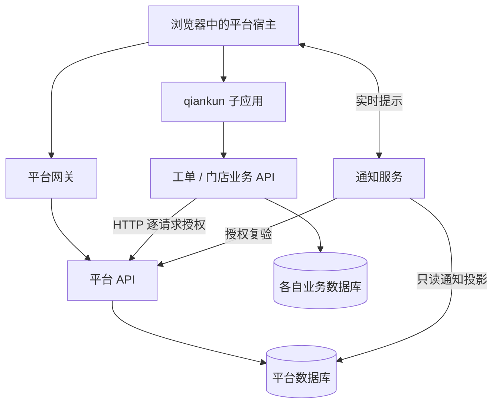

# 系统架构

平台统一身份和应用入口，业务服务独立管理业务数据。前端微应用的当前加载方案是 qiankun；迁移完成度及剩余缺口见[审查报告](qiankun-audit.md)。

## 部署单元和依赖

| 仓库 | 运行单元 | 数据所有权 |
| --- | --- | --- |
| `saas-plateform` | React 宿主、Rust API、网关、可选部署代理与运维工具 | 身份、租户组织、菜单角色、数据授权、应用发布、通知 |
| `saas-work-orders` | Vue 工单微应用、Rust API | 工单、处理人、幂等与提醒意图，专属 PostgreSQL |
| `saas-stores` | React 门店微应用、Rust API | 门店、人员关联、日报，专属 PostgreSQL |
| `saas-notification` | Rust Socket.IO 服务 | 只读访问平台通知投影；不另建身份库 |
| `saas-micro-app-sdk` | 无常驻服务，提供版本化发布物 | JSON schema、JavaScript/TypeScript/Rust 公共协议 |
| `saas-examples` | 五个前端及可选聊天/OAuth Rust 服务 | 示例隔离状态及会话 |

各仓库独立构建。消费者保存审阅过的 SDK 2 固定副本和来源摘要，不在构建时读取相邻 SDK 源码。平台内部库和工具位于 `backend`，不是工单/门店的业务实现依赖。

图表示逻辑调用；同源网关与跨域直连需要分别配置。业务后端不直查平台身份表；通知服务是专门限定的只读适配器。

## 前端加载与上下文

`App.tsx` 保留平台 React Router；`MicroAppContainer.tsx` 处理 `/micro/{code}/*`，取得应用授权上下文后解析入口，再调用 `createQiankunLifecycle`。适配器使用 `loadMicroApp`，由 qiankun 管理 HTML/脚本/样式和沙箱，旧宿主 ESM loader、自研 sandbox 和 iframe 微应用 loader 已移除。

子应用交付 HTML 与 classic/UMD 脚本，导出 `bootstrap`、`mount`、`update`、`unmount`。`props.platform` 是版本化 MicroProps；`props.services` 是宿主能力；`props.container` 限定本次 DOM 挂载范围。SDK 版本 2.0.0、MicroProps 版本 2.0、应用授权上下文与通知协议版本 1.0 是不同的版本维度。

宿主负责 token 更新、上下文到期、组织变化、路由权限与取消。授权变化后撤销旧 signal，旧请求或资源即使迟到也不能更新当前上下文。静态资源请求剥除 Authorization/Cookie 并使用 `credentials: omit`；业务 API 另用应用 token。qiankun 沙箱提供兼容与资源管理，可信子应用代码仍在宿主页面执行。

系统管理、Hermes 等内置路由继续由宿主 React 渲染；`/embed/*` 外链页使用 iframe。这两类页面没有被转换为独立微应用，应与旧微应用 loader 区分。

## 入口和发布

启用应用的现行配置为 `HTML + TRUSTED`。独立微应用的平台路径为 `/micro/{code}`；内置路由没有可执行微应用入口。入口解析顺序是当前环境的 URL override、活动 release、应用登记入口。URL 开启代理时映射到 `/micro-proxy/{code}/{revision}/`；版本入口使用固定目录。

直接 URL 配置通过格式与来源检查即就绪，不等于资源和生命周期经过版本预检。release 则须登记、服务端预检和显式激活；激活/回滚在同事务中清除该环境 URL override。ZIP 分发、镜像部署与外部地址是交付来源，最终仍消费 qiankun HTML。

`0009` 禁用不兼容独立微应用而保留原菜单、授权和 release；`0010` 统一内置页面元数据并阻止启用旧配置。历史 release 保留只读，新发布及预检/激活/回滚拒绝旧 iframe/ESM 配置。历史数据存在不代表旧 loader 仍可运行。

## 授权与事务边界

平台管理会话与应用 token 分开。业务请求同时核对应用、用户、租户、直接组织成员关系、功能 permission、资源/动作数据授权及期限；业务 API 将结果落实到自己的 SQL 过滤。浏览器提供的组织和 owner 不能替代服务端核验。

combined 与 legacy 是后端授权调用方式，不是前端运行模式。数据授权策略默认空列表拒绝，授权管理与业务读写范围独立。跨平台库和业务库没有全局事务，短期授权快照不承诺跨库原子撤销。

通知先写平台库，实时 Socket.IO 发送通知事件供界面提示并触发补拉，持久收件箱为准；重连或重复事件不应重复发布业务通知。平台变更与管理审计尽量在同一数据库事务提交，审计失败导致变更回滚。

## 运维范围

平台 API 启动时迁移数据库；迁移编译进二进制，新增迁移需重建镜像。当前历史基线校验只识别代码明确登记的初始 checksum，不放宽其他迁移校验。恢复工具是固定三库和指定工单/门店版本的停写 pilot，尚未覆盖任意 qiankun 应用或生产 PITR。

[支付规划](pay/README.md)尚无对应服务，不属于当前部署图。生产接线、CSP、业务来源和历史制品问题以审查报告及[部署文档](deployment.md)为准。
