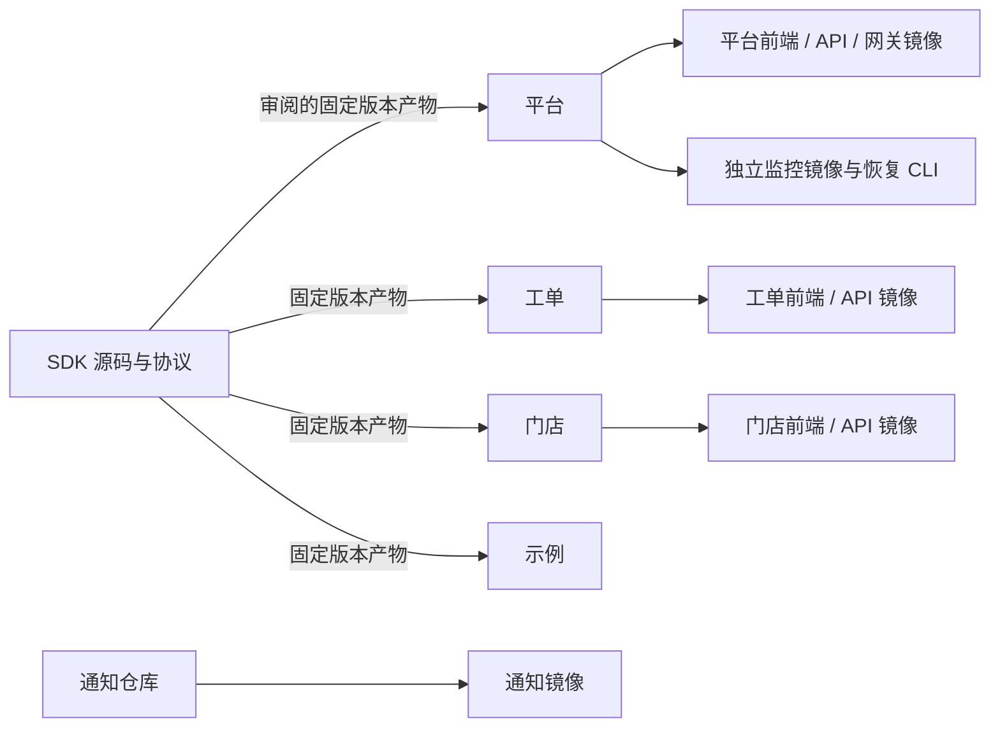
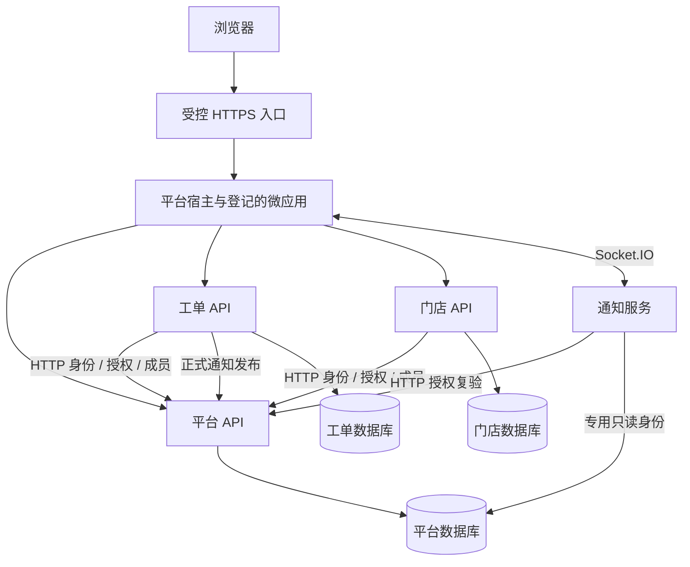

# 当前整体架构

## 仓库边界

| 仓库 | 职责 | 交付形式 |
| --- | --- | --- |
| rust-saas | 平台宿主、身份、权限、应用登记/发布、通知收件箱 | React 前端、Rust API、网关；可选独立运维工具 |
| saas-work-orders | 工单、处理人分配、提醒 | Vue 前端、Rust API、专属 PostgreSQL |
| saas-stores | 门店、员工关联、日报 | React 前端、Rust API、专属 PostgreSQL |
| saas-notification | 平台持久通知的实时提示 | 独立 Rust Socket.IO 服务 |
| saas-micro-app-sdk | 公共协议、生成器、固定发布材料 | SDK 1.0.0 候选产物 |
| saas-examples | Vue/jQuery、聊天、OAuth 接入参考 | 各自独立前端及必要 Rust 服务 |

平台、工单、门店根目录保留 frontend、backend、.github 与 Git 配置。其他三个仓库按实际工程布局。没有跨仓库源码快照、根 npm 调度工程或统一构建；固定 SDK 与协议副本是明确的产物依赖。

## 构建关系

SDK 升级时审阅来源和摘要，消费者构建只使用仓库内固定副本。平台内部 crates、tools 和 ops 各有实际编译边界，不是独立业务服务的实现依赖。

## 运行关系

图表示逻辑连接；各公开路由需要实际配置。独立构建不消除运行时依赖。三座数据库隔离，业务不直接读取平台用户表；通知使用平台通知表的专用只读账号，不另建身份主库。

## 平台内部职责

main.rs 只调用 bootstrap.rs，由启动模块装配配置、数据库、后台维护和 HTTP 服务。src/routes 处理身份、组织、角色、菜单、数据授权、应用、发布、通知和管理接口；身份与授权策略、数据库及外部网络适配留在后端。migrations 是增量数据库历史，禁止改写已执行版本。

生产协议类型位于 src/public_contract.rs；Rust 兼容测试只读取 tests/fixtures/micro-app-protocol 下的独立 Rust DTO、schema、示例、版本声明与来源摘要。浏览器 SDK 由 frontend/vendor 管理。

前端管理会话、路由和微应用生命周期。默认 opaque iframe 使用 SDK 握手；已登记 TRUSTED 兼容模式按自身边界运行。授权替换、到期或切组织后取消旧请求并隔离旧数据。浏览器传入的 tenant、organization、owner 不作为可信授权。

业务访问同时满足应用身份、操作 permission、资源/动作数据授权与租户/组织上限；最终 SQL 范围由业务 API 执行。跨平台与业务库没有原子事务，成员短期预校验不能视为跨库强一致。

通知先落库，实时服务只发提示。丢失提示通过 HTTP 收件箱补拉恢复，不能再次发布通知补偿。应用发布的镜像 worker、ZIP 节点代理是可选平台功能，不是跨仓库构建器。

## 部署与运维边界

平台 Compose 包含数据库、API、静态前端和网关，只有网关公开 HTTP/TLS。工单和门店各有自己的 Compose 与数据库；通知、监控显式启用。恢复工具当前是固定三库停写备份与隔离恢复，production PITR 未实现。

[开发指南](development.md)、[部署指南](deployment.md)说明实际入口。[支付方案](pay/README.md)属于后续规划，不在当前运行图中；[验证状态](repository-split-validation.md)说明已有证据和未验证范围。
