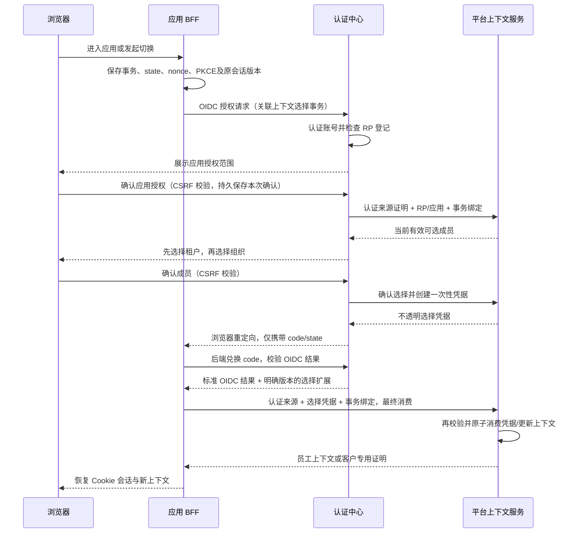

# 认证中心统一租户、组织与成员身份选择方案

日期：2026-10-27  
状态：实施中；认证中心分步选择页、code 扩展、员工 BFF 消费及客户门户消费/恢复已加入；真实 HTTPS 串联、完整浏览器与部署验收仍未完成。本文不是完整功能验证通过记录。  
涉及项目：saas-identity、saas-plateform、saas-customer-portal；门店、工单和 SDK 按接入方式配合。

## 1. 目标与结论

认证中心统一提供登录时的租户、组织、成员身份选择，以及登录后的身份切换页面。各应用保留当前身份展示和切换入口，由原应用后端发起流程，完成后返回原应用。

平台继续拥有租户、组织、成员、角色和应用授权。认证中心通过受保护的服务接口取得可选身份，不能直接读取平台业务表，也不能独立认定某个账号属于某个组织。平台在消费选择结果、建立业务会话时再次校验。

选择的真实对象是 `membershipId`。租户和组织是用于查找、分组与确认的界面层级，不能用组织 ID 推断或自动补建成员。

本方案统一选择体验，保留各 RP 的会话边界。认证中心不维护一个能够直接改变所有应用权限的全局“当前组织”。

## 2. 当前实现与改动边界

以下是编写时的现有依据：

| 现有能力 | 源码或文档 | 本方案中的处理 |
| --- | --- | --- |
| 账号、SSO、OIDC 由独立认证中心提供 | [身份服务说明](../../../../saas-identity/README.md) | 保留 |
| 平台拥有成员、组织与授权 | [成员与访问控制](../identity-and-access.md)、[架构](../architecture.md) | 保留权威归属 |
| 平台完成 SSO 回调后选择员工成员 | [SSO 唯一登录](../sso-only.md)、[BFF 路由](../../src/bff/routes.rs) | 将选择交互移至认证中心 |
| 平台校验成员、会话版本并建立上下文 | [BFF 上下文](../../src/bff/context.rs) | 提取和复用现有业务规则 |
| 平台顶部发起组织与成员身份切换 | [TopBar](../../../frontend/src/components/layout/TopBar.tsx)、[认证 API](../../../frontend/src/api/auth.ts) | 保留入口，改为发起统一选择流程 |
| 客户门户使用独立 CUSTOMER RP 和本地 BFF | [客户门户说明](../../../../saas-customer-portal/README.md) | 复用页面，保留独立会话与证明合同 |
| 现有身份私有接口不返回选定成员 | [身份内部接口](../../../../saas-identity/docs/internal-api.md) | 新增独立合同，不改变原有证明的含义 |

后文的交互事务、选择凭据及接口名称均为拟新增设计，不表示当前已有这些路由或配置。

本次不搬迁业务数据、不删除已有数据、不增加平台本地登录方式。成员管理、组织树维护、角色授权和管理员查看其他租户数据时的筛选器继续留在平台；这些管理筛选器不属于登录身份选择。

## 3. 职责与信任关系

| 参与方 | 负责 | 不可承担的职责 |
| --- | --- | --- |
| 认证中心 | 账号认证、SSO 来源校验、统一选择页面、OIDC 交互绑定 | 直接查平台成员表、创建成员、判断业务记录访问权限 |
| 平台身份上下文服务 | 查询可选成员、验证组织及租户状态、验证应用资格、签发并消费选择凭据 | 接收浏览器声明的账号或组织作为权威依据 |
| 员工平台 BFF | 发起事务、完成 OIDC 回调、消费结果、更新员工会话 | 把客户身份建立为员工会话 |
| 客户门户 BFF | 完成 CUSTOMER RP 登录、兑换客户上下文证明、更新门户会话 | 使用员工 Cookie、员工权限或员工上下文令牌 |
| 微应用与业务 API | 使用宿主或自身合法会话；执行资源级授权 | 根据前端显示的租户或组织直接放行请求 |

认证中心调用平台的新私有上下文接口，需要独立登记的服务身份、限定用途、HTTPS 与证书校验。现有认证中心的服务凭据用于调用身份服务，不能直接当作反向调用平台的授权。

平台仍需在线核验认证来源。为避免循环调用，认证中心向平台提供与本次 OIDC 交互绑定的账号认证证明；平台只调用认证中心的底层账号/来源核验能力，该能力不得再次调用平台上下文接口。两个方向分别配置超时、并发上限和失败策略。

## 4. 用户体验

### 4.1 登录时选择

1. 用户进入目标应用，应用后端保存登录事务并发起 OIDC code + PKCE。
2. 认证中心完成认证；已有有效 SSO 会话时通常无需再次输入密码。
3. 认证中心按登记的 RP、目标应用和允许的成员类型请求可选身份。
4. 没有有效身份时显示无法访问的原因与返回入口；不得自动创建成员。
5. 首次确认应用授权，之后复用账号已保存且未撤销的 scope 授权；一个租户直接进入组织选择，选定租户下只有一个可用组织身份则自动继续，多选项才要求用户选择。授权管理页提供显式撤销入口。
6. 回调完成并通过平台最终校验后，进入目标应用。

可将租户、组织、成员做成一个页面，支持搜索和组织路径展示。仅有一个租户时无需单独确认租户；仅有一个组织时无需单独确认组织。员工与客户按 RP 登记用途过滤，不能通过浏览器参数扩大允许类型。

### 4.2 登录后切换

应用顶部展示租户、组织和身份类型，并提供“切换组织/身份”。用户点击后，应用先处理未保存内容，再由 BFF 发起新的选择事务，跳转认证中心。按 2026-10-27 用户修订，切换复用已保存的应用授权；只有一个租户时跳过租户页，选定租户下只有一个可用身份时通过相同确认协议自动继续，多身份仍显式选择。

选择完成后返回原应用。原路径仅在新上下文具有访问资格时恢复，否则进入该应用可访问的首页；资源不存在或无权访问时不展示旧组织数据。

取消选择时返回原应用并恢复原会话。选择期间成员或账号已失效的，原会话也必须按现有规则失效，不能因为取消而继续使用。

## 5. 会话与切换范围

“当前应用”应按实际拥有会话的 BFF/RP 界定，不能只按页面名称界定。

| 场景 | 默认行为 |
| --- | --- |
| 平台宿主内的门店、工单微应用 | 共用宿主上下文；切换宿主后，所有挂载微应用同步更新或重新挂载 |
| 独立 RP/BFF 接入的应用 | 仅切换该 BFF 的当前浏览器会话，不改变其他独立应用 |
| 同一 BFF 会话的多个标签页 | 同步会话版本；旧页面暂停请求并恢复新的上下文 |
| 员工平台与客户门户 | 各自选择、各自建会话，共享账号 SSO，不共享成员上下文 |
| 其他浏览器或设备 | 保持原上下文；账号级注销或撤销继续按原有规则生效 |

最近选择仅是偏好，可按账号、RP、应用和成员类型分别记录。每次使用都要重新校验；首期多身份登录仍显式确认，不自动复用最近身份。认证中心的 SSO Cookie 不写入具有业务授权效力的全局组织。

由当前旧业务会话派生的凭据，在切换提交时按现有来源失效规则撤销或拒绝。其他独立会话来源的合法授权不受影响。

## 6. 推荐协议流程

### 6.1 登录与选择

选择凭据通过后端 code 兑换响应的版本化扩展传递，不放进前端 URL、localStorage 或通用 ID token 声明中。OIDC 的 `sub` 始终表示账号；组织切换不改变账号主体。

标准 OIDC 接入方不必启用此扩展。需要统一选择的 RP 必须在服务端明确登记扩展能力与目标应用，不能仅凭请求中带有自定义参数启用。扩展缺失或不匹配时拒绝建立业务上下文，不自动选其他成员。

### 6.2 一次性选择凭据

凭据由平台签发，使用高熵随机不透明值，平台仅保存摘要。建议有效期 120 秒，且不得超过账号认证来源、本次交互事务或授权流程的剩余有效期。

服务端记录至少绑定：

- 合同版本、唯一事务 ID、选择凭据摘要、有效期、消费状态。
- `issuer`、`sub/userId`、SSO 来源、`accountVersion`、本次 OIDC interaction。
- RP/client、RP 策略版本、目标应用、允许成员类型、已登记回调关联。
- `tenantId`、`organizationId`、`membershipId`、`memberType`、`identityVersion`。
- 操作类型（登录或切换）；切换时绑定原 BFF 会话及 `expectedVersion`。
- 应用策略版本，以及服务端保存的返回路径引用。

返回路径保存在 BFF，不接受认证中心或浏览器提供的任意外部回跳地址。state、nonce 和 PKCE 继续承担原有作用，选择凭据不能替代它们。

浏览器确认时只提交当前交互中可选择的成员引用。账号、RP、应用与版本从可信事务取得，不信任表单提供的同名字段。消费时重新检查完整绑定及当前权威状态，过期或重放不得签发新上下文。

### 6.3 拟新增合同

以下为逻辑操作名，具体路由应在实施时按现有 API 风格冻结，并形成独立版本化合同。

| 操作 | 调用方 → 提供方 | 输入与结果 |
| --- | --- | --- |
| 创建选择交互 | BFF → 认证中心 | 登记的 RP/应用、事务关联、登录或切换意图；返回短期交互引用 |
| 查询可选成员 | 认证中心 → 平台 | 交互绑定、账号认证证明；返回最小成员 DTO |
| 确认选择 | 认证中心 → 平台 | 同一交互、所选成员；重新检查后返回一次性凭据 |
| 交付选择扩展 | 认证中心 → BFF | 与本次 code 兑换绑定的版本化结果 |
| 消费选择 | BFF → 平台 | 原始认证来源、事务绑定、凭据及预期版本；返回用途限定的上下文结果 |

成员 DTO 只包含选择所需名称、组织路径、身份类型及引用，不返回角色全集、菜单、联系方式或全租户人员。停用身份如需显示原因，只返回当前账号本人且目标 RP 允许看到的记录。

客户门户的消费结果应沿用客户访问证明与客户上下文合同，不能拿到员工平台会话或员工业务 Bearer。现有 customer-access-proof 合同保持原义，新选择合同单独版本化。

## 7. 切换原子性、并发与失败恢复

### 7.1 切换提交

原应用在发起切换前进入交互冻结状态，停止新业务写入；跨标签页协调复用现有会话机制。服务端原会话在提交前继续有效，页面冻结不能替代服务端授权。

平台消费凭据时，沿用既有账号、应用/来源、成员和会话锁顺序，在同一数据库事务内完成：

1. 检查原始来源、原会话及预期版本。
2. 检查账号、目标成员、租户、组织链和应用资格的当前状态。
3. 消费一次性凭据并记录操作结果。
4. 撤销被替换的业务上下文及其派生凭据，建立新上下文并递增版本。
5. 写入带切换前后身份与事务关联的审计。

切到当前完全相同且有效的成员可按幂等无变更处理，仍要完成凭据消费和结果记录，避免无意义地反复撤销业务授权。

平台自身 BFF 与平台上下文在同一事务范围内尽量原子更新。客户门户具有独立数据库，不声明跨库原子性：平台先保存与门户会话及操作绑定的消费结果，门户再持久化本地会话，成功后才向浏览器宣布完成。

### 7.2 竞争与恢复

- 两个标签页同时切换时，仅允许与当前版本匹配的提交成功；另一个返回冲突并重新读取会话，不能覆盖已提交结果。
- 选择后成员被停用、组织过期或应用授权被撤销时，消费失败，不能用新版本补齐旧凭据。
- 网络超时后的结果查询只允许原 BFF、原事务和原始来源，并有短期截止时间；只返回既有操作状态或仍有效的既有结果，不重新消费或延长权限。
- 平台已提交而门户本地保存失败时，保持页面不可操作；通过受认证的结果恢复完成本地保存，无法恢复则要求重新登录。不得把旧上下文显示成当前有效上下文。
- 切换成功后清空旧身份的查询缓存、菜单、权限、持久化偏好命名空间和通知订阅；旧版本的异步响应直接丢弃。
- 已在途的写请求必须在自身事务提交前检查原始会话证明。此前已经完成的业务事务不因切换自动回滚。

| 失败情形 | 预期行为 |
| --- | --- |
| 用户取消或交互到期，尚未提交 | 恢复仍然有效的原会话；首次登录返回未登录状态 |
| 认证中心或平台权威服务不可用 | 提示暂时无法选择/切换，不发新凭据，不提供本地登录回退 |
| state、nonce、PKCE、来源或凭据绑定不匹配 | 终止本次流程并记录安全审计 |
| 原会话已注销或版本冲突 | 拒绝切换，读取权威状态后重新发起流程 |
| 新身份不能访问原路径 | 进入可访问首页；目标应用已无资格时拒绝建立会话 |

## 8. 安全与可观测要求

- 认证中心页面遵守现有来源、CSRF、Cookie、CSP、禁止嵌入和禁止缓存策略，禁止把页面嵌入跨域 iframe 以共享 Cookie。
- 确认选择是有副作用的操作，使用受 CSRF 保护的 POST。应用的发起切换操作同样需要会话和 CSRF 校验。
- 每个 RP 只访问登记用途的成员集合。用户提供的 `tenantId`、`organizationId`、`memberType`、应用 ID 均不能扩大查询范围。
- 私有接口凭据采用独立用途、独立轮换与最小权限；不得复用 RP secret、JWT 私钥或其他业务服务凭据。
- 交互、查询、确认和消费均有限流、时限和容量上限。到期事务及凭据摘要按保留策略定向清理，不记录原始凭据。
- 审计关联同一事务 ID，记录账号、RP、应用、原/目标成员、结果与错误原因；日志不包含 code、Cookie、token、凭据原文或秘密配置。
- 监控选择耗时、取消率、无可选身份比例、版本冲突、凭据重放、来源不可用和消费结果恢复失败；业务审计记录与技术日志按现有权限分开访问。

## 9. 实施阶段

本节是建议实施顺序，不表示已执行。一次只推进明确范围，不能用阶段名称替代验证证据。

| 阶段 | 范围 | 完成条件 |
| --- | --- | --- |
| 1. 冻结协议 | 明确 RP/应用映射、交互绑定、服务认证、DTO、错误码、结果恢复和生命周期 | 合同与威胁边界可审查，明确员工和客户的不同返回类型 |
| 2. 平台上下文能力 | 复用成员与授权检查，新增选择事务、凭据消费、并发与恢复逻辑 | 契约、重放、撤销和并发测试通过；认证中心无需业务表权限 |
| 3. 认证中心页面 | 接入查询/确认合同，增加统一选择页及 code 兑换扩展 | 单身份、多身份、无身份、取消和过期流程验证通过 |
| 4. 员工平台接入 | 改造首次登录、顶部切换、回调和跨标签页协调 | 宿主及门店/工单微应用切换同步，旧来源凭据失效 |
| 5. 客户门户接入 | 独立 CUSTOMER 流程、客户上下文证明与跨库恢复 | 员工/客户隔离，失败恢复及独立会话范围验证通过 |
| 6. 收敛与交付 | 删除重复选择页面及不再需要的公开选择入口，更新当前文档 | 所有受管入口收敛；配置、部署说明、源码与当前文档一致 |

新增事务存储按当前全新安装政策修改相应初始化基线，并验证空库安装；这不授权清空任何已有数据库。已有环境若无法按新基线直接运行，必须单独明确部署处置，不加入旧 UUID 搬迁或历史 checksum 兼容逻辑。

开发期间可按已登记 RP 的能力逐个接入；发布时应核对认证中心、平台和门户合同版本。协议不兼容时阻止新流程启用，保留既有 SSO 架构的可部署版本作为应用级回退。已提交切换不得通过降级恢复旧权限。

## 10. 验收矩阵

| 验收主题 | 必须覆盖的行为 |
| --- | --- |
| 基本登录 | 0/1/多个有效成员；跨租户同名组织；组织路径；员工与客户过滤 |
| 资格校验 | 成员停用、租户停用/过期、组织祖先停用/过期、应用未授权 |
| 来源隔离 | 替换账号、RP、应用、用途、原会话、回调或选择事务均失败 |
| 一次性凭据 | 重放、过期、错误消费方、跨事务使用、重复 code 兑换均不能产生新授权 |
| 并发切换 | 双标签页竞争、切换与注销竞争、切换与成员停用竞争、过期版本回调 |
| 前端状态 | 缓存隔离、延迟响应丢弃、通知重订阅、微应用重挂载、无权原路径回落 |
| 会话范围 | 同宿主微应用同步；独立 RP、客户门户和其他设备保持隔离 |
| 派生授权 | 原上下文 access/refresh、应用授权码及其他来源证明按既有规则失效，不能刷新恢复旧上下文 |
| 取消与恢复 | 提交前取消；平台提交后响应丢失；门户落库失败；重复结果查询 |
| 故障 | 身份服务/平台不可用、服务凭据错误、版本不兼容、无本地认证回退 |
| 安装与部署 | 全新基线可安装，最小数据库权限、HTTPS 网关、精确回调与私有接口不可公开访问 |

验证优先使用现有本地工具及契约测试。需要集成环境时，先检查脚本是否隐式创建容器，并记录 WSL Docker context、参与项目、已有资源和容器预算；依赖也计入预算。开发和验证结束后按工作区规则定向清理本次容器、卷、网络、专用镜像及临时数据，并比较 `docker system df`。

## 11. 文档交付与后续更新

当前提案保持独立，不加入仅描述现行实现的[平台文档索引](../README.md)。实施落地后再同步更新现行架构、SSO 登录、成员授权、OAuth 签发、身份私有接口、客户门户和 SDK 接入说明，并将实际生效的合同纳入索引。

后续实现应以冻结后的协议与当前源码为依据。本文不证明任何新接口、页面、数据库结构或集成测试已经可用。

## 12. 当前实施证据

2026-10-27 已开始执行，完整目标和第 10 节验收范围保持不变。

- [实施合同 v1](context-selection-contract.md)已明确路由设计、RP 映射、独立服务用途、交互绑定、code 扩展、消费和恢复语义；尚未上线的路由在合同中明确标注。
- [协议核心](../../src/context_selection.rs)已实现规范 UUIDv7/版本解析、员工与客户类型隔离、完整来源及会话版本绑定、120 秒截止上限、重放拒绝和有限恢复判定。
- [PostgreSQL 存储适配器](../../src/context_selection_store.rs)已实现仅存摘要、有限容量、事务内消费和结果引用恢复。初始化基线新增平台所有的短期选择表及绑定不可修改触发器；尚未修改任何已有数据库。
- [协议测试](../../tests/context_selection.rs)和[真实数据库测试](../../tests/context_selection_database.rs)已有本次执行证据，范围和限制见[本次验证记录](centralized-context-selection-verification.md)。

本轮已新增认证中心的后端交互创建、授权请求绑定和在线来源核验；平台已加入 RP/服务登记结构、成员与应用资格查询及确认处理器。双向服务用途及 RP 范围分别校验，并已用真实受限数据库角色验证表权限边界。

认证中心已加入“账号登录 → 应用授权 → 选择租户 → 选择组织 → 进入应用”的分步页面。应用授权通过受 CSRF 保护的 `consent` 操作持久保存于本次交互；此时不签发 code、不查询成员。重新载入后保留授权步骤；组织步骤可返回更换租户。即使只有一个租户或组织，也预选并等待用户继续。

选择凭据短期加密保存，绑定 transaction、flow、RP 与 issuer；只在授权码兑换中交付，交付时清除密文，refresh 不再次交付。员工平台已加入后端创建交互、回调校验、同库消费及业务上下文建立；`POST /auth/context-switch` 绑定原 BFF 会话版本，受管 RP 拒绝旧的直接成员选择接口。顶部入口前往认证中心，失效上下文的登录页也引导重新选择。

客户门户现已加入独立消费身份、CUSTOMER 选择消费和同结果恢复。平台先原子提交选择与客户证明，再由门户保存本地会话；门户保存失败时保留加密的原操作，通过结果查询恢复同一证明。待完成操作不能读取普通会话或资料；切换撤销原门户会话版本下所有历次续期的客户证明，保持与员工及其他独立 RP 隔离。

下一步仍需完成真实三服务 HTTPS 联调、员工切换竞争与取消的完整浏览器验证、跨标签页冻结与微应用同步验收，以及部署登记和当前文档收敛。现有测试的隔离边界见[验证记录](centralized-context-selection-verification.md)；完整链路接通前不得启用生产 RP 的统一选择能力。
