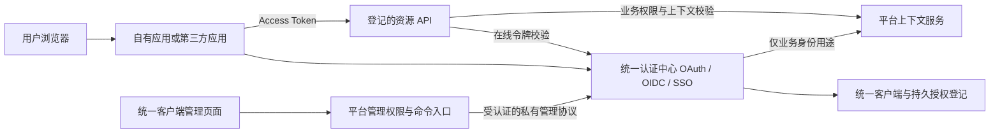
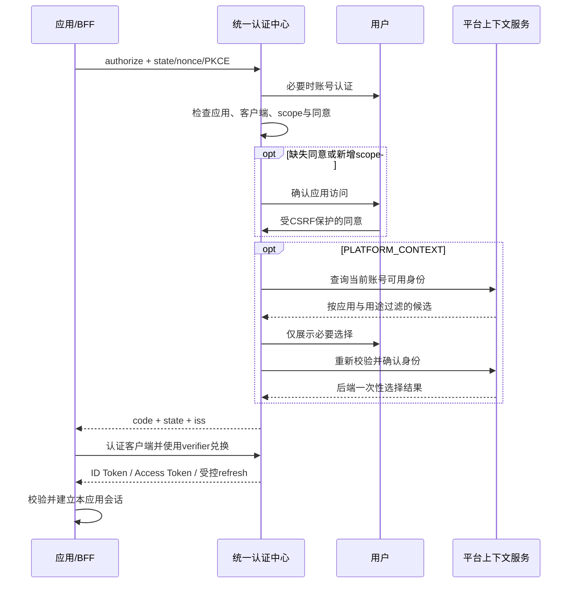

# 统一 OAuth / OIDC / SSO 与第三方接入总体方案

日期：2026-10-27。状态：目标架构待实施；开放问题已按用户授权采纳建议。

执行阶段、依赖、验收与最新进度统一维护在[项目任务台账](unified-oauth-oidc-sso-task-ledger.md)。创建台账不等于已经开始实施，本方案不代替台账的执行指针。

本文依据当前工作区源码与本轮产品讨论编写。本文中的目标模型、接口、配置项和验收要求，除明确说明“当前已有”外，均为设计约定，不代表已实现、已部署或已通过验证。后续实施必须以实际源码和当次验证结果更新实施状态。

## 1. 核心结论与范围

统一登录本身是 OAuth 客户端的一种用途。OIDC 在 OAuth 2.0 上提供标准账号认证能力，因此管理平台、客户门户、自有业务应用和第三方系统应使用一套应用登记、一套客户端登记、一个认证中心、一组标准协议入口。

本方案要求合并底层客户端与协议实现，而不仅是合并管理页面。最终不得长期保留两套客户端表、两个 OAuth 授权服务器和按新旧类型分流的令牌链路。

“平台自有／第三方”描述应用归属；客户端运行形态、授权方式、人员／机器主体、业务上下文和资源权限分别配置。自有应用仍遵守客户端认证、回调匹配、scope、受众及撤销规则。

### 1.1 本次目标

1. 统一当前业务 OAuth 与登录 OIDC 客户端模型及管理入口。
2. 将账号 SSO、OAuth/OIDC 授权码、令牌签发与撤销统一归属认证中心。
3. 同时支持纯账号登录、使用平台业务身份登录、机器访问 API。
4. 对外提供标准 OAuth 2.0＋OIDC，使外部公司系统使用本平台账号登录。
5. 保留平台的租户、组织、员工／客户成员、角色与数据权限边界。
6. 建立应用审核、持久授权、撤销、账号安全及运行保障规则。
7. 按当前全新安装维护方式落地，不建设历史 UUID 搬迁、旧 checksum 接管或双轨兼容体系。

### 1.2 首版不承诺的能力

- 不自动成为通用身份代理；接入微信、企业微信、外部企业 IdP、SAML 或 SCIM 需要后续独立设计。
- 不因支持外部公司系统，就默认支持其他公司账号登录本系统。
- 不默认开放任意用户自助注册、跨公司人员搜索、全部业务数据或自动创建业务成员。
- 不在首版实现动态客户端开放注册、任意自定义 scope、任意资源 URL、客户端自定义 issuer。
- 不宣称已获得 OpenID 互操作认证；对外发布需完成本方案验收和协议兼容测试。

## 2. 当前状态与待消除的分裂

| 能力 | 当前实现 | 目标 |
| --- | --- | --- |
| 业务客户端 | 平台 `oauth_clients`、`/api/oauth/clients` | 认证中心统一客户端登记 |
| 登录客户端 | 身份服务管理 `oidc_clients`，平台代理 `/api/oidc/clients` | 与业务客户端合并为同一模型 |
| 协议服务 | 平台业务 `/oauth/*` 与身份服务 `/oidc/*` 分担 | 认证中心提供统一标准协议入口 |
| 管理页面 | OAuth 与 OIDC 两个标签 | 一张列表、一套搜索／筛选／分页与按类型呈现的表单 |
| 用户应用同意 | 身份域 `oidc_consents`，当前按账号与 RP 保存 | 显式同意组、资源与 scope 的持久授权 |
| 业务身份 | 平台成员、会话、统一上下文选择 | 继续归平台，认证中心经私有接口使用 |
| 登录门户 | 管理平台和客户门户各有 BFF | 保留独立 BFF、Cookie 与会话空间，统一认证来源 |

当前平台登录客户端由数据库登记，并由 BFF 的部署配置引用，不是固定写死在业务客户端列表中。当前两个管理标签仅解决可见性，尚未完成底层统一。

当前源码入口包括：[身份服务](../../../../saas-identity/README.md)、[平台架构](../architecture.md)、[OAuth 边界](../oauth-issuance.md)、[上下文选择合同](context-selection-contract.md)、[持久授权交互验证](auth-approval-ux-verification.md)。这些资料描述当前实现；与本文目标不同的部分须在实施时同步调整，不能直接继承其通过结论。

## 3. 概念与职责

### 3.1 应用、客户端、资源是不同对象

| 对象 | 含义 | 示例 |
| --- | --- | --- |
| 合作方 | 对应用承担责任的公司或组织 | 平台运营方、某外部软件公司 |
| 应用 | 用户认识和授权的产品 | 管理平台、客户门户、合作方 CRM |
| 客户端 | 应用的一个具体接入实例 | CRM Web BFF、CRM 手机端、CRM 后台任务 |
| 资源服务器 | 接受访问令牌的 API 服务 | 账号资料 API、工单 API、门店 API |
| 用户同意 | 某个账号允许应用访问指定资源及 scope | 允许 CRM 获取基本账号资料 |
| 业务授权 | 成员在租户、组织和资源上的实际权限 | 只能读取某门店的工单 |
| 登录会话 | 应用在认证成功后建立的会话 | 平台 BFF 会话、第三方网站会话 |

一个应用可以有多个客户端。Web、手机端和机器任务使用不同客户端；测试和生产分别登记。客户端不能因为同属一个应用就共享 secret、refresh token 或任意互换令牌。

合作方归属不等于业务租户。对方软件公司可以为多个客户服务，其接入身份不能自动获得任何业务租户的管理员权限。

### 3.2 职责分配

| 模块 | 负责 | 禁止承担 |
| --- | --- | --- |
| 认证中心 `saas-identity` | 账号认证、SSO、客户端登记、应用同意、标准 OAuth/OIDC、令牌、密钥、账号审计 | 直查平台角色菜单并推导业务权限 |
| 平台应用管理 | 应用产品信息、合作方关联、业务应用准入、发布和管理权限 | 自行签发另一套对外 OAuth 令牌 |
| 平台上下文服务 | 可选成员查询、租户组织与应用准入、上下文确认及失效 | 仅凭浏览器提交的账号或组织字段放行 |
| 管理平台 BFF | code＋PKCE、上游校验、服务端凭据保存、员工会话 | 向浏览器暴露上游 refresh token |
| 客户门户 BFF | 独立客户会话、本人的客户资料能力 | 继承员工会话或管理员权限 |
| 第三方应用 | 验证身份、建立自己的会话、执行自身业务权限 | 获取用户密码、将 ID Token 当 API 访问凭据 |
| 资源 API | 校验受众、scope、主体与实时业务权限 | 只凭前端菜单或 JWT 签名判断业务访问 |

## 4. 统一分类模型

### 4.1 应用分类

- `ownership`：`FIRST_PARTY`／`THIRD_PARTY`。表达归属与审核流程，不直接授予数据权限。
- `partner_id`：负责该应用的合作方；第三方应用必须登记明确主体及联系人。
- `status`：`DRAFT`、`PENDING_REVIEW`、`APPROVED`、`SUSPENDED`、`RETIRED`。
- `environment`：生产、测试等环境隔离维度，不允许测试客户端使用生产回调或生产凭据。
- 展示信息：名称、图标、说明、服务与隐私政策地址、负责人、联系方式和审核记录。

### 4.2 客户端独立维度

| 字段 | 值或约束 |
| --- | --- |
| `client_type` | `CONFIDENTIAL`／`PUBLIC` |
| `runtime_kind` | `WEB_BFF`、`SPA`、`NATIVE`、`SERVICE`、受控 `DEVICE` |
| `subject_mode` | `USER`／`MACHINE`；同一个客户端不能混用两类主体 |
| `context_mode` | `ACCOUNT_ONLY`／`PLATFORM_CONTEXT`；机器客户端不配置人员上下文 |
| `allowed_member_types` | 业务身份用途显式限定 EMPLOYEE／CUSTOMER；纯账号用途不要求成员 |
| `grant_types` | 登记的授权方式，按客户端类型和主体模式校验 |
| `token_endpoint_auth_method` | 首版 `client_secret_basic` 或 PUBLIC 的 `none`；后续可增加 `private_key_jwt` |
| `application_id`、`environment` | 必须关联有效应用与明确环境 |
| 回调及退出地址 | 单独登记，严格匹配，不按前端传入地址临时建立 |
| scope／资源 | 仅能使用应用审核已允许的集合 |
| 生命周期 | 状态、策略版本、凭据版本、创建与修改审计 |

协议选择不由“自有还是第三方”推断。例如，第三方 Web BFF 可以是 USER＋ACCOUNT_ONLY；自有后台任务可以是 MACHINE；第三方经额外审核也可以申请平台业务 API。

### 4.3 典型登记

| 应用／客户端 | 归属 | 客户端 | 主体／上下文 | 授权方式 |
| --- | --- | --- | --- | --- |
| 管理平台 Web BFF | 自有 | 机密 | USER／PLATFORM_CONTEXT，EMPLOYEE | code＋S256，按策略 refresh |
| 客户门户 Web BFF | 自有 | 机密 | USER／PLATFORM_CONTEXT，CUSTOMER | code＋S256，按策略 refresh |
| 合作方 CRM Web BFF | 第三方 | 机密 | USER／ACCOUNT_ONLY | code＋S256 |
| 合作方 CRM 手机端 | 第三方 | 公开 | USER／ACCOUNT_ONLY | code＋S256；无内置 secret |
| 工单同步后台服务 | 自有或第三方 | 机密 | MACHINE／无人员上下文 | client_credentials |

机器任务和人员登录需要同时存在时，登记两个客户端；不延续旧 `LEGACY_MIXED` 模式。

## 5. 数据模型与所有权

以下为逻辑实体及约束，不是可直接执行的迁移 SQL。具体表名、索引与协议 DTO 在实施设计中固定，但不得改变这里的归属和不变量。

| 实体 | 关键字段／约束 | 所有权 |
| --- | --- | --- |
| `partners` | 公司主体、验证状态、联系人、状态；与业务租户分离 | 平台接入管理 |
| 平台 `applications` | 应用产品信息、归属、合作方、发布与业务策略 | 平台 |
| `auth_applications` | 应用 ID、审核状态、最小授权展示、同意组、版本；平台应用的认证投影 | 身份域 |
| `auth_clients` | UUIDv7 ID、应用、环境、类型、主体、上下文、授权方式、回调、状态与策略版本 | 身份域 |
| `auth_client_credentials` | 客户端、凭据版本、secret 摘要或公钥、启用／到期／撤销时间 | 身份域 |
| `auth_resources` | 固定资源标识、受众、可信校验方式、状态 | 身份域登记，资源服务运维审核 |
| `auth_scopes` | scope 名称、资源、说明、敏感级别、审核要求 | 身份域 |
| `auth_client_permissions` | 客户端获准申请的资源／scope、有效期与版本 | 身份域 |
| `auth_consent_groups` | 同一应用内允许共享用户同意的明确客户端集合 | 身份域 |
| `auth_consents` | 账号、同意组、状态、授权代际、授权／撤销时间 | 身份域 |
| `auth_consent_scopes` | 同意记录下的资源、scope 与说明版本 | 身份域 |
| `auth_subject_links` | 内部账号、subject sector、外部 sub；唯一且稳定 | 身份域 |
| 授权请求／code／grant／token | 原始来源、客户端、scope、受众、同意与策略版本、可选上下文引用、期限与撤销状态 | 身份域 |
| 业务上下文与成员 | 平台当前的成员、上下文选择、员工／客户会话与代际 | 平台 |
| 授权与管理审计 | actor、操作对象、结果、请求／操作 ID 和必要版本，不保存秘密 | 分别按域保存 |

### 5.1 不变量

1. 内部账号、应用、客户端与业务对象继续使用 UUIDv7；客户端的展示 code 不充当协议主键。
2. `auth_clients` 是唯一客户端权威；目标版本移除原来两套独立登记的运行路径。
3. 一个客户端固定一个应用、一个环境及一个主体模式；改变这些关键归属采用新登记，不能用普通编辑静默改变已有授权的含义。
4. 客户端允许权限必须是应用审核权限的子集；用户同意也不能突破客户端和应用审核上限。
5. secret 仅在创建／轮换时交付，数据库只存校验摘要；密码 PHC、OIDC 签名私钥与客户端 secret 分离。
6. 无效应用／客户端／scope／资源不能新增授权；既有 token 按撤销合同失效。
7. grant 固定保存原始账号、客户端、同意、业务上下文及版本，不读取最新代际来“修复”已失效来源。
8. 平台 runtime 不能直接读写身份客户端表或秘密；身份 runtime 不能读取平台角色和业务成员全集。

### 5.2 同库与跨服务边界

首版维持当前共享物理 PostgreSQL 与独立 owner/runtime，不因统一客户端立即拆出第二个账号库。唯一 canonical migration job 建立新基线并执行角色交接，在线 runtime 不建表、不 seed。

平台应用与 `auth_applications` 之间通过明确私有管理协议同步最小投影，不开放跨域任意 SQL。创建、审核和停用使用稳定 operation ID、幂等摘要、操作 receipt 与状态查询。未知提交结果先查询原操作，不重新执行或用新 ID 重试。

涉及停用和权限收缩时优先保证拒绝旧能力：若跨服务同步未确认，管理页显示处理中／失败；依赖新投影或新版本的授权失败关闭。不能把消息最终送达当作即时撤销已经完成。

## 6. 标准协议与客户端安全

### 6.1 统一公开端点

以认证中心固定 issuer 为唯一认证来源，部署时显式提供准确 HTTPS origin；不从 Host、回调地址或请求代理头推导 issuer。

| 端点 | 用途 |
| --- | --- |
| `/.well-known/openid-configuration` | OIDC 发现 |
| OAuth 授权服务器元数据端点 | 按最终路由发布 RFC 8414 元数据 |
| `/oauth/authorize` | 人员授权码登录与应用授权 |
| `/oauth/token` | code 兑换、refresh、client_credentials |
| `/oauth/userinfo` | 标准 OIDC 用户信息 |
| `/oauth/jwks` | 签名公钥与生命周期 |
| `/oauth/introspect` | 受认证的在线 token 校验 |
| `/oauth/revoke` | 标准 token 撤销 |
| 发现文档登记的登出端点 | 用户发起的退出，按阶段提供 back-channel logout |
| `/sso/applications` | 用户自己的应用授权管理 |

以上 `/oauth/*` 为目标统一路由，当前 `/oidc/*` 与平台 `/oauth/*` 不是已经完成合并的证据。全新部署时统一修改网关、发现文档、各 BFF 与客户端配置，不维持两个有效 issuer 或两套签发路径。

### 6.2 首版能力与约束

- 人员登录采用 authorization_code＋PKCE S256，机密客户端也使用 PKCE。
- 不提供 password grant 和 implicit flow，不让第三方代收用户密码。
- refresh token 仅向允许的客户端和 scope 签发，使用轮换、重用检测及 family 撤销；公开客户端不因没有 secret 而免除这些约束。
- 机器访问仅允许受审核的 client_credentials，不返回 ID Token、人员成员或用户 refresh token。
- 设备授权为后续受控能力；只有完成真实实现和验收后才在元数据中声明。
- 首版不开放动态客户端注册。管理接口、令牌内省与用户资料接口不能被任意未登记系统调用。

### 6.3 回调、请求和浏览器约束

- Web 回调必须是登记的精确 HTTPS URL；禁止通配符、片段、用户名密码、任意 return URL 和开放重定向。
- Native 客户端另按 RFC 8252 设计系统浏览器、claimed HTTPS 或受控 loopback；loopback 端口例外只能用于明确的原生类型，不能放宽 Web 回调。
- code 一次性使用，摘要保存，建议 TTL 60 秒；绑定客户端、回调、PKCE、原始 grant 和用途。state、nonce、issuer 均按协议验证。
- `prompt=login`、`max_age`、必要时的敏感操作重新认证按标准处理；`prompt=none` 不能绕过缺失的同意或业务上下文。
- 默认复用已有同意。若明确采用标准 `prompt=consent`，须实现该显式重新确认语义，并避免 BFF 在日常登录时无条件附带它；当前忽略该参数的行为不作为对外标准合同保留。
- CORS 只允许登记的准确来源；允许 CORS 不等于允许回调，也不替代认证与授权。
- Cookie 使用 Secure、HttpOnly、host-only；SameSite 按真实跳转方式选择并测试。BFF 默认服务端保存上游凭据，不将 refresh token 放入 localStorage。
- 所有确认、切换、撤销、删除和敏感管理写入均保护 CSRF；页面和私有 API 使用 no-store，页面名称和应用说明按文本呈现。

## 7. 三类主要流程

### 7.1 第三方纯账号登录

1. 对方登记应用及 USER＋ACCOUNT_ONLY 客户端，审核通过后取得客户端标识及适用凭据。
2. 对方保存登录事务，生成 state、nonce 和 PKCE，跳转统一授权端点。
3. 认证中心确认账号；有有效 SSO 且满足本次认证要求时复用登录。
4. 检查应用审核、客户端状态、权限上限及持久同意。无同意或新增 scope 时展示确认。
5. 不查询平台租户／组织，也不要求账号具有员工或客户成员。
6. 返回 code，对方兑换 token、验证 ID Token，建立自己的会话。
7. 对方使用 issuer＋sub 识别账号；需要附加资料时通过 UserInfo 或明确开放的资源 API 获取。

一个没有平台租户／组织的有效账号，也可以完成此流程。是否允许该账号继续使用对方业务，由对方自己的成员、组织和角色规则决定。

### 7.2 使用平台业务身份登录

1. 应用登记 USER＋PLATFORM_CONTEXT，并限定成员类型、目标资源和业务应用。
2. BFF 发起绑定 state／nonce／PKCE／回调的上下文选择事务。
3. 认证中心完成账号认证，复用或取得应用同意。
4. 通过专用私有身份调用平台查询当前账号、本应用允许的成员；认证中心不直查平台成员表。
5. 多租户显示租户卡片；单租户直接进入组织选择。选定租户下仅有一个真实可用身份时，自动走同一受保护确认接口。搜索结果只有一条不触发自动选择。
6. 平台重新核验账号来源、租户组织、应用准入、成员状态和版本，提交一次性结果。
7. 认证中心只在来源和最终选择均有效后签发 code；一次性选择凭据只经后端兑换传递。
8. BFF／消费者将选择结果与业务会话在事务中绑定；跨库故障只恢复原结果，不重新签发或重复消费。

员工与客户用途仍隔离。SSO Cookie 不保存对所有应用生效的“全局组织”；切换一个 RP 的组织不改变其他独立应用的业务上下文。

### 7.3 机器访问

1. 管理员审批应用可访问的资源及机器权限，登记 MACHINE 客户端与独立凭据。
2. 客户端通过 token endpoint 认证，申请其已登记资源和 scope。
3. 认证中心签发短期机器 Access Token，不伪造用户或员工身份。
4. 资源服务根据机器主体、受众、scope，以及显式的租户／数据范围绑定执行授权。

如机器被允许代表用户执行操作，属于独立的委托能力，必须有明确来源、期限和审计；首版不以额外参数冒充用户。

## 8. 用户标识、资料与账号关联

### 8.1 稳定标识

第三方必须使用精确 issuer＋sub 识别账号，不能用用户名、邮箱或手机号作永久主键。更名、改手机号、改邮箱不会改变同一 sector 下的 sub；注销后的标识不可重新分配给另一个人。

对外默认采用 pairwise subject：不同合作方／应用的 subject sector 隔离，同一内部用户对不同 sector 得到不同的 opaque sub。sector 由平台审核登记，不接受客户端任意指定字符串来关联其他公司的用户。

同一应用的 Web／手机客户端可显式绑定同一 sector，以满足跨端账号一致性；跨应用或跨合作方共享须单独审核，不能按“同一个域名”自动合并。

建议使用持久 `auth_subject_links` 生成并保存不可预测 sub，避免轮换 HMAC 密钥时导致所有外部标识改变。身份链接查询仅在身份域内完成，不向第三方披露内部用户 UUID。

当前 BFF／proof 中将 sub 当作内部 UUIDv7 的代码必须调整：标准 ID Token／UserInfo 的 sub 保持 opaque 且相互一致；平台需要的内部账号 ID 经受认证的私有证明提供，不能要求第三方识别或传回内部 UUID。

### 8.2 资料最小化

| scope | 建议范围 |
| --- | --- |
| `openid` | OIDC 账号身份；sub 与必要标准声明 |
| `profile` | 用户已同意的基础资料子集，如显示名称、头像；不默认包含内部角色和组织 |
| `email` | 明确开放并有可靠验证状态时提供 email／email_verified |
| `phone` | 明确开放并有可靠验证状态时提供手机号及验证状态 |
| `offline_access` | 用户和客户端均获准的持续访问，不等于无限期会话 |

未实现或无法可靠验证的字段不在发现文档中承诺。资料更新、删除及访问留存需有产品规则和隐私告知。

### 8.3 第三方已有账号绑定

首次登录时，对方可以创建自己的业务账号，也可以引导绑定已有账号。绑定应证明两个账号的控制权，不能只因邮箱／手机号相同就自动合并。解绑、换绑和账号合并需要重新认证与审计。

平台不替第三方自动分配其公司角色，也不允许第三方根据账号姓名、邮箱后缀推导平台管理权限。

## 9. 用户同意、撤销和记录删除

### 9.1 同意粒度

用户认识的是应用，因此管理页按应用／明确同意组展示，组下保留实际客户端及资源范围。默认可为同一应用的同类人员客户端设置共享同意组，但必须同时满足：同一归属主体、相同隐私目的、明确登记的客户端集合。

不同应用、合作方、生产与测试环境不自动共享同意。机器客户端没有用户同意记录，其权限由应用审核和管理员授权建立。

授权决定为：当前账号＋同意组＋资源＋scope 的有效覆盖。首次出现的客户端不能借助任意同名应用、同一 owner 或未审核组成员关系继承同意。

### 9.2 复用与重新确认

- 已同意且未撤销、申请范围没有扩大的，日常登录不重复弹出。
- 退出登录、SSO 到期、token 到期、切换租户组织不自动清除持久同意。
- 新增资源、scope 或实质改变已同意的数据用途时重新确认；普通应用更名不应无故要求全部用户重新同意。
- 应用管理员放开可申请 scope，不代表用户已同意该 scope。
- 平台自有应用如需免交互预授权，必须是明确、可审计的独立策略，不能仅凭 FIRST_PARTY 标签静默开放所有权限；首版默认仍采用用户首次同意。

### 9.3 状态与事务

`未授权 → 已授权 → 已撤销 → 删除展示记录`。撤销后可重新同意，建立新代际；旧 token／grant 不得复活。删除展示记录后，再次访问仍为未授权。

撤销与授权签发使用统一锁顺序和同意代际，至少按账号与同意组串行化：

1. 验证本人 SSO、来源与 CSRF，在锁内重新验证账号会话。
2. 将同意标记撤销并递增代际。
3. 撤销该同意组及范围下所有相关客户端的 grant／refresh family，失效未完成请求和选择事务。
4. 将登出通知写入同一事务的 outbox；提交后投递。
5. 提交前重新检查授权来源期限，审计与授权变更原子完成。

旧标签页、并发 token 兑换和刷新不能在撤销后恢复旧代际。跨库消费者按来源版本拒绝旧能力，失败时不能默认继续。

### 9.4 用户管理页面

- 显示应用名称、所属公司、自有／第三方、已授权范围、授权时间、可用状态及适用客户端。
- 提供“已授权”“已撤销”、筛选、分页、详情与逐应用撤销。
- 已撤销记录允许确认删除；活动授权必须先撤销，其他账号的记录不可操作。
- 如果记录在其他页面重新授权，旧删除请求返回冲突。
- 删除用户可见记录不清除必要安全审计，也不修改旧凭据的撤销事实；审计留存与个人数据删除按明确规则执行。

## 10. 令牌、资源与权限

### 10.1 凭据分工

| 凭据 | 面向对象 | 用途与限制 |
| --- | --- | --- |
| SSO Cookie | 认证中心浏览器会话 | 证明账号登录；不代表平台业务权限 |
| ID Token | 指定 OIDC 客户端 | 证明本次账号认证；不得调用业务 API |
| Access Token | 指定资源 API | 在受众与 scope 内访问；不能跨 API 混用 |
| Refresh Token | 原客户端与 grant | 延续已批准范围，轮换与重用检测；不扩大授权 |
| BFF Cookie | 单个应用／RP | 恢复本应用会话；与认证中心和其他 BFF 隔离 |
| 业务上下文证明／短期内部能力 | 指定内部业务服务 | 证明具体成员与来源；不构成第二套对外 OAuth 授权服务器 |

统一的是客户端与对外认证协议，不要求把所有 Cookie、内部会话和业务上下文都做成同一种 token。

### 10.2 签发与校验策略

- 首版优先采用 opaque Access Token 和在线 introspection，实现明确的实时撤销；ID Token 使用标准签名 JWT。
- 当前平台短期业务 Bearer 如继续保留，必须作为 BFF 业务会话派生能力，使用独立 token_use／audience／验证器，不能拿来替代统一 OAuth Access Token。
- 若后续开放 JWT Access Token，需单独固定 token profile、类型、iss、aud、jti、期限与撤销时效；不因 JWKS 验签成功就忽略业务来源失效。
- API 接受登记的固定 audience；客户端不能通过任意 URL 指定资源服务器，内省也不向无关客户端泄露令牌内容。
- scope 采用资源限定的语义，例如 `work-orders:read`，不长期使用可跨全部资源解释的裸 `read`／`write`。
- refresh 不延长来源允许的绝对期限，不授予新增 scope，也不把过期业务身份替换成当前可用身份。
- 平台内部业务请求遇到来源不可验证时失败关闭；对外资源明确提供 401／403／503 语义，不能把认证中心故障当用户无权限并清空所有账号数据。

在线会话续期与真正的离线授权必须分开：首版 PLATFORM_CONTEXT 的 refresh 用于在线会话内续期，受原 SSO／业务来源的绝对期限限制，不能仅凭申请 `offline_access` 越过该限制。ACCOUNT_ONLY 在明确批准 `offline_access` 后，可以建立独立到期的离线 grant；浏览器 SSO 的空闲或自然到期不自动等于撤销该离线 grant，但显式全局注销、账号停用、应用撤销和原授权安全代际变化仍使其失效。其校验须检查持久 grant、同意代际、账号状态及撤销事实，而不是错误地要求原浏览器会话始终未到期。业务 API 的离线用户委托首版不开放，后续须另定数据范围与失效合同。

BFF 的在线 refresh 可以按客户端策略在不申请真正离线访问的条件下签发，并严格受来源上限约束；这需要调整当前将 refresh 签发绑定 `offline_access` 的实现，不能把现有行为直接视为目标已经支持。

### 10.3 访问判定

业务请求必须同时满足：

> 应用审核允许 ∩ 客户端允许 ∩ 当前用户同意 ∩ 正确资源受众 ∩ 当前主体权限 ∩ 当前业务数据范围。

纯账号登录没有平台成员时，只能取得相应账号资料；不能获得工单、门店或后台管理能力。前端按钮、菜单、应用标签和公司归属均不替代资源服务授权。

### 10.4 初始期限建议

| 对象 | 初始建议 | 说明 |
| --- | --- | --- |
| authorization code | 60 秒、一次性 | 摘要保存，兑换重放拒绝 |
| 登录与选择交互 | 5 分钟以内 | 仍受账号／来源最早期限约束 |
| ID Token | 5 分钟 | 应用验证后建立自己的会话 |
| Access Token | 5–10 分钟 | 资源敏感级别可收紧，仍在线校验 |
| SSO 会话 | 空闲 30 分钟、绝对 12 小时 | 高风险操作要求重新认证；记住登录另行设计 |
| Refresh family | 初始绝对 7 天，另设空闲期限 | 必须与 SSO／账号撤销和客户端策略协调，不能只靠 token 本身的到期时间 |

最终采纳值见第 19 节决策文档：Access Token 5 分钟；在线 refresh 不超过原来源期限；独立离线 family 绝对 7 天、空闲 24 小时。它们是待实现与实测的目标配置，不是当前服务已经采用的参数。

## 11. 会话、退出、停用与注销

| 操作 | 必须生效的范围 | 持久应用同意 |
| --- | --- | --- |
| 退出当前应用 | 当前应用会话与明确关联的 token 来源 | 保留 |
| 退出统一账号／全部登录 | 明确选定的 SSO 范围及关联 grants，会话通知按协议处理 | 保留 |
| 切换业务组织 | 当前 BFF 上下文、派生业务能力与同标签页协调 | 保留 |
| 撤销应用授权 | 同意组范围内的 grants、refresh 和未完成流程 | 撤销 |
| 停用客户端／凭据 | 对应客户端或凭据来源，不误伤其他客户端 | 可保留记录，禁止继续使用 |
| 停用应用／合作方 | 其全部客户端和相关 grant | 展示不可用，按管理原因处理 |
| 修改密码／账号风险处置 | 按账号安全策略撤销 SSO、grant 及业务来源 | 不等于用户逐应用撤销；恢复后是否重新同意按明确安全事件策略决定 |
| 注销账号 | 所有认证能力、关联业务来源与通知 | 终止，并按数据留存／删除规则处理 |

第三方通常有自己的会话。我们撤销 token 后，它的本地页面未必立即退出。平台必须分别公布：资源 API 停止接受 token 的时效、登出通知的时效、第三方本地会话的上限与重新检查责任，不能统一宣称“所有页面瞬间退出”。

对外上线前实现并验证登记客户端的 OIDC Back-Channel Logout：签名 logout token、正确 aud／sid／sub、事件类型、重放防护、明确登记的 HTTPS 接收地址、outbox、有限重试和失败告警。投递前验证接收地址与网络策略，防止管理端或回调成为 SSRF 通道。

合作方不支持通知时，必须接受短会话与定期在线检查的降级合同；前端 iframe 登出不作为唯一可靠措施。

## 12. 第三方接入与管理产品

### 12.1 接入流程

1. 登记合作方主体及负责人员，验证联系人和允许使用的域名。
2. 创建应用，填写用途、环境、隐私政策、服务条款和资料留存说明。
3. 申请客户端类型、资源、scope、回调和登出地址。
4. 审核应用主体、敏感数据、回调归属及允许的数据范围。
5. 先在独立测试环境通过标准登录、错误处理、撤销与登出验证。
6. 审核生产客户端，通过受保护渠道交付一次性凭据，明确轮换与责任人。
7. 发布接入文档、配额、联系人及故障响应方式，持续监控。

测试与生产不仅区分一个字段：凭据、回调、资源、用户数据和 issuer 环境需完整隔离，不让测试客户端访问生产用户数据。

### 12.2 统一管理页面

一张客户端列表支持按应用、合作方、自有／第三方、环境、主体、上下文、客户端类型和状态筛选，后端稳定排序分页。

创建客户端先选择应用，再选择人员／机器及运行形态，只展示合法选项。详情分为基本信息、认证与回调、资源与 scope、凭据、策略与审计。平台管理和客户门户也从此页面查看与管理，无“隐藏的另一套客户端”。

关键字段变更展示影响范围：修改回调、准入、资源权限或停用会使哪些授权失效，是否需要重新接入；使用乐观版本、命令幂等键和审计防止并发覆盖。秘密不出现在列表、日志或普通编辑回填中。

管理入口复用平台当前员工会话与管理权限；“查看”“登记”“审核”“修改策略”“轮换凭据”“停用”应拆分权限。合作方管理员仅管理明确分配的应用，不能通过合作方归属获得平台系统管理权限。

### 12.3 凭据轮换

机密客户端允许受控的双版本短暂重叠；登记创建者、到期和撤销时间。新版本只显示一次，通过安全渠道交付；确认接入后撤销旧版本。紧急泄露场景立即撤销受影响凭据，并按来源追踪撤销相关 grant。

签名密钥遵守发布、激活、保留验证窗口、退役与紧急撤销生命周期。签名私钥不交付第三方，JWKS 只发布公钥；不能在旧 token 仍合法时无依据删除对应公钥。

## 13. 账号安全与隐私

- 保留密码强度、抗枚举、有限队列、超时和账号／IP／客户端多维限流；容量饱和时明确拒绝，不退化为无界内存。
- 对管理员操作、凭据重置和高风险账号引入 MFA／step-up；若首版未实现，不得向第三方宣称相应 `acr`／`amr` 强度。
- 账号注册、邀请、密码恢复、手机号／邮箱变更、注销分别设计，不能借第三方回调直接创建员工或平台管理员。
- 第三方 UserInfo 只返回已同意且实现的数据，禁止默认返回角色全集、用户列表、内部组织树或内部凭据。
- 登录与授权页明确展示应用真实名称及所属公司；第三方不能使用未审核的品牌冒充平台。
- 安全日志不记录密码、secret、token、Cookie、授权码、PKCE verifier、私钥或完整连接串；请求日志对敏感查询和回调进行脱敏。
- 用户可见授权删除、安全审计留存、账号注销及第三方数据删除通知分别有规则。对方已合法取得的资料不能通过撤销 token 自动“收回”，需要隐私政策与合作协议约束。
- 风险吊销和管理员操作建立审计，记录原因、操作者、对象、版本、结果和必要关联 ID，保留可核查的失败事实。

## 14. 运行保障与对外合同

### 14.1 可用性

认证中心故障会影响多个应用，需独立监控健康、readiness、登录成功率、code/token 延迟、内省错误、数据库连接池、签名失败和登出积压。

无状态 HTTP 节点可多实例；授权请求、code 消费、refresh 轮换、同意撤销和操作幂等依赖数据库原子约束，不用单进程内存锁保证集群正确性。密码校验队列和限流需要明确单节点与全局范围。

数据库连接、网络调用和队列均设超时与上限。登出投递和非关键审计导出使用有界重试，不能阻塞主登录链路。账号写审计与安全事实仍必须跟授权事务一致。

### 14.2 外部发布需明确

- 服务支持的 issuer、协议端点、scope、客户端类型、认证方式和版本策略。
- 登录和 API 配额、限流响应、可预期的错误码与 request ID。
- token 撤销、账号停用、业务成员收缩及第三方本地会话的时效边界。
- 凭据／密钥轮换窗口、变更通知、紧急联系人和维护窗口。
- 备份恢复、数据库与密钥灾难恢复演练；恢复后不得意外复活已撤销授权。

SLA／RTO／RPO 的数值需由资源与运营能力确认，不能只在方案中填写而不演练。对外开放前至少完成容量评估、备份恢复、签名密钥轮换、认证中心失联和依赖故障演练。

## 15. 实施范围与源码调整

| 仓库 | 主要工作 |
| --- | --- |
| `saas-identity` | 统一客户端／同意模型、OAuth 与 OIDC 协议、subject 映射、USER/MACHINE 分支、标准提示参数、撤销和登出、私有管理接口 |
| `saas-plateform/backend` | canonical `0001` 与角色交接、管理命令代理、上下文与资源授权接口；退出旧业务 OAuth 签发与双客户端登记 |
| `saas-plateform/frontend` | 一套客户端列表、类型化编辑、合作方审核与权限、用户授权入口；改用统一分页 API |
| `saas-customer-portal` | 新发现文档、opaque sub／内部证明适配、客户 BFF 与登出、同意组与上下文恢复 |
| `saas-stores`／`saas-work-orders` | 统一 audience/scope、在线凭据与业务来源校验；保留各自数据库边界 |
| `saas-notification` | 随业务会话和身份代际撤销／重连，不将统一账号登录当员工投递权限 |
| `saas-micro-app-sdk` | 固定上下文与通知契约，验证切换后宿主与微应用同步；不承担账号认证 |
| `saas-examples` | 完整第三方 OIDC Web 示例、可选 native／机器示例、错误／撤销／登出接入说明 |

私有服务协议继续使用独立服务身份、限定用途／RP／应用范围、HTTPS 与证书验证。公开网关拒绝私有内部路径；BFF 与认证中心之间不能共用同一 secret 充当所有方向的调用授权。

## 16. 全新安装与切换规则

本方案遵守当前工作区[全新安装基线](../fresh-installation.md)，不提供旧库原地兼容迁移。

1. 在当前 canonical `0001` 固化目标统一模型，删除目标版本不再使用的两套客户端和协议结构，完善 owner／runtime／函数最小权限与 readiness。
2. 在任务专属空库验证完整初始化、管理登记、两个 BFF、业务 API 和第三方示例。
3. 通过显式初始化配置登记合作方、应用、客户端、资源、scope、管理员与密钥；不从旧会话、token、同意或旧 UUID 数据生成兼容记录。
4. 准备全部应用的准确新端点、客户端标识、凭据、回调、CA 和资源配置，先形成可审阅的部署清单。
5. 切换前核对本机／远端、库名、归属及已有数据。重置任何已有环境需获得该任务的明确授权；本文本身不授权清库。
6. 新环境上线后，各应用重新建立会话与首次授权；目标运行不接受旧入口、旧 token 或旧数据库 checksum 作为旁路。
7. 若切换失败，恢复原环境应连同其匹配程序、配置、数据库及 issuer 边界整体恢复，不能让两套实现同时争用同一个 issuer。演练和生产环境不能共用正式 issuer。

当前本机验证环境仅说明现有源码的局部能力，不能当作该统一方案的完成证据。仅编写／评审本文不启动容器、不重建数据库、不变更在线服务。

## 17. 分阶段实施与交付门禁

以下是实施顺序，不是自动执行授权或已完成任务台账。每阶段交付源码、当前文档与当次证据，完成门禁后再推进。

| 阶段 | 内容 | 进入下一阶段前的条件 |
| --- | --- | --- |
| A：设计合同 | 固定对象关系、数据归属、client/subject/consent/resource DTO、scope 与撤销语义 | 明确 USER/MACHINE、纯账号／业务上下文、同意共享与 subject sector；无依赖冲突 |
| B：模型与管理 | 新基线、角色交接、统一客户端服务与管理 API、单一列表及表单 | 空库初始化、最小权限、分页、幂等、版本冲突和审计回归通过 |
| C：统一协议 | 单 issuer 与发现文档、code＋S256、USER/MACHINE token、subject/UserInfo、refresh/introspection/revoke | 协议正确性、并发兑换、重用检测、凭据隔离与失败关闭通过 |
| D：自有应用接入 | 平台、门户、微应用和业务 API 适配，统一身份选择与会话派生 | 两个 BFF 完整浏览器登录／切换／撤销、实际业务 API 与标签页同步通过 |
| E：用户与合作方管理 | 持久同意组、撤销／删除、第三方审核、凭据轮换、登出通知 | 跨客户端撤销、活动记录删除拒绝、旧会话失效及通知重试通过 |
| F：外部试点 | 独立第三方样例及标准 OIDC 客户端试点、容量与恢复演练 | 第三方不依赖内部 UUID／平台数据库即可完成接入；运行与安全门禁满足 |
| G：正式开放 | 发布接入文档、生产登记审核与支持流程 | 对外合同、监控告警、应急和发布回退演练完成 |

管理员 TOTP／敏感操作二次认证按已采纳政策纳入实施与正式开放门禁。设备授权、private_key_jwt、额外 MFA 方式及自动化开发者门户按需求独立排期；不得在尚未实现时通过发现文档提前声明。

## 18. 必须通过的验收矩阵

| 类别 | 必验场景 |
| --- | --- |
| 统一登记 | 自有／第三方同表管理；一应用多客户端；测试生产隔离；无另一套隐藏登录客户端 |
| 普通外部登录 | 无业务成员账号可登录 ACCOUNT_ONLY；第三方仅凭标准发现文档与 OIDC 信息接入 |
| OIDC 一致性 | iss/aud/sub/nonce/auth_time 正确；ID Token 与 UserInfo sub 一致；错误客户端／issuer／nonce 拒绝 |
| subject 隔离 | 同 sector 稳定；不同合作方隔离；用户更名不改变标识；账号注销后不复用 |
| code/PKCE | 错误回调、明文／错误 challenge、错误 verifier、code 重放、并发双兑换拒绝 |
| refresh | 轮换、并发、重用 family 撤销、绝对期限、scope 收缩与不扩权 |
| 客户端认证 | 公开客户端不持有 secret；机密客户端错误凭据拒绝；轮换与紧急撤销有效 |
| 资源隔离 | ID Token 不能调用 API；错误 audience、跨资源 scope、错误主体拒绝；机器不伪装用户 |
| 同意 | 首次确认、后续复用、新增 scope 确认、跨组不继承、同组受控共享 |
| 撤销与删除 | 活动授权不可直接删；撤销后所有相关来源失效；删除不恢复旧 token；并发重新授权后旧删除请求冲突 |
| 上下文 | 零／一／多租户组织；单项自动继续；搜索不触发自动选；员工客户不串用；纯账号不调用上下文接口 |
| 业务权限 | 组织／成员／应用准入收缩即时拒绝相应能力；第三方 scope 不突破用户实际权限 |
| 跨库与标签页 | 原结果恢复、操作重试不重复消费、切换冻结、旧请求不覆盖新上下文、微应用／通知同步 |
| 管理安全 | 查看／修改／审核／轮换权限隔离；越权、CSRF、审计失败、幂等与版本冲突 |
| 登出 | 当前应用、全局退出、应用授权撤销范围正确；back-channel 签名／重放／重试与降级时效 |
| 浏览器 | 桌面与移动端、键盘与焦点、弹窗滚动、禁止开放重定向与 XSS、Cookie 限制场景 |
| 故障 | 身份／平台／数据库不可用、连接池与队列满、超时、时钟偏移，错误语义正确且失败关闭 |
| 运维 | 密钥轮换、备份恢复不复活撤销记录、容量与限流、日志脱敏、测试资源完整清理 |

验证须区分单元测试、HTTP fixtures、真实数据库、真实跨服务 HTTPS、浏览器和外部标准客户端。任何一种不能单独替代全链路验收。报告包含版本、命令、结果、限制和资源清理，不包含真实秘密。

## 19. 已采纳政策与待核实发布事实

用户于 2026-10-27 授权“开放问题你给建议按建议执行”。Q1–Q10 的具体政策、期限、验收目标及发布门禁统一见[开放问题决策](unified-oauth-oidc-sso-policy-decisions.md)，其决策优先于本文此前的建议值。

已确定：显式同应用同意组、按应用与环境隔离 pairwise sub、人工第三方审核、受控账号与邀请、第三方最小 openid/profile、管理员 TOTP 与敏感操作二次认证、在线／离线分开的期限、留存默认值和受邀试点容量目标。

待核实的是实际审核／值班责任人、运营法域与合同、容量与恢复证据、生产环境及具体切换授权。政策已定不代表实现已完成或已取得法律合规结论；这些发布事实按台账门禁落实。

## 20. 标准依据与相关文档

实施依据以具体标准、实际元数据和验证结果为准，不以“OAuth 兼容”一句话替代：

- [OpenID Connect Core 1.0](https://openid.net/specs/openid-connect-core-1_0.html)
- [OAuth 2.0，RFC 6749](https://www.rfc-editor.org/rfc/rfc6749)
- [OAuth 安全最佳实践，RFC 9700](https://www.rfc-editor.org/rfc/rfc9700)
- [PKCE，RFC 7636](https://www.rfc-editor.org/rfc/rfc7636)
- [Token Revocation，RFC 7009](https://www.rfc-editor.org/rfc/rfc7009)
- [Token Introspection，RFC 7662](https://www.rfc-editor.org/rfc/rfc7662)
- [授权服务器元数据，RFC 8414](https://www.rfc-editor.org/rfc/rfc8414)
- [原生应用，RFC 8252](https://www.rfc-editor.org/rfc/rfc8252)
- [授权响应 issuer 标识，RFC 9207](https://www.rfc-editor.org/rfc/rfc9207)
- [OpenID Connect Back-Channel Logout 1.0](https://openid.net/specs/openid-connect-backchannel-1_0.html)

工作区参考：[数据库边界](../fresh-installation.md)、[身份角色与权限](../../ops/identity-deployment/README.md)、[业务访问控制](../identity-and-access.md)、[当前 OAuth 签发](../oauth-issuance.md)、[上下文合同](context-selection-contract.md)。这些文档在相应实施阶段同步更新，本文目标没有落地前不改写为“当前已统一”。
