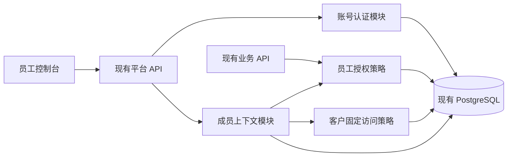
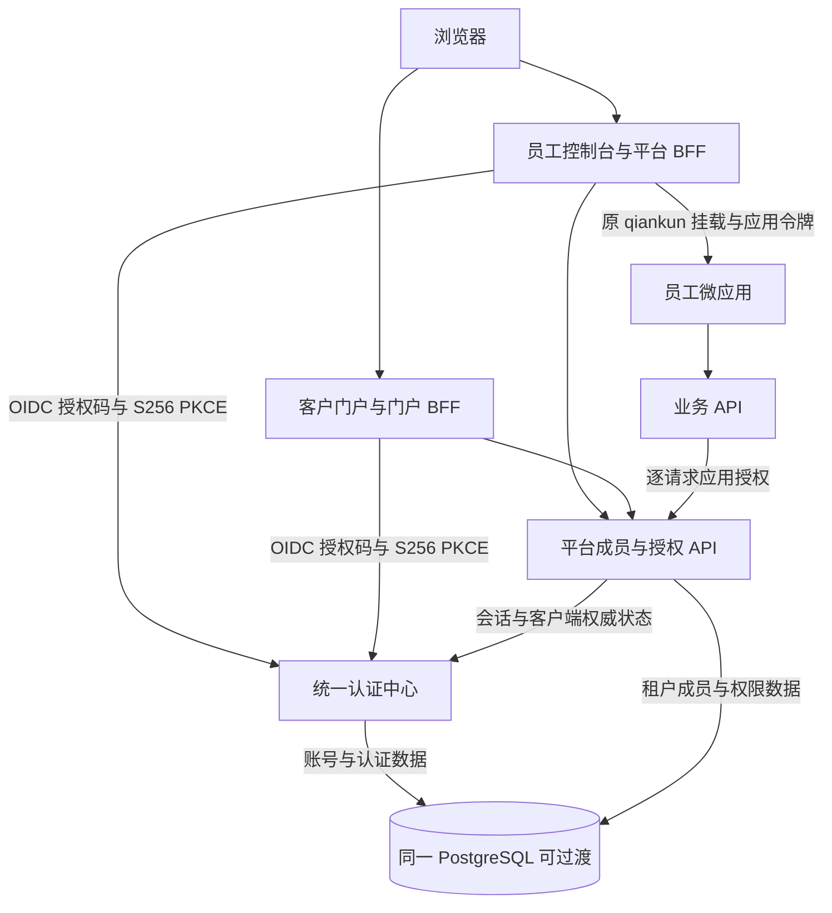
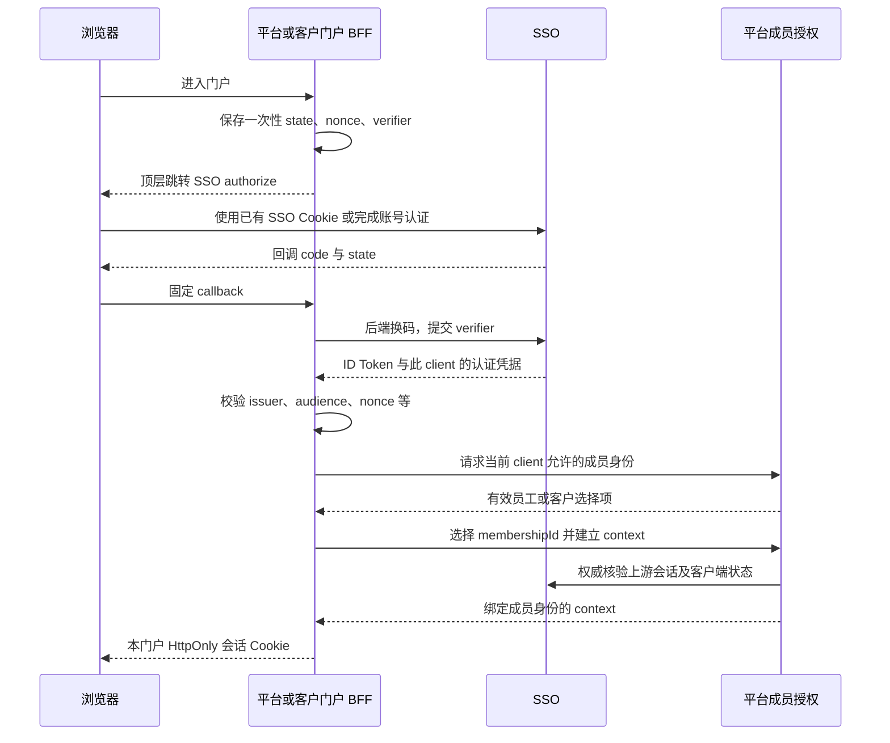

# 员工、客户身份与统一认证中心方案

> 状态：版本 v1.6，2026-10-25。Phase 1～12 已完成成员生命周期、具体凭据证明、准入管理、员工授权／目录／通知／管理 UI 隔离、客户最小资源、同进程认证边界、全局 SSO 会话、标准 OIDC、平台 BFF、独立客户门户与独立认证部署／最小数据库权限，真实结果见[Phase 1](validation/phase-01.md)、[Phase 2](validation/phase-02.md)、[Phase 3](validation/phase-03.md)、[Phase 4](validation/phase-04.md)、[Phase 5](validation/phase-05.md)、[Phase 6](validation/phase-06.md)、[Phase 7](validation/phase-07.md)、[Phase 8](validation/phase-08.md)、[Phase 9](validation/phase-09.md)、[Phase 10](validation/phase-10.md)、[Phase 11](validation/phase-11.md)和[Phase 12](validation/phase-12.md)。当前阶段为 Phase 13 多客户端灰度、恢复与退役验收（IN_PROGRESS），阶段状态和指针以[实施台账](task-ledger.md)为准。创建、SSO、OIDC 与 BFF 开关默认仍关闭；任务自有 development 新库已完成真实安全门禁、独立收缩、receipt 启动及 30 项 HTTP 验收，生产尚未开放。客户门户已通过真实双 RP 验收，独立认证服务已通过 [Phase 12 验收](validation/phase-12.md)，容量、双库身份感知恢复与最终灰度按 Phase 13 执行，预览三库 UUID 专项独立维护。

配套执行依据为[实施台账](task-ledger.md)。Phase 1 接口、配置和扩展迁移见[成员生命周期 API](phase-01-api.md)及[写路径审查](phase-01-membership-path-audit.md)；Phase 2 见[凭据绑定](phase-02-credential-binding.md)及[策略管理](phase-02-policy-api.md)。Phase 5 的管理端 proof、选择项、能力开关与缓存规则见[控制台成员证明](phase-05-console-identity.md)。Phase 6 见[客户本人资料](phase-06-customer-profile.md)、[独立收缩／启用](phase-06-rollout.md)及[写入器清单](phase-06-writer-readiness.md)。Phase 7 的端口、同库事务和数据归属见[账号认证边界](phase-07-authentication-boundary.md)及[验收](validation/phase-07.md)。Phase 8～12 的全局会话、OIDC、两客户端和独立认证部署已按各自阶段交付，入口汇总于[文档导航](../README.md)；当前仅 Phase 13 的最终运行与验收仍在进行。现行业务合同仍以[平台架构](../architecture.md)、[OAuth 签发](../oauth-issuance.md)、[应用授权契约](../application-authorization-contract.md)和源码为准。

开放问题的具体建议见[新库实施建议](open-question-recommendations.md)。本身份功能使用新库，无历史账号分类、旧 ID 映射或凭据迁入；真实空库迁移、seed 和活动消费者验证见[空库 v7 基线](validation/fresh-v7-baseline.md)。预览库审查与保数据重建见[UUID v7 审查与方案](uuid-v7-audit.md)、[只读聚合证据](uuid-v7-inventory.json)及[UUID 专项台账](uuid-v7-task-ledger.md)。其实际状态与动态指针独立维护，不作为身份新库的历史搬迁前置。

Phase 8 已验收的五个账号认证入口、独立 HTTPS 主机、Cookie／CSRF 与全局／成员撤销边界见[SSO 全局会话](phase-08-global-session.md)，实际门禁、失败修复与已完成验收见[阶段记录](validation/phase-08.md)。这些账号入口不直接授予平台上下文。Phase 9 已完成[标准 OIDC 与密钥生命周期](phase-09-oidc-provider.md)，[实际验收](validation/phase-09.md)包含独立标准 RP、两轮各 117 项真实 Edge 检查与最终视觉复核。Phase 10 已完成[平台 BFF 与兼容入口](phase-10-platform-bff.md)，[实际验收](validation/phase-10.md)包含服务端凭据、严格员工选择、真实 qiankun／通知短令牌续期与撤权、故障恢复和两种注销，浏览器不保存长期凭据。 Phase 11 已完成[独立客户门户](phase-11-customer-portal.md)，[真实验收](validation/phase-11.md)覆盖精确客户选择、四字段本人资料、同组织双向局部撤销、全局注销、跨标签页与认证故障后的显式恢复。

## 1. 方案结论与范围

采用以下路线：

身份新功能使用空库，从已有 SQLx 迁移链和 seed 建立 UUID v7 基线。相关生成器、输入校验、追加迁移及活动消费者合同须在隔离新目标验收；账号、成员从创建起使用 v7，后续拆服务保持 ID 稳定。本范围没有历史账号归类、旧 ID 映射、外部旧主体映射、凭据迁移或保数据导入前置；不读取、转换或借用预览库旧主体。

1. 保留 `users` 作为全平台统一账号，在 `memberships` 分别保存员工、客户成员关系。同账号在同一组织可有两条不同类型的关系，独立启停，不增加员工身份表或客户身份表。
2. OAuth 用户客户端和应用均增加 `allowedMemberTypes`，共同约束可以进入的成员身份；保留 `PUBLIC / CONFIDENTIAL` 原有协议含义。
3. 先在现有平台进程内完成身份隔离、认证模块与平台授权模块的边界整理。
4. 建立全局 SSO 会话、标准 OIDC 和两个独立登录客户端：员工控制台、客户门户。此时认证模块仍可与平台同进程运行。
5. 协议及撤销链验证通过后，将认证模块部署为独立服务；初期继续使用同一个 PostgreSQL 数据库，按数据归属划分数据库权限。

“不增加另外的表”在本方案中指不另建员工、客户身份关系表。SSO 会话、OIDC 一次性凭据、客户端、令牌及可靠撤销等认证基础设施允许按职责增加表，不能把这些不同生命周期的数据都塞进 `memberships`。

已交付 Phase 1～12 的成员与准入扩展、生命周期、精确凭据与撤销、员工授权／目录／通知／管理 UI 隔离、客户最小 DTO、开发库收缩／receipt 启动、认证边界、全局 SSO、标准 OIDC／独立密钥、平台 BFF、独立客户门户和独立身份服务／最小数据库权限。两个新工程均已存在并通过任务自有部署验收；没有执行生产部署。身份路线保留13阶段，当前 Phase 13 实施容量、请求灰度／安全回退、双库身份感知恢复及活动消费者验收。预览库 UUID 保数据专项保持独立范围。

### 1.1 已确定的设计决策

| 编号 | 决策 | 直接影响 |
| --- | --- | --- |
| D01 | 本身份新库从创建起使用 v7 `users.id` 作为稳定全局主体，SSO `sub` 使用同一值 | 无旧主体映射或联系方式合并；后续拆服务不重编号。v0.3 的一次性旧 ID 映射仅保留于独立预览库保数据专项 |
| D02 | 成员身份为 `EMPLOYEE / CUSTOMER`，目标唯一键为 `UNIQUE(user_id, organization_id, member_type)` | 同账号同组织可同时有员工、客户两条关系，每种类型最多一条 |
| D03 | 每条成员关系有独立 ID、`status`、`identity_version`，类型创建后不可原地改写 | 同组织员工离职不影响客户资格；当前请求只使用一条成员关系 |
| D04 | 客户不参与后台 RBAC 和成员数据授权 | 客户接口使用固定业务规则及本人数据归属校验 |
| D05 | 客户、员工都关联真实组织 | 租户及完整组织链的停用、到期同样限制客户身份 |
| D06 | 客户端与应用分别声明允许身份集合 | 实际成员、客户端、应用三者共同收窄准入 |
| D07 | 全局账号认证、平台成员上下文、应用 token 分层 | SSO ID Token 不作为业务 Bearer，组织变化不修改全局账号 |
| D08 | 先同进程逻辑拆分，再独立部署，数据库可共用 | 不为登录路由搬迁引入两个服务任意改同一套表 |
| D09 | 历史 SDK 2.0.0 字节保留；活动 SDK 与消费者须满足 v7 输入／生成及合同验收，MicroProps 2.0/Context 1.0/Notification 1.0 保持语义 | 以实际版本和证据核对版本允许列表、生成 DTO、来源摘要与消费测试；不以预览库 U05 状态代替新库验收，客户门户先使用独立 DTO |
| D10 | 客户创建前所有在线实例达到身份感知安全基线 | 客户出现后不能回退至不识别 `member_type` 的旧版 |
| D11 | 保持当前逐请求权威校验与撤销语义 | 无法确认身份有效性时终止受保护操作，不退化为只验 JWT |
| D12 | 首版客户由有权限管理员创建或绑定账号，明确选择租户内组织 | 自助注册、短信验证及未注册客户线索管理不在首版范围 |
| D13 | 系统自有正常 UUID 生成与新建记录统一 v7，PG17 基线采用应用显式写 ID、追加移除 v4 默认的迁移 | Phase 1 首先验收空库基线；密钥、code、refresh、nonce 等安全随机材料继续使用 CSPRNG，密码哈希维持现有安全要求；历史迁移字节、固定发行物和 v4 负例保留原义 |

### 1.2 首版产品规则

- 一个成员关系必须关联已有全局账号。当前 `users.password_hash` 为非空；不支持脱离账号存在的客户线索或联系人档案。
- 首版允许同账号在不同组织拥有不同身份，也允许在同一组织同时拥有员工和客户两条关系。员工后台选择员工关系，客户门户选择客户关系；两种入口均适用的应用每次请求也只使用一个明确 context。
- 客户归属组织由获授权管理员显式选择，服务端检查租户一致性和组织有效性。不能根据名称、创建时间或第一条组织猜测归属，也不自动挂租户根组织。
- 客户关联根组织也不取得根组织管理权限、员工目录权限或组织子树数据权限。
- 客户首个可验收功能为读取本人账号与当前客户身份资料。订单、工单、会员资产等真实客户业务必须另行冻结资源、动作和归属字段，不能将“本人资料通过”视为所有客户业务已完成。
- “切换访问身份”选择另一条已存在且有效的 `membershipId`，不会修改成员类型或自动创建关系。“新增另一种身份”与“停用原身份”分别操作；业务上需要替换身份时采用明确的组合流程，不能复用原成员 ID 改写历史归属。

## 2. 当前实现核对

| 当前事实 | 源码依据 | 本方案需要处理的内容 |
| --- | --- | --- |
| 全局 `users` 无 `tenant_id`，用户名全局唯一 | [初始结构](../../migrations/0001_init.sql)的 `users` 与 `users_username_key` | 空库创建稳定 v7 账号，不复制租户账号，不按联系方式合并；没有旧账号或旧会话迁入 |
| `memberships` 已追加类型、独立状态、身份版本和更新时间，类型及归属不可原地改写 | [0013 扩展迁移](../../migrations/0013_membership_identity_policy.sql)、[生命周期 API](phase-01-api.md) | 普通迁移仍保留双约束；[Phase 6](phase-06-rollout.md)独立工具经真实 ready 证据才收缩，任务新库已验收，生产默认关闭 |
| 原审查发现平台 23 个 v4 默认及多处 v4 生成；U02 已记录生成／输入与追加迁移改造 | [UUID 审查](uuid-v7-audit.md)、[U02 证据](validation/uuid-u02.md) | 在新目标重新验证最终 schema、生成器、seed 和活动消费者为 v7；不把历史审查计数或专项状态当作空库验收 |
| 旧员工批量保存与联系人初始化已显式限定员工，UPSERT 使用三元键；Phase 2 凭据已按具体成员证明读取 | [写路径清单](phase-01-membership-path-audit.md)、[users.rs](../../src/routes/users.rs)、[session.rs](../../src/session.rs) | Phase 3～6 已分别完成授权、通知、界面及整体双身份基线，环境实际开放仍须独立 ready／收缩证明 |
| 控制台 context 保持员工入口；全部用户凭据保存具体成员／账号／策略证明，普通 OAuth 依据明确客户端准入 | [auth.rs](../../src/routes/auth.rs)、[session.rs](../../src/session.rs)、[oauth_issuance.rs](../../src/oauth_issuance.rs)、[BFF](../../src/bff/mod.rs) | 旧缺证明凭据直接重认证，精确撤销与权威版本检查已完成；[Phase 8](phase-08-global-session.md) 允许无成员账号完成账号认证，[Phase 10](phase-10-platform-bff.md) 仅从本 RP 员工集合明确选择具体成员 |
| 生命周期变更在同事务重验具体 actor session、员工资格、实时权限及组织指纹，记录必填的真实变更原因 | [service.rs](../../src/membership_lifecycle/service.rs) | 稳定排序锁账号、再锁成员，不晚取父实体强锁；等待后与提交前重验、审计失败整体回滚 |
| 角色按用户与组织祖先链计算，存在超级管理员分支 | [authorization.rs](../../src/authorization.rs)、[state.rs](../../src/state.rs) | 当前成员为客户时，必须先终止员工权限路径 |
| 用户成员保存只替换管理范围内员工，保留客户及已有停用员工状态 | [users.rs](../../src/routes/users.rs)、[生命周期 API](phase-01-api.md) | 单项启停／移除／第二身份／替换使用明确成员 ID；阶段 6 前不开放真实双行 |
| 成员目录直接查询组织成员 | [app_members.rs](../../src/routes/app_members.rs) | 列表、单人资格校验均只接受有效员工 |
| 通知广播枚举成员，收件箱主要按用户、租户、组织过滤 | [notifications.rs](../../src/notifications.rs)、[通知路由](../../src/routes/notifications.rs) | 新建通知绑定具体身份与版本，验证员工消息不进入客户收件箱；没有历史通知回填 |
| 普通 OAuth 用户 grant 依赖完整用户、租户、组织；应用 token 关联父平台会话 | [oauth_issuance.rs](../../src/oauth_issuance.rs)、[app_token.rs](../../src/app_token.rs) | 按用途登记协议消费者和 owner，不能把全部 `/oauth/*` 直接转发给 SSO；不迁移旧凭据 |
| legacy OAuth 与标准 OIDC 分别保留明确 owner 和协议入口；OIDC 已有 code＋S256、ID Token、nonce、发现和 JWKS | [oauth2.rs](../../src/routes/oauth2.rs)、[标准 OIDC](phase-09-oidc-provider.md) | legacy 回归与活动消费者合同继续有效；稳定 issuer 与独立签名密钥已验收，独立部署仍须保持这些合同 |
| `oauth_clients` 兼任应用调用客户端，`oauth_tokens` 混存普通 OAuth 与应用 token | [OAuth 管理](../../src/routes/oauth_admin.rs)、初始结构 | 独立 SSO 前拆清凭据用途、写入归属和历史兼容路径 |
| 前端跨标签页协调使用固定平台存储键 | [session-coordinator.ts](../../../frontend/src/lib/session-coordinator.ts) | 员工端、客户门户按客户端和门户隔离会话、锁和广播通道 |

现有电话和邮箱可以对应多个账号。拆 SSO 时继续以密码证明、明确账号选择及稳定 UUID 区分账号，不能按联系方式自动合并权限。

Phase 1 已增加应用的 `allowed_member_types`／`access_policy_version`，以及客户端的上述字段和 `subject_mode`，含规范集合、条件 grant 和策略版本约束。普通应用／USER 默认只允许员工，MACHINE 明确机器用途，禁止新建 LEGACY_MIXED。准入策略管理 API／CLI、策略版本与精确失效已由 Phase 2 实现并验收，见[策略管理](phase-02-policy-api.md)与[验收证据](validation/phase-02.md)。空库、升级 fixture、生命周期和锁等待专项、编译及广泛回归的最终结果统一记录在[阶段证据](validation/phase-01.md)，不将某一轮失败或待完成的复核描述为通过。

## 3. 总体架构与依赖方向

### 3.1 第一里程碑：同进程完成身份隔离



现有登录入口保留兼容，但客户端用途、成员类型和应用准入必须在服务端校验。客户创建开关默认关闭，直至所有实例和调用链完成改造。

### 3.2 目标：SSO 为认证方，平台为成员与授权方



认证中心不依赖工单、门店等业务实现，也不负责计算组织角色。平台验证 SSO 账号后解析当前成员关系。业务服务继续经平台授权接口访问，不直接读取平台或 SSO 的账号表。

在同进程阶段通过窄模块接口调用；独立部署后替换为 HTTP 适配器。领域规则不依赖 Axum、SQLx 或另一个服务的业务 crate。必要的共享内容仅限稳定协议和生成 DTO。

## 4. 成员数据模型与生命周期

### 4.1 `memberships` 增量字段

| 字段 | 类型与约束 | 含义 |
| --- | --- | --- |
| `id` | UUID v7 主键，空库基线验收后从创建起保持稳定 | 具体组织下的成员身份 ID |
| `user_id`、`organization_id` | 现有字段，与 `member_type` 组合唯一 | 同账号同组织可以分别有员工和客户关系 |
| `member_type` | `VARCHAR(20) NOT NULL`，`EMPLOYEE / CUSTOMER` | 新建成员显式指定类型；旧格式员工维护请求继续只操作员工 |
| `status` | `VARCHAR(20) NOT NULL`，`ENABLED / DISABLED` | 当前成员身份是否可用 |
| `identity_version` | `BIGINT NOT NULL DEFAULT 1`，大于等于 1 | 该条成员的状态等身份资格变化时递增；类型不可原地改写 |
| `updated_at` | `TIMESTAMPTZ NOT NULL` | 最近成员关系变更时间 |
| `department_id`、`position` | 保留现有字段 | 客户要求部门为空、岗位为空字符串 |

以下 SQL 表达扩展与最终收缩两个发布步骤。Phase 1 实际扩展迁移为 [0013_membership_identity_policy.sql](../../migrations/0013_membership_identity_policy.sql)，没有修改 `0001_init.sql` 等历史 migration；Phase 6 已交付[独立收缩与 receipt 工具](phase-06-rollout.md)，不进入默认自动迁移。本新库没有历史成员回填，从 v12 员工 schema 升级的默认值与兼容行为已纳入隔离 fixture：

```sql
ALTER TABLE memberships
    ADD COLUMN member_type VARCHAR(20) NOT NULL DEFAULT 'EMPLOYEE',
    ADD COLUMN status VARCHAR(20) NOT NULL DEFAULT 'ENABLED',
    ADD COLUMN identity_version BIGINT NOT NULL DEFAULT 1,
    ADD COLUMN updated_at TIMESTAMPTZ NOT NULL DEFAULT now(),
    ADD CONSTRAINT memberships_member_type_check
        CHECK (member_type IN ('EMPLOYEE', 'CUSTOMER')),
    ADD CONSTRAINT memberships_status_check
        CHECK (status IN ('ENABLED', 'DISABLED')),
    ADD CONSTRAINT memberships_identity_version_check
        CHECK (identity_version >= 1),
    ADD CONSTRAINT memberships_customer_profile_check
        CHECK (member_type <> 'CUSTOMER'
               OR (department_id IS NULL AND COALESCE(position, '') = '')),
    ADD CONSTRAINT memberships_user_organization_type_key
        UNIQUE (user_id, organization_id, member_type);

-- 后续独立收缩迁移：所有实例和写入路径适配后才执行，不能提前上线。
ALTER TABLE memberships
    DROP CONSTRAINT memberships_user_id_organization_id_key;
```

迁移分为扩展、收缩两步。阶段 1 加字段和三元唯一约束，暂保留旧二元唯一；阶段 1～5 的客户、第二身份及新增生命周期写入口只在隔离环境验证，实际部署开关默认关闭；新代码先适配三元 UPSERT 与具体成员查询。阶段 6 确认所有实例与写入路径达到安全基线后，才通过单独追加的收缩迁移移除旧二元唯一并开放双身份。新库无旧部署时，旧 binary 清退记录可按范围登记不适用，不能替代安全验收。预检依赖旧唯一键的 FK、SQL、批量导入和 CLI，不使用 CASCADE 自动删除未知依赖。上面的两个 ALTER 表示最终设计和不同发布步骤，不能作为阶段 1 的同一上线批次。

阶段 2～5 的双身份用例使用专用目标结构 fixture，在自有隔离库中显式移除旧二元约束以构造两行数据；这只是测试准备，不提前发布收缩迁移。扩展迁移本身的兼容测试仍验证旧约束存在。阶段 6 再验证真实增量收缩迁移和整套升级顺序。

Phase 1 管理 DTO 实际字段与版本输入以[生命周期 API](phase-01-api.md)为准，返回 `id`、`memberType`、`status`、`identityVersion` 等字段；后续授权 context 将显式绑定 `membershipId` 与身份版本。面向浏览器的身份上下文版本采用十进制字符串以避免 JavaScript 大整数精度损失，应在相应阶段固定 DTO 并验证，不能将其误记为当前管理响应已经改为字符串。管理资料和授权上下文使用明确 DTO，不把管理字段暴露给业务候选目录。

建议为有效员工目录增加按 `organization_id` 的局部索引，为成员身份筛选增加覆盖实际查询条件的索引。以真实查询计划决定索引，不机械给所有列建索引。

### 4.2 同组织双身份与引用规则

同一门店员工在本店消费的示例：

| 成员 ID | 全局账号 | 组织 | 类型 | 状态与身份版本 |
| --- | --- | --- | --- | --- |
| M001 | U001 | O001 | EMPLOYEE | ENABLED，版本 1 |
| M002 | U001 | O001 | CUSTOMER | ENABLED，版本 1 |

两行共享账号基础资料，各自维护资格和生命周期。停用 M001 只使员工 context、授权资格、员工通知和相关凭据失效；M002 的客户 context 不因此失效。全局账号封禁及账号版本提升才同时影响两行。

- 成员的类型是这条关系的类别，创建后不可原地 UPDATE 为另一类型。登录切换为另一个 ID；新增身份插入另一类型的行，同类型已存在则返回既有关系或 409，不创建重复行，也不自动启用停用关系。
- 所有需要确定身份的查询、JOIN、锁、更新和删除使用 `membership_id`，或在可信场景下明确限定 `user_id + organization_id + member_type`。仅凭用户和组织查询不得隐式取首条，也不得让 JOIN 倍增结果、计数或重复投递。
- 平台 context、普通用户 OAuth、应用 token、数据授权、通知接收和缓存从签发或创建起绑定具体成员 ID。缺少可证明绑定的凭据直接拒绝，不根据当前新增关系猜测身份；本新库不补绑或恢复历史凭据。
- 员工处理业务时的操作者与客户数据的归属分别记录。例如员工替自己下单也分别使用 `operator_membership_id=M001`、`customer_membership_id=M002`；具体资源字段由业务合同确定，不能仅用全局 user ID 合并两种含义。
- 授权判断检查当前 context 是否为员工，不因同账号另有员工关系就允许客户请求，也不因账号另有客户关系就禁止其合法员工请求。客户身份中的角色与后台权限固定为空。

### 4.3 创建、维护与身份替换语义

- 员工、客户列表都按类型查询；全局账号管理和跨范围操作检查仍遍历所有类型、所有保留状态的关系。
- 原 `PUT /api/users/{id}/memberships` 的旧请求语义收窄为“替换管理范围内员工关系”，不删除客户关系。缺少 `memberType` 的旧请求只能维护员工；同组织已有客户时可新增独立员工行，不能覆盖客户 ID 或资料。已有停用员工关系不能通过旧整批保存隐式启用。
- 新增按 `membershipId` 操作的单项接口。新增另一类型身份、状态变更和身份替换分别有明确动作，不能通过整批保存隐式完成；UPSERT 冲突目标改为三元唯一键。
- 新生命周期写入口在完整安全基线通过前仅用于隔离验证；正式环境的新停用、启用、身份替换功能保持关闭。客户开关同时覆盖新增客户、组合替换、导入、CLI 和种子等全部产生客户关系的路径，不能只禁用页面按钮或单个 POST。
- `organization_id` 不通过普通更新移动；跨组织变更使用“撤销旧关系、创建新关系”，保留历史审计和业务归属。
- 普通临时停用可保留员工授权配置，但所有读取立即失效；重新启用需显式操作并递增版本。永久离职、删除员工关系或业务身份替换时清理不再适用的员工授权；同组织仍有效的客户行保持原 ID、状态和版本。
- 客户绑定已有账号需完成获授权的邀请或账号归属确认，不能只凭输入某个邮箱、电话搜索命中就替他建立客户访问关系。首版管理员流程须记录绑定来源。

### 4.4 状态变更与业务身份替换事务

Phase 1 版本敏感变更要求 `expectedIdentityVersion`，过期返回 409；所有新生命周期写 DTO 必填真实 `reason`，去除首尾空白后须非空、最多 500 字符且无控制字符，并与成员变更原子审计。先稳定排序锁定操作者及目标账号，再锁目标成员，不晚取组织／租户强锁。锁等待后和提交前用实时权威状态及指纹重新核验。当前 API 拒绝停用、移除或替换当前登录员工身份，由其他管理员执行。以下为包括 Phase 2 完整凭据绑定在内的目标事务合同，当前兼容边界见[生命周期 API](phase-01-api.md)。

事务内执行：

1. 重新检查操作者的当前员工身份、管理权限、目标组织和范围；客户不能调用管理变更。
2. 重新读取源成员类型、状态和版本；涉及目标类型时同时锁定该账号、组织、目标类型的关系并检查三元唯一冲突。
3. 普通新增客户身份独立创建客户行，不停用员工、不清员工授权。明确要求“员工替换为客户”时，创建目标客户关系，或显式选择已存在的客户关系；目标已停用时不得顺带盲目启用，须核验启用权限及目标版本。客户行部门、岗位为空，源员工行保留历史身份类别。
4. 永久离职、删除或身份替换需要清理时，按事务结束后的员工关系集合复核 `user_roles`，只清理失去有效员工支持的绑定；普通临时停用允许保留配置，但停用关系不能作为实时授权资格证明。现有角色关系未记录授予来源，不能按 `user_id` 全删，也不能声称可以按原成员来源精确撤回。
5. 状态变更只修改目标成员的状态和版本；身份替换停用源关系并递增源版本，按永久退出规则清理源员工数据授权，不能将源行的 `member_type` 改写成目标类型。新关系使用新 ID；已存在目标关系若没有资格变更，不递增其版本。
6. 按精确成员 ID 撤销源或被变更成员的上下文会话、刷新族、应用令牌及绑定该上下文的普通 OAuth access/refresh、未消费授权码和已批准设备码。保留同组织另一身份的合法凭据；有目标启用变更时处理目标自己的版本和旧凭据，绝不复活历史会话。
7. 身份变更审计与撤销变更一起提交；失败整体回滚。没有实际变化的幂等请求不制造新版本。

0013 已替换原成员删除触发器：扩展期只撤员工适用的旧凭据，删除客户 fixture 不触碰同组织员工凭据；所有旧签发／资格入口限定有效员工以维持此前提。Phase 2 再改为具体 `membership_id`／版本绑定的完整撤销，并覆盖 UPDATE 状态的所有消费路径。`member_type` 及归属不可原地改写已由数据库保护与统一用例共同保证，成员重新创建获得新的 ID；旧凭据不得按相同账号与组织补绑复活。

## 5. OAuth 客户端与应用的身份准入

### 5.1 两者都增加允许身份集合

采用 `allowed_member_types` 数据库字段和 `allowedMemberTypes` API 字段，值为去重、有序的 `EMPLOYEE / CUSTOMER` 集合。成员相关配置要求非空、无未知值；空集合不解释为允许全部。

| 配置维度 | 示例 | 用途 |
| --- | --- | --- |
| 现有 `clientType` | `PUBLIC / CONFIDENTIAL` | 协议维度：能否保管客户端密钥 |
| 新增客户端 `allowedMemberTypes` | `["EMPLOYEE"]` | 此登录客户端或用户 OAuth 客户端允许建立的成员上下文 |
| 新增应用 `allowedMemberTypes` | `["CUSTOMER"]` | 应用允许承载的成员身份 |
| 成员 `memberType` | `CUSTOMER` | 服务端查到的当前真实成员身份 |

数据库建议使用 `TEXT[]`，约束非空数组、元素无 NULL、值属于枚举集合，并由写入层规范化去重；集合最多两个值。新库的普通应用和人员客户端默认仅 `["EMPLOYEE"]`，客户门户显式为 `["CUSTOMER"]`；本范围没有历史客户端回填。机器专属客户端的该配置标记为不适用，不能将空集合用作用户身份通配；机器与人员用途分别登记。

为避免机器客户端与非空集合约束冲突，客户端同时显式标记主体模式 `subject_mode=USER / MACHINE / LEGACY_MIXED`：USER 的允许集合非空；MACHINE 的集合为空且只允许机器 grant；LEGACY_MIXED 仅为其他部署中已登记历史混合客户端保留的兼容模式，本新库不创建。应用的允许集合始终非空。目标 OIDC 登录客户端使用 USER，平台服务调用凭据采用独立机器用途。

为客户端和应用分别增加 `access_policy_version`，身份准入、状态或其他影响准入的配置变更时递增。应用创建后默认仅允许员工；客户支持必须显式启用并通过客户策略适配验收。

### 5.2 准入公式与例子

用户进入应用的必要条件为：

```text
账号有效 + 认证会话有效 + 当前成员及完整租户/组织链有效
+ 成员类型在来源登录客户端 allowedMemberTypes 中
+ 成员类型在应用 allowedMemberTypes 中
+ 当前租户授权此应用 + 当前组织授权此应用
+ 此身份对应的资源动作策略允许
+ 具体业务记录在该身份可访问范围内
```

其中员工继续执行角色操作权限与成员数据授权；客户执行固定客户能力和数据归属规则。允许集合只控制“能否进入”，不能代替动作、数据或租户组织应用授权。

| 当前成员 | 客户端允许 | 应用允许 | 身份准入结果 |
| --- | --- | --- | --- |
| EMPLOYEE | EMPLOYEE | EMPLOYEE | 可继续检查员工授权 |
| CUSTOMER | EMPLOYEE | CUSTOMER | 拒绝：客户端不允许客户 |
| CUSTOMER | CUSTOMER | EMPLOYEE | 拒绝：应用不允许客户 |
| CUSTOMER | CUSTOMER | CUSTOMER | 可继续检查客户策略与本人归属 |
| EMPLOYEE 或 CUSTOMER | 两者 | 两者 | 使用当前选中的单个成员身份，分别执行对应策略 |

允许“两者”的应用必须显式提供两套服务端策略和合适的入口。集合中有两个值只允许选择账号实际已有的成员关系，不自动创建另一身份，也不合并员工和客户权限。同组织已有两条关系时，每次请求仍只使用其中一个 context。

这里的客户端首先指来源登录客户端。平台 context 记录 `origin_client_ref`（含 issuer 和 client ID），应用 token 继承此来源及其身份限制；另用 `application_service_client_ref` 记录应用后端服务凭据。现有 app token 的 `client_id/cid` 继续用于服务绑定，不能覆盖登录来源。如果应用另有用户 OAuth 客户端，其允许集合进一步收窄；机器专属服务凭据仅证明服务调用资格，不提供人员身份集合，也不能凭自身权限扩大来源客户端准入。同进程旧控制台登录由服务端绑定明确的 legacy 来源客户端，不能信任浏览器自行声明 client ID。

### 5.3 客户端配置的管理与执行位置

- 现阶段在 `oauth_clients` 增加身份准入配置，更新客户端编辑页面、API、CLI、seed 和策略校验；现有 `clientType` 不改名、不改变含义。
- 目标 SSO 的 OIDC 客户端注册也保留允许身份集合，作为注册客户端的用途策略。SSO 校验协议客户端及请求用途；平台从可信客户端策略投影读取允许集合，并依据新鲜成员资料作最终授权。
- SSO 全局账号认证本身不要求存在成员。账号能完成 SSO 认证，但没有客户端所需员工或客户关系时，平台返回“没有可进入的身份”。不能把角色查询塞回全局密码验证。
- 平台管理端编辑客户端通过受控账号/客户端管理接口完成；SSO 内部接口采用限用途服务认证，普通客户端凭据不自动取得注册或全局账号管理权限。
- 应用与用于用户登录、应用调用、机器访问的客户端分别显式绑定。不能继续依赖“创建时间最早的机密客户端”推导新 SSO 登录客户端。
- 第三方纯账号认证客户端可只使用 OIDC 账号身份，不申请平台成员上下文；不能因此取得平台应用权限。首版员工控制台、客户门户均需明确成员准入配置。

### 5.4 策略变更与即时收紧

收紧客户端或应用允许集合时，在事务中提升策略版本并阻止新的不合规 context、授权码、设备批准和刷新。现有凭据每次使用校验当前策略版本及准入；撤销受影响会话和令牌，不能等到 access token 自然到期。

SSO 的 OIDC code 不承载已选择的成员类型，因此其客户端用途策略变化后，该 client 的旧 code、refresh 和关联客户端 grant 统一按版本失效，需要通过仍有效的全局 SSO 会话重新授权；不能让 SSO 查角色或成员来挑选所谓不合规 code。平台依据最新客户端策略和真实成员重新建立 context。应用策略变更则只收紧对应应用访问。

客户端策略收紧只影响该客户端派生访问，保留全局 SSO 及其他客户端合法会话；应用策略收紧不能误删其他应用的合法身份。扩大允许集合也不让旧客户会话直接变成员工会话，仍需建立新成员上下文。配置变更与差量审计一起提交。

事务原子性的边界是策略 owner 原子更新版本、状态与审计，并由所有凭据使用方读取新鲜权威状态而立即拒绝旧版本；跨 owner 的派生记录物理清理通过可靠事件完成。独立部署后不要求两个服务跨边界共同修改表，也不以异步清理完成时间作为撤销生效时间。

## 6. 三层会话与令牌边界

| 层次 | 必须绑定的身份 | 维护方 | 明确禁止的用途 |
| --- | --- | --- | --- |
| 全局 SSO 会话 | 稳定账号 `sub`、SSO `sid`、账号凭证版本、认证时间 | 认证中心 | 不能直接证明租户成员资格或员工角色 |
| OIDC 客户端 grant / RP 会话 | SSO 会话、client、授权及策略版本 | 认证中心与对应 BFF 各自维护自己的会话 | 不能供其他 client 直接复用 refresh token |
| 平台成员 context | 账号、上游 SSO/client grant、`membershipId`、tenant、org、type、identityVersion | 平台 | 客户 context 不能调用员工接口 |
| 应用专用 token | 父 context、成员绑定、app audience、client 绑定、jti、策略版本、到期时间 | 平台 | 不能作为 SSO 登录凭据或其他应用凭据 |

现有 `platform_sessions` 结构继续承载平台 context，追加成员 ID、签发时类型和版本、上游认证来源/会话引用、客户端策略绑定等字段。短期应用 token 继续绑定父会话，维持最长 300 秒和实时父会话检查。按保留兼容协议新签发的普通 OAuth 用户凭据也必须绑定可验证的成员上下文；机器 grant 不添加虚构成员。

所有被接受的用户凭据记录从签发起绑定全局账号凭证版本 `account_version`，权威来源沿用并最终由 SSO 管理 `users.session_version`。这同时覆盖按登记兼容协议签发、没有 SSO sid 的 access、refresh、code、device 及待选择凭据。全设备注销、封禁和改密码在账号 owner 的事务中提升此版本；使用、换码、批准和刷新实时比较版本，使尚未被平台物理标记撤销的旧记录也无法继续使用。缺少可证明版本绑定的用户凭据拒绝使用，不事后按当前版本补绑。本新库不接纳历史凭据；机器凭据保持独立机器撤销规则。

SSO 使用独立 issuer、非对称签名和验证规则；平台 context/app token 使用自己的用途及密钥边界。任何服务不得仅因签名可验证，就接受错误 issuer、audience 或 token 用途。

客户固定接口要求真实客户 context；“无角色”不会放宽成任意已登录账号。员工路径先检查有效 `EMPLOYEE`，再计算角色或超级管理员规则。`users.is_super_admin` 不进入 SSO ID Token，也不使客户 context 获得员工权限。

### 6.1 撤销矩阵

| 事件 | 失效范围 | 保留的合法身份 |
| --- | --- | --- |
| 关闭当前平台 context | 当前 context、刷新链及派生应用 token | SSO 登录和其他门户 context |
| 成员停用、删除、业务身份替换 | 按具体成员 ID 失效其全部 context 与绑定凭据 | 同账号其他有效成员，包含同组织另一身份，以及全局 SSO |
| 登录时切换员工/客户访问身份 | 新请求使用另一个有效成员 ID 的 context，不修改任何成员类型 | 同组织另一门户的合法 context，按门户分别管理 |
| 组织或祖先停用、到期 | 受影响组织链内 context 与访问 | 账号在其他有效组织的身份 |
| 应用禁用、组织应用撤权 | 对应应用及目标组织的访问 | 其他应用及成员身份 |
| 客户端停用或用途收紧 | 该客户端受影响 grant/context | 其他客户端合法会话 |
| SSO 当前设备退出 | 当前 SSO 会话及全部派生 RP/context | 其他设备的独立 SSO 会话 |
| 全设备注销、账号封禁、密码重置 | 该账号全部 SSO、平台、应用及按登记兼容协议签发的普通 OAuth 派生凭据 | 无旧凭据继续使用；后续需重新认证 |

同库阶段可通过限列、限用途的权威只读投影验证上游 SSO 会话和客户端状态。独立进程不等于必须远程 HTTP；独立存储后通过受控实时内省维持同等语义。应用授权结果仍只作为当前请求的短期证明，不承诺不同业务库事务提交与身份撤销的全局原子性。

异步撤销事件、OIDC back-channel logout 用可靠 outbox、幂等消费、重试、版本比较和对账主动清理 BFF/context。它们不替代逐请求权威有效性检查。未确认有效时返回 503；明确无效返回 401；有效身份权限不足返回 403；不可见目标返回 404。

## 7. 登录、选择身份与退出流程

### 7.1 同进程过渡登录

原用户名、电话或邮箱登录先完成账号凭证验证，再枚举允许客户端用途下的有效成员身份。选择项明确显示租户、组织及员工/客户类型；客户端提供的门户意图只用于收窄，不作为授权事实。

登录和切换 context 请求使用 `membershipId`。旧请求只有 user/organization 时，只有在已验证的客户端用途与明确类型能唯一定位一条有效关系的情况下才能兼容；仍有歧义则返回 400 要求选择成员身份，不按创建时间或首条选择。员工专用门户自动选符合条件的员工关系，客户专用门户选客户关系；多组织或双用途入口在有多个合法候选时显示明确身份选项。

当前凭据选择票据还需绑定成员或客户端策略的可验证版本，选择 context 时重新查询。不能用签发票据时的旧成员快照跳过撤销。旧票据缺少必要身份绑定时要求重新登录。

### 7.2 目标 OIDC 登录



无成员账号可以完成 SSO 认证，但门户展示无可用身份和联系管理员入口，不自动创建员工或客户关系。某 client 仅允许员工时，不会列出客户身份；只有客户身份的账号不能因 SSO 已登录就进入员工控制台。

首版客户由管理员绑定，不开放公开注册；后续自助注册必须另加已确认租户入口、配置的客户承接组织、手机号/邮箱证明、防滥用及账号绑定规则，不能直接接受任意 tenant/org 参数。

### 7.3 门户与浏览器存储

目标员工控制台、客户门户、SSO 采用不同 origin 和不同 client。域名在部署阶段配置，本文不虚构真实域名。SSO Cookie 仅认证域可用，不设置父域共享 Cookie；门户分别使用 `Secure`、`HttpOnly`、适当 `SameSite` 的 host-only Cookie。

门户 BFF 在服务端保存 OIDC refresh token，采用顶层跳转完成 SSO，不依赖第三方 Cookie 或隐藏 iframe。修改型 BFF 请求执行 CSRF/Origin 验证，回调 URI 精确匹配注册配置。

同源过渡部署必须按 portal/client 隔离 localStorage、sessionStorage、Web Locks、BroadcastChannel 和刷新协调键。所有缓存、通知状态、请求作用域与身份比较包含 `membershipId + memberType + identityVersion + context`；类型或状态变化使旧请求失效并清除相关页面状态。

员工 qiankun 微应用仍按原方案获得短期应用 token；浏览器不得取得 SSO refresh token或认证中心私钥。BFF Cookie 化不会将上游 SSO access token 当作 SDK token。

为接续现有 HTTP Bearer 和 Socket.IO 合同，平台 BFF 增加拟定的 `POST /auth/context-token`：在验证门户 Cookie、CSRF、当前上游会话与成员后，返回最长 300 秒的原用途平台 context access token。浏览器仅在内存保存，不取得平台 refresh；续期再次经 BFF Cookie 完成。宿主用此 token 调用现有平台 API、`/api/oauth/session-token` 和通知 context 接口，并仍按 `authenticate({token})` 完成通知握手。它是成员 context Bearer，具有现有用途所需权限，不能冒充仅通知凭据；短期与逐请求校验共同限制其生命周期。原 qiankun 应用 token、Notification 1.0 载荷均保持不变。BFF 改造必须验收真实挂载、socket 续期与撤权，不能把 HttpOnly Cookie 当成既有 JSON 中的 token。

“退出当前门户”和“退出统一账号/全部设备”采用明确不同操作。局部退出不隐式注销其他门户；全局退出按撤销矩阵失效派生会话。

## 8. 接口与错误合同

以下新增路由是拟定合同，实施阶段在不冲突现有路由的前提下冻结。内部接口不向浏览器开放。

| 能力 | 拟定入口或现有入口处理 | 核心要求 |
| --- | --- | --- |
| 按身份维护成员 | `GET/POST /api/memberships`，`GET /api/memberships/{id}` | 员工管理员、组织范围、显式类型；新建客户受开关保护 |
| 独立启停 | `PUT /api/memberships/{id}/status` | expectedIdentityVersion、精确成员撤销；不影响同组织另一身份 |
| 业务身份替换 | `POST /api/memberships/{id}/replace-identity` | 显式创建/选择目标身份并停用源身份的组合动作；验证源/目标版本，不原地改 member_type |
| 旧成员维护 | 保留 `/api/users/{id}/memberships` | 仅替换员工范围，不能删除或隐式覆盖客户 |
| 应用、客户端配置 | 现有应用与 OAuth 客户端管理 API | allowedMemberTypes、accessPolicyVersion、类型适配验证 |
| 当前成员上下文 | 保留并扩展宿主 `/api/auth/context`、`/api/auth/profile` | 真实成员校验，员工客户端仅列员工，客户客户端仅列客户 |
| 客户最小资料 | `GET /api/customer/context`、`GET /api/customer/profile` | [当前客户合同](phase-06-customer-profile.md)只接受有效客户证明，无角色、菜单或员工目录 |
| 客户应用目录 | `GET /api/customer/applications` | 客户端、应用、租户及组织授权交集；成功仅返回精确登记应用，未登记或目标失效时拒绝 |
| OIDC 登录 | 稳定认证 issuer 下 `/authorize`、`/token`、`/userinfo` | code + S256，精确 client/redirect 绑定 |
| OIDC 发现与公钥 | issuer 对应的标准发现地址及 `/jwks` | 发现文档与 issuer 路径一致，公钥不含私钥 |
| OIDC 登出、内省、撤销 | `/logout`、`/introspect`、`/revoke` 及 back-channel 合同 | 精确客户端、会话归属和注销范围 |
| 门户 BFF 登录 | 各门户 `/auth/login`、`/auth/callback`、`/auth/logout` | 服务端一次性状态、门户 Cookie、局部/全局退出区分 |
| 既有宿主凭据接续 | 平台 BFF `POST /auth/context-token` | Cookie 与 CSRF 验证后返回短期平台 context Bearer，仅存浏览器内存，refresh 留服务端 |
| SSO 内部管理 | 限用途的账号/客户端管理及会话状态 API | 调用方服务认证、操作审计、最小授权，禁止公网匿名访问 |

客户 context 示例，不属于 SDK 2 的应用 context：

```json
{
  "contractVersion": "1.0",
  "user": { "id": "<user-uuid>", "displayName": "张三" },
  "membership": {
    "id": "<membership-uuid>",
    "memberType": "CUSTOMER",
    "identityVersion": "1"
  },
  "tenant": { "id": "<tenant-uuid>", "name": "示例租户" },
  "organization": { "id": "<org-uuid>", "name": "示例组织" }
}
```

客户 DTO 不承载后台角色、数据授权或管理菜单。现有通用宿主兼容接口如必须返回旧字段，对客户固定返回空集合；真正员工 API 仍拒绝客户调用。

| 场景 | 建议状态码及行为 |
| --- | --- |
| 凭证错误、过期或被撤销 | 401，明确需要重新认证 |
| 成员类型与客户端/应用不匹配、缺员工权限 | 403，明确用途或权限不允许 |
| 目标不在本人客户范围或组织可见范围 | 404，不披露目标是否存在 |
| 身份/策略版本过期、同账号同组织同类型重复 | 409，重新读取后由用户处理；另一种身份合法存在 |
| 参数未知枚举、客户包含部门岗位 | 400，拒绝无效配置 |
| 限流 | 429，带 Retry-After |
| SSO/授权依赖超时，无法确认有效状态 | 503，终止当前操作；前端保留可恢复登录状态，不自动清空所有门户 |

## 9. 员工授权、客户规则、通知与 SDK

### 9.1 员工路径

当前成员必须为有效员工，之后才执行原角色、菜单、超级管理员和数据授权规则。覆盖平台管理 API、应用 context/authorize、external 菜单角色、搜索、监控、导出、CLI 和后台管理发现接口，不能只在前端隐藏菜单。

角色分配有“用户分配角色”和“角色分配用户”两条入口，两者及授权读取都核验有效员工关系。数据授权的发现、预览、差量提交也只处理员工。`ensure_role_membership_in_tx` 一类资格判断必须使用有效员工关系。

角色管理请求应定位员工 `membershipId`；同账号另有客户行不构成拒绝合法员工授权的理由。现有 `user_roles` 可保留用户与祖先角色的关联含义，但资格证明只能来自有效员工关系，客户 context 永不消费这些角色。成员数据授权本就绑定 `membership_id`，只能写入员工行。

应用成员列表与单人验证只返回有效员工，门店营业联系人、员工目录、工单指派均复用这一约束。账号管理的全局操作范围检查必须保留客户和停用成员，不能机械给所有成员 SQL 增加员工过滤。

### 9.2 客户路径

客户可执行能力由服务端固定策略登记，与角色无关。每个客户业务资源须声明 tenant、organization、customer membership 或稳定账号归属字段，并说明组织变化后历史数据的访问规则。

同组织双身份的业务资源优先明确客户成员归属与员工操作身份；确需按稳定账号归属的资源，合同必须另行声明其跨成员共享范围，不能把员工经办记录自动解释为客户本人记录。

客户本人数据不能用“前端提交 userId 与当前 userId 相同”证明；服务端从已验证 context 取得成员和租户，落实到业务 SQL。不能因挂在根组织就取得子树或全租户访问，也不能借用员工 `SELF` grant 代替客户规则。

现有工单、门店等应用默认只允许员工。客户调用这些应用会被准入拒绝，直到对应应用实现客户资源动作、归属校验及独立入口。未来统一客户业务授权协议应另行版本化，不能静默放宽当前 `/api/apps/{appCode}/authorize` 的 RBAC 合同。

### 9.3 通知受众与历史隔离

通知是开放客户创建之前的必需改造：

- 旧组织/租户广播和缺省收件策略只选有效员工。明确客户通知用途后，才能发布到客户；SYSTEM 通知同样声明受众。
- 组织范围通知的持久投递记录绑定 `recipient_membership_id`、`recipient_member_type` 和 `recipient_identity_version`，由平台后端写入，客户端不得自报收件身份。
- 同账号同组织的员工、客户通知分别绑定两条成员关系。现有按用户与组织去重的通知唯一键、发布去重和收件候选 JOIN 必须改为精确接收成员维度，避免漏投、重复投递或将两种收件身份合并；计数、分页和逐条 socket 验证使用同一身份边界。
- 本新库不执行历史 APP/SYSTEM 通知回填；新建投递从创建起绑定成员身份与版本。兼容协议的 LEGACY 类型继续遵守隔离和不实时投递规则，缺少可证明接收身份的记录不作为客户消息展示。
- 本期采用保守的身份代际规则：成员身份版本变化后，旧代通知保留记录，不自动进入新代收件箱；不按相同用户、组织重新投递。需要跨代历史归档时另定有权限的归档读取规则。
- 收件箱列表、单条读取、未读数、批量标记、socket-context 及每条实时投递都核验当前成员身份与版本，员工转客户后不能读取旧员工消息。
- 通知服务继续只读通知投影并向平台复验授权，不拥有认证私钥，不写身份表。身份失效时断开连接并清理对应客户端通知缓存。
- 客户通知入口在客户路由允许清单内；旧员工 `/micro/*` 深链不直接作为客户跳转。

通知 wire DTO 不必因后端身份过滤变化而增加字段；若客户通知需要新的目标类型或客户端字段，必须通过正式通知协议版本发布，首版客户门户不复用未适配的员工通知界面。

### 9.4 SDK 与协议发布

历史 SDK 2.0.0 发行字节和摘要保持不变；新库活动 SDK 必须使用通过 v7 生成／输入和消费者合同验收的实际版本，不能把活动 vendor 永远锁定为旧版本，也不能把预览专项的计划发布当成已验收产物。需要发布升级时，同步 `supportedSDKVersions`、门店 `validContext` 等版本判断、生成 DTO、来源记录、校验脚本及消费者测试，并复用专项中适用的真实产物与证据。`public_contract.rs` 是生成文件，不能手改。内部令牌可以追加受严格验证的成员绑定字段，但对外契约成员字段扩展须分别审查 SDK 包、MicroProps、授权 context、通知协议的版本兼容。

本方案首版员工微应用沿用 Context 1.0 与 MicroProps 2.0，平台在内部保证只为员工签发这些应用上下文；客户先使用门户 DTO。未来确需微应用承载客户时，先在 SDK 仓库生成新版本 schema、DTO、fixtures、manifest，再按消费者逐仓升级，不覆盖历史 release。

身份相关变化必须进入平台投影摘要、contextVersion、上下文 epoch 和取消作用域；相同用户、组织的类型或版本变化也必须取消旧挂载请求与迟到响应。

## 10. 认证模块、SSO 数据归属与共库部署

### 10.1 同进程模块边界

| 模块能力 | 输入与输出 | 不承担的内容 |
| --- | --- | --- |
| AccountAuthentication | 账号标识、密码证明、稳定账号主体 | 不查询角色或选择组织 |
| GlobalSession | 全局登录、退出、凭证版本及状态 | 不计算成员权限 |
| OidcProvider | client、code、PKCE、ID Token、认证 grant | 不签发平台业务角色 |
| MembershipContext | 经认证主体、可信 client 策略、成员选择 | 不验证密码 |
| EmployeeAuthorization | 有效员工 context、资源动作 | 不授权客户 |
| CustomerAccess | 有效客户 context、固定能力及本人归属 | 不读取员工角色取得权限 |
| ApplicationAdmission | 成员、client、app、租户组织应用授权 | 不代替业务记录 owner 检查 |

Phase 7～10 已按现有职责建立消费者定义的窄认证port；Phase 11 已创建同级独立 `saas-customer-portal/`，采用Rust/Axum BFF与React/Vite前端；Phase 12 已创建同级独立 `saas-identity/`，完成薄入口／厚库、独立normal进程和同库最小权限验收，不依赖平台业务crate。工程名称与实际位置已落实；生产维护人员、生产资产及正式发布归属仍按真实部署登记，任务工程存在不替代这些事项。

### 10.2 表级归属与旧表拆分

| 数据 | 目标唯一维护方 | 过渡安排 |
| --- | --- | --- |
| `users` 的凭证、联系资料、全局状态和账号凭证版本 | SSO | 新库创建起使用稳定 v7 ID 与 FK；平台只经接口修改，读取限列投影 |
| 全局 SSO 会话、OIDC 客户端、code、refresh、认证 token、签名元数据 | SSO | 建立独立用途的数据结构，不复用组织 context 表冒充全局会话；账号版本使 legacy 凭据也能即时失效 |
| tenants、organizations、memberships、roles、menus、data grants | 平台 | 所有类型关系都由平台管理 |
| platform_sessions 及其刷新、应用 token、应用服务凭据和绑定 | 平台 | 继续执行成员授权，不整体搬入认证中心 |
| 应用登记、allowedMemberTypes、应用策略版本 | 平台 | 租户与组织应用授权保持原规则 |
| 按保留兼容协议新登记／签发的普通 OAuth client/grant/token | 平台 legacy 兼容模块 | 仅为有明确消费者的用途开放；本新库不导入旧客户端和凭据，其他部署历史退役另列清单 |
| 平台运维特权 | 平台 | 当前保留 `users.is_super_admin`，由平台策略维护；identity runtime 没有该列权限，platform runtime 仅获受控权限。迁出到独立授权表是后续选项，不属于当前完成声明 |
| 平台管理审计、成员变更和通知 | 平台 | SSO 操作有自己的认证审计，以 request ID 关联 |

现有 `oauth_tokens` 结构同时支持 `token_use=oauth/app`，现有 `oauth_clients` 兼任应用服务调用身份。即使从空库开始，独立 SSO 前仍须分离新 OIDC 身份凭据与平台应用凭据的存储/适配；沿用的混合结构由平台 legacy 模块单一维护。不能让两个服务按行用途各自任意写同一敏感表并分别演进结构。

SSO 客户端允许身份集合由其注册管理方维护，平台通过可信策略投影或内部查询读取；应用允许集合由平台维护。禁止双方维护无版本的双写副本。平台按上游 grant、客户端策略版本与当前成员共同判定授权。

### 10.3 共数据库的权限与迁移

- 可以继续同一个 PostgreSQL 实例和数据库，运行账号分为 SSO、平台、通知只读及部署迁移账号。
- 平台运行账号不读取 `password_hash`、恢复凭据或认证秘密；只能读取限列账号投影和限用途会话状态投影。SSO 运行账号无权修改 memberships、RBAC、应用和业务数据。
- 平台账号创建、修改联系资料、重置密码及全局封禁通过 SSO 管理 port；独立部署后由限用途内部 API 实现。平台先核验操作者权限与全部关系范围，SSO 再核验服务调用权限并执行审计。
- SSO 不因接到普通 OAuth 客户端请求就允许全局账号管理。应用 service client 与管理 service client 分别登记、分别限权。
- 共库阶段沿用现有 SQLx 历史，由单一部署迁移作业执行按顺序追加的迁移；SSO 不启动另一套迁移重放现有 public schema。Phase 12 已完成该交接：identity runtime 从不迁移或 seed，平台 `IDENTITY_REMOTE_ENABLED=true` 分支验证部署与成员 readiness 后跳过迁移、seed 及区域初始化，默认本地初始化分支仍保留原行为。
- 新认证表可放独立 schema；若未来使用独立迁移历史，必须先交接表归属、版本和跨 schema 顺序，不让两个服务争用 `_sqlx_migrations`。
- 备份恢复覆盖账号、成员、上下文和认证版本的一致检查点；单独恢复账号库或平台库必须进行撤销版本校验，不能恢复出已被撤销的凭据。RPO/RTO 和容量在部署前按目标环境确定。

独立数据库属于后续选项，不作为本路线首期前提。共库过渡的 FK、跨表事务和只读投影都需记入依赖清单，未来分库时通过明确接口和恢复合同替代。

## 11. 标准 OIDC 与运行要求

### 11.1 协议基线

- 新门户采用 OIDC Authorization Code Flow + S256 PKCE，平台 BFF、客户门户 BFF 分别注册独立 confidential client；浏览器不持 client secret。
- `state`、`nonce`、verifier 与单次发起会话、client、精确 callback 绑定，服务端保存，限时且一次消费。回调验证 `iss`、`aud`、必要时 `azp`、`exp`、`iat`、`nonce`、签名；使用 `max_age` 时验证 `auth_time`。
- `sub` 使用本身份新库从创建起稳定的 v7 账号 UUID，不依赖旧→新主体映射或外部旧 RP 迁移。ID Token 不携带可以长期信任的角色、成员授权或超级管理员标志。
- 使用固定 HTTPS issuer，独立于未来承载进程；标准 discovery 地址与 issuer 的路径规则匹配。当前 `/oauth/.well-known/openid-configuration` 与根 issuer 组合不能直接照搬为目标 OIDC 合同。
- ID Token 仅作客户端身份认证结果，API 使用对应 audience 的 access token或平台 context；`openid/profile` scope 不授予员工角色或客户业务动作。
- 授权码一次消费，refresh token 轮换并进行重放检测；并发刷新单赢家，token 仅保存摘要，必要原文仅在 BFF 受保护存储中存在。
- 采用已有成熟 OIDC 实现依赖或经过合同测试的协议模块，执行阶段先比较现有依赖能力，不自行拼接未经验证的密码学协议。

### 11.2 密钥、客户端和环境

SSO 使用独立非对称签名及 JWKS，平台不持认证中心私钥。签名轮换顺序为先发布新公钥、再用新 `kid` 签发、保留旧公钥至旧 token 生命周期及允许时钟偏差结束。未知 `kid` 只能触发有预算的公钥刷新，不能接受任意算法或跳过验签。

正常轮换与私钥泄漏的紧急撤销分别制定操作步骤；已知公钥的有界缓存只能用于验签，不替代会话和客户端实时有效性校验。目标环境分别使用自己的 issuer、密钥、client ID、secret、redirect URI；本地和生产配置不混用。

Q4 的开发候选为 `https://auth.saas.test`、`https://console.saas.test`、`https://customer.saas.test`，分别承载固定 issuer、员工控制台与客户门户。发现地址为 issuer 下的 `/.well-known/openid-configuration`；两个 BFF 的精确回调各为自身 origin 的 `/auth/callback`，注销后返回各自 `/signed-out`。`platform-console-dev`、`customer-portal-dev` 只是注册配置别名，实际运行使用服务端生成的 client ID；前者 USER 仅允许 EMPLOYEE，后者 USER 仅允许 CUSTOMER，分别注册 confidential client。每个主机使用独立 `__Host-` Cookie，Secure、HttpOnly、Path=/、不设 Domain，初版建议 SameSite=Lax 与顶层 GET 回调，并校验 CSRF 与精确 Origin。生产采用自有主域下独立子域，实际域名、证书、client、密钥和回调均未配置，接入前按环境冻结；拆部署不改变该环境 issuer。

### 11.3 依赖故障与可观测性

认证或授权状态不可确认时，新登录、换码、刷新、创建 context 和受保护请求返回可识别的暂时故障；不自动回退到本地密码验证、旧 issuer 或缓存角色放行。客户端保留短期恢复页面，避免 503 被误处理为永久退出。

记录登录、选身份、策略变更、身份新增/替换、成员启停、全局撤销及失败原因，关联 request ID。不得记录密码、code、refresh token、完整 access token 或私钥。

监控至少覆盖登录/换码成功率与延迟、内省延迟和错误、成员类型拒绝、身份版本不匹配、刷新重放、撤销事件积压及跨客户端异常。真实容量、超时预算、限流和告警阈值在隔离压测与部署阶段冻结；保持当前未确认授权时终止操作的规则。

Q6 首轮隔离测试建议为 100 个并发会话，登录／换码／刷新合计 10 RPS、权威鉴权 100 RPS 持续 30 分钟，再做 2 倍速率 5 分钟突发；权威校验目标 p95≤100ms、p99≤300ms，换码／刷新 p95≤500ms、p99≤1s，密码认证单独统计 Argon2 代价。沿用门店／工单现有 3s 鉴权总预算、最多 1s 连接，新 SSO 换码／刷新初始候选总预算 3s，敏感操作不自动重试。生产可用性候选为滚动 30 天 99.9%，依赖故障的 503 计入不可用。这些均是待实测的建议，不能当作已达到的容量或上线承诺，不以缓存成功授权削弱立即撤销。

## 12. 历史兼容、发布顺序与回退

### 12.1 凭据兼容矩阵

本节的兼容指协议和当前活动消费者的接入路径。本身份新库没有历史 session、access、refresh、code、device 或旧 sub 迁入；凭据均从新环境签发。保留员工 SDK、应用和机器服务合同，不等于接纳历史凭据或默认开放全部旧 grant。其他部署的旧客户端迁移与退役不作为本新库前置。

| 现有入口或凭据 | 处理策略 |
| --- | --- |
| 平台 access / refresh | 从新库签发起绑定账号及具体成员版本，平台继续处理，后续关联 SSO 上游；不导入旧会话 |
| `/oauth/token` 中的平台刷新分支 | 保留在平台，不随 OIDC 路由整体切到 SSO |
| qiankun 应用 token | 平台继续签发与实时验证父 context，增加内部身份和策略绑定 |
| 普通 OAuth 用户 client/grant | 仅为明确消费者登记 client、issuer、用途与 owner；在平台 legacy 模块处理，不自动升级为 SSO 身份，不导入历史客户端 |
| password grant | 新客户端默认关闭；有明确兼容消费者才单独登记，禁止自动选第一条 membership |
| device grant | 新客户端默认关闭；有明确消费者才单独登记，批准与轮询都复核成员及 client 策略 |
| client_credentials | 始终为机器身份，不赋 memberType、不变成人员或客户 |
| 历史明文／旧存储 token | 本新库不接纳、不导入、不补绑；兼容路由不得恢复其有效性 |

全局改密码/踢出目前会特意撤销普通 OAuth access、refresh、未消费 code 和 device。新库按保留协议签发此类凭据后，拆分也必须保留等效覆盖；只撤销 SSO session 不足以覆盖未绑定该 session 的协议链路。

新安全基线要求全部被接受的用户凭据从签发起具有可证明的账号及适用成员版本绑定，缺失绑定直接拒绝，不补写当前版本恢复其效力。当前设备 SSO 退出只作用其已关联链路，全设备注销通过账号凭证版本覆盖所有已启用协议链路。新 USER client 默认仅 code＋S256，refresh 按 BFF 需要显式开启；MACHINE 只允许机器 grant，不能扩大人员准入。

### 12.2 安全发布顺序

[空库 UUID v7 基线](validation/fresh-v7-baseline.md)及 Phase 1～12 的成员隔离、凭据绑定、两客户端与独立认证部署已按[台账](task-ledger.md)及各阶段证据验收。下列是仍适用的发布顺序与环境门禁，不表示这些已交付步骤尚未实施。当前 Phase 13 为 IN_PROGRESS，完整容量、灰度、身份感知恢复及最终聚合尚未验收；任务隔离测试不构成生产开放，UUID 预览保数据专项继续独立执行。

1. 登记隔离新目标并验收空库 v7 基线；使用明确标注的账号、成员和应用 fixtures，不读取、转换或导入预览库业务数据。历史迁移、固定 SDK 发行字节及 v4 负例保留原义。
2. 追加成员与准入扩展迁移；新建成员显式类型，先加三元唯一、暂留二元唯一。阶段 1～5 的客户、第二身份及新增生命周期入口仅在隔离环境验证，实际部署开关默认关闭；不做历史成员回填。
3. 适配所有服务与前端，覆盖二元 ON CONFLICT、单行假设、JOIN、成员撤销触发器及全部生成客户／第二行的路径，验证目录、授权、通知和登记 grant。新库无旧部署时清退登记不适用；隔离 fixture 仍验证旧格式员工维护兼容与迁移升级。
4. 所有新凭据从签发起绑定账号、成员和策略版本；拒绝无绑定负例，不做旧凭据迁移或补绑。在阶段 6 单独执行收缩迁移移除旧二元唯一；验证同组织两种身份并发写入与局部撤销后，才开放受控客户和第二身份创建。
5. 建立同进程 SSO 与标准 OIDC；逐个客户端接入员工控制台、客户门户，使用隔离 fixture 及允许范围灰度。
6. 采用对应环境稳定认证域名及 issuer，通过网关切换 OIDC 的实际承载进程，平台继续处理其刷新和已登记 legacy 路由，不按 `/oauth/*` 一刀切流。
7. 验证两个门户的 SSO、独立 context、全局注销和故障处理后，再扩大受众。真实客户业务未适配时不对客户开放现有员工应用。
8. 新部署默认关闭没有明确消费者的旧 grant；需要退役已登记兼容协议时，先验证消费者迁移、最长凭据窗口和无使用观测，不编造日历期限，不把其他部署的历史退役作为本新库前置。按实际部署验证容量、备份、故障与恢复后再宣称上线完成。

### 12.3 回退规则

- 客户关系或同组织第二身份产生后，最低可回退版本是完整双身份安全基线。禁止回到把所有 memberships 当普通员工或假设 user+organization 仍唯一的旧二进制；不重新加回二元唯一来强行回退。
- 回退优先关闭客户入口、客户创建或特定 client/app，不删除客户数据、不回滚已执行迁移、不把 CUSTOMER 改写为 EMPLOYEE。
- SSO 进程回退只切换到具有相同 issuer、密钥管理、协议、表归属和撤销合同的兼容实现。不能在故障时恢复旧本地密码旁路。
- 保留旧 schema 的兼容读取窗口；只有消费者退役及恢复验证完成后才删除旧字段。旧密钥保留窗口与安全撤销分开处理。
- 数据库恢复后统一校验会话/身份/策略版本及外部客户端状态；不得因恢复备份使已撤销凭据复活。

## 13. 验收矩阵

每个阶段应将适用用例实现为与变更相称的单元、数据库、协议或浏览器测试。下表是完整路线验收要求；Phase 1～12 的适用项与实际结果见[文档导航中的阶段验收](../README.md)，各记录只证明自己的环境与范围。Phase 13 仍为 IN_PROGRESS，不能因下表列出了预期结果或早期子流程通过就标为最终验收。

| 编号 | 场景 | 必须达到的结果 |
| --- | --- | --- |
| A01 | 同账号在 A 是员工、B 是客户 | 分别建立对应 context，互不带入权限 |
| A02 | 同账号同组织创建员工和客户各一条，再重复创建同类型 | 两种身份并存且 ID 独立；同类型重复 409 或约定幂等，不覆盖旧行 |
| A03 | 客户账号具有其他组织祖先角色或全局超管标志 | 当前客户 context 角色、后台菜单为空，员工 API 拒绝 |
| A04 | 客户 context 查询员工目录；员工选择仅客户或双身份的目标 | 客户调用方拒绝；仅客户的目标不能当员工；双身份目标返回有效员工关系，绝不返回客户行 |
| A05 | 员工页面批量保存旧格式 memberships | 保留全部客户关系，冲突不覆盖客户 |
| A06 | 同组织客户被停用，员工仍有效；员工离职，客户仍有效 | 分别只撤销对应成员凭据，同组织另一身份及其他组织合法身份继续有效 |
| A07 | 新增另一身份、登录切换或业务身份替换与旧刷新并发 | 每次请求绑定单个成员；新增不撤旧身份；替换仅撤源，旧凭据不映射目标 |
| A08 | 转换后账号在其他组织仍有员工身份 | 仅清理失去支撑的角色，不按 user 全删 |
| A09 | 客户端允许员工，应用允许客户 | 客户和员工均不能借另一侧放宽准入 |
| A10 | 客户端或应用从两者收紧为员工 | 已发不合规 token、code、refresh/context 立即被当前检查拒绝 |
| A11 | 客户传入他人 membership、user、tenant、org 或记录 ID | 后端归属校验拒绝，不扩大本人范围 |
| A12 | 客户挂租户根组织 | 不能读取员工目录、组织子树或租户全部数据 |
| A13 | 旧组织/租户广播、SYSTEM 通知 | 默认只投递员工，客户不接收员工广播 |
| A14 | 停用员工身份后，以同组织客户 context 查旧消息、未读数和 socket 推送 | 客户不可见员工消息；旧员工 socket 失效；另一有效客户连接保持合法 |
| A15 | 没有 memberships 的有效账号 | 能完成 SSO 认证，不能创建平台成员 context |
| A16 | 同浏览器两个门户、多标签页并发刷新 | 门户 Cookie/存储/锁不串用，刷新单赢家 |
| A17 | OIDC state、nonce、code 或 verifier 重放、跨 client/redirect | 全部拒绝，不能换取错误门户会话 |
| A18 | ID Token、SSO access、平台 session、app token 互换 | 按 issuer/audience/用途拒绝 |
| A19 | 正常密钥轮换与未知 kid 请求 | 正常有效 token不中断，未知 key不绕过验签且刷新有预算 |
| A20 | 局部退出、当前 SSO 退出、全设备退出 | 与撤销矩阵精确一致，无跨设备误踢或遗漏 |
| A21 | 全局封禁、改密码后使用新库按登记兼容协议签发的 refresh/code/device | 无法生成新凭据，先前签发的 access 也失效；未启用 grant 的请求直接拒绝 |
| A22 | 换码或写入等待期间成员/账号/策略被撤销 | 等待后重查，不能凭等待前证明重新获权 |
| A23 | SSO 或授权依赖不可达 | 503 且不降级放行，前端可恢复而非错误清除所有会话 |
| A24 | 客户上线后的回退演练 | 仅回退身份感知安全基线，客户数据和拒绝边界保留 |
| A25 | 同库运行账号越权读写与两服务并发启动 | DB 权限拒绝跨边界写及凭证读取，只有一个迁移执行者 |
| A26 | 空库新账号与 OIDC 主体稳定性 | users.id 与 sub 从创建起为同一稳定 v7 ID，拆进程不重编号；无联系方式合并或权限合并，不导入旧主体 |
| A27 | 现有员工 qiankun、门店和工单流程 | SDK 固定发布物不变，原合法员工业务回归通过 |
| A28 | 通知服务 DB 投影与授权失败 | 保持只读，失败不继续推送，无客户消息跨身份泄露 |
| A29 | 同组织双身份切换、双用途客户端和应用 | 员工请求有合法员工权限，客户请求角色为空；只允许实际存在的成员，不能合并权限 |
| A30 | 空库迁移链、二元唯一扩展/收缩、旧格式 bulk 与三元 UPSERT fixture | 保留 fixture 员工 ID/授权，同组织新增客户不覆盖员工；员工批量保存不删客户，不自动启用停用关系；不依赖历史数据回填 |
| A31 | 删除员工行的触发器、按成员 JOIN 与通知去重 | 不误撤同组织客户，分页/计数不倍增，投递不按 user+org 合并两种身份 |
| A32 | 普通请求原地改类型、歧义旧格式 context 请求 | 原地改类型拒绝；无法唯一定位成员时要求明确选择，不取首条；原成员归属不改绑 |
| A33 | 空库 UUID v7 基线、生成／输入／seed／活动消费者 | [现有基线证据](validation/fresh-v7-baseline.md)覆盖真实迁移链、系统自有 v7 与引用一致、活动发行及消费者验证；完整凭据版本拒绝另见已完成的[Phase 2 验收](validation/phase-02.md)，不以存量映射或预览专项完成替代新库验收 |

## 14. 实施里程碑与执行入口

完整阶段输入、交付物、验收、风险和当前指针见[实施台账](task-ledger.md)，阶段状态是实施进度的唯一来源。

| 里程碑 | 阶段 | 可验收终态 |
| --- | --- | --- |
| M0 空库 UUID v7 基线 | Phase 1 首项验收，不新增阶段编号 | 已形成[真实空库基线](validation/fresh-v7-baseline.md)，包含迁移链、seed、v7 生成／输入／约束、活动 SDK／消费者；不含历史映射或导入 |
| M1 成员身份安全基线 | 1～6 | 员工/客户数据、会话、授权、通知及管理端隔离；客户最小资料接口通过，旧应用默认只允许员工 |
| M2 同进程统一认证 | 7～11 | 认证边界、全局会话、OIDC 完整；员工控制台与独立客户门户作为两个客户端接入 |
| M3 独立认证部署 | 12～13 | SSO 独立发布、共库权限与迁移归属明确；灰度、撤销、故障与恢复通过 |

Phase 1～12 已交付成员安全基线、全局 SSO、标准 OIDC、两个独立客户端和独立认证服务／最小数据库权限。当前执行入口为 Phase 13 的容量、指定客户端灰度、安全回退、身份感知双库恢复与活动消费者最终验收，状态保持 IN_PROGRESS。Phase 6 已在任务自有 development 新库完成独立收缩和 receipt 启动；客户、同组织第二身份及生命周期开关的生产默认仍关闭，不因任务 fixture 或阶段交付自动开放。

现有证据包括[空库基线](validation/fresh-v7-baseline.md)、[Phase 1～12 阶段导航](../README.md)、[独立认证验收](validation/phase-12.md)和[当前活动消费者与 SQL 审查](phase13-consumer-audit.md)。[Phase 13 验收记录](validation/phase-13.md)继续登记实际命令、环境、原始失败、通过／未运行与限制，完整最终结果尚待取得。预览 UUID 专项不接管本身份新库，其进度仍以独立台账为准；真实客户业务、生产域名和运维承诺按实际部署确定。

## 15. 开放问题的范围结论与建议

Q1／Q11 已由用户“新库、新功能、旧数据不涉及”的说明解决为本范围无历史数据，Q10 沿用已确认双身份模型。Q2～Q9 为建议方案，详见[新库实施建议](open-question-recommendations.md)；未因此确认生产配置、运维目标或实际负责人，不要求全部问题先行答复才能实施早期隔离阶段。

| 编号 | 输入 | 当前处理与影响阶段 |
| --- | --- | --- |
| Q1 | 历史账号／成员分类 | 已解决：本身份新库无历史账号归类、合并或成员回填；不按联系方式合并主体 |
| Q2 | 客户实际归属租户或具体门店的规则 | 建议有权限管理员显式选择当前租户内真实有效组织，跨组织分别建 CUSTOMER 行；无自助注册、自动归根或建组织 |
| Q3 | 客户第一个真实业务用例 | 建议首版仅客户 context、本人最少资料及已适配应用目录；订单／工单等在开放前另立资源动作与 owner 合同 |
| Q4 | SSO、控制台、门户真实域名、client ID 和 callback | 建议 https://auth.saas.test、https://console.saas.test、https://customer.saas.test 三个开发 origin、独立 BFF client 与精确 /auth/callback；别名不是实际 client ID；生产自有域名与环境配置在接入前冻结 |
| Q5 | 协议消费者与兼容范围 | 无旧凭据迁移或历史退役前置；建议新 USER 默认 code＋S256，password／device 默认关闭，MACHINE 独立；保留活动 SDK／应用合同，确需退役依据真实消费者与最长凭据寿命 |
| Q6 | 容量、延迟预算、告警与可用性目标 | 建议按 11.3 的隔离压测假设测量，现有鉴权 3s 总预算、最多 1s 连接；生产候选滚动 30 天 99.9%，上线前冻结，禁止缓存成功授权削弱撤销 |
| Q7 | RPO/RTO、备份保留与恢复责任 | 试运行候选 RPO≤24h／RTO≤4h，每 12h 加密备份并远端认证回读、保留 14 天及 8 个周备份、每月演练；生产候选≤15min／≤60min，须新增 WAL/PITR 与一致恢复验证，Phase 12～13 冻结责任人 |
| Q8 | 新认证及门户工程最终名称/部署归属 | Phase 11 saas-customer-portal与Phase 12 saas-identity均已创建为同级独立工程并通过任务部署验收；生产维护归属、人员与发布资产按实际部署登记，不以任务测试替代 |
| Q9 | 客户通知用例及跨身份代际归档规则 | 建议首版关闭客户通知，缺省广播只投有效员工；Phase 4 绑定成员／类型／版本，旧代保留审计不自动进入新代；实际客户通知及允许路由另定，无历史通知回填 |
| Q10 | 同账号同组织同时作为员工和客户（已确认） | 2026-10-24 用户要求纳入：采用两条独立成员关系、三元唯一、单请求单 context；不再作为实施待确认项 |
| Q11 | UUID 旧库重建／映射是否是本身份前置 | 已解决：本身份新库不涉及旧 ID／外部旧主体映射、凭据迁移或保数据导入，改为真实空库 v7 基线验收；预览三库专项独立保留原范围与状态 |

Phase 1～12 已按各自证据验收，Phase 13 最终验收仍在进行；建议中的生产域名、容量与恢复承诺不因此视为已落实。已有任务恢复子演练记录对应环境的实测 RPO／RTO 及边界，但不能替代本阶段完整链路、生产目标或持续 WAL／PITR；24h 备份年龄门槛本身也不证明恢复目标达成。恢复覆盖账号、成员、认证与策略版本、客户端配置、签名密钥和必要库外材料，密钥分别托管；恢复后推进不会随备份倒退的失效边界，拒绝旧会话后再开放流量。运维、认证、平台与发布职责分别登记，实际生产人员在部署前确定。

## 16. 设计变更记录

| 版本 | 日期 | 变更 |
| --- | --- | --- |
| v0.1 | 2026-10-24 | 初版按同账号同组织单身份规划，已由 v0.2 的双身份决策取代 |
| v0.2 | 2026-10-24 | 纳入同组织双身份；更新三元唯一、独立成员生命周期、登录选择、查询/触发器、业务归属、通知去重、分步迁移与验收；没有执行实现阶段 |
| v0.3 | 2026-10-24 | 历史范围：增加 UUID v7 审查、只读预览库证据和六阶段保数据重建前置台账；修订 D01 为一次性 ID 映射后稳定 sub，保留原 13 阶段编号。其“身份必须等待 U06”的前置已由 v0.4 新库范围取代；预览库专项自身保留 |
| v0.4 | 2026-10-24 | 按新库范围解除历史分类、旧 ID 映射、凭据迁入和保数据导入前置，安排空库 v7 基线并同步 Q1～Q11；这是当时的范围与台账文档交付记录，不代表当前实现进度 |
| v0.5 | 2026-10-24 | 同步 Phase 1 成员／准入扩展、生命周期 API、写路径与锁等待修复、最小有效员工凭据守卫及实际证据；下一实施入口为 Phase 2 的完整身份／版本绑定。生产默认关闭，收缩迁移留 Phase 6；预览 UUID 专项独立，完整测试结果以阶段验收为准 |

Phase 12 已交付[独立认证部署与权限治理](phase-12-identity-deployment.md)，[验收](validation/phase-12.md)记录 221 协议、214 浏览器检查及八图、完整共享平台库恢复与受限身份进程健康。该次恢复不替代 Phase 13 的双库、库外材料和恢复后失效边界演练；原六轮失败均保留。
