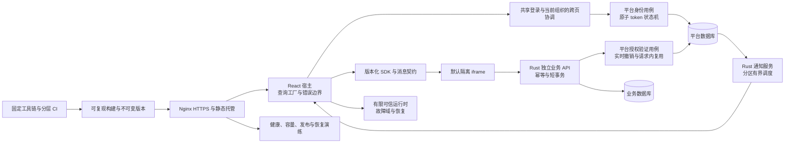
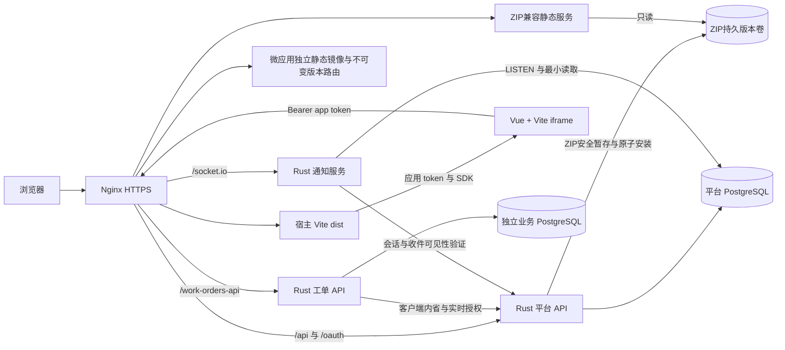
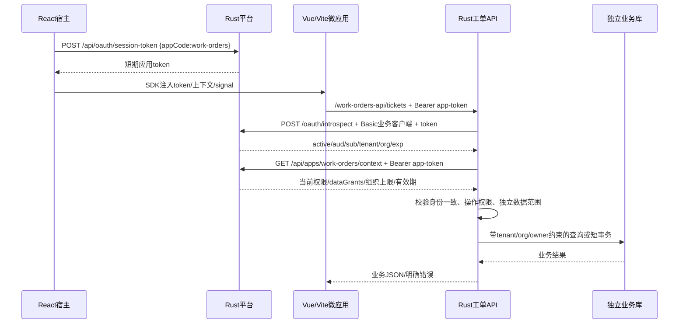
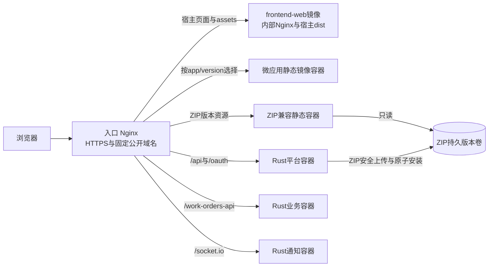
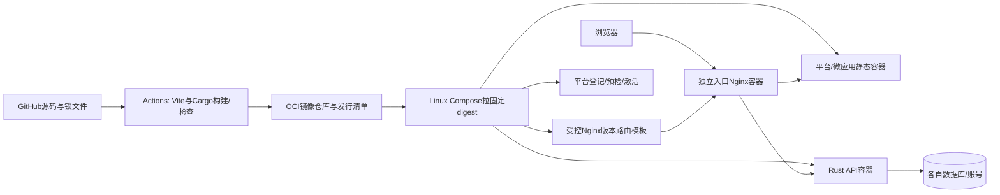

# 前端微应用与项目整体架构优化方案

审查日期：2026-10-14。源码基线：`32956c4`，以本次工作区实际文件为准。

本文是基于源码审查和有限本地验证的改进提案，不表示其中的改造已经实施。[系统架构与应用接入](architecture.md)继续作为当前实现的统一说明；每项改造完成后，应把实际行为、接口和运行要求同步回该文档，避免形成两套现状描述。

2026-10-15 已创建[架构优化任务台账](architecture-optimization-ledger.md)。后续实施状态、具体阶段边界、依赖、决策和当前指针统一维护在台账中；本方案保留分析及设计依据，第 9 节的大阶段仅作里程碑，不作为逐次执行边界。

2026-10-16 阶段编号同步：主线按执行顺序统一为 Phase 1–34，条件扩展为 Phase 35–37。本文台账阶段引用采用当前编号；历史验证记录和证据文件保留原编号，对照见[阶段编号映射](phase-numbering-map.md)。

2026-10-15 根据 Q01–Q13 讨论更新设计基线：**GitHub Actions 构建镜像，Linux Docker/Compose 部署，独立入口 Nginx 容器代理；宿主与微应用以前端静态镜像为推荐交付方式，保留 ZIP 兼容与外部 HTTPS URL 登记。** 平台首期不控制 Docker 生命周期。补充门店系统作为第二个真实业务消费者；浏览器、会话、授权、实时协议、保留、容量及恢复建议见[第 15 节](#deployment-runtime-decisions)。本次仅完善方案与台账，未执行实施；保留周期和 SLO/RPO/RTO 是待测量、待生产确认的候选值。

**2026-10-14 补充的强制约束：宿主前端独立部署到 Nginx；所有前端及示例前端统一 Vite；所有后端服务统一 Rust；禁止 Bun、Caddy、Node 后端和 Next.js。Node/npm 仅作为 Vite 的前端开发、构建及测试工具，不作为生产后台运行时。必须交付一个真实的 Vite 前端 + Rust API + 独立业务数据库的微应用示例。** 详细部署与接入设计见[第 12 节](#nginx-rust-vite)。为简化交付，推荐将前端封装为 Nginx 静态 Docker 镜像，再由入口 Nginx 反向代理，见[第 13 节](#docker-frontend-nginx)；每个微应用独立镜像的具体接入见[第 14 节](#per-microapp-image-integration)。

本次仍交付方案分析。当前源码中存在的 Bun、Caddy 和 Node 服务是必须迁移的遗留项，下文保留它们的代码证据，不表示允许继续采用。

## 1. 结论与范围

项目的总体方向合理：以 Rust 平台 API 承担身份与授权，以 React 宿主编排前端，默认通过 opaque iframe 隔离 HTML 微应用，让独立业务服务持有业务数据库。建议继续沿用这一架构，在现有边界内完善发布、身份状态机、生命周期和工程门禁。

部署目标明确为 **独立入口 Nginx 容器 + 宿主/微应用静态镜像 + Rust 平台 API + Rust 独立业务 API + Rust 通知服务**。推荐由 GitHub Actions 构建、镜像仓库分发、Linux Compose 部署成不可变版本 URL，平台统一登记、预检、激活和回滚。ZIP 兼容通道使用同机持久版本卷；确有跨机 ZIP 分发需求时才扩展受控发布组件。独立镜像不要求平台共享前端文件，也不依赖平台控制 Docker。

最先需要解决的实际问题是：仓库缺少多处配置直接依赖的 `deploy/` 文件；普通 OAuth 流程的凭据消费和状态撤销语义与平台会话、应用 token 不一致；可信微应用的永久挂起会阻塞后续挂载。其后优先处理多标签页刷新竞争、登录保护的内存与计算边界、工单写入结果不确定以及关键操作的审计一致性。

审查覆盖：

- `frontend/`：React 宿主、路由、Query 缓存、认证状态、微应用容器、iframe、可信运行时和内置 ESM。
- `backend/`：Axum 路由、平台会话、OAuth、授权上下文、数据库约束、发布、通知、审计和可观测性。
- `business-apps/work-orders/`：Vue 微应用、独立 Node API、业务数据库和授权接入。
- `mini-services/`、`examples/`：通知服务、开发示例、前后端接入辅助代码。
- 根目录、`scripts/`、`tests/`、`.github/`：依赖管理、开发命令、部署引用、CI 与测试入口。

结论证据分为三类：**已复现**指本次执行命令或最小实验确认；**代码确认**指源码中存在明确结构或逻辑缺口；**待测量**指优化方向有依据，但收益和规模阈值需要压测或浏览器测量。本文没有连接生产服务、修改数据库或执行发布，也没有运行完整 PostgreSQL、浏览器和 Docker 验收。

## 2. 已有能力与应保留的边界

| 方面 | 当前已有能力 | 优化时的约束 |
| --- | --- | --- |
| 微应用隔离 | HTML 默认 opaque iframe、MessageChannel、来源白名单、nonce、应用/epoch 校验；TRUSTED 为明确可信代码 | 保持默认 IFRAME；不可为下载、调试或性能开启 `allow-same-origin` |
| 上下文安全 | 短期应用 token、30 秒授权上下文、`contextEpoch`、`AbortSignal`、旧响应丢弃、过期停止执行 | 不把展示 props 当成业务授权，不取消服务端实时撤销校验 |
| 生命周期 | 串行 mount/update/unmount；异步 mount 完成后最终卸载；iframe 有协议 ACK/超时 | 补足可信执行的故障边界，保留串行和清理不变量 |
| 发布 | 不可变静态版本、上传安全检查、真实预检、激活前再检、部署指针、回滚 | 旧版本目录需保留；程序回滚与数据库回滚分别处理 |
| 宿主认证 | 单页面刷新单飞、轮换结果校验、上下文切换 cancel/clear、认证查询带 epoch | 本文的多标签页问题不等同于单页面刷新未做 |
| 多租户授权 | 用户角色与租户/组织授权交集，独立数据 grant，组织范围硬上限，关系外键和防环约束 | 任何缓存、接口合并、模块抽取都要通过原隔离测试 |
| 业务数据 | 工单独立数据库、真实租户/组织/所有者字段、乐观版本、软删除 | 不让平台模块直接拥有工单业务数据或绕过数据范围 |
| 通知 | 同事务持久化、发布幂等、逐投递复验、LISTEN 重连、宿主重连补拉 | 优化在线提示吞吐；保留数据库收件箱作为事实来源 |
| 运维基础 | 服务代码已有健康检查、结构化日志、请求编号、指标、优雅退出 | 实现存在与仓库部署工具可用须分别验证 |

这些能力不是本次重新设计的目标。没有证据表明目前需要全面迁移到其他微前端框架、把所有业务页面拆成远程应用，或立即引入 Kubernetes、Redis、消息队列及 Rust 多 crate workspace。

## 3. 优先级总表

P0：阻断构建/交付，先修复。P1：影响身份、数据一致性、故障恢复或关键门禁，应纳入近期迭代。P2：性能、维护和运维改进，按测量结果及业务需求实施。

| 编号 | 优化项 | 优先级 | 证据等级 | 主要收益 |
| --- | --- | --- | --- | --- |
| D01 | 恢复部署文件及校准文档引用 | P0 | 已复现 | 干净检出能够构建和交付 |
| D02 | Nginx 独立部署与微应用产物接入 | P1，强制 | 代码确认，跨机 ZIP 分发为条件能力 | 镜像入口与 ZIP 均真实可达、预检通过后才激活 |
| D03 | 前端静态 Docker 镜像与入口 Nginx | P1，推荐交付方式 | 部分构建基础已有，运行镜像需改造 | 镜像统一交付、升级与回退，保留微应用独立发布 |
| T01 | 统一 Vite 前端与 Rust 后端 | P1，强制 | 代码确认 | 移除被禁止的工具链和后台运行时 |
| X01 | 完整前后端分离工单示例 | P1，强制 | 有现有基础，需迁移/补交付 | 可独立构建、部署、授权和联调 |
| X02 | 简单门店系统与双业务消费者验证 | P1，新增交付 | 用户明确业务方向，尚未实现 | 独立 Vite/Rust/业务库，验证通用成员与授权契约 |
| S01 | 普通 OAuth 原子消费与实时撤销 | P1 | 代码确认 | 防止并发重复刷新、停用身份继续换发 |
| S02 | 有界登录保护与密码计算隔离 | P1 | 代码确认 | 限制内存增长及异步运行时阻塞 |
| S03 | 多标签页会话协调 | P1 | 代码确认，场景待浏览器回归 | 防止刷新竞争、旧标签页覆盖会话 |
| M01 | 可信生命周期故障隔离 | P1 | 已复现 | 单个可信应用挂起不拖住后续 iframe |
| M02 | 区分授权续期与展示更新 | P2 | 代码确认，收益待测量 | 减少无效清空、重取与界面抖动 |
| M03 | 工单创建幂等及未知结果处理 | P1 | 代码确认，场景待故障注入 | 防止提交成功后重试产生重复工单 |
| F01 | 统一菜单查询与路径判定 | P2 | 代码确认 | 共享缓存、减少请求、保持展示一致 |
| B01 | 优化授权调用链与事务持锁时间 | P1/P2 | 代码确认，容量待测量 | 缩短数据库锁及平台依赖链 |
| B02 | 关键管理操作与审计同事务 | P1 | 代码确认 | 保证成功变更存在可追踪记录 |
| N01 | 通知分区调度与有界并发 | P2 | 代码确认，容量待测量 | 减少慢收件人阻塞及平台复验洪峰 |
| E01 | 固定工具链、补齐分层 CI | P1 | 已复现/代码确认 | 让现有测试在普通开发机和 runner 可复现 |
| F02 | 宿主加载边界、错误边界与资源预算 | P2 | 构建已复现，体验待测量 | 降低入口开销和故障影响范围 |
| C01 | SDK 与跨语言契约版本化 | P2 | 代码确认 | 减少复制漂移，支持独立发布兼容 |
| B03 | 平台模块收敛与业务能力解耦 | P2 | 代码确认 | 降低 handler 耦合及工单专用逻辑泄漏 |
| O01 | 数据迁移、保留及授权运维闭环 | P2 | 代码确认，需求待确认 | 支持持续升级和常态管理 |
| O02 | 运行指标、容量基线与发布演练 | P2 | 待测量 | 用可比较证据决定后续扩容/拆分 |

## 4. 发布与工程保障

### D01. 恢复部署文件及校准文档引用

**现状与证据。** 当前工作树、Git 跟踪列表及 `HEAD` 树均没有根 `deploy/` 目录；`.gitignore` 仅忽略其下的微应用产物目录，不能解释所有部署源码缺失。[frontend/Dockerfile](../frontend/Dockerfile):12 直接复制 `deploy/Caddyfile.production`；[CI](../.github/workflows/production-build.yml):58、61 调用监控、恢复和原生构建脚本；README 与架构文档也链接这些文件。本次执行 `node --test tests/production-native-config.mjs` 立即因 `deploy/native/render.mjs` 不存在报 `ERR_MODULE_NOT_FOUND`。

**实施方案。** 先确定部署源码是否被遗漏、移出仓库或位于其他受控项目：恢复 Nginx、原生构建、监控和恢复的真实可维护文件，或把消费者切换至实际路径和明确版本的外部依赖。生产静态镜像改为 Nginx，Compose 删除旧网关及其专用卷；禁止恢复 Caddy 为部署选项。不要只补空文件使检查通过。统一 Dockerfile、Compose、原生构建和文档中的路径；区分受版本控制的配置模板与被忽略的私有配置、构建产物。给构建流程增加必需文件清单校验和 Markdown 本地链接检查。

**验收。** 从干净检出执行部署配置测试、原生构建和生产前端镜像构建；必需路径全部可解析。实际启动 Compose，核验 HTTPS、静态版本、API、WebSocket 和工单 profile。输出构建 manifest 与明确的失败诊断。文件恢复前，历史部署/恢复验收记录不能证明当前仓库可交付。

**遗留开发网关退出。** 根 [Caddyfile](../Caddyfile):1–7 监听 `:81`，允许通过 `XTransformPort` 查询参数选择本机上游端口，没有批准端口清单。它不是 Dockerfile 指定的生产配置，不能据此判定现网存在同样问题；按最新约束应删除此入口及其依赖，开发只保留 Vite 明确服务代理，生产只保留 Nginx。禁止恢复查询参数控制上游端口的通用代理。

### E01. 固定工具链并建立分层 CI

**现状与证据。** 根 [package.json](../package.json):8–12 使用 Bash/Bun，而多个组件 README 和 CI 使用 Node 24/npm；存在根 `bun.lock` 及各包 `package-lock.json`。[scripts/start-all.sh](../scripts/start-all.sh)还包含 `/home/z/my-project` 绝对路径。[frontend/package.json](../frontend/package.json):22 有 eslint 命令，但未声明 eslint、也没有对应配置，本次执行失败。本机 PATH 中 `node` 为 v16.13.1，使用内置 Node v24.19.0 才能执行当前测试。浏览器测试又默认引用 Codex 缓存中的 Playwright。唯一 CI 显式执行部分 Rust 测试和部署工具测试；完整微应用、通知、工单、浏览器与容器门禁没有独立明确的执行步骤，部署构建间接覆盖情况又受 D01 缺文件影响。

**实施方案。** 前端统一 Vite + Node 24/npm 构建工具链，声明工具版本和包管理器，保留独立前端工程各自的 npm 锁文件；禁止 Bun，删除其锁文件及命令。后端仅使用 Rust/Cargo，Node 仅供前端构建和测试，禁止 Node/Next.js 后台服务。先修复 eslint 的真实依赖、配置和现有问题。开发启动从脚本位置解析根目录，以环境配置数据库和端口，提供跨平台入口与 readiness 等待。浏览器依赖由项目 devDependencies 或固定的 CI 工具包提供，保留本地可覆盖路径但不依赖个人缓存。

CI 建议拆为以下可并行的层级，依赖安装均使用锁文件；后端业务/协议测试迁为 Rust 测试，JS 仅保留前端及浏览器测试驱动：

| 层级 | 主要检查 | 门禁要求 |
| --- | --- | --- |
| 静态与构建 | TypeScript/Vite、真实 lint、Rust fmt/check/clippy | 所有 PR 执行，使用固定工具链 |
| 无数据库契约 | 微应用 runtime/sandbox/iframe/packaging、会话、通知上下文、工单客户端、配置 | 明确列出入口；关键测试不能默默跳过 |
| 隔离数据库 | 租户约束、授权隔离、会话刷新、OAuth 并发、通知发布、工单 CRUD | 临时 PostgreSQL；显式执行相关 ignored 测试；设置资源与时间上限 |
| 浏览器 | 普通用户直达、组织切换、多标签页、续期/撤销、发布回滚、真实工单 | 项目提供 Playwright；断言测试实际执行 |
| 交付烟测 | 镜像构建、Compose/原生包、网关、旧版本 chunk、恢复工具 | 主分支或候选版本；保留日志和 manifest |

**验收。** Windows 开发机与干净 Linux runner 使用同一版本规则完成约定门禁；`npm run lint` 可运行；测试输出分别记录 pass/fail/skip。Rust 不必为了符合模板拆 workspace；检查命令按当前单 crate 形态执行。

## 5. 身份、授权与数据一致性

### S01. 统一普通 OAuth 的凭据消费和撤销语义

**现状与证据。** 平台 `psr_` refresh 已在 [session.rs](../backend/src/session.rs):115–189 中使用事务和行锁，应用 token 也有实时状态检查。问题限定在 [oauth2.rs](../backend/src/routes/oauth2.rs) 的普通 OAuth 分支：779–826 先读取 refresh 的 `revoked`，再无条件更新并独立签发；529–600 的 access/refresh 分别写入；745–754 的授权码条件消费和后续签发不在同事务。两个并发普通 refresh 请求存在同时通过前置读取的路径，签发失败还可能留下已消费凭据或半套 token。

此外，userinfo 的 972–986 与普通 introspect 的 1143–1165 没有统一检查用户、成员、租户、组织当前状态。[初始化迁移](../backend/migrations/0001_init.sql):573–662 的相关 token 撤销触发器限于 `token_use='app'`，665–731 的成员/实体状态处理主要撤销平台会话。因此不能把停用账号后的普通 OAuth token 行为视为与应用 token 相同。这是代码路径确认，尚未执行对应真实数据库并发回归；不等同于工单应用 API 已被绕过。

**实施方案。** 为授权码、设备码和 refresh 引入统一 token 签发用例，在同一事务内锁定/条件消费、检查身份和客户端、写入完整 token 对及审计。锁定次序与平台会话保持一致，条件更新必须检查受影响行数。为用户 OAuth token 定义一致的有效性规则：用户启用、相关租户/组织有效、所需成员仍存在；userinfo、introspect 和 refresh 复用该规则。`client_credentials` 没有用户，按客户端规则独立处理。新增迁移和存量失效处理，不修改已执行的初始化基线。

普通 access token 同时补随机 `jti`，停止保存 JWT 原文。[oauth2.rs](../backend/src/routes/oauth2.rs):554–574 当前利用相同声明产生相同 JWT 并 upsert，且把 access 原文写入 `oauth_tokens.jwt`；应用 token 已有随机 jti 且不存原文，可复用其最小存储原则。对旧列的弃用/清理用新增迁移和明确兼容窗口处理，避免把 token 字符串相同当作业务幂等。

**验收。** 同一个普通 refresh 并发提交至少 20 次，仅一次成功；重放返回 `invalid_grant`。故障注入验证消费与 token 对写入整体回滚。停用用户、删除成员、停用/到期组织租户、停用客户端后，相关用户 OAuth token 不能继续换发，内省/userinfo 按新契约失效。既有 `psr_` 轮换、应用 token 受众及隔离测试继续通过。

新 token 记录只保存摘要和必要元数据；同秒签发的不同 token 可分别撤销，错误、审计与诊断不出现 token 原文。

### S02. 限制登录状态规模并隔离密码计算

**现状与证据。** [auth.rs](../backend/src/routes/auth.rs):20–66 使用进程内 `LOGIN_ATTEMPTS` HashMap；失败记录按输入用户名/IP 增加键，缺少全表过期清理和容量上限。不存在账号的失败同样进入记录；不断变化的标识可能持续增长内存。其他 OAuth rate 状态已有容量控制，说明可以沿用现有思路。登录验密使用 `spawn_blocking`，但同文件 560–563 的改密、用户管理中的密码 hash，以及普通 OAuth password grant 的 verify 仍直接运行在 async handler 内。

**实施方案。** 先统一为有容量、TTL、清理策略和可注入时钟的限流存储，限制标识长度，在账号查询/密码计算前施加来源与总计算成本限制。把密码运算收敛到有限并发的 blocking helper，区分等待超时与认证失败。部署仅允许可信网关传入客户端 IP；不要让任意转发头决定限流身份。多实例前再确定共享计数实现，可先使用网关限流和既有 PostgreSQL，只有测量证明需要时再增加 Redis。

**验收。** 大量不同登录标识不能使状态容器超过配置上限，TTL 可重复测试；密码并发压力下普通 API 与健康检查不被同步计算拖住。两个平台实例的总登录预算符合声明策略，缺失/伪造转发头不会轻易绕过来源限制。

### S03. 解决多标签页的刷新与上下文竞争

**现状与证据。** [auth.ts](../frontend/src/stores/auth.ts):3–5、38–67 将 access/refresh 保存至共享 localStorage；[api.ts](../frontend/src/lib/api.ts):37–48 的刷新单飞只存在于一个页面模块实例。没有 storage/BroadcastChannel/Web Locks 会话协调。服务端平台 refresh 一次性消费，因此两个标签页同时刷新同一个值时，后者可失败并清除共享存储；另一标签页的内存凭据与共享存储、组织上下文也可能分离。现有单页面刷新测试不能覆盖这一情况。

**实施方案。** 首期采用共享登录、共享当前租户/组织。使用 Web Locks 串行刷新，并在锁内重新读取最新会话，通过 BroadcastChannel 通知会话版本、退出与组织变化；access/refresh 作为一个带版本记录保存，写入前核对会话身份。切组织时各页中止旧请求并替换上下文，草稿按原组织隔离。兼容环境提供可验证的协调方案，不能只用固定等待或未经证明的 localStorage 互斥锁。每页独立组织留待明确需求，再由服务端分别签发独立会话，不能只换 sessionStorage。后续是否引入 HttpOnly/BFF 属于单独认证设计。

**验收。** 使用两个真实浏览器页面覆盖同时刷新、一个页面退出、一个页面切组织、刷新中关闭页面、网络结果未知；不能发生误退出、凭据覆盖或旧组织数据展示。保持现有单页面刷新单飞与旧响应丢弃测试通过。

### B01. 减少授权重复工作及持锁网络等待

**现状与证据。** [工单 auth.mjs](../business-apps/work-orders/backend/auth.mjs):102–123 每次业务请求先调用 `/oauth/introspect`，再调用应用 context，并比对身份/到期信息；[app_context.rs](../backend/src/routes/app_context.rs):23–144 又完整检查应用 token，串行读取菜单、角色、grants、组织子树及运行元数据，并在返回前再次确认有效性。该设计安全但有重复网络/SQL 成本，实际容量需要测量。[server.mjs](../business-apps/work-orders/backend/server.mjs):263–277 在锁定工单行后调用平台成员查询，使行锁持有时间包含外部 HTTP 延迟。

**实施方案。** 先为平台调用数、SQL 数、连接池等待和锁时间建立基线。将处理人有效性查询移到业务事务前，事务内重新核对工单版本、组织、数据范围及授权剩余期限；预读记录、锁定记录或授权上下文的组织不一致时，拒绝或重新校验，不能复用原成员结果。当前工单不支持修改归属组织。保留乐观版本冲突和关键写入前的 freshness 检查。

工单现有 statement/idle-in-transaction timeout 应保留，同时补 Rust handler 的总 deadline、锁等待和连接获取预算；现有 Node `requestTimeout` 主要约束接收请求，迁移时不能把它当成完整处理期限。平台池当前固定 10，可按容量参数化。超时后的 SQL/密码后台任务要有资源回收和背压口径，不能仅让 HTTP 先返回。

随后设计仅供机密业务客户端使用的合并验证接口，一次返回经完整检查的 token 身份、受众、有效期和授权上下文；其客户端认证、scope、跨应用限制须与内省等价，注册的 application_id 必须与 token 的 application/audience 一致，服务端重新执行权限及数据 grant 校验。`contextVersion` 是内容哈希，不能单独作为可信授权凭据。不能简单删掉现有 introspect，或让浏览器 context 接口承担未经设计的服务凭证校验。平台内部先合并重复查询、引入请求内复用；如需要跨请求缓存，必须同时定义撤销版本与失效机制。按 20 秒轮询、N 个活跃页面粗算，仅微应用 context 就约 `N/20` 请求/秒，另加宿主 profile/菜单/permissions 和业务验证，不能把此公式当成压测结果。

上下文组装还应定义一致快照：当前菜单、角色和 grants 分别查询 pool，可能来自不同时间点；结束时的 token inspect 不等同于重新比较所有授权字段。可用聚合 SQL 或受控事务读取一致授权内容，返回前用当前撤销/授权版本复核；不能在同一个旧快照内复核后便声称已看到最新撤销。版本规则应覆盖角色菜单、两级授权、grants 和组织边界变更。

**验收。** 模拟平台成员接口延迟，数据库行锁不再随该网络耗时增长；并发更新仍只有一个版本成功。新旧验证接口对应用、用户、租户、组织、权限、失效及故障场景输出等价。以同一数据量比较 p95/p99、SQL 数和连接池等待，再决定是否需要缓存。

### B02. 关键管理操作与审计同事务

**现状与证据。** [audit.rs](../backend/src/util/audit.rs):57–96 为 best-effort 写入，失败仅记日志；部分管理路由在变更提交后调用该方法。审计不可用时业务已成功，但数据库可能缺少该变更记录。通知持久化已采用同事务原则，可借鉴其错误处理方式。

**实施方案。** 将审计分级：角色/授权变更、成员移除、账号停用、密码重置、OAuth 客户端及发布指针等关键变更，在主事务内写入必要审计；需要异步外发时，主事务记录 outbox，再独立投递。普通访问/诊断日志保留 best-effort。审计内容持有变更前后必要摘要、操作者和请求编号，避免依赖删除后的对象查询补名。

**验收。** 注入审计写失败，关键变更整体回滚或存在可恢复的事务内事件；成功操作均可由 requestId 追踪。重试不重复产生含义相同的审计，审计不包含凭据和敏感正文。

## 6. 微应用与宿主优化

### M01. 为可信运行时建立挂起和故障恢复边界

**现状与证据。** [runtime.ts](../frontend/src/components/micro/runtime.ts):121–127、144–150 的可信生命周期串行链没有截止时间；[MicroAppContainer.tsx](../frontend/src/components/micro/MicroAppContainer.tsx):166、219、372 使用全局 `disposalBarrier` 等待前实例清理。本次最小实验让 mount 返回永不结束的 Promise，stop 在观察窗口后仍 pending，cleanup 未执行。后续 iframe 也会等待该 barrier。iframe 自身的 ACK 超时已经实现，此问题不能泛称所有运行模式缺少超时。

**实施方案。** 为 load/mount/update/unmount 配置期限，记录失败阶段并清晰展示恢复操作；分开可信页面执行域与隔离 iframe 的调度边界。可信任务超时后，标记该执行域不可继续安全复用，停止后续 TRUSTED 执行并引导重载；让可独立隔离的新 iframe 不被全局可信 barrier 拖住。不能仅 `Promise.race` 后强行继续运行同页面可信代码，因为超时不会终止原异步任务，原任务仍可能修改宿主。无限同步循环同样需要隔离边界，前端计时器无法终止；降低 TRUSTED 使用范围是有效措施。

**验收。** 覆盖永不结束的 mount/update/unmount、迟到 resolve/reject、切应用和组织；失败必须进入明确状态，后续 iframe 可恢复使用。可信域不得在未清理情况下悄悄挂载另一个可信实例。正常串行卸载与防重复执行回归全部通过。

### M02. 区分授权续期、授权变化与路由/主题更新

**现状与证据。** [runtime.ts](../frontend/src/components/micro/runtime.ts):73–85 续期时中止旧 signal 并递增 epoch，这是有效的安全机制；[工单 app.mjs](../business-apps/work-orders/frontend/src/app.mjs):228–253 在收到 props 时清理服务器缓存、更新 client 并再次加载详情/列表。普通主题/路由变更与授权刷新进入相同更新入口，可能放大请求和界面抖动。项目已提供 `contextVersion`，可作为授权内容变化的依据之一，但不能代替 signal 与期限。

[iframe-bridge.js](../examples/micro-app-sdk/iframe-bridge.js):65–68 对每个 DTO 都重建授权 controller，即便是同 epoch 的主题更新；工单 client.update 也无条件停止旧请求。因此展示更新的优化需同时修改 bridge 与业务消费方，不能只让 Vue 少渲染一次。

**实施方案。** 在 SDK 内明确四种事件语义：身份/组织替换、授权内容变化、token/有效期续期、路由/主题变化。可以在现有协议内先推导变化类型，再通过后续兼容版本提供显式字段。身份变化清空业务状态；失权立即移除敏感状态；同身份同授权版本续期替换请求凭据和 signal，并按约定决定是否复验可见数据；纯展示更新不全量清空和重取。保留草稿的条件必须与身份、权限、记录版本绑定，不恢复旧上下文的服务器结果。

**验收。** 仅切换主题时列表无额外业务请求；续期保持合法草稿及当前路由；删除 grant 或移除成员后立即停止操作和移除失权内容。对比相同操作序列的请求数量和闪烁次数，测得收益后再扩大到其他应用。

**入口快照与恢复补充。** 容器目前主要核对实时 context 的 runtimeMode，加载入口和注入版本仍来自 profile，激活/回滚期间可能短暂不一致。挂载前比较完整的 `runtimeMode/entryType/entryUrl/deploymentVersion/entryVersionId` 元组，刷新 profile 或采用经验证的单一入口快照；部署元数据不在授权 `contextVersion` 哈希中，必须单独比较。入口变化走重挂，不能作为普通授权 update。对 context 网络/临时 5xx 失败，可以在已取消旧 signal、隐藏业务内容后以有界退避重新取得全新 token/context；401/403/404、契约错误与模式不一致分别进入拒绝或受控重新校验，不能用通用重试掩盖。安全恢复不允许继续使用旧上下文。

### M03. 工单创建幂等与“结果未确认”状态

**现状与证据。** [client.mjs](../business-apps/work-orders/frontend/src/client.mjs):89 的创建没有事件键；[app.mjs](../business-apps/work-orders/frontend/src/app.mjs):121–139 在提交被上下文取消时忽略 AbortError，草稿可能保留。[后端创建接口](../business-apps/work-orders/backend/server.mjs):229–247 每次生成新 UUID 并插入，没有创建幂等记录。相比之下，提醒已有独立幂等键。由此推导：服务端提交成功、响应遇到续期/切换或网络断开而被丢弃时，用户再次提交可能得到两张工单。取消请求不等于数据库事务必然未提交。

**实施方案。** 创建操作使用稳定 idempotencyKey，键与调用身份/租户/组织/动作绑定，规范化正文摘要与结果同事务保存。同键同正文返回已有结果，同键异正文返回冲突；结果查询和重试仍重新验证当前权限，不能向失权用户返回旧记录。前端增加“提交结果未确认”状态，保留原键并在恢复后查询或按同键重试；确实开始新业务事件才换键。不得自动用新键重试非幂等写操作。更新/删除保留现有乐观版本，并提供清楚的冲突恢复。

**验收。** 在 commit 后丢弃响应、超时、续期取消及并发相同提交的故障注入中，最多一张工单；同键异正文为 409。切换组织后不能沿用旧身份结果进入新页面。用户能够区分“未提交”与“结果待确认”。

### F01. 统一菜单查询与展示权限判定

**现状与证据。** [use-auth-data.ts](../frontend/src/hooks/use-auth-data.ts):22–34 使用 `["auth-menus", appId, epoch]`、signal、切换禁用和 20 秒刷新；[use-authorized-paths.ts](../frontend/src/hooks/use-authorized-paths.ts):35–44、[CommandPalette.tsx](../frontend/src/components/layout/CommandPalette.tsx):227–232 和 [DashboardPage.tsx](../frontend/src/pages/dashboard/DashboardPage.tsx):502 使用没有 epoch 的另一组 key，部分查询不传取消 signal且使用 60 秒新鲜度，因此没有真正共享侧栏/路由 guard 缓存。`useAuthorizedPaths` 的固定路径白名单与真实 route guard 也存在口径差异。全局 contextEpoch cancel/clear 已存在，不能据此声称当前已证实串租户越权。

**实施方案。** 引入 `authQueries.menus(appId, sessionScope)` options 工厂，统一 key、queryFn、signal、enabled、staleTime 和失效方式；逐步将管理数据 query key 也显式带 tenant/org/session epoch，不依赖全量 clear 作为唯一约束。侧栏、命令面板、最近访问、收藏及 route guard 复用同一权限谓词，少数免授权页面由一处声明。命令面板打开时再查全应用菜单，能够用已加载应用 context 菜单时优先复用，但先保持数据结构与撤销语义等价。

将路由 loader、标题、所属应用、操作权限、平台根限定及 public/personal 策略集中成类型化描述，避免新增页遗漏权限条目后因 undefined 被当成放行。当前路由 guard 还拉取全部应用菜单并等待全部成功，可先在统一缓存后使用当前上下文授权快照、按需加载应用菜单；无关应用菜单失败不应阻塞已有明确授权的页面，未知授权仍拒绝。工作台的 enterApp 与 AppLayout 的首菜单跳转复用同一带选择代次的导航用例，防止先选 A 后选 B 时 A 的晚返回把路由切回。

**验收。** 同一应用、同一会话只有一份菜单缓存；侧栏、命令面板和直达路由对同一路径判断一致。组织切换、授权撤销、迟到响应及 query 取消不重新展示失权入口。记录登录后的菜单请求数并比较改造收益。

### F02. 宿主加载边界、错误边界和资源预算

**现状与证据。** [App.tsx](../frontend/src/App.tsx):7–35 已使用页面 lazy；但 :4 静态导入 AppLayout，后者常驻导入命令面板、动效等宿主依赖。本次 Vite 构建的主入口 JS 为 **865.74 kB，gzip 268.57 kB**，图表共享 chunk 为 **384.76 kB，gzip 106.27 kB**，出现大 chunk 提示。仓库没有通用 React ErrorBoundary；网络 ErrorState 与 Suspense 不能捕获渲染异常或 lazy 导入失败。[vite.config.ts](../frontend/vite.config.ts)末尾明确记录过按包名拆 vendor 导致循环初始化的问题，应保留这一经验。

**实施方案。** 首先量测登录、首次后台页面与微应用加载的实际模块图，lazy 加载受保护的 AppLayout；命令面板按打开加载，重图表与地图只在对应页面加载。不要直接恢复按包名手工切 chunk。为应用顶层、受保护页面和可信微应用分别增加错误边界，提供重试、重新加载及请求编号，避免一个页面异常使整个宿主失去恢复入口。大管理页面按业务用例拆组件/hook/API 编排，避免以行数为唯一标准。

**验收。** 建立 gzip/Brotli、初始实际传输量、LCP/INP 与微应用 ready 时间基线；入口加载的宿主模块和 JS 体积有可测下降。注入页面 render 失败、lazy chunk 404、微应用异常，宿主导航和恢复入口仍可用。候选预算可先设“入口 gzip 较当前减少 20%，同等功能不回退”，最终阈值由真实设备测量决定，不能以调高 warningLimit 作为优化结果。

### C01. SDK 与跨语言契约版本化

**现状与证据。** [types.ts](../frontend/src/components/micro/types.ts) 手写宿主 TypeScript 契约，Rust context 用 `serde_json::Value` 组装，Node/Vue/iframe SDK 各自解析。已有 context 1.0、props/iframe 2.0 校验，缺口是统一版本来源和兼容验证，而不是完全没有协议版本。[工单 vendor/iframe-bridge.js](../business-apps/work-orders/frontend/vendor/iframe-bridge.js) 与示例 SDK 存在复制关系，宿主升级要求 SDK 同步的成本会随应用数量增长。

**实施方案。** 先把 iframe bridge、context client 和通知 publisher 收敛为有版本的接入包，静态应用构建时 vendoring 固定版本并校验来源摘要，保留离线部署能力。以 JSON Schema/OpenAPI 或明确的 Rust DTO 管理公共 HTTP/消息契约，生成 TypeScript 等消费类型，并对运行时边界进行校验。定义宿主支持的 SDK 版本区间、必需能力和不兼容错误；按真实需求加入能力协商，不能仅接受任意版本字符串。SDK 不共享数据库模型或业务实现。

目前示例与工单 vendored bridge 的内容一致，应描述为治理缺口而非已发生漂移。统一请求 helper 的 `credentials: omit`、结构化 status/code/requestId、受限响应读取、401/403/409 分类和错误脱敏；工单 client 已有可复用实现。宿主 API 也逐步补类型化响应与 signal 注入，契约不匹配给出明确错误，避免 `asPage/asArray` 把未知格式静默转成空列表。

**验收。** 多种框架应用使用同一个版本源；CI 检测复制文件漂移、生成产物漂移、缺字段和未知版本。兼容矩阵覆盖当前宿主与已声明支持的旧 SDK，旧静态版本激活/回滚仍可工作；不支持的版本给出明确错误。

## 7. 后端、通知与运维演进

### N01. 通知调度分区、有界并发与背压

**现状与证据。** [service.mjs](../mini-services/notification-ws/service.mjs):10、225–228 已有 1000 条 pending hint 上限和丢弃计数；但 :65 的单个 `hintChain` 串行处理所有收件人。一个投递的慢复验可让其他用户排队；:213 的单收件上下文全部 socket Promise.all、:244–249 的周期复验也缺少全服务并发预算，连接增长时可能形成平台请求洪峰。持久化、复验、LISTEN 退避和 HTTP 补拉已存在。

**实施方案。** 按收件人 user/tenant/org 分区保持必要顺序，在全服务有限并发池中调度；合并重复的通知提示，但保留逐投递授权验证和连接身份检查。周期复验增加抖动与并发预算，定义队列满、超时、依赖异常时的行为。实时提示丢弃必须可观测，客户端恢复时补拉；在证明需要实时离线重放或更大吞吐前，不引入消息队列。横向扩展前明确 Socket.IO polling 的负载均衡会话亲和以及各节点 LISTEN/收件处理模式，依据实际跨节点通信需求决定 adapter。

按最新约束，上述调度必须在 Rust 通知服务中实施，现有 Node 服务最终退出。优先验证 Rust 的 Socket.IO/Engine.IO 兼容实现，保留客户端和 `/socket.io/` 协议；Axum 原生 WebSocket 不能直接被视为 Socket.IO 替代。迁移方式见第 12.8 节。

**验收。** 一个用户复验超时不阻塞其他收件人；socket 验证并发和内存队列始终有界。高负载、LISTEN 重连、队列溢出后收件箱仍完整，失权消息不能发送；新增队列深度、等待时间、丢弃、复验并发与投递延迟指标。

### B03. 以业务能力收敛 Rust 模块和平台边界

**现状与证据。** 当前是单 Rust executable crate，业务已分模块，但没有 `lib.rs`；[routes/](../backend/src/routes) 中较长 handler 混合 HTTP、授权、SQL、事务与通知/审计编排。祖先工程规则要求薄入口、厚库及模块优先，适合渐进处理。[app_members.rs](../backend/src/routes/app_members.rs):35–38、86、98 的平台通用成员接口硬编码工单 `ticket:create/update` 及 ticket 数据 grant，使平台基础能力依赖一个应用资源名称。

**实施方案。** 保留单 crate，先提供窄 library 出口，将 OAuth 签发、授权上下文、版本激活和成员/角色替换等用例从 handler 抽到能力模块；HTTP 只解析/校验和映射错误，事务由用例统一控制，SQL 实现与稳定规则分开。已有基础函数先复用，不为每张表造 repository/trait，不创建无边界的 common。只有独立编译、复用或发布需求明确时再拆 crate。

平台成员查询改为受应用能力声明约束的窄接口：资源/动作参数必须在管理员登记的能力范围内，由平台重新校验操作和数据 grant，不接受浏览器自由声明。工单分配、状态转换及数据表仍归工单服务。第二消费者确定为第 15.9 节的简单门店系统；先记录两端的真实用例和契约，再验证共用接口，不能仅凭存在两个目录就抽公共 crate。

**验收。** 新增能力可通过 library 公共用例测试而不需要复制 HTTP；跨模块依赖可解释、公开 API 收敛。工单与第二个应用可使用同一成员查询协议，未登记 resource/action 或跨应用访问被拒绝，原租户关系与授权隔离回归通过。

### O01. 数据迁移、保留和授权运维闭环

**现状与证据。** 项目当前只有统一初始化基线；架构文档明确后续迁移应从 `0002` 新增，但从旧基线升级仍需要重建，长期生产迭代需形成可执行流程。audit、通知、OAuth 历史、一次性刷新记录与静态版本会持续积累；不应仅靠定期无条件删除。编制本方案时，独立数据 grants 依靠工单部署工具生成 SQL 草案，没有公共管理写 API；该历史入口已在 Phase 25 退役，当前使用[正式 grant API](data-grant-management.md)和[Rust 管理 CLI](../tools/platform-admin/README.md)。

**实施方案。** 采用 expand/contract 迁移和版本兼容窗口，CI 验证从受支持上一个版本升级，而不仅测试空库初始化。建立表级保留、清理批次、索引使用和容量观察，先以查询计划决定索引，不默认分区或物理按租户分库。静态版本保留须兼顾已挂载浏览器的旧 chunk、回滚窗口及备份 manifest。

增加数据 grant 的受控管理用例/API/UI：首版由平台根上下文中具有独立 grant 管理权限的操作者写入，其他上下文不因管理员角色自动获得写权。检查有效 direct membership、已登记资源/动作、组织硬上限、审计、差量变更与及时失效。后续委派使用单独的可授能力边界，不能照搬管理员自己的业务 grant 或按 scope 枚举排序。首版提供变更预览和审计，高风险扩权的审批/委派作为后续明确需求，不先建设通用审批引擎。备份恢复工具先按 D01 恢复到仓库，再建立隔离恢复演练，不能仅沿用文档里的历史记录。

先修复通用 [paging](../backend/src/routes/mod.rs):67–82 的极大 page 乘法边界，使用上限或 checked arithmetic 返回明确输入错误。工单 `%...%` ILIKE、精确 count 和深 OFFSET 的规模成本，用 EXPLAIN 与代表性多租户数据确认后再选择游标、按需计数或文本索引；当前已有租户/组织和归属人索引，不能泛称缺少索引。

**验收。** 升级不会修改既有迁移校验和，旧版本程序是否能运行有明确矩阵。清理不删除仍在使用的凭据、回滚版本或应保留审计；grants 管理不能跨租户/子树越界。隔离新库恢复包含实际重新登录、授权、工单与通知验证，RPO/RTO 以完整演练时间记录。

### O02. 用运行指标和演练决定后续架构调整

**现状与证据。** [observability.rs](../backend/src/observability.rs) 和两个 Node 服务已有请求编号、健康与指标；平台微应用运行事件仅包含失败计数，缺少从入口到 ready、加载资源、上下文取得和卸载的耗时分解。发布已有预检、不可变版本和回滚，尚无完整灰度/审批产品能力。历史本机验证不等于 Docker、现网或当前版本容量结论。

**实施方案。** 补充宿主与 SDK 的低基数耗时/失败原因，关联应用版本与 requestId；避免以用户/token/具体 URL 作指标标签。优先观测 context SQL/HTTP、密码工作池、数据库连接池、通知队列和持锁时间。发布流程先补审批记录、候选版本烟测和回滚演练；明确有多环境/多组织灰度需求后，再扩展部署指针和 profile 元数据，不把灰度入口当成权限变更。

以下是首轮候选观察目标，必须在目标机器与数据规模下确认后才可成为正式门禁：

| 维度 | 初轮观察/验收方式 |
| --- | --- |
| 宿主加载 | 登录及首次业务页的 LCP/INP、传输 JS、路由错误可恢复；与 F02 同配置对比 |
| 微应用 | entry → READY → mount 的 p50/p95，连续挂载卸载后的定时器/监听/内存趋势 |
| 授权 | 多租户多组织负载下 context 与工单请求 p95/p99、SQL 次数、撤销可见时间 |
| 通知 | committed 与 realtime delivered 分别统计；持续负载下队列、延迟与恢复完整性 |
| 发布 | 普通用户收到新版本、旧资源保留、模式降级与失败回滚场景 |
| 恢复 | 新库恢复、凭据轮换、依赖 ready、重新登录后的业务验证总耗时 |

**验收。** 同一负载脚本和数据集能够比较前后结果；无指标证明的缓存/分库/新中间件改造不作为默认优化。告警应有明确处理动作，探针 ready 与真实用户授权、消息收件分别验证。

## 8. 建议目标结构

下图表示边界和交互的演进方向；新增内容主要是受控协议、故障恢复、授权用例和工程门禁，不要求新增一批服务。



建议新增的代码组织只在边界确定后实施：宿主 `authQueries`/路由策略工厂、接入 SDK 包、Rust 能力模块与窄 `lib.rs`、业务创建幂等模块、通知调度器及受版本控制的部署目录。它们不是要求一次性搬迁全项目的目录模板。

## 9. 分阶段实施与验收顺序

| 阶段 | 工作范围 | 前置依赖 | 完成标准 |
| --- | --- | --- | --- |
| A：交付基线 | D01、D02 的 Nginx/版本 URL 与 ZIP 兼容卷基线、D03 镜像、T01 的前端 Vite/禁止项门禁；E01 | 无 | 独立入口 Nginx、Linux 镜像交付与隔离测试入口可验证；测试清单明确且 skip 可见 |
| B：Rust 示例与身份一致性 | T01 的后台迁移、X01；S01、S02、S03、M01、M03、B02；B01 的持锁 HTTP 改造 | A 的可重复测试；协议/DB基线接管 | Rust 工单/通知/演练服务替代旧后台；分离示例及关键回归通过 |
| C：性能与契约 | F01、M02、F02、C01、B01 的调用合并、N01 | B 的安全回归稳定；先有性能基线 | 请求数/传输量/延迟有对比收益，隔离和撤销语义保持 |
| D：持续运营 | X02 门店系统、B03、O01、O02，以及受控 grant 管理 | 迁移/兼容规范与稳定接入协议；门店契约先于公共能力抽取 | 工单与门店双消费者验收、受控升级、回滚与隔离恢复演练 |

每个改造提交应只承担一个可验证的行为变化，先补能复现问题的测试，再修改实现。风险最高的身份与授权优化不与大范围模块搬迁同时提交。当前估时不足以给出可信日历计划；阶段规模需结合部署文件恢复来源、支持的浏览器/SDK 和目标负载确定。

回退原则：Query 工厂、lazy 和调度改造可按应用或 feature 逐步启用；协议改造保留已声明旧版本兼容窗口；涉及 token 表、幂等表和审计的变化使用新增迁移，不能通过修改已执行 SQL 或删除数据库“回退”。授权链合并先双路径比较结果再切换，正式请求只采用明确的权威结果。可信生命周期超时后优先恢复宿主，不把未完成任务视为已终止。

## 10. 本次验证记录与限制

本次检查使用内置 Node **v24.19.0**；PATH 默认 Node **v16.13.1** 不符合当前测试要求。以下结果仅对应此次本地检查：

| 检查 | 结果 | 说明 |
| --- | --- | --- |
| Git 工作树与部署文件清单 | 审查前无修改；`deploy/` 未存在/未跟踪 | 使用单命令 safe.directory 覆盖，未修改 Git 全局配置 |
| 前端 `npm run build` | 通过 | TypeScript 与 Vite 构建成功；主入口 gzip 268.57 kB，存在大 chunk 提示 |
| `node --test` 六组微应用/会话/通知上下文测试 | 88 项，86 通过、0 失败、2 跳过 | 六组为 micro-context-runtime、micro-sandbox-lifecycle、micro-iframe-protocol、package-microapp、session-refresh、notification-context |
| 两项跳过 | 未执行 | 浏览器 iframe 用例未启用；Windows 文件 symlink 用例因 EPERM 跳过 |
| `node --test tests/production-native-config.mjs` | 失败 | 缺 `deploy/native/render.mjs`，`ERR_MODULE_NOT_FOUND`，不是业务断言失败 |
| `npm run lint` | 失败 | eslint 未安装/声明且无对应配置 |
| TRUSTED 永久 pending 最小实验 | 复现 | mount 永不完成时，stop 仍 pending，cleanup 未执行；需扩展正式回归测试 |
| Rust 全量、真实 PostgreSQL、完整浏览器、Docker/现网/恢复 | 本次未执行 | 未把历史记录或单元通过当作当前完整验收 |

本次只新增优化方案及入口链接；构建生成物不作为源码变更提交。OAuth 并发、多标签页、工单未知结果、容量提升等验收属于后续实施工作，不能在尚未执行的情况下写成通过。

补充约束后的本轮仅继续源码分析和方案修订，尚未实施 Vite/Rust 服务迁移，也未执行下述 Nginx 模板、Rust Socket.IO 兼容性或跨机发布验收；原先的测试通过不能证明迁移目标已完成。

## 11. 暂不优先实施的方向

- 全面更换微前端内核：现有 iframe 隔离与发布协议覆盖了主要接入目标，迁移成本需由实际缺陷证明。
- 将每个业务页面拆成微应用：只有独立团队、发布节奏和边界清楚的业务才值得拆分。
- 用长时间正向授权缓存降低延迟：先优化重复调用与 SQL；任何缓存必须有实时撤销或可接受且明确的失效窗口。
- 一开始拆大量 Rust crate、引入通用 repository 框架：先按现有真实用例收敛模块及 API。
- 未测量就引入 Redis/MQ/Kubernetes、表分区或每租户独立数据库：以容量、可靠性和运维需求作为引入条件。
- 直接扩大 iframe 权限或把第三方应用标记 TRUSTED：优先复用现有受控 broker 与默认隔离。

完成阶段 A 和 B 后，项目能先获得可交付、可复现、可恢复的一致性基础；阶段 C 和 D 再用测量结果推动性能及长期演进。

<a id="nginx-rust-vite"></a>
## 12. Nginx 独立部署、Rust 后台接入及 Vite 分离示例

本节落实补充需求，并覆盖前文中与旧工具链有关的可选建议。**D02、T01、X01 是必须完成的交付要求。** 当前已有代码只提供部分基础，以下新增目录、Rust 服务和发布任务均为待实施设计。

### 12.1 技术栈与部署边界

| 单元 | 目标技术 | 部署责任 |
| --- | --- | --- |
| 宿主前端 | React + TypeScript + Vite | 只产出静态 `dist/`，独立部署到 Nginx |
| 微应用前端 | Vue/React/jQuery 等 UI + Vite | 推荐独立静态镜像；HTML + IFRAME 接入；ZIP 兼容静态版本卷 |
| 平台后端 | Rust + Axum + SQLx + PostgreSQL | 用户、组织、权限、OAuth、通知持久化与版本控制 |
| 示例业务后端 | Rust + Axum + SQLx + reqwest | 独立 API、业务库和平台接入；不并入平台身份服务 |
| 通知后台 | Rust，优先兼容现有 Socket.IO/Engine.IO 协议 | 在线提示、会话/投递复验、PgListener、有界调度 |
| OAuth 演练后台 | Rust + Axum + reqwest | 密钥、token 交换、PKCE 流程状态及平台代理 |
| 跨机发布组件（条件） | Rust worker/agent | 仅在仍需平台 ZIP 跨机分发且无共享存储时增加 |
| 网关 | Nginx | HTTPS、静态文件、平台/业务 API 和实时通道反代 |
| 前端构建工具运行时 | Node 24 + npm + Vite | 仅开发、构建与前端测试，不提供生产后台 |

Bun、Caddy、Node 后台及 Next.js 不保留为备选。Vite 是前端工具，不能替代鉴权、数据库、Socket.IO 或 OAuth 的后台职责；Rust 二进制无需依赖 Node/npm 运行。

推荐使用一个公开 origin，例如 `https://platform.example.com`。入口 Nginx 在独立容器中；首期模板采用同一 Linux Docker 主机的私有网络，静态与 Rust 服务用 service DNS 通信，仅入口暴露公网 80/443。实际是否跨主机仍需按部署环境确定，Docker 网络本身不分发文件，也不天然跨主机。使用同一公开域名不代表 opaque iframe 的业务请求免除 CORS。



ZIP 兼容与原生部署建议路径如下；纯镜像链路的静态文件位于各自镜像内，不要求创建或共享下面的产物目录：

```text
/srv/platform/frontend/releases/<host-build-id>/  # 宿主构建，独立更新
/srv/platform/frontend/current/                   # 受控切换的宿主版本
/srv/platform/micro-apps/<app>/versions/<version>/ # Nginx只读的已安装微应用
/srv/platform/micro-app-staging/                  # 暂存，与版本目录同文件系统
/srv/platform/artifacts/                         # 上传原包/摘要，不公开服务
/etc/platform/                                  # 私有服务配置，不能在静态目录内
```

重建宿主、重启 Nginx 或重新部署 Rust API，均不能破坏已发布微应用入口。ZIP 目录必须持久化，镜像版本必须保留必要的旧容器/路由或等价资源。宿主发布与微应用发布分别记录版本、构建摘要和回退对象。

### 12.2 T01：必须改造的工程清单

| 现有位置/状态 | 必须改造的目标 | 验收重点 |
| --- | --- | --- |
| 根 `package.json`、`bun.lock`、`scripts/dev.sh`/`start-all.sh` | 前端命令改为 npm/Vite；删除 Bun 锁和运行调用；跨平台启动 Rust/Vite | 无 Bun API/命令依赖，无个人绝对目录 |
| `frontend/` 已为 Vite | 保留 Vite；Docker 运行阶段改 Nginx；静态构建与 Rust API 分离 | 前端线上不运行 dev/preview 服务 |
| `mini-services/micro-vue`、`micro-jquery` | 删除 Bun 静态服务器入口，提供标准 Vite `dev/build/preview` 和版本内相对资源 | 两个示例均可构建为可上传的 HTML 产物 |
| 工单前端的独立 esbuild 脚本 | 改 Vue + Vite 标准 module 入口，`base: './'`、公开配置与 SDK | 不以重命名命令假装已经迁移；模块在 opaque iframe 中可加载 |
| 工单 Node API | 独立 Rust crate、Rust 镜像、SQLx/reqwest 授权接入 | 原 API/数据/错误契约保持，最终停止 Node API |
| Node 通知服务 | Rust 通知服务并验证 Socket.IO 协议兼容 | 保留身份绑定、逐投递复验、重连补拉 |
| OAuth 演练 Node 服务与内嵌页面 | 拆 Vite 前端 + Rust 后端 | 密钥/交换/PKCE 状态在 Rust；清除硬编码演示 secret |
| Node 平台登记/授权管理 CLI | 平台 Rust 管理 API/UI 或独立 Rust CLI | 保留审阅、幂等、冲突拒绝和秘密保护；不新增 Node 后台工具服务 |
| `examples/websocket` 等独立后台示例 | Vite 前端 + Rust 实时后台，或收敛至 Rust 通知示例 | 不再展示 Node 后台启动方式 |
| 前端 Dockerfile、根 Compose、旧 Caddyfile、网关测试 | Nginx-only 配置、卷、镜像与测试 | 移除旧网关专用卷/工具/runner 检查，不将其恢复成兼容选项 |
| README、架构文档、各组件 README、CI | 全部使用目标栈；历史证据只保留为明确的迁移背景 | 文档命令、依赖、实际启动一致 |

Node 可以运行 Vite、npm、前端 lint、浏览器测试驱动；不能在 Compose/systemd/生产镜像中启动 `node index.*`、Node HTTP 服务或 Next.js server。前端 Vite 的内部打包依赖不属于 Node 后台；工单的自定义构建流程仍须切到 Vite。

建立禁止项门禁，检查受版本控制的 package scripts、依赖、Dockerfile、Compose、服务单元、脚本和后台源码；历史审查文字可保留，不允许活动入口依赖禁用技术。Rust 服务运行镜像使用 Rust 二进制及其必要系统资源，前端运行镜像使用 Nginx，不安装 Node/Bun 充当后台环境。每个前端工程有 `vite.config.*` 和可执行的 `dev/build/preview`，每个后台工程由 Cargo 独立构建测试。

### 12.3 D02：Nginx 下如何保留微应用部署功能

镜像推荐链路先由外部 CI/Compose 部署，平台 Rust API 统一做入口登记、预检、激活和回滚。下面描述保留的 ZIP 兼容通道：平台负责上传鉴权、安全解包与原子安装，静态 Nginx 只读文件。业务后端由独立 Rust 发布流程启动，不由微应用压缩包上传接口启动。

现有实现可以复用：

- [上传路由](../backend/src/routes/application_releases.rs):127–192 限定 `HTML + IFRAME`，生成 `/sub-apps/<code>/versions/<version>/index.html`，写到 `MICRO_APPS_DIR/<code>/versions/<version>/`，再登记并执行 HTTP 预检。
- 发布工具统一打包 `dist/` 内部内容，以 `index.html` 为包根入口；当前解析器也兼容所有文件共同位于一个外层目录的情况，会剥离该单一前缀，不应误写成完全拒绝 `dist/index.html`。
- 当前上限为压缩包 20 MiB、单文件 4 MiB、解压总量 16 MiB、49 个文件，见 [release_archives.rs](../backend/src/release_archives.rs):13–16。Vite 分包、字体及 sourcemap 可能触及限制，需以真实产物测量后同步调整上传/预检配额；不要只删除限制或默认发布源码映射。
- 激活和回滚都先执行真实 HTTP 预检，再在事务中切换部署指针；适用于 Nginx。管理端不能提交“已通过”的客户端声明代替检查。

**ZIP 方案 A：同机共享持久卷，兼容通道默认。** 平台 Rust 容器将 `/srv/platform/micro-apps` 映射为 `/micro-apps` 且可写，ZIP 静态 Nginx 将同一目录只读挂载；入口 Nginx 可只做代理。宿主 `dist` 单独发布，不需要与平台一起构建。流程为：

1. Vite 构建前端，压缩包上传到平台；检查管理员平台根上下文及 `system:application`。
2. Rust 在 Nginx 不可访问的同文件系统暂存目录完成安全解包、文件清单/摘要检查和必要持久化。
3. 将完整暂存产物原子安装到最终版本目录。并发同版本不可覆盖；同版本重试只接受相同摘要。
4. Rust 请求公开 Nginx URL，检查入口、资源、MIME、静态 CORS 和嵌入策略。
5. 预检通过后管理员激活；平台更新 `activeReleaseId`，宿主取得新版本快照并重挂。
6. 回滚重新预检旧版本目录，然后交换部署指针；旧文件仍保留。

**当前需要补的部分。** [release_archives.rs](../backend/src/release_archives.rs):179–210 是直接创建最终目录、逐文件写入，尚非原子发布。改为暂存完成再原子安装，并验证已有目录/并发任务不被覆盖；不要假设跨文件系统 rename 是原子的。暂存目录不在 Nginx root/alias 下。文件发布成功和 DB 登记是两个步骤，失败恢复按应用、版本、摘要对账，保留无法确认提交结果的产物，避免误删已登记版本。

**ZIP 方案 B：仍需平台 ZIP 跨机分发且没有共享存储，才增加条件功能。** 当前上传只写 API 主机，不会自动同步另一台静态 Nginx。可采用受控对象存储/静态托管；需要向固定文件节点分发时使用 Rust worker/agent，经受认证 HTTPS 协议收发不可变 artifact，不以浏览器传 SSH 命令或任意下载地址作为部署接口。以下是 agent 方向的设计；独立镜像不共享静态卷并不触发本扩展。

```text
上传完成 → 等待分发 → 正在分发 → 所有必需节点部署完成
                                     ↓
                              公共URL预检通过 → 可激活 → 当前版本

分发失败/预检失败 → 保留原当前版本 → 同artifact摘要重试
```

分发状态单独保存，不能把现有 `DRAFT/PASSED/FAILED` 预检字段兼作网络传输状态。建议新增 deployment target、artifact、deployment job 和 per-target receipt，至少记录应用、环境、版本、SHA-256、必需节点、尝试次数、结果和 requestId。上传返回 artifact/release/task 标识，管理端查询任务进度；跨机上传不再同步等待所有节点分发。

目标来自管理员维护的白名单。Agent 完成受限解包、摘要验证、暂存与原子安装后回执，回执必须绑定目标/应用/版本/摘要。所有提供流量的必需节点完成才能执行公共 URL 预检并允许激活；负载均衡下单次 HTTP 可能只命中一个节点，不能代替逐节点部署确认。任一必需节点失败时，active 指针保持旧版本。节点增减需与流量接入一致，未安装版本的节点不能承接新版本流量。

**版本和环境。** 现有存储/URL 不含 environment。同应用同版本跨环境应提升同一字节产物，不能重写 Vite 环境配置后覆盖。需要不同环境产物时使用不同版本，或新增环境命名空间并同步修改存储、URL、预检和分发契约。当前相对上传入口不支持独立静态域名：后续引入受控 target public base 才能支持该功能；不要只改 `MICRO_GATEWAY_ORIGIN` 冒充资源域名。

### 12.4 Nginx 路由、配置与缓存要求

| URL | 处理方式 | 必须保持的行为 |
| --- | --- | --- |
| 宿主 `/`、`/system/*`、`/micro/*` | 宿主静态目录与 HTML 导航 fallback | 只有宿主导航回退 `index.html` |
| `/assets/*` | 宿主真实文件 | 缺失 404，不能返回 HTML |
| `/sub-apps/<app>/versions/<version>/*` | 推荐按版本代理微应用静态容器；ZIP 由只读版本目录托管 | 缺失 404；HTML no-cache；资源 immutable；错误 no-store |
| `/api/*`、`/oauth/*` | Rust 平台 API | 保留完整路径、认证头、正文及状态码 |
| `/work-orders-api/*` | Rust 工单 API | 保留此前缀，未知 API 返回业务 404 |
| `/socket.io/*` | Rust 通知服务 | polling POST、WebSocket Upgrade、连接及重连语义 |
| `/api/internal/*` 和各私有 metrics | 公共 Nginx 拒绝 | 监控走独立私有网络/监听入口 |

以下为**ZIP 静态目录模式待落盘并验证的参考配置片段**，不代表已有可执行 `deploy/nginx.conf`；镜像版本转发见第 14.3 节。TLS 证书路径、真实上游、日志、资源限额和完整 CSP 要按目标环境展开；`mime.types` 中必须包含 `.mjs` 的 JavaScript 类型。

```nginx
# http {} 内：下面的缓存值在响应时按实际status求值。
map $uri $version_file_cache {
    default   "public, max-age=31536000, immutable";
    ~*\.html$ "no-cache";
}
map $status $version_response_cache {
    default "no-store";
    200     $version_file_cache;
    304     $version_file_cache;
}
map $http_upgrade $connection_upgrade {
    default upgrade;
    ''      close;
}

upstream platform_api    { server 10.20.0.10:3001; }
upstream work_orders_api { server 10.20.0.11:3004; }
upstream notification   { server 10.20.0.12:3003; }

server {
    listen 443 ssl;
    server_name platform.example.com;
    ssl_certificate     /etc/nginx/tls/fullchain.pem;
    ssl_certificate_key /etc/nginx/tls/privkey.pem;
    root /srv/platform/frontend/current;

    # 作为边缘网关覆盖来访者提供的转发头；前置LB另行配置可信real_ip。
    proxy_set_header Host              $host;
    proxy_set_header X-Real-IP         $remote_addr;
    proxy_set_header X-Forwarded-For   $remote_addr;
    proxy_set_header X-Forwarded-Proto $scheme;

    location = /api/internal { return 404; }
    location ^~ /api/internal/ { return 404; }
    location = /work-orders-api/metrics { return 404; }

    location ^~ /sub-apps/ {
        rewrite ^/sub-apps/(.*)$ /$1 break;
        root /srv/platform/micro-apps;
        try_files $uri =404;
        autoindex off;
        disable_symlinks on;
        add_header Access-Control-Allow-Origin "*" always;
        add_header Cache-Control $version_response_cache always;
        add_header X-Content-Type-Options nosniff always;
        add_header Content-Security-Policy
            "frame-ancestors https://platform.example.com" always;
        limit_except GET { deny all; }
    }

    # 在一般/api规则之前设置发布端点的独立限制。
    location ~ ^/api/applications/[0-9a-f-]+/releases(?:/upload|/[0-9a-f-]+/(?:preflight|activate))$ {
        client_max_body_size 20m;
        proxy_read_timeout 65s;
        proxy_send_timeout 65s;
        proxy_pass http://platform_api;
    }
    location /api/   { proxy_pass http://platform_api; }
    location /oauth/ { proxy_pass http://platform_api; }
    location /work-orders-api/ { proxy_pass http://work_orders_api; }

    location /socket.io/ {
        proxy_pass http://notification;
        proxy_http_version 1.1;
        # 本location声明proxy_set_header后须重复继承需要的头。
        proxy_set_header Host              $host;
        proxy_set_header X-Real-IP         $remote_addr;
        proxy_set_header X-Forwarded-For   $remote_addr;
        proxy_set_header X-Forwarded-Proto $scheme;
        proxy_set_header Upgrade           $http_upgrade;
        proxy_set_header Connection        $connection_upgrade;
        proxy_buffering off;
        proxy_read_timeout 75s;
    }

    # /assets及宿主HTML导航按上表补独立规则，禁止全局error_page回退SPA。
}
```

这个片段刻意展示发布/代理边界，不包含完整宿主 fallback 和所有禁止路径规则，不能直接当作完整生产配置交付。实施时必须补充 `/api`、`/oauth`、`/work-orders-api`、`/socket.io`、`/sub-apps` 的无尾斜杠处理及 metrics 相关路径拒绝，避免落到宿主。宿主 fallback 至少限定 GET/HEAD、有效 HTML Accept 和宿主导航路径，文件型路径、保留 API 前缀及 Vite dev 路径不能回退。

上例 HTTP 上游仅用于受控内网，跨不可信网络改 HTTPS 上游并显式开启 `proxy_ssl_verify on`，配置 CA、正确 SNI/Host；平台访问公开 Nginx 也保持正常 TLS 验证。上传/激活/预检 read timeout 覆盖当前 30 秒预检预算，rollback 应配置同等发布请求预算；普通 API 使用独立期限，跨机任务不靠不断加大 HTTP timeout 完成。

静态 CORS `*` 只用于公开匿名版本资源。业务 API 的 Origin/OPTIONS 由 Rust 服务统一生成并由 Nginx透传，避免双份 CORS 头；不能把静态规则复制到平台所有 API。微应用入口不能继承 `X-Frame-Options: DENY` 或 `frame-ancestors 'none'`；宿主自身可保持更严格的禁止嵌入策略，两类响应分别配置。Nginx `add_header` 的继承行为要通过实际响应检查，而不是只看配置文件。

现有网关测试预期特定 alias 模板，示例片段采用 root/rewrite；实施时统一实际模板与契约断言，测试应验证路径、MIME、缓存、隔离和真实 404，避免把一种语法写法当作架构要求。

### 12.5 平台与独立后台的配置分工

平台 Rust 生产参数示例（公开值，不含真实 secret）：

```dotenv
PUBLIC_APP_URL=https://platform.example.com
MICRO_GATEWAY_ORIGIN=https://platform.example.com
MICRO_ALLOWED_ORIGINS=https://platform.example.com
CORS_ALLOWED_ORIGINS=https://platform.example.com
# ZIP兼容服务启用时挂载真实持久目录；镜像URL登记不依赖此目录。
MICRO_APPS_DIR=/micro-apps
STATIC_DIR=
TRUSTED_PROXY_IPS=10.20.0.2
```

`MICRO_GATEWAY_ORIGIN` 是浏览器实际宿主 origin，现有 [FetchPolicy](../backend/src/releases.rs):146–159 用它推导宿主来源及相对入口。平台必须能够解析、访问该 HTTPS 地址；可用内部 DNS 把同一域名解析到 Nginx 内网 IP，保持证书与公开主机名一致。独立资源域名须在 allowlist 内、入口采用明确绝对 URL，并与上传目标设计同步。

Rust 工单 API 保持现有公开配置名称，降低迁移成本：

```dotenv
WORK_ORDERS_HOST=0.0.0.0
WORK_ORDERS_PORT=3004
PLATFORM_API_ORIGIN=https://platform.example.com
PLATFORM_CLIENT_ID=<实际创建并关联的客户端ID>
PLATFORM_CLIENT_SECRET=<仅Rust业务服务持有>
WORK_ORDERS_DATABASE_URL=<独立业务数据库连接>
WORK_ORDERS_ALLOWED_ORIGINS=null
PLATFORM_AUTH_TIMEOUT_MS=3000
```

微应用前端只能包含 appCode、版本、API base 和允许的宿主 origin 等公开配置。Vite 的 `VITE_*` 值都视为会进入公开 JS，禁止存入 client secret、数据库连接、平台 JWT secret 或管理员 session。

浏览器与 SDK 的两个来源规则不同：MessageChannel 初始宿主白名单为精确 `https://platform.example.com`；opaque iframe 发业务 fetch 的 `Origin` 为字面 `null`。业务 Rust CORS 按契约允许 `null`，允许 `Authorization`/`Content-Type` 及实际业务方法，禁 Cookie credentials，所有请求仍验证应用 token。`null` 不能区分所有沙箱来源，因此不能将它本身当作鉴权凭据，也不能全局允许它访问宿主管理 API。

### 12.6 微应用 Rust 后台如何与平台交互

微应用后端调用平台 HTTP 契约，不直连平台身份表，不持有平台签名密钥。当前 [工单 auth.mjs](../business-apps/work-orders/backend/auth.mjs):102–155 可作为迁移契约，不能继续作为目标后台实现。

| 凭据 | 持有位置 | 用途 |
| --- | --- | --- |
| 平台管理员 session | 管理端或受控发布工具 | 登记应用、关联客户端、发布和授权管理 |
| 宿主用户 session | 宿主 | 登录、切组织、向平台申请应用 token |
| `work-orders` 应用 token | iframe 内存、当前请求 | 该用户调用工单 API与最小应用平台能力 |
| 机密客户端 ID/secret | Rust 工单 API 私有配置 | 内省时认证业务服务，仅限关联应用 |
| 工单数据库连接 | Rust 工单 API 私有配置 | 访问独立业务库 |
| 平台 JWT 签名密钥 | Rust 平台 API | 业务服务无需持有 |

`clientName=work-orders-client` 不等于真实生成的 clientId；创建返回的一次性明文 secret 要进入业务服务 secret store。`client_credentials` 是服务身份流程，不能替代浏览器用户的应用 token，也不能默认授予工单数据访问。



Rust `platform_client` 建议复用 reqwest/rustls：固定平台 HTTPS origin，限制重定向、响应容量、连接/请求总 deadline，传播 requestId；日志与错误不回显 token/secret。每个受保护请求执行：

1. 读取 Bearer，拒绝缺失、无效或不符合业务应用的 token。
2. 用机密客户端 Basic 认证调用 `/oauth/introspect`，检查 `active=true`、`aud=work-orders`、`token_type=Bearer`、有效 exp/sub/tenant/org；HTTP 200 的 `active=false` 同样拒绝。
3. 用应用 Bearer 获取 `/api/apps/work-orders/context`，核对 contractVersion、appCode、身份与内省一致、有效期不超过 token、组织上限及上下文内容。
4. 分别检查 `ticket:<action>` 功能权限和 `ticket/<action>` 独立 data grant；缺任一项拒绝。
5. 在 SQL 中执行 tenant、organizationScopeIds、scope 对应组织集合/owner 条件。list、count、detail、write、export 使用同一边界，前端传来的 tenant/owner 不具权威性。
6. 关键写入前确认授权仍新鲜，事务内校验资源版本。平台不可达时返回 503，不使用旧 props 或仅本地解 JWT 放行。

处理人候选/有效性通过平台 `/api/apps/work-orders/members` 获取；目标组织必须在授权上限内。提醒通过 `/api/apps/work-orders/notifications` 使用用户应用 Bearer 发布，保留独立幂等键；收件可见性及通知持久化由平台验证。两条能力在现有工单中已有实现，迁移需保持功能及负向场景。

初版保留内省和 context 两次调用以保证与当前契约兼容；后续 B01 的合并接口必须同时验证机密客户端、应用绑定和完整授权，不是在迁 Rust 时直接删一条请求。

| 返回状态 | 业务含义与前端行为 |
| --- | --- |
| 400 | 输入/状态转换非法，保留草稿并提示 |
| 401 | 应用 token/身份失效，中止旧请求并隐藏旧服务器视图，等待宿主新上下文 |
| 403 | 缺操作或数据 grant，暂停该动作；不能通过显示按钮绕过 |
| 404 | 资源不存在或不可见；不泄漏其他租户记录是否存在 |
| 409 | 乐观版本或幂等冲突，保留草稿并明确恢复步骤 |
| 413 | 请求/导出超过容量限制 |
| 503 | 平台或业务依赖不可达，停止受保护操作 |

### 12.7 X01：必须交付的 Vite + Rust 前后端分离工单示例

以已有 `business-apps/work-orders` 为基础迁移，保留真实 CRUD/CSV/成员目录/通知/授权用例，不重新制造一个仅展示 token 或假数据的示例。Vue/jQuery 微应用演示目前只提供静态服务，不能替代这个完整业务工程。

建议交付结构：

```text
business-apps/work-orders/
  frontend/                         # Vue 3 + TypeScript + Vite
    package.json / package-lock.json
    vite.config.ts                  # base: './'
    index.html                      # 标准module入口
    src/                            # SDK、公开配置、业务client与UI
    tests/
    dist/                           # 构建产物，部署到Nginx，不入源码
  backend/                          # 独立Rust crate
    Cargo.toml / Cargo.lock
    src/
      main.rs / lib.rs              # 装配入口与窄公共出口
      config.rs / errors.rs
      platform_client.rs            # 内省、上下文、成员、通知
      authorization.rs              # 权限、grant和数据边界
      tickets/                      # 用例、SQL、DTO与routes
      observability.rs
    migrations/
    tests/
    Dockerfile                      # Rust构建，生产只运行二进制
    config.env.example
  deploy/
    nginx.work-orders.conf           # 真正可用的Nginx模板
    compose.example.yml             # RustAPI/独立DB/静态目录挂载
    bootstrap.manifest.json
    grants.manifest.example.json
    README.md                       # 独立部署+外部平台接入
  tests/
    platform-e2e.mjs                 # 浏览器/联调驱动，不是Node后台
  README.md
```

新增模板必须落盘并由 CI 验证，不能只有上面的目录说明。复制此工程到独立工作区后，应能分别 `npm ci && npm run build` 与 `cargo build --locked`，不依赖根 `frontend/node_modules`、Codex 个人缓存或平台源码内部实现；平台作为外部受信 HTTPS 服务配置。

**前端 Vite 改造。** 当前 [app.mjs](../business-apps/work-orders/frontend/src/app.mjs):4 依赖 `window.Vue`，构建脚本以 esbuild 输出 IIFE。目标使用 `import { createApp, h, reactive, nextTick } from 'vue'`、标准 module 入口和 Vite `base: './'`，SDK 使用受版本控制的模块或明确兼容的 classic bridge。公开 build/version/host/API 配置单独生成，不夹带后台秘密。

Vite 构建出的 `<script type="module">`、modulepreload 和相对 chunk，必须在实际 opaque iframe 中验证匿名静态 CORS与MIME/CSP；不能通过加 `allow-same-origin` 绕过。开发可使用 Vite HMR及明确 API代理，但 opaque iframe 中 HMR连接还需单独验收；生产 Nginx不运行 Vite dev/preview 或 HMR通道。

**Rust API 改造。** 使用 Axum、Tokio、SQLx PostgreSQL、serde、reqwest/rustls、tracing 和必要 tower-http，与平台复用已有技术经验。保持现有 `/work-orders-api/**` 路径、DTO、`{code,message}`、status、CORS、requestId、资源归属不可变、版本冲突、软删除、CSV和平台能力。工单数据仍在独立库，Rust服务不查询平台内部表；迁移期间先做新旧契约对照，正式运行最终切到 Rust并退役 Node API。

**现有数据库接管。** 当前 [db.mjs](../business-apps/work-orders/backend/db.mjs):12–31 使用 `work_order_migrations` 保存 SHA-256。迁到 SQLx时需要受控基线接管：验证已执行记录、实际表/约束/索引与预期结构，然后记录新迁移体系；禁止对已有库再次执行建表 `0001`、直接改校验和或删除旧业务库。`work_orders`、`work_order_counters` 和 [不可变身份触发器](../business-apps/work-orders/backend/migrations/0001_work_orders.sql)保持兼容。空库初始化与存量库接管是两条需分别验收的流程。

**完整业务要求。** 示例包含列表/筛选/分页、详情、创建、编辑、状态流转、删除、真实 CSV、有效处理人目录和平台通知。Rust版本同时补 M03 的创建幂等：唯一键绑定 tenant/org/user/action/key，规范化正文摘要、工单与结果同事务；同键同正文复用结果、异正文 409，未知响应沿用原键恢复。旧提醒幂等保留，不代替创建幂等。

**平台登记与授权步骤。** 用实际生成的客户端 ID登记 `work-orders`，设置 `HTML/IFRAME`、`basePath=/micro/work-orders`，关联机密客户端；分别建立租户/组织应用菜单上限、用户角色按钮权限、当前直接 membership 的资源/动作数据 grants。发布不会自动授予这三层权限。当前初始化 manifest只有根入口和按钮，详情与创建要补明确授权 MENU；不能依赖父路径隐式放行。默认 grant 配置保持为空，部署工具不得为所有人自动开 TENANT 范围。

详情模式 `/micro/work-orders/tickets/:id` 会匹配编制本方案时的创建路径 `/micro/work-orders/tickets/new`，当时 [microRouteAccess](../frontend/src/lib/micro-route-permissions.ts) 以任意授权模式命中即放行。因此建议将创建路由改为不重叠的 `/micro/work-orders/ticket-create`，同步Vite应用路由、宿主菜单与测试；或者设计完整路由表静态优先/参数约束并证明不能回退动态读授权。只追加两个MENU而不处理此重叠不满足验收。新增MENU还须同步manifest、bootstrap/grants校验器、授权计划和Rust管理工具。Phase 9 已采用独立创建路径；Phase 25 将原固定菜单数/key校验迁入[Rust CLI 与严格 schema](../tools/platform-admin/README.md)，固定七个节点和key集合，单改manifest仍会被拒绝。

数据 grants 不能长期靠业务团队直接改平台库：平台要交付受控管理 API/UI/审计，检查当前管理子树、direct membership、应用能力、资源/动作与范围上限，并及时使上下文失效。迁移过渡期可保留受审阅 SQL工具，但完整示例交付要提供正常受控的授权路径。统一工单 README中旧“保存 membership 必然重建 UUID”的说法，保留项差量维护已有实现；删除成员仍撤销会话和对应 grants。

**独立启动与发布顺序。** 平台先完成迁移/ready；独立入口 Nginx 先提供 HTTPS 监听和宿主；Rust 工单 API 连接业务库并迁移/ready；Rust 通知服务在平台 HTTPS 可达后收敛到 ready。GitHub Actions 构建前端镜像，Linux Compose 拉取并启动固定版本、配置公开路由，再登记/预检/激活；ZIP 兼容链使用上传/原子安装。应用/客户端与普通用户授权单独建立，最终用普通用户验证。Nginx 启动不得等待依赖自身公开 HTTPS 的通知 ready，避免启动循环。

前端激活只切静态版本。Rust业务API的镜像、配置和数据库升级独立发布，必须兼容仍保留的旧前端；新增字段采用兼容扩展后再收缩。v2前端回滚到v1不意味着业务库或Rust二进制自动回滚。

### 12.8 通知与 OAuth 示例统一迁 Rust

**通知。** 当前 [宿主 hook](../frontend/src/hooks/use-notification-socket.tsx):2、145–164 使用 socket.io-client，事件为 `authenticate/authenticated/unauthorized/notification`，服务是 Socket.IO而非裸WebSocket。推荐先评估并锁定 Rust Socket.IO/Engine.IO兼容库，例如 socketioxide/engineioxide；此处是选型候选，未验证即不能承诺兼容。

迁移保留 `/socket.io/`、polling/WebSocket、认证、room与重连语义；Rust用 SQLx PgListener接平台通知提示，用 reqwest复验会话及通知可见性，保持user/tenant/org绑定、到期断开、周期检查、限制数据库账号和N01有界队列。后端无平台签名密钥，收件箱依旧由平台数据库提供。测试使用现有真实 socket.io-client验证握手、认证、错误、重连、polling和Upgrade。

如果兼容库无法满足要求，必须另立前后端一起迁原生WS的协议变更：Rust Axum WS、客户端、路径、认证、心跳、Nginx和测试同时更新。禁止仅把服务端换成裸WS便声称兼容；最终生产仍全部是Rust。

**OAuth演练。** 当前 [index.ts](../mini-services/oauth-playground/index.ts):21–36、86–94 将Node HTTP后台、页面与硬编码客户端secret放在一处。改成独立 Vite页面前端和Rust Axum/reqwest后台，设备码发起、机密token交换、内省/revoke、受保护资源代理都留在Rust。PKCE state/verifier由服务端生成并按TTL/一次性/发起会话绑定处理，回调UI不含secret。

平台HTTPS origin、批准页面origin、callback URL和端口由明确配置提供，避免与工单3004冲突。OAuth演练不是生产服务凭据来源；密码grant如为历史兼容测试保留，应明确限定演练范围，不成为新业务推荐登录方式。Next.js、Node HTTP、Bun静态服务器和Caddy均不参与目标结构。

### 12.9 管理端微应用发布功能的产品要求

保留“应用→版本→部署”入口，明确区分外部已部署 URL 登记与 ZIP 上传。管理员权限仍要求平台根上下文及 `system:application`。首期不展示未实现的容器启停/节点分发状态；条件扩展启用后，操作者才可选择受控目标，不输入执行命令。

| 动作 | 可见状态/约束 |
| --- | --- |
| 登记外部版本 URL（推荐） | 镜像或其他静态服务由外部部署；平台接收入口、版本、资源清单并真实预检 |
| 上传Vite静态包 | 校验应用/版本/格式/容量，展示明确结果；同版本异摘要拒绝 |
| 查看发布进度 | 首期区分外部部署证据、上传和预检；条件分发启用后才显示节点任务，不把已登记当成已部署 |
| 重试 | 按原artifact摘要及目标重试，结果未知先查询；不创建另一份同名产物 |
| 预检 | 展示入口/资源/嵌入/CORS/MIME诊断，状态来自Rust平台 |
| 激活 | 真实预检通过才可用；条件分发启用时还须必需节点完成，失败保留旧指针 |
| 回滚 | 展示上一版本及兼容限制；旧文件不可达时失败，不伪称成功 |
| 清理 | 当前/上一/其他环境引用、在途任务和保留期内版本禁止删除 |

宿主读取profile/context的完整运行与版本元组，变化后按M02重挂；浏览器直接刷新 `/micro/work-orders/tickets/:id` 由Nginx给宿主HTML，再由宿主按权限选择微应用入口，不能把宿主路由直接rewrite到子应用的某个固定版本。

### 12.10 强制验收矩阵

| 场景 | 完成标准 |
| --- | --- |
| 技术栈 | 生产入口只有Nginx和Rust服务；无Bun/Caddy/Node后台/Next.js；所有前端示例有真实Vite构建 |
| 独立交付 | 工单工程可独立安装/构建；平台只作为外部HTTPS API；无根node_modules/个人缓存依赖 |
| Nginx | `nginx -t`与实际HTTPS测试通过；静态MIME/缓存正确；JS/API不存在均为真实404 |
| 推荐镜像发布 | GitHub Actions 构建/发行清单→Linux Compose 拉起→独立 Nginx 版本路由→登记/预检/激活；纯镜像不挂平台产物卷 |
| ZIP兼容发布 | 上传→安全暂存→原子安装→预检→激活，不重建宿主；同版本异摘要拒绝 |
| 跨机 ZIP 分发（条件） | 仅触发扩展后必测；任一必需节点缺文件/摘要不符禁止激活，重试幂等、部分失败保留旧版本 |
| 浏览器 | Vite module/chunk在opaque iframe实际加载；业务Origin:null/OPTIONS正确；无allow-same-origin |
| 凭据 | dist/ZIP/VITE配置/错误/日志不含client secret/DB URL/JWT key/宿主session |
| 平台联调 | 应用token/客户端关联正确；其他应用token、平台session、过期/撤销token均不能调用工单 |
| 路由授权 | 仅有read/detail、没有create MENU时，创建路由必须拒绝；动态:id不能扩大静态创建路径授权 |
| 数据范围 | SELF/ORG/ORG_SUBTREE/TENANT、组织硬上限、上级/平级/其他租户真实数据库负向测试 |
| 示例功能 | Rust真实CRUD/状态/删除/CSV/成员/通知；普通用户有正确功能及数据授权 |
| 不确定提交 | commit后丢响应及续期取消，再提交同键只产生一条工单；异正文409 |
| 数据迁移 | 空库与旧work_order_migrations库分别验收；不重建/丢失存量数据 |
| 实时协议 | Rust与socket.io-client真实互通，或完整WS联合迁移；失权停止投递，重连补拉收敛 |
| 回滚与升级 | v1→v2→v1保留宿主独立版本和业务数据；旧前端与当前RustAPI兼容 |
| 故障 | 平台/DB/分发故障不放行授权或激活，readiness与live分别反映实际依赖 |

只有上述部署材料和真实联合验收完成，才能将“前后端分离示例”标记为完成。当前已有工单功能、历史Nginx记录及JS单元通过，仅作为迁移基础；不证明Vite/Rust/Nginx目标交付已经实现。

<a id="docker-frontend-nginx"></a>
## 13. D03：前端 Docker 镜像 + 入口 Nginx，简化部署

**结论：可行，推荐作为宿主前端的交付方式。** 将 Vite 构建后的静态文件放入内置 Nginx 的前端镜像；部署服务器只拉取固定镜像、启动容器，再由入口 Nginx 统一提供公开 HTTPS 和服务路由。生产前端容器运行 Nginx，不运行 Node、Vite dev/preview、Bun、Caddy 或 Next.js。

这仍是前后端分离：前端镜像与 Rust 平台/业务/通知镜像独立构建、启动和升级。容器内部的 Nginx 负责静态文件，入口 Nginx 负责公网 TLS 与反代，两者职责清楚。宿主与推荐微应用各自携带静态文件，不共享产物目录；第 12 节的物理路径与持久卷只适用于原生静态托管及 ZIP 兼容分支。

### 13.1 推荐拓扑：API 直接转 Rust，静态请求转前端容器



入口路由建议如下：

| 入口路径 | 目标 | 职责 |
| --- | --- | --- |
| 宿主页面、`/assets/*` | `frontend-web:8080` | 镜像内宿主静态文件与受限 SPA fallback |
| 已登记镜像的 `/sub-apps/<app>/versions/<version>/*` | 对应微应用版本容器 | 静态文件来自该镜像；真实 404、CORS、缓存及可嵌入策略 |
| ZIP 来源的版本路径 | `micro-static:8080` 等兼容静态服务 | 只读持久卷；不得覆盖已绑定镜像的同一版本路径 |
| `/api/*`、`/oauth/*` | Rust 平台服务 | 平台业务、上传与发布管理；不经过静态容器 |
| `/work-orders-api/*` | Rust 工单服务 | 用户应用 token 与实时授权校验 |
| `/socket.io/*` | Rust 通知服务 | polling/WebSocket协议 |
| 私有 metrics/internal | 公共入口拒绝 | 私有监控入口访问 |

直接代理 Rust 避免 API再经过一层静态 Nginx，保留清晰的超时、认证和可信代理边界。内部静态 Nginx 也要对 `/api`、`/oauth`、业务 API、实时及其他保留前缀返回真实 404，以防入口规则遗漏后被 SPA吞掉。

本次基线明确入口 Nginx 在独立容器中，前端只加入同一私有 Docker 网络并用 service DNS，无需发布前端端口到宿主；只有入口 Nginx 暴露公网 80/443。若未来改为宿主机入口，再绑定 `127.0.0.1:8080:8080`；跨机用明确内网地址，跨不可信网络启用并校验上游 TLS。

宿主机上的 Nginx 不能直接使用 Compose 服务名；同 Docker 网络使用 DNS 时，容器重建后地址可能变化，需采用经验证的动态解析或部署时受控 reload，不能认为静态 upstream 会自动跟随。Compose 外部网络必须先受控创建，普通 bridge/service DNS 不代表跨主机网络。

### 13.2 前端镜像内容与构建规则

复用现有 [frontend/Dockerfile](../frontend/Dockerfile) 的多阶段构建思路，替换被禁止的运行阶段和缺失配置引用。建议交付 `frontend/nginx.static.conf` 及镜像构建/启动检查。下面是待实施模板，基础镜像正式版本与 digest 由发行流程锁定：

```dockerfile
# 仅构建阶段使用Node/npm/Vite。
FROM node:24-alpine AS build
WORKDIR /app
COPY frontend/package.json frontend/package-lock.json ./
RUN npm ci --no-audit --no-fund
COPY frontend/ ./
RUN npm run build

# 生产运行阶段：非root Nginx，监听8080，无Node后台。
FROM nginxinc/nginx-unprivileged:stable-alpine AS runtime
COPY --from=build /app/dist/ /usr/share/nginx/html/
COPY frontend/nginx.static.conf /etc/nginx/conf.d/default.conf
EXPOSE 8080
```

模板中的 `frontend/nginx.static.conf` 当前尚未创建，不能据此宣称镜像已构建成功。配置需实现第 12.4 节静态行为、明确8080监听、日志到stdout/stderr、PID/临时文件到可写tmpfs；实际只读启动与healthcheck必须验收。使用固定静态配置时，确保镜像入口脚本不再向只读`/etc/nginx/conf.d`执行envsubst等配置生成；需要生成时应设计专用可写配置路径。不同Nginx基础镜像的用户/目录约定要核对，不能直接搬旧网关的443能力、权限或缓存卷。

镜像仅包含宿主 `dist/`、静态Nginx配置和必要运行文件。CI使用锁定依赖构建，生成宿主buildId、源码SHA、资源清单和镜像digest；使用固定版本标签或digest发布，不把`latest`作为唯一回退依据。私有.env、平台密钥和数据库配置继续排除在构建上下文之外，前端运行镜像不安装构建工具。

Vite `VITE_*` 通常在构建时固化，容器`environment`不会自动重写JS。入口在同一公开域名时优先使用相对 `/api`、`/oauth`、`/work-orders-api`。外部静态域名直载时，根相对 API 会解析到该静态域名，须配置绝对业务 HTTPS API base 或在静态域名提供受控反代，同时验证 Origin:null、CORS 和 CSP connect-src；SDK 宿主白名单仍是平台 origin。公开配置跨环境变化须有明确运行时配置及校验，配置 no-store 且无秘密；不要用任意文本替换整个 bundle 注入变量。

### 13.3 Compose 最小前端启动片段

以下仅展示推荐链路中的宿主静态服务，Rust 服务、微应用版本服务、数据库、入口 Nginx 和私有参数按完整模板补齐。入口容器也须加入预先创建的 `platform-edge` 网络。通过镜像仓库拉取已验证产物，部署机不安装 Node、不现场构建：

```yaml
services:
  frontend-web:
    image: ${FRONTEND_IMAGE:?Set a fixed image version or digest}
    expose: ["8080"]
    networks: [edge]
    read_only: true
    tmpfs:
      - "/tmp:rw,noexec,nosuid,size=64m"
    cap_drop: [ALL]
    security_opt: ["no-new-privileges:true"]
    healthcheck:
      test: ["CMD", "wget", "-q", "--spider", "http://127.0.0.1:8080/index.html"]
      interval: 10s
      timeout: 3s
      retries: 5
    restart: unless-stopped
networks:
  edge:
    external: true
    name: platform-edge
```

微应用静态服务采用相同只读/非 root/私有网络约束，文件来自各自镜像；不挂平台产物卷。业务 API 与数据库只加入所需网络，数据库不因前端代理而暴露到入口网络。

ZIP 兼容 profile 另外增加 `micro-static` 服务：它将宿主 `MICRO_APPS_DIR` 只读挂载到 `/micro-apps`，平台 Rust 将同一目录可写挂载。静态配置把 ZIP 版本路径映射到该目录，暂存目录不公开。路径预先创建并配置最小 ACL，bind 使用 `create_host_path: false`，或使用明确管理权限/备份的持久卷。入口 Nginx 本身无需挂载 ZIP 卷；不把该 profile 的挂载要求施加于纯镜像服务。

静态容器health只说明入口与当前宿主文件可读，不能证明Rust API、应用授权、微应用文件或业务库正常；完整ready和端到端检查另外执行。容器启动不依赖Rust API ready，避免网关/通知依赖公开HTTPS时产生循环。

Docker healthcheck并不会使外部Nginx自动摘除节点，Compose也不会因health失败自动回滚镜像。发布步骤必须明确等待健康、检查公开URL、失败保留/切回旧版本，以及需要时的代理重载；缺少这些步骤不能宣称已有自动回滚。

### 13.4 入口 Nginx 示例与响应头归属

入口Nginx主要保留稳定的URL到服务映射。以下是配置片段，需与完整TLS/保留路径/发布超时/Socket.IO配置一起落盘：

```nginx
upstream frontend_static {
    server frontend-web:8080; # 本次基线：入口为同网络独立容器
}

server {
    # TLS、server_name及Rust API/通知规则按第12节配置。
    # 镜像版本须先展开第14.3节的更具体路径规则。
    # 以下通用分支仅在ZIP兼容服务启用时配置。
    location ^~ /sub-apps/ {
        proxy_pass http://micro-static:8080; # ZIP保留完整版本路径
        proxy_set_header Host $host;
    }
    location / {
        proxy_pass http://frontend_static;
        proxy_set_header Host $host;
    }
    # /api、/oauth、业务API、实时、private路径必须独立优先匹配。
}
```

内层Nginx负责静态响应的MIME、no-cache/immutable/no-store、匿名CORS和微应用frame-ancestors。入口透传这些响应，不能再全局追加`X-Frame-Options: DENY`或`frame-ancestors 'none'`使子应用失效，也不能重复添加CORS/Cache-Control。宿主页面的更严格CSP与可嵌入的微应用CSP分别处理；外层不要把上游404改成200/宿主HTML，不启用会缓存API/token结果的通用proxy cache。

ZIP profile 未启用时，通用分支应明确为 `location ^~ /sub-apps/ { return 404; }`；已登记镜像使用更长的版本前缀规则优先匹配。未知应用/版本不能落入宿主 SPA fallback。

Rust API由入口直接代理，入口覆盖X-Real-IP/X-Forwarded-For并传递正确公开Host、协议；平台 `TRUSTED_PROXY_IPS` 配实际连接Rust的入口代理地址，而非静态容器IP。`PUBLIC_APP_URL`与`MICRO_GATEWAY_ORIGIN`保持公开HTTPS origin，不能改成`http://frontend-web:8080`。平台预检通过公开入口读取资源，内部服务按正常TLS/域名规则互通。

### 13.5 宿主镜像与微应用版本分别发布

**推荐组合：宿主和微应用各自使用静态镜像，平台统一管理版本 URL；ZIP 作为兼容通道。** 外部部署和平台激活分别记录结果，各自可回退：

| 发布对象 | 更新方式 | 回退方式 |
| --- | --- | --- |
| 宿主前端 | CI构建镜像→拉取固定digest→启动/切流 | 切回上一宿主镜像及匹配配置 |
| 微应用前端（推荐） | GitHub Actions 构建→仓库固定 digest→Linux Compose 与版本路由→登记/预检/激活 | 保持旧入口可达，重新预检并切 active 指针 |
| 微应用前端（ZIP兼容） | 平台上传→同机卷暂存/原子安装→预检→激活；跨机分发为条件能力 | 重新预检旧目录并切 active 指针 |
| Rust业务后端 | 独立Rust镜像/二进制发布 | 按数据库与旧前端兼容矩阵回退 |

微应用更新不触发宿主镜像重建。镜像来源的文件随不可变镜像交付；ZIP 文件不能写在容器可写层，替换 ZIP 静态容器时须重新挂载同一持久目录。仅 ZIP 跨机文件发布需要额外共享/分发；镜像由仓库分发，不要求与平台共享文件系统。Docker 网络提供通信，不自动同步文件。

宿主镜像的独立回退还有旧 chunk 问题：新容器只含新 dist 时，已打开的旧页面可能继续请求旧 hash 文件。建议由构建/发行流程保留约定兼容窗口内的旧宿主 assets（镜像受控合并或独立持久静态资源存储），或按 host-build-id 保留并路由旧版本资源；不把 404 兜底成 HTML 掩盖问题。页面 reload 恢复是补充措施，不能代替关键资源保留。微应用不可变版本路径继续按 active/previous/其他环境引用及保留期保护；保留旧镜像不能代替旧入口在线可访问。

### 13.6 是否每个微应用也单独做前端镜像

可以，但其成本与平台ZIP发布不同，应明确区分：

| 模式 | 适用情形 | 发布能力要求 |
| --- | --- | --- |
| 宿主和微应用独立静态镜像（推荐） | GitHub 构建、Linux Docker 部署，独立版本与交付周期 | 外部 Compose/CI 管理 digest、容器健康和版本路由；平台统一 URL 登记，不要求平台部署任务 |
| 宿主镜像 + ZIP 微应用持久版本卷（兼容） | 需要继续从平台上传静态包 | 复用上传契约，补原子安装；只有明确跨机需求才增加分发 |

两种模式保留同一运行、SDK 和授权契约。ZIP、镜像是产物形式，外部托管是部署责任，两者不是三个互斥开关；一个 release 只能绑定一个确定来源和一份不可变字节产物。保留双通道增加存储/容器、路由和失败恢复验收成本，不要求业务请求经过两套发布链。首期采用外部 CI/Compose 部署镜像，平台标记为已部署 URL 登记；若以后平台管理容器，再新增受控 Rust 发布任务和 agent，限制仓库/目标，主平台 API 不挂 Docker socket。

无论采用哪种模式，公开入口都要包含不可变版本路径。只把`/sub-apps/work-orders/`指向一台“最新版”容器，替换后旧chunk将不存在，无法满足既有版本一致性和回滚。可以按版本保留容器/路径映射或把旧静态产物放入版本存储；前端激活、旧资源保留、业务后端兼容三者一并验收。

### 13.7 部署步骤和新增验收

部署链路为 GitHub Actions 构建/推送及保存清单→Linux 按 digest 拉取→启动候选容器→就绪检查→验证并更新 Nginx 版本路由→公开 URL 预检→平台激活；ZIP profile 另配置持久目录。运维不必在目标机器安装前端依赖或手工复制 dist。可将下面的参考命令写入最终可执行部署 README：

```sh
# 私有部署配置已准备好，服务名与完整Compose模板一致后使用。
docker compose --env-file /secure/platform.env pull frontend-web
docker compose --env-file /secure/platform.env up -d frontend-web
docker compose --env-file /secure/platform.env exec -T edge-nginx nginx -t
```

替换绑定同端口的单个容器可能出现短暂中断，这种最小Compose方式不承诺零停机。需要连续可用时再采用候选容器独立端口、health检查、Nginx切流并优雅下线旧容器；不要在无需求时引入复杂编排。

新增验收包括：最终镜像不含 Node/Bun/Caddy/Next.js 后台；只读非 root 启动和 Nginx 配置验证通过；外部 API/实时请求不被静态容器吞路径；公开 HTTPS 下 opaque iframe 加载 Vite 模块并请求 Rust API。镜像模式重建后固定版本 URL/digest/旧 chunk 与平台指针仍正确，回退兼容当前 Rust API/业务库；ZIP profile 验证上传不重建宿主、重建静态容器后持久目录不丢失。宿主旧 hash 资源策略两种模式均需有效。

本节是部署方案补充，尚未修改Dockerfile、Compose或创建Nginx配置，也未执行实际镜像构建/容器启动。当前仓库运行阶段仍需按D01/D03迁移后，才能使用上述简化部署方式。

<a id="per-microapp-image-integration"></a>
## 14. 每个微应用独立前端镜像如何接入平台

**接入协议仍为 HTML + IFRAME + MicroIframe SDK。** 镜像负责运行静态前端服务，Nginx把它映射成公开的不可变版本入口，平台登记并选择该入口，宿主以iframe加载它。镜像地址属于部署信息，浏览器使用的是HTTPS HTML入口。

这里的“每个微应用一个镜像”指独立的**前端静态镜像仓库/构建产物**；同一应用不同发布版本有不同tag/digest，必要时多个版本容器同时提供资源。配套Rust业务API使用独立后台镜像和独立数据库，保持前后端分离；用户登录、授权和应用身份不会随前端镜像版本变化而重建。

### 14.1 工单示例的完整接入链路

```text
work-orders 前端源码（Vue + Vite + SDK）
  → GitHub Actions构建并推送 registry.example.com/work-orders/web:1.2.0，记录digest
  → Linux Compose拉取固定digest，启动 work-orders-web-120（内部Nginx静态服务）
  → 入口Nginx暴露 /sub-apps/work-orders/versions/1.2.0/index.html
  → 平台登记HTML版本 → 真实预检 → 激活
  → 用户进入 /micro/work-orders
  → 宿主取得当前版本URL、应用token与授权上下文
  → iframe加载1.2.0，SDK握手/挂载
  → 前端Bearer调用 /work-orders-api
  → Rust工单API内省、读实时上下文、执行权限与SQL数据范围
```

分成两类工作：基础设施先让固定版本 URL 可用；平台再决定哪些用户可访问、当前激活哪个版本。登记链接不会自动创建 Nginx 配置，路由由受控部署模板/CI 维护；如果已是批准的外部 HTTPS 入口，宿主可直接按该 URL 加载，不要求 Rust 代理所有静态流量。仅启动容器、只创建应用记录或只赋予菜单，均不能代替完整链路。

### 14.2 应用与SDK的一次性登记

平台创建一个稳定应用，示例约定为：

| 配置 | 值/要求 |
| --- | --- |
| 应用编码 | `work-orders`，与SDK、Rust API受众一致 |
| 宿主路由 | `/micro/work-orders`；详情/创建按第12.7节独立授权 |
| 入口类型 | `HTML` |
| 运行模式 | `IFRAME` |
| 发布入口 | `/sub-apps/work-orders/versions/1.2.0/index.html`等固定版本URL |
| SDK允许的宿主来源 | `https://platform.example.com`，不填容器名或内部端口 |
| 前端业务API地址 | 同origin推荐 `/work-orders-api`；外部静态域名须用明确业务HTTPS API base或自有受控反代 |

每个Vite应用需要接SDK并提供mount/update/unmount。宿主下发MicroProps 2.0，包括应用token、用户/租户/组织、permissions、dataGrants、组织上限、routePath、主题、epoch、有效期和取消信号。应用接收更新、停止旧请求并清理实例；不能依赖读取宿主localStorage或把token放进iframe URL。

现有 [工单生命周期](../business-apps/work-orders/frontend/src/app.mjs):407–416 已通过 `MicroIframe.connect` 连接SDK，迁Vite时应保留此语义。接入声明的形状如下，`lifecycle`由具体框架适配器实现：

```js
window.MicroIframe.connect({
  appCode: 'work-orders',
  allowedHostOrigins: ['https://platform.example.com'],
  container: document.querySelector('#app'),
  lifecycle: {
    mount(container, props) { /* 创建Vue/React实例，接入当前授权 */ },
    update(props) { /* 更新路由/主题/凭据，处理失权与取消 */ },
    unmount() { /* 中止请求、销毁实例和监听 */ },
  },
})
```

上述为接口形状示意，不是可替代业务实现的完整示例。SDK可以作为受版本控制的模块引入，或由镜像HTML明确加载兼容classic bridge；Vite模块及相对资源遵守匿名静态CORS，iframe保持opaque隔离。

### 14.3 镜像发布与Nginx版本路由

前端镜像可以只包含`dist/index.html`和相对`assets`，内部Nginx以`/`托管。入口Nginx按应用和版本选择容器，例如：

```nginx
# 入口同Docker网络时使用服务DNS；宿主机入口改实际环回映射端口。
upstream work_orders_web_120 { server work-orders-web-120:8080; }
upstream work_orders_web_110 { server work-orders-web-110:8080; }

location ^~ /sub-apps/work-orders/versions/1.2.0/ {
    proxy_pass http://work_orders_web_120/;
    proxy_set_header Host $host;
}
location ^~ /sub-apps/work-orders/versions/1.1.0/ {
    proxy_pass http://work_orders_web_110/;
    proxy_set_header Host $host;
}
```

这里`proxy_pass`末尾的`/`**有意剥离静态版本前缀**，使公开`/.../1.2.0/index.html`在容器内读取`/index.html`；浏览器地址仍包含1.2.0。Vite `base: './'`和相对模块/资源URL确保后续请求仍命中公开版本路径。与此前共享卷方案的“保留完整路径”是两个明确模式，不可混用；Rust业务API仍使用不剥离`/work-orders-api`的代理。

也可以把完整版本路径烘焙进静态镜像，此时使用无URI的proxy_pass保持全路径，但构建/配置/清单必须一致。以上选择应写入应用镜像模板，避免每个团队各自调整。

先部署1.2.0容器与入口路由、验证Nginx配置并受控reload，再登记/预检/激活。1.1.0的容器或等价静态文件及入口路由仍保留，不能激活1.2.0便删掉；旧iframe后续chunk和平台回滚仍可能请求1.1.0。相同应用版本URL绑定固定digest，禁止镜像标签被改写后原位换内容。

Nginx静态响应必须具备正确MIME、HTML no-cache、资源immutable、错误404/no-store和匿名CORS；外层透传，不能增加拒绝微应用嵌入的全局头。每个版本容器的健康与公开URL预检分别验证，平台只访问用户实际使用的公开HTTPS入口。

### 14.4 复用现有Rust版本登记API

第一阶段不必新增容器控制服务：CI或运维先部署镜像，受控发布工具调用已有 [版本登记接口](../backend/src/routes/application_releases.rs)。例如使用平台根上下文管理员session及`system:application`：

```http
POST /api/applications/{applicationId}/releases
Authorization: Bearer <平台管理员session>
Content-Type: application/json
```

```json
{
  "environment": "production",
  "version": "1.2.0",
  "entryType": "HTML",
  "entryUrl": "/sub-apps/work-orders/versions/1.2.0/index.html",
  "healthUrl": null,
  "resources": []
}
```

相对入口在公开宿主origin下解析；独立静态域名使用绝对HTTPS入口并加入受控allowlist。入口的真实目录段必须与version完全一致，不能用`index.html?v=1.2.0`代表不可变版本。

`resources: []`是合法的最小登记，预检可发现HTML直接引用的script/link；真实Vite发布应从构建清单生成所有需检查的SCRIPT/STYLE/ASSET，包括动态chunk，并补浏览器运行验收。资源数、容量与48项显式清单限制须同步核对；预检不执行JS，不能只检查index便声称所有懒加载成功。

登记返回DRAFT，不会自动激活。后续顺序为：

1. `POST /api/applications/{applicationId}/releases/{releaseId}/preflight`，读取响应`validationStatus`；HTTP200而状态FAILED仍不可激活。
2. 状态PASSED后，调用对应`/activate`；服务端会再次真实预检，再事务切active/previous指针。
3. 查询deployments，核对版本；使用普通用户打开应用并验证SDK、Rust API与授权。
4. 回滚调用既有`/deployments/{environment}/rollback`，旧版本必须依然可达。

当前RegisterBody拒绝未知字段，只接受现有登记契约；**不能把image/digest/targetId直接加进此JSON**。镜像digest与部署证据初期由CI发布清单绑定app/environment/version/entryUrl，平台需要保存时另建metadata/部署记录并扩展协议。业务客户端client_credentials不具备平台发布管理员权限，不能拿它代替上述session。

### 14.5 Rust业务后台接入与授权不变

为应用创建并关联启用的CONFIDENTIAL客户端，使用实际生成clientId；clientSecret只给Rust业务API。客户端的`applicationId`绑定稳定应用UUID，不随1.1.0/1.2.0版本分别创建。Rust后台按第12.6节逐请求Basic内省+用户应用Bearer context，校验应用受众、用户、租户、组织、permissions、dataGrants及SQL边界。

前端镜像与Rust API各自发布：

```text
work-orders-web:1.2.0 → Nginx静态前端
work-orders-api:<兼容版本> → Rust业务后台
work-orders数据库 → 独立持久业务数据
```

平台分别配置租户/组织应用菜单授权上限、角色按钮权限、当前membership数据grants。镜像部署、登记、预检、激活均不自动授权。只拥有入口菜单但没有ticket/read数据授权的用户，Rust业务读取仍应拒绝。

### 14.6 管理页面需要补什么

当前 [applicationsApi](../frontend/src/api/applications.ts) 没有JSON register方法，[ApplicationReleasesPanel](../frontend/src/pages/system/applications/ApplicationReleasesPanel.tsx):118–120 的“登记”实际调用ZIP上传，不能按现有界面直接录入镜像入口。

建议先增加两种明确发布来源：

| 来源 | 管理端字段/行为 | 执行者 |
| --- | --- | --- |
| 平台静态包发布 | 文件、环境、版本；上传/分发/预检/激活 | 平台Rust与共享卷/发布agent |
| 已部署镜像入口登记 | 环境、版本、入口URL、可选health及构建资源清单；登记/预检/激活 | 镜像由外部CI部署，平台管理入口选择 |

后者复用已有后端register API，只补前端API封装、表单、校验和状态提示；不把“登记入口”标成“平台已启动镜像”。镜像发布清单可导入经过校验的metadata，但在服务端正式提供存储之前，不应显示虚假的镜像部署状态。

第二阶段如需管理员直接选择镜像“一键部署”，再新增受控Rust发布任务API及agent：imageRef固定可信registry+digest、targetId为白名单、公开版本路由、部署job及节点readiness回执。网络/端口/volume/启动命令由服务端模板控制，secrets引用服务端secretRef，不暴露给前端、不接受任意Docker参数或shell。平台API本身不挂Docker socket。

该模式的顺序为“登记发布意图→agent部署版本容器与路由→健康/摘要回执→公共预检→允许激活”，失败保留旧指针。自动移除旧容器还要检查active/previous、其他环境引用、在途任务及旧资源保留策略。

### 14.7 首个镜像微应用的验收

首个工单镜像示例必须覆盖：SDK握手与主题/路由/组织切换、Rust API真实CRUD和数据权限、Origin:null预检、Vite动态chunk、1.1.0/1.2.0共存、激活/回滚不丢旧资源、同版本异digest在CLI/CI真实拒绝、只有读权限不能进入创建路径，以及前端回退后仍能调用兼容Rust API。容器健康由CI/Compose控制推进；平台拒绝入口/资源及已配置healthUrl的预检失败，不能把两者混为平台已读取Docker health。

本节是已有API能力与待新增管理功能的接入分析，尚未部署实际镜像或修改发布界面。可先交付外部CI部署+入口登记模式，验证完整链路后再决定是否把Docker生命周期纳入平台。

<a id="deployment-runtime-decisions"></a>
## 15. Q01–Q13 部署与运行决策补充

本节根据 2026-10-15 的讨论及“按建议完成文档，再优化台账”的指令固化首期设计。架构建议作为实施基线；尚未提供的真实环境值仍是开放项。下列功能均未因文档更新而实现，数值候选也不构成生产 SLA。

### 15.1 决策范围与待定项

| 问题 | 首期设计基线 | 仍需实际环境或测量确认 |
| --- | --- | --- |
| Q01 产物/托管 | 镜像为推荐交付，保留 ZIP 兼容；外部托管使用同一 URL 登记契约 | 每个业务具体选用哪条交付链、允许的托管域名 |
| Q02 入口位置 | 独立 Nginx 容器；模板使用同 Linux 主机的私有 Docker 网络 | 实际主机、网络、DNS、TLS 和 trusted proxy 地址 |
| Q03 文件共享 | 镜像不共享静态文件；ZIP 同机使用 API 可写、静态服务只读的持久卷 | ZIP 是否启用、卷类型/权限/备份；跨机需求另行触发 |
| Q04 构建部署 | GitHub Actions 构建/发行，Linux Docker/Compose 拉固定 digest | 镜像仓库、CPU 架构、部署目标、域名和证书 |
| Q05 浏览器/会话 | Chrome/Edge 最近两稳定版为首期矩阵；共享登录和当前组织；SDK 按清单兼容 | 实际通过的版本清单，Firefox/Safari 扩展及旧 SDK 下线日期 |
| Q06 grant 管理 | 平台根上下文加独立 grant 管理权限才能写；预览/审计；委派以后明确扩展 | 最终权限编码、只读管理范围、是否需要正式审批/委派 |
| Q07 实时协议 | 先验证 Rust Socket.IO；实证不满足时联合迁原生 WS | 候选库版本与真实兼容结果；原生 WS 分支是否触发 |
| Q08 保留 | 采用第 15.6 节候选政策设计 dry-run 与保护规则 | 生产保留期限、旧页面支持窗口、归档成本 |
| Q09 性能 | 第 15.7 节候选口径，先测量再冻结门禁 | 真实设备/网络/数据量/CPU内存预算及正式目标 |
| Q10 验证环境 | GitHub Linux CI + 接近生产的 Linux 预发布环境 | 实际可用机器、浏览器矩阵、隔离数据库与恢复空间 |
| Q11 恢复 | 试点与生产采用不同候选 RPO/RTO，异机备份与完整恢复演练 | 正式恢复目标、停写窗口、备份/密钥保管、告警渠道 |
| Q12 第二消费者 | 简单门店系统，Vite 前端、Rust API、独立业务库 | 示例组织映射可逆，不扩大为完整 POS/库存产品 |
| Q13 一键部署 | 首期 CI/Compose 部署，平台登记 URL；平台容器控制为条件扩展 | 未来是否需要平台管理镜像拉取/启停/路由 |

### 15.2 镜像拉取、链接接入与路由管理的边界



Docker Compose、环境模板、秘密注入和路由材料准备好以后，目标是通过 `pull` 与 `up -d` 拉起服务。数据库准备/迁移、就绪、公开入口检查和平台激活是流程中的独立步骤，不能仅凭命令退出成功就判断发布成功。生产机器不安装前端依赖；服务目标 CPU 与基础镜像由发行清单锁定。

| 地址或配置 | 门店示例 | 责任 |
| --- | --- | --- |
| 平台宿主路由 | `/micro/stores` | 平台菜单、直达路由与操作权限 |
| 公开版本入口 | `/sub-apps/stores/versions/1.2.0/index.html` | 平台登记的浏览器 HTTPS 资源地址 |
| Nginx 内部上游 | `stores-web-120:8080` | Linux 部署模板维护，不暴露为浏览器入口 |
| 业务 API | `/stores-api/` | Nginx 保留约定前缀并代理 Rust API |
| 镜像引用 | `<registry>/stores-web@sha256:<digest>` | 发行清单及 Compose 使用的部署产物 |

平台登记 URL 不会自动修改 Nginx。统一域名的版本路由由 CI/部署工具根据固定模板维护；已具有独立 HTTPS URL 的服务可在 allowlist 和嵌入策略通过后直接接入，不必经平台 Rust 静态代理。任意普通页面即使能显示，也必须接入 SDK 才能消费平台上下文。

首期发布清单持久绑定 app/environment/version/entryUrl/source/镜像 digest 或 artifact 摘要。已有 RegisterBody 不接受这些部署扩展字段；先由 Rust CLI/CI 清单拒绝同版本换源/换 digest，未来平台存储须另做真实建模。一个 release 不同时维护两个可互相覆盖的来源。外部部署、URL 登记、预检状态和 active 指针分别展示。

平台直接管理 Docker 时才启用 Rust worker/agent、受控任务、目标白名单、secretRef 与回执协议。主 API 不挂 Docker socket。失败保留当前版本；healthcheck 不代表 Nginx 自动摘流或 Compose 自动回滚，最小部署也不承诺零停机。

### 15.3 浏览器、SDK 与跨页会话

首期桌面 Chrome/Edge 最近两个稳定版本进入必测矩阵；Firefox/Safari 在真实测试通过后扩展，Playwright WebKit 不代替真实 Safari 的产品承诺。检测 Web Locks、BroadcastChannel、MessageChannel 等必要能力，缺失时使用经过验证的兼容路径或明确提示。不能用固定等待模拟跨页刷新安全。

SDK 支持版本以发布清单和能力矩阵为准：保持现有 context 1.0、MicroProps/iframe 2.0 的必需安全能力，未知大版本拒绝；主版本内保持兼容，破坏性升级候选迁移窗口 90 天。旧静态版本/回滚使用的 SDK 必须进入真实矩阵，不虚构已有发布历史。

首期所有同一登录会话的标签页共享当前租户/组织。刷新、登录替换、退出、组织切换统一协调，锁内重读会话版本后写入一份完整凭据记录，广播只通知版本变化。各页在上下文切换时取消旧请求、断开旧通知连接、移除旧组织服务器视图，并重建应用上下文。草稿按 app/tenant/org 隔离；SDK 不读取宿主存储。每页独立组织需独立服务端会话设计，暂不纳入首期。

### 15.4 数据 grant 管理与后续委派

首版 grant 查询/写入权限独立于用户管理、角色菜单和业务操作权限。写入要求实际平台根上下文及独立管理权限，根上下文也不绕过有效 direct membership、应用能力、目标租户/组织、资源动作和 scope 校验。组织管理员可在明确的管理范围内只读；不能提交的入口不展示写操作，直接构造请求也必须拒绝。最终权限编码在 API 契约阶段统一登记。

功能权限、租户/组织应用上限、业务 data grant 与组织硬上限共同约束业务访问；发布和授权管理不能扩大这些边界。变更使用差量维护、冲突检查、同事务审计与及时失效，空 grant 默认拒绝。首版交付变更预览和审计，高风险扩权保留正式审阅入口，不把通用审批引擎作为前置。

未来显式委派必须定义可授 cap：tenant/app/resource/action/可管理成员/组织集合/允许 scope，首期不递归转授。管理员自己的业务读取 grant 不等于其可授能力；SELF 与 subject 绑定，四类 scope 不能按字符串或枚举排序比较。未建模 cap 前不开放组织管理员写入。

### 15.5 Rust 实时协议的失败分支

选型阶段真实测试当前 socket.io-client 与候选 Rust 实现的 polling、Upgrade、认证事件、到期、重连和错误语义，输出 `SOCKET_IO_COMPATIBLE` 或有证据的 `NATIVE_WS_REQUIRED`。缺少环境、测试未执行或不明失败不能作为放弃兼容的证据。选型阶段可以在明确得到“不满足”的结论后完成；实际服务迁移仍有后续门禁。

若结果为 `NATIVE_WS_REQUIRED`，进入独立条件阶段，联合交付 Rust Axum WS 协议适配、宿主客户端、新版本路径、Nginx、消息 schema、心跳、重连退避、背压和认证超时。浏览器连接后通过短超时内首帧认证，认证前不发送业务消息，token 不放 URL；通知仍使用宿主平台会话语义，不能误用微应用 token。原生 WS 客户端不能沿用 socket.io-client 的协议。

两条分支随后共用 PgListener、逐投递复验和有界调度；HTTP 收件箱与断线补拉始终保留。WS 失败不会天然回退 polling，需要时另做显式机制。旧宿主升级窗口/提示与切流策略必须验证，不能靠常驻 Node 服务维持最终兼容。条件分支一旦有证据触发，就是后续通知迁移的必需前置，不再要求重复选择同一回退方案。

### 15.6 保留候选与旧资源成本

| 内容 | 候选起点 | 保护规则 |
| --- | --- | --- |
| 宿主 assets、微应用静态版本 | 至少 30 天且至少最近 5 版，即保留两者并集 | active/previous、其他环境引用、在途任务始终保护 |
| 审计 | 在线 180 天，归档按业务政策 | 不随业务软删除自动清除 |
| 普通通知 | 90 天 | 关键业务结果归业务记录，不只依赖通知 |
| 过期会话/一次性凭据记录 | 到期后增加安全缓冲，数值在实现前确定 | 活跃/未过期凭据及必要重放证据不删 |
| 业务软删除 | 30 天候选 | 以业务恢复和关联引用要求为准 |

候选用于设计和隔离 dry-run，不自动启用生产删除。有限保留窗口同时意味着旧页面支持窗口有限，应在超出支持范围时明确提示刷新。镜像模式需保留旧版本在线容器/路由或等价历史静态托管；仓库保留镜像、备份保留文件均不能单独保证浏览器还能加载旧 chunk。静态容器数量和占用纳入容量预算，Rust API 通常维持兼容服务，无需为每个前端版本复制一套数据库。

### 15.7 性能候选与验证环境

| 指标 | 首轮候选/测量口径 |
| --- | --- |
| 常规查询 API | p95 ≤ 500ms、p99 ≤ 1s；注明是否含平台授权、数据量与网络 |
| 页面体验 | LCP ≤ 2.5s、INP ≤ 200ms；固定设备/网络，不能仅以 build 大小替代 |
| 微应用 | 首次/缓存加载、entry/READY/mount 分解，记录 p50/p95 和失败原因 |
| 非预期 5xx | 约定负载下低于 0.1%；不混入合法的 401/403/409 |
| 撤权 | 提交后新请求按最新授权拒绝；前端候选感知上限 20 秒，区分进行中的事务 |
| 初轮模型 | 100 个并发活跃会话、10 万条代表性业务记录，再逐档增压 |

以上不是已测容量或对外 SLA。在线会话、活跃会话和并发请求分别记录；锁等待、平台 HTTP/SQL、密码工作池和 DB 池预算一并观察。授权缓存不得为了满足数字延长撤权窗口。CPU/内存预算按实际 Linux 主机记录，未达到目标要明确失败及瓶颈。

GitHub Actions 的 Linux runner 使用临时 PostgreSQL、锁定浏览器和 Docker 构建；PR 执行相称快检，发行候选执行真实隔离 DB、容器、HTTPS 与浏览器联合验收。Chromium 为必需，Firefox/WebKit 用于扩展兼容检查，正式支持清单以真实版本验收为准。私有 Linux 预发布环境复用生产拓扑但隔离数据和秘密，执行升级、旧资源、回滚及恢复。Fork PR 不获得生产部署/仓库凭据；真实推送/目标部署作为明确配置的发行步骤。

### 15.8 RPO/RTO 与完整恢复

| 场景 | 候选 RPO | 候选 RTO | 所需能力 |
| --- | --- | --- | --- |
| 试点/验证 | 24 小时 | 4 小时 | 定期完整备份、异机副本及真实恢复演练 |
| 正式业务生产 | 15 分钟 | 1 小时 | 验证的完整备份 + PostgreSQL WAL 归档/PITR，监控备份延迟 |

RPO 以故障时最近异机可用恢复点计算；RTO 包含取得密钥、恢复全部必需数据、服务就绪、重新登录和业务验收。停写窗口单独记录，不与 RTO 混为一谈。每天一次 dump 无法证明 15 分钟 RPO，生产目标没有经 PITR/恢复演练不得声称达标。

恢复覆盖平台、工单、门店等实际数据库，以及发布元数据、版本文件/镜像 digest 与可恢复产物、Nginx 路由和必要配置。共享 PostgreSQL 实例也须明确各 DB 的协调恢复点；跨库无法天然同事务快照，可在受控停写窗口备份或定义一致恢复/对账机制。至少一份异机加密备份，密钥分离保管；异机镜像/产物可取得性也要验证。

开放恢复服务前强制失效旧平台会话、应用 token、OAuth access/refresh 和未完成授权凭据，记录恢复审计；只换 JWT 密钥不足以证明全部凭据失效。建议定期恢复演练并记录完整时间，备份失败、过旧、校验失败有 DOWN/RECOVERED 事件。实际告警渠道和生产定时任务另按已提供环境配置，本次不安装或发送。

### 15.9 X02：简单门店系统与第二消费者实证

交付目标为真实的 `business-apps/stores/` 独立项目，而非复制工单后只改 appCode；以下路径均是未来输出。建议前端 React/TypeScript/Vite，后台独立 Rust crate，分别有锁文件、配置示例、镜像和 README；不依赖仓库根 node_modules 或平台实现 crate。

| 功能 | 最小范围 | 权限/数据示例 |
| --- | --- | --- |
| 门店资料 | 名称、营业状态、业务联系方式、所属组织；列表/详情/创建/编辑 | 已登记的 `store` 资源及 read/create/update 动作 |
| 员工关联 | 绑定平台有效 direct membership、查询负责人/员工目录、解除关联 | `store-staff` 资源；写入前通过平台窄成员接口验证 |
| 每日营业记录 | 业务日期、金额/备注、录入人，录入/查询/汇总；金额用明确精度 | `store-daily-report` 资源；SELF/ORG/ORG_SUBTREE 及组织硬上限 |

每日记录采用“一店一营业日一份日报”，数据库以tenant/store/营业日期唯一约束并带version；重复提交返回既有结果或明确409，不重复计入汇总。金额使用明确十进制定点值（如NUMERIC(18,2)，API用十进制字符串），禁止浮点累计；示例营业日期统一按Asia/Shanghai解释，后台验证日期，汇总读取有效日报，不扩展成交易流水系统。

不扩展支付、收银、复杂库存、排班或通用审批。示例约定一个门店映射一个门店组织节点，上级组织可包含下级门店；门店资料留在业务库，平台节点只承担身份和授权。归属由后端确认，既有记录不允许借编辑跨租户/组织搬移。示例不能把这个映射固化为所有应用都必须遵守的模型，也不新增虚构的 STORE 数据 scope。

门店库与平台库/工单库使用独立数据库和账号，可同 PostgreSQL 实例。保存必要的 tenantId/organizationId/owner 与平台用户或 membership 关联，不复制密码/身份表，不持平台 JWT 签名密钥。前端通过 SDK 获取 stores 应用 token，Rust 使用机密客户端内省及应用 context，再对每个列表/count/detail/write/汇总执行功能权限、独立 grant 和 SQL 数据边界。

先交付门店 Rust API/迁移与真实权限回归，再交付 Vite UI/SDK 和双应用契约实证，最后纳入镜像/ZIP 接入与公共能力收敛。首版成员窄策略可逐应用登记；门店不等待“最终通用框架”，最终通用化必须等待两端真实实证，避免依赖环。

双消费者验收包括：两套独立工程安装/构建/启动；店员本人、店长本店、区域下属门店、平级/其他租户隔离；工单与门店 token 不互换、client/application 绑定不匹配拒绝；相同权限字符串不跨应用授权；成员查询复用同一受控协议且业务用户无需 grant 管理权限；双页面组织切换取消旧请求；各自前端版本、镜像、Rust API、业务数据和回退可追踪。首期工单既有完整业务要求继续保留。

### 15.10 实施衔接与文档状态

台账新增门店 API、门店 Vite/双消费者两个主线阶段，补齐原生 WS 条件阶段后，已按执行顺序统一编号，并同步 Phase 30/34 的必需依赖。ZIP 兼容阶段继续必测，但不是镜像运行依赖；平台容器控制和 ZIP 跨机分发仍为各自独立条件扩展。具体顺序以台账依赖图为准。

本轮仅更新方案和台账，未迁移运行时、构建发行镜像、启动容器、连接数据库或变更授权。正式域名/仓库/CPU/主机、生产保留和性能恢复目标继续作为开放项，不能以文档中的占位符或候选值替代实测证据。
