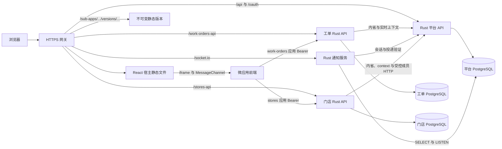
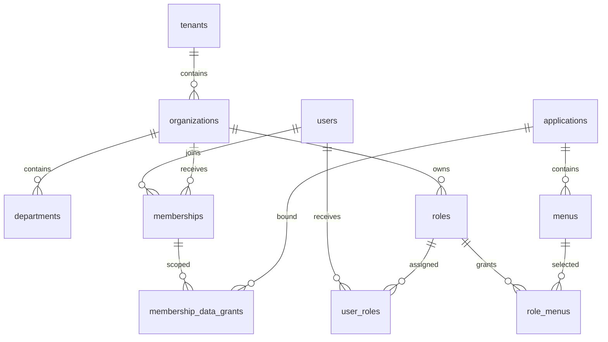
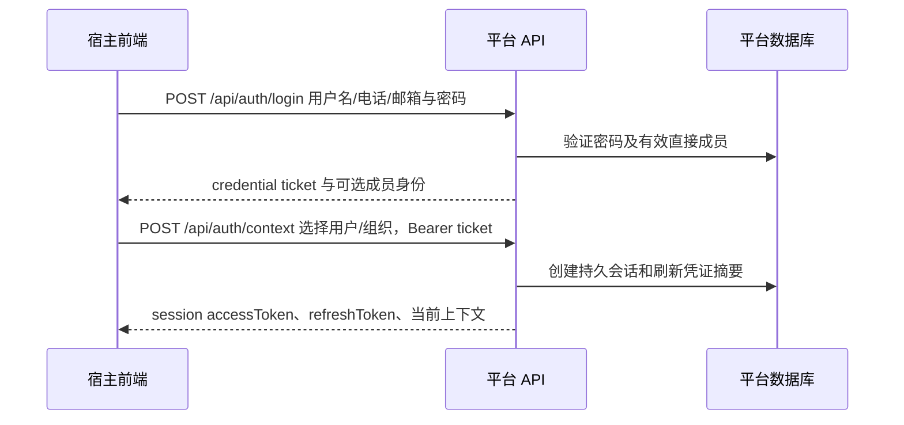

# SaaS Platform 系统架构与应用接入

本文是平台架构、身份与权限、微应用、业务后端、通知、发布和运行恢复的统一文档入口。整理日期为 2026-10-14，依据现有源码、配置与既有文档；历史测试结果单独标明日期，不代表本次重新执行或当前环境已部署。

当前实现优先于早期提案。接口字段以对应 Rust 路由及前端类型为准，数据库完整 DDL 以增量迁移为准，运行参数以配置解析器与部署模板为准。历史设计结论已融入正文；2026-10-15起的架构优化实施状态由[架构优化任务台账](architecture-optimization-ledger.md)单独维护，本文件同步实际实现。

2026-10-19 Phase29宿主边界：公开路由与受保护AppLayout分开加载，匿名深链先登录再下载壳；命令面板在点击搜索或Ctrl/Meta+K后才导入，快捷键监听属于壳。Outlet使用局部Suspense和错误边界，待加载、render throw或chunk404时保留应用栏、侧栏和TopBar；普通页面按epoch/path重置，微应用仍按epoch/appCode保持挂载，子路由走增量update。普通渲染异常可局部重试；失败的lazy import由用户明确刷新恢复，没有自动reload。公开入口/壳加载也有恢复边界；命令面板独立隔离。应用管理仅拆创建/编辑用例hook与表单组件，保留原API、entry/runtime不可变字段和HTML创建后发布引导。宿主Nginx缺失assets返回404纯文本/no-store，保留旧hash仍按原策略交付。性能口径、原始数据和实际验收见[Phase29](validation/phase-29.md)，实验室交互时延不等同线上INP。

2026-10-15 工程基线：工具固定为 Rust 1.97.0、Node 24.18.0、npm 11.16.0；前端提供独立 lint、typecheck 和无数据库契约检查。Phase 2 已交付独立 Vite 示例，Phase 3 已实现 Nginx/Compose/原生构建源码，实际验收见各阶段证据。完整组件/协议/遗留运行入口与检查分类见[工程基线](engineering-baseline.md)。Phase32 新增独立 Rust 私有监控及候选容量测量；Phase33提供独立Rust恢复工具，恢复边界见第13节；迁移状态及环境验收以台账为准。

2026-10-15 Phase 2：Vue/jQuery兼容微应用与WebSocket聊天前端已成为独立Vite工程，使用各自npm锁文件与相对静态资源；根Bun入口/锁及两个Bun静态服务已移除。根开发调度默认只启动静态前端，支持端口配置、readiness总时限和拥有进程树清理。宿主缺版本目录不再阻启动，静态缺资源返回404；真实结果及旧管理UI浏览器fixture限制见[Phase 2证据](validation/phase-02.md)。工单及其它Node后台继续按各自阶段迁移，当前状态以台账和组件事实为准。

2026-10-16 Phase 24：OAuth 演练改为独立 Vite 页面与 Rust 流程 API，旧 Node HTTP 与内嵌页面入口退役。默认页面 3010/API 3011，开发同源代理，生产独立非 root Nginx 静态镜像与私网 Rust 镜像，经独立 HTTPS 入口访问；客户端 secret、token、PKCE verifier 和流程状态只由 Rust 内存持有。authorization code 使用机密客户端加 PKCE，设备码、受控服务凭据及显式开启的历史 password 各按能力配置，错误 state/重放/过期/错误会话拒绝。配置、流程矩阵与部署见[OAuth 演练](../mini-services/oauth-playground/README.md)，实际验证见[Phase 24](validation/phase-24.md)；不将此局部迁移描述为全部后台迁移完成。

2026-10-15 Phase 4：已建立 [项目受管分层 CI](../scripts/ci/README.md)。快速门禁使用平台单 crate 的显式 manifest（Phase 30 增加窄 lib target）；数据库门禁在自有私网 PostgreSQL 中实际执行四组选定平台测试；浏览器包固定 Playwright 及必测清单，Chromium/Chrome/Edge 分别报告实际版本。候选交付构建并验证三份 Linux OCI 镜像、平台 ELF/动态库及真实 Nginx HTTPS、上游重建和旧资源恢复。日志脱敏，源码以 HEAD 加实际工作树逐文件摘要绑定；自有测试资源按 owner 清理。GitHub 配置已通过静态政策检查，本次实际门禁运行在 WSL 干净 Linux 容器；没有远端 workflow 运行、registry 推送或生产部署。详细结果和剩余 Rust/兼容矩阵限制见 [Phase 4 证据](validation/phase-04.md)。

2026-10-15 Phase 5 实现：同机 ZIP 发布采用规范产物清单、跨环境共享摘要和同文件系统无覆盖原子安装；同环境同内容重试复用 release ID，提交结果未知时保留正式文件并查询对账。离线维护默认只扫描，使用维护锁且仅清理可确认归属的暂存项。操作、升级停写及回退边界见 [ZIP 对账与暂存恢复](../deploy/zip-recovery.md)，实际验收和最终阶段状态见 [Phase 5 验证记录](validation/phase-05.md)及台账。

2026-10-15 Phase 6 实现：[SDK 登记](../examples/micro-app-sdk/release.json)首次记录1.0.0，context1.0、MicroProps/iframe2.0及notification1.0保持现有 wire 版本。schema 生成 TypeScript 与纯 serde Rust DTO，平台在 context 输出边界实际消费；浏览器 classic/ESM、宿主及三个前端消费者使用同一登记。固定生成入口和 CI 在构建前拒绝漂移；实际旧 bridge 字节单独保留用于兼容/回滚。响应限额、错误/requestId、能力与框架说明见 [SDK README](../examples/micro-app-sdk/README.md)，实际检查与限制见 [Phase 6](validation/phase-06.md)。这不代表 Rust 业务服务或实时协议已经迁移。

2026-10-16 Phase16建立工单独立Rust crate、自己的锁文件、薄入口及窄library、业务PostgreSQL安全初始化／SQLx接管与live/ready，保留存量身份与记录，见 [Phase16](validation/phase-16.md)。2026-10-17 Phase17增加逐请求授权、同范围列表/count/详情、筛选／分页和CSV，见 [Phase17](validation/phase-17.md)；Phase18增加创建幂等、版本／状态／软删除及0002，见 [Phase18](validation/phase-18.md)。Phase19增加普通应用Bearer成员目录、有效直接成员分配、memberLookups声明、锁前预校验／锁内复核和短有效期，见 [Phase19](validation/phase-19.md)。Phase20增加0003不可变提醒意图、当前read／publish双重授权及正式通知API消费，见 [Phase20](validation/phase-20.md)。Phase21前端使用独立Vue模块／Vite构建、Rust创建header与显式未知结果恢复；完整契约／回退见 [Rust工单说明](work-orders-rust-baseline.md)及[前端README](../business-apps/work-orders/frontend/README.md)，实际验收由 [Phase21](validation/phase-21.md)单独记录。旧Node保留兼容、生产尚未切流，不以实现说明预记本轮通过。

2026-10-18 Phase26实现：[简单门店Rust后端](../business-apps/stores/README.md)是第二个独立业务消费者，独立crate／Cargo锁及专属业务库／账号，不复用平台或工单实现crate。逐请求Basic内省＋stores应用Bearer context，门店store/read/create/update、员工store-staff/read/assign/unassign、日报store-daily-report/read/create/update分别验证permission／grant；summary使用日报read。所有列表/count/detail/write/汇总SQL与tenant／组织硬上限交集；store owner是创建人、staff owner是经验证员工、report owner是录入人，manager变化不改owner或扩大SELF。日报NUMERIC(18,2)以十进制字符串输入输出，营业日默认Asia/Shanghai当天且接受有效历史／未来日，同店同日唯一409；未知写先读回，不自动重发。新负责人／员工经既有成员窄HTTP预校验后再短事务复核，绝对窗口最多3秒且不续期，跨库最后检查至COMMIT竞态保留。配置／协议见[后端README](../business-apps/stores/backend/README.md)及[API](../business-apps/stores/backend/API.md)；实际验收由台账及Phase26证据单独记录，不表示Phase27前端、应用菜单manifest、网关采用或Docker部署已完成。

2026-10-18 Phase27实现：[门店前端](../business-apps/stores/frontend/README.md)新增独立React19.3.0／TypeScript5.9.3／Vite8.3.4工程、登记SDK1.0.0完整ESM／类型、相对动态chunk和构建摘要；薄入口同步连接bridge后再加载React。stores公开bootstrap／grant manifest、精确11菜单及三种memberLookups与Rust管理CLI对齐；client secret仍只在服务端。表单按app／tenant／organization／user保存内存输入，真实授权替换隔离旧快照和formId，同身份续期保留合法输入但重读编辑version，主题保留请求；上海营业日显式确认、十进制金额、409重读与未知写显式读回遵循真实API。正式r2的Chromium／Chrome／Edge各21个必需浏览器组通过、零失败／跳过，实际覆盖真实平台／两业务Rust／三库、opaque静态ESM、普通用户操作及跨页共享会话／组织隔离；运行范围和其他门禁见[Phase27验证记录](validation/phase-27.md)。[成员契约与实证](stores-member-contract.md)为Phase30输入；镜像／公开v1v2与联合交付归Phase28，不提前抽公共框架。

## 阅读导航

| 主题 | 章节 |
| --- | --- |
| 系统整体与职责边界 | [系统总览](#overview)、[模块结构](#modules) |
| 用户、租户、组织和数据库 | [数据模型](#data)、[授权边界](#authorization) |
| 登录、会话与应用 token | [身份生命周期](#identity) |
| 后台验证 token、获取用户信息 | [业务后端接入](#backend-integration) |
| 不同框架的前端如何接入 | [微应用架构](#microfrontend)、[开发示例](#frontend-examples) |
| 上传、预检、激活和回滚 | [应用发布](#releases) |
| 持久通知与实时推送 | [通知架构](#notifications) |
| 平台配置、地区、地图与管理员 | [平台能力](#platform-capabilities) |
| 启动、生产配置和部署 | [运行部署](#deployment) |
| 日志、指标、备份与恢复 | [可观测性](#observability)、[备份恢复](#recovery) |
| 历史验收、限制和后续工作 | [验收与边界](#validation) |
| 维护与故障排查 | [维护规则](#maintenance)、[故障排查](#troubleshooting) |
| 管理 API 索引与发布协议细节 | [API 索引](#api-catalog)、[发布协议](#release-contract) |

<a id="overview"></a>
## 1. 系统总览

平台提供统一身份、租户与组织、角色与菜单、独立数据授权、OAuth、通知及微应用版本管理。业务应用通过明确的 API 和上下文契约接入，业务数据由独立业务服务持有。



### 1.1 可部署单元

| 单元 | 技术 | 职责 | 常用端口 |
| --- | --- | --- | --- |
| 宿主前端 | React 19、TypeScript、Vite 6、React Router | 登录、后台管理、授权导航、微应用编排 | 开发 3000；生产由网关服务 |
| 兼容微应用前端 | Vue/jQuery经典生命周期、独立Vite 8 | 保留TRUSTED沙箱示例，构建dist及版本内相对资源 | 3005 / 3006 |
| 聊天示例前端 | React/TypeScript、独立Vite 8 | 默认离线的Socket.IO聊天页面；与通知协议不同 | 3007 |
| 平台 API | Rust 2021、Axum 0.8、Tokio、SQLx 0.8 | 身份、授权、OAuth、发布、通知持久化、审计 | 3001 |
| 通知实时服务 | 独立 Rust、socketioxide、SQLx | 已落库消息在线提示、平台会话复验、有界分区调度 | 3003 |
| 工单 Rust API | 独立 Rust 2021 crate、Axum、SQLx | 库接管、live/ready、逐请求授权、读写／CSV、创建幂等、成员分配、持久提醒意图与官方通知API发布；尚未切流 | 3004，须与兼容实例使用不同绑定地址或端口 |
| 工单业务兼容 API | 保留的 Node 24、pg | 当前完整业务规则与数据范围执行；使用独立业务数据库 | 3004 |
| 门店前端 | 独立React19.3.0、TypeScript5.9.3、Vite8.3.4、SDK1.0.0 | opaque iframe门店／员工／日报页面，相对ESM与动态chunk、内存草稿及显式恢复 | 独立dev／preview3014；根调度3009 |
| 门店 Rust API | 独立 Rust 2021 crate、Axum、SQLx | 门店资料、受控成员关联、日报与精确汇总；stores专属业务库／账号 | 3031 |
| OAuth 演练 | 独立 Vite 页面、Rust/Axum API | 会话绑定、一次性 PKCE/device/token/内省/撤销与固定资源代理 | 3010 / 3011 |
| 资源网关 | 独立入口 Nginx + 宿主静态 Nginx | HTTPS、静态版本、API 和 WebSocket 反代 | 仅入口公开 80 / 443 |
| 数据库 | PostgreSQL 17 | 平台库与业务库分别持有自己的数据 | 5432，按部署配置 |

端口是默认或示例值，不是服务发现协议。开发演练服务可能占用同一默认端口，应按实际配置调整。

### 1.2 信任与依赖边界

- 平台签名密钥只有平台后端持有；业务服务、通知服务和浏览器均不需要该密钥。
- 业务 API 调用平台 HTTPS 接口，不直接查询平台库来推导权限。
- 通知服务为 LISTEN 和收件读取连接平台库，但身份及每次实际投递由平台 API 验证。
- 前端上下文用于展示和请求，不能成为资源归属的权威依据。
- 默认 HTML 微应用隔离在 iframe；只有明确可信的第一方模块可在宿主页面执行。
- 发布版本与授权分开：上传、激活或回滚不会自动授权用户，也不会启动业务后端。

<a id="modules"></a>
## 2. 模块结构与代码入口

| 位置 | 内容与关键入口 |
| --- | --- |
| [backend/src/main.rs](../backend/src/main.rs) | 运行配置、数据库连接、迁移、种子、路由装配及退出 |
| [backend/src/routes/mod.rs](../backend/src/routes/mod.rs) | 平台 API 总路由与通用分页 |
| [backend/src/extractors.rs](../backend/src/extractors.rs) | 当前会话提取、权限检查、请求输入 |
| [backend/src/authorization.rs](../backend/src/authorization.rs) | 有效菜单及操作权限计算 |
| [backend/src/session.rs](../backend/src/session.rs) | 持久平台会话与刷新生命周期 |
| [backend/src/app_token.rs](../backend/src/app_token.rs) | 应用 token 实时有效性 |
| [backend/src/oauth_issuance.rs](../backend/src/oauth_issuance.rs) | 普通 OAuth 实时身份规则和事务内 token 对写入 |
| [backend/src/login_limits.rs](../backend/src/login_limits.rs)、[util/password.rs](../backend/src/util/password.rs) | 进程内有界登录状态、统一异步密码计算预算 |
| [backend/src/client_ip.rs](../backend/src/client_ip.rs) | 真实 peer 与精确信任代理链的来源规范化 |
| [backend/src/release_archives.rs](../backend/src/release_archives.rs) | 静态包解压与安全检查 |
| [backend/src/releases.rs](../backend/src/releases.rs) | 入口来源、资源和预检协议 |
| [backend/migrations](../backend/migrations) | 增量 DDL、数据补丁、约束与撤销触发器 |
| [frontend/src/App.tsx](../frontend/src/App.tsx) | 宿主页面路由 |
| [frontend/src/lib/api.ts](../frontend/src/lib/api.ts) | 平台 API 请求与会话刷新 |
| [frontend/src/components/micro](../frontend/src/components/micro) | 容器、iframe、可信 HTML 加载、沙箱与类型 |
| [frontend/src/micro-apps/registry.ts](../frontend/src/micro-apps/registry.ts) | 随宿主构建的 ESM 模块注册 |
| [examples/micro-app-sdk](../examples/micro-app-sdk) | iframe bridge、上下文请求和通知辅助组件 |
| [business-apps/work-orders](../business-apps/work-orders) | 真实 Vue 微应用、独立后端、业务迁移及部署工具 |
| [business-apps/stores](../business-apps/stores) | 独立React／TypeScript／Vite前端、固定SDK、Rust后端与业务迁移、公开登记manifest、配置和HTTP契约 |
| [mini-services/notification-ws](../mini-services/notification-ws) | 实时服务、配置及测试 |
| [deploy](../deploy) | Compose/原生网关、监控、恢复和环境模板 |
| [tests](../tests) | 平台、浏览器、网关、契约与隔离测试 |

平台当前是一个 Rust 可执行 crate，不是多个业务微服务 crate 的集合。新增业务服务可使用 Rust、Java、Go、Node 或 Python，只需实现相同的 HTTP 接入契约。

当前优化目标已冻结新增及迁移后台使用Rust，上述跨语言HTTP接入是既有协议能力。静态兼容示例的入口为 `mini-services/micro-*/index.html`，`public/`只保存classic脚本与vendor；先Vite构建再发布dist。根 `build:all`顺序为示例构建→同步兼容副本→宿主构建，避免从源码public直接发布或携带旧副本。新建默认IFRAME应用仍须SDK握手；保留兼容示例不表示放宽iframe同源权限。

<a id="data"></a>
## 3. 数据模型与持久化

### 3.1 身份和授权实体



用户是全局账号，可通过不同成员关系加入多个组织和租户。电话、邮箱可以重复，账号主键是 UUID，用户名保持唯一。组织归属一个租户，部门归属一个组织；角色归属明确组织。

### 3.2 表职责

| 领域 | 核心表 | 关键约束 |
| --- | --- | --- |
| 租户组织 | `tenants`、`organizations`、`departments` | 同租户组织父节点、同组织部门父节点、树无环、每租户唯一根组织 |
| 用户角色 | `users`、`memberships`、`roles`、`user_roles`、`role_menus` | 成员部门与组织一致，角色租户与组织一致 |
| 两级授权 | `tenant_applications`、`tenant_menus`、`organization_applications`、`organization_menus` | 组织授权不得超出租户上限 |
| 数据授权 | `membership_data_grants` | 当前直接成员、应用、资源、操作唯一绑定一个范围；缺失即拒绝 |
| 平台认证 | `platform_sessions`、`platform_session_refresh_tokens`、`users.session_version` | 持久撤销、账号版本、一次性刷新摘要 |
| OAuth | `oauth_clients`、`oauth_tokens`、授权请求、授权码、设备码表 | 客户端密钥哈希，token 摘要、受众、会话绑定和撤销 |
| 微应用 | `applications`、`menus`、`application_release_artifacts`、`application_releases`、`application_deployments` | 应用/版本共享不可变产物，环境 release 分别绑定，部署指针可切换 |
| 通知审计 | `notifications`、`notification_publications`、`notification_prefs`、`audit_logs` | 收件归属、发布幂等、同事务通知、请求关联 |
| 平台配置 | `platform_settings` | 单行展示配置；平台租户名称仍保存在 `tenants` |
| 地区目录 | `region_versions`、`regions` | `(version, code)` 唯一，版本删除标记避免重导入 |

业务工单表和租户计数器位于独立业务数据库，包含真实 `tenant_id`、`organization_id`、`owner_user_id`、修订版本和软删除状态。业务服务不以平台演示数据代替业务记录。

门店 `stores`、`store_staff`、`store_daily_reports` 及追加式安全业务审计位于第三个独立库；平台／工单／门店三库与专属账号可同PG实例，业务账号不能直查平台身份表。staff／report以tenant／store／organization复合外键绑定同门店归属，触发器保护identity／owner／创建时间、日报日期与关联user，version单调递增。tenant／organization一店及tenant／store／营业日一报是示例业务唯一约束，不固化平台组织模型；SUM(numeric)与读取相同SQL范围，不能在内存过滤或浮点累计。迁移与schema契约、未知提交及成员跨库窗口见[门店后端说明](../business-apps/stores/backend/README.md)。

### 3.3 迁移和升级

平台数据库以 [backend/migrations/0001_init.sql](../backend/migrations/0001_init.sql) 作为统一初始化基线。该文件创建基线表结构、主键、外键、租户与组织边界约束、索引、函数和触发器，并初始化内置微应用与全局展示配置。租户、账号、角色、授权链与 OAuth 客户端由 `src/seed.rs` 按开发或生产初始化流程创建。Phase 5 新增 [0002_release_artifacts.sql](../backend/migrations/0002_release_artifacts.sql)，保存应用/版本的跨环境产物摘要和清单，为 release 增加可空摘要绑定、外键与不可变约束；0001 内容和已执行校验和保持不变。

Phase 11 新增 [0003_oauth_issuance.sql](../backend/migrations/0003_oauth_issuance.sql)，用 `storage_version` 区分旧元数据与新签发，要求新普通 OAuth 行不保存 JWT 原文，同时允许旧非空原文行正常更新撤销状态。迁移不自动清除历史原文或凭据，兼容窗口与采用步骤见 [普通 OAuth 契约](oauth-issuance.md)。

初始化 SQL 面向 PostgreSQL 17 及以上的空数据库。空库通过 SQLx 顺序执行 0001、0002、0003；已有兼容基线的库保留 `_sqlx_migrations` 并追加未执行项，再次启动校验已执行迁移，不会重复初始化或覆盖自定义配置。更早的基线替换要求属于历史整合记录，不是当前删除旧库或重置迁移记录的指令；不兼容的早期数据库须先在隔离副本评估。迁移失败时不开放监听。

默认数据库为 `saas_platform`，环境文件路径使用绝对 `APP_ENV_FILE`。可执行程序为 `saas-platform-backend`；浏览器键与指标分别使用 `platform-*` 和 `platform_*`。升级后重新登录，宿主和微应用 SDK 一同切换到 `MicroIframe`、`MICRO_*` 和 `__MICRO_APP__`。

后续结构变化继续新增迁移，不修改已执行文件。程序回滚不等于数据库回滚；缺少已执行迁移的旧二进制可能拒绝已有数据库，不能通过删迁移记录绕过。0003 采用前应停用并排空旧普通 OAuth issuer；回退构建须保持新存储/状态契约，不能降 schema 或混跑旧 issuer。产物的兼容镜像和一致恢复边界另见 [ZIP 升级与回退](../deploy/zip-recovery.md)。


<a id="authorization"></a>
## 4. 授权边界

### 4.1 组织进入与管理上下文

- 只能进入用户拥有有效直接成员关系的组织，祖先成员身份不自动授予子组织登录权。
- 进入后，祖先角色可以贡献菜单和操作权限，但不扩大数据范围。
- 只有实际平台租户的根组织会话为平台管理上下文，`platformContext=true`。
- 平台子组织、普通租户及全局超管切换后的非平台根上下文，管理数据范围均为当前组织及有效子组织。
- 上级、平级、其它租户记录不在范围内；无法访问的资源 ID 通常按不存在返回 404。

`tenant.isPlatform` 只表示租户身份，不能替代平台根上下文检查。全局超级管理员可跳过用户角色层，但仍受租户和组织应用/菜单授权上限约束。

### 4.2 菜单和操作权限

普通用户有效菜单/操作权限按用户有效角色、当前组织菜单授权与租户菜单授权交集计算。应用必须同时在当前租户与组织启用授权。菜单可见、按钮权限和 API 操作授权使用相同服务端规则。

菜单路由不是任意子页面通行证。父菜单不自动授权全部子路径，动态页面应明确配置 `:参数` 或 `*` 模式。未授权用户直接输入地址也不能挂载应用。

全局应用、菜单、OAuth 客户端、全局监控等管理接口要求平台根上下文及对应操作权限；拥有同名菜单不能绕过平台上下文门禁。

### 4.3 独立数据授权

绑定键为当前组织的直接 `membership_id + application_id + resource + action`。角色变更不改写数据范围，祖先角色不继承 data grant，没有显式授权默认拒绝。

| 范围 | 业务 API 必须实现的含义 |
| --- | --- |
| `SELF` | 当前用户拥有的记录，叠加组织上限；工单按创建人/归属人判断，处理人不扩大范围 |
| `ORG` | 当前组织内的记录 |
| `ORG_SUBTREE` | 当前组织及平台确认的有效子组织集合 |
| `TENANT` | 本租户范围；非平台根上下文由平台收窄，仍须执行组织上限 |

`organizationScopeIds` 是硬上限。仅可信实时平台根上下文可明确返回 `null`；旧上下文缺少该字段时保守限制为当前组织。数据 grant 还须匹配当前用户和租户，列表、总数、详情、写入、导出执行相同规则。

Phase 14 提供 `GET /api/data-grants` 快照、`POST /api/data-grants/preview` 与 `PATCH /api/data-grants` 差量维护。目标精确绑定 tenant/org/user/membership/application 五个 UUID；独立查询权 `system:data-grant:read` 叠加实际会话组织范围与策略 read，写入权 `system:data-grant:write` 还要求实际平台根和策略 write，预览同时满足两条链。合法平台根可管理策略明确允许的业务租户，不以操作者的平台租户误限目标；普通组织管理员没有隐式写权。

服务端启动配置 `DATA_GRANT_POLICY` 按应用 UUID 登记 resource/action/可选 scope，并显式列出 tenant/org 根、是否含子树及 read/write 正向范围，默认空拒绝，重叠允许项取并集。提交的每个 pair 还须在目标应用中有启用且 permission 精确匹配的菜单登记。管理能力不由操作者自身业务 grant 或 scope 排序推导，没有默认 TENANT。有效 scope 仍按目标成员的 app_context 组织硬上限收窄，平台根操作者不会放大目标用户的业务范围。

差量携带服务端快照的 expectedVersion，锁后复核新鲜权限、关系、能力与版本；scope 更新和未修改 grant 保留 UUID，成员 UUID 保持。真实变更与目标业务上下文的 `DATA_GRANT_CHANGE` 审计同事务，no-op 不造变更事件；下一受保护新请求读取最新授权。GET 可显示既有未登记历史项，策略收紧不自动撤销它们；包括 remove 在内的所有变更 pair 均需当前登记，清理时须暂保留相应能力登记。

Phase 15 的独立 `/system/data-grants` 页面要求 read 权限及当前获授权的精确 MENU 路由；编辑再叠加实际平台根、独立 write 和服务端目标可写提示。`GET /api/data-grants/options` 只返回相同 read 边界内的可管理应用、有效直接成员和 `canWrite` 提示，不扩展通用用户/应用目录权限。先选应用、再搜索分页选择精确成员，`userId` 深链仍经有效候选校验；原 `GET /api/users/{id}/memberships` 保留 `system:user` 及原组织范围，不是页面目标选择的前置条件。

页面显示 stored/effective scope 与组织集合，仅提供已登记能力和 scope；历史未登记项只读。先预览精确 delta，再确认 PATCH，无自动保存；409 或保存回执未知时先重新读取并审阅。403 退出可写状态并隐藏旧快照，手动 GET 获准后只恢复只读展示，当前编辑器不自动恢复写入。成功 requestId 经会话与目标检查后显示，仅对 `system:audit` 提供按 requestId、目标 application/tenant 和 `DATA_GRANT_CHANGE` 查询的页面内审计面板。grant 权限不等于审计权限，目标或会话变化不会承接旧草稿和迟到回执。

新空库 seed 保留“授权管理”下原隐藏 read/write BUTTON，额外创建系统应用根级可见 MENU `/system/data-grants`，仅按初始化规则明确授予平台根管理员角色、租户和组织。已有安装通过菜单、租户/组织与角色授权 API 显式注册并授权新 MENU，保留原按钮的父菜单、UUID 和已有授权，不自动迁移扩权。Phase 25 已退役工单部署 SQL 草案输出，日常 grant 维护使用页面、正式 API 或受控 Rust CLI。策略更新仍需同步重启所有副本，没有热重载或跨副本全局锁。完整契约见[数据 grant 管理](data-grant-management.md)，普通用户的功能授权、直接成员数据范围、验证和撤销见[操作指南](data-grant-user-guide.md)，实际结果见 [Phase 14](validation/phase-14.md) 与 [Phase 15](validation/phase-15.md)。

### 4.4 关联维护与共享账号

用户成员、用户角色、角色用户的替换仅修改可管理子树内关联，保留范围外记录。当前成员保存采用差量删除和保留项 UPSERT，保留有效 membership UUID、数据授权和会话；旧部署说明中“保存成员必然重建全部 UUID”的描述不再作为当前行为。

删除成员仍会撤销对应会话并级联删除其数据 grants。共享账号还有范围外成员或角色时，子树管理员不能修改全局资料、状态、密码或删除账号，应由具备授权的平台根上下文处理。

<a id="identity"></a>
## 5. 身份生命周期

### 5.1 登录与选择组织



电话、邮箱可由多个账号共用，先验证密码，只返回验证通过账号的有效成员选择项；多账号票据为 `credential_multi`，组织选择同时提交明确 `userId`。普通票据或会话不能任意换用户。

credential 仅用于建立上下文，不能作为业务 token。有效期受配置限制；响应中的实际到期值为准，不使用早期文档固定数值作为协议常量。

### 5.2 平台会话与刷新

session JWT 带 `sid/ver`，每次请求查持久会话、账号版本、直接成员、租户与组织祖先有效性。登出当前设备、撤销本人设备、改密、管理员重置/踢出及成员/状态变更按规则立即失效；恢复启用或重加成员不会复活旧凭据。

组织切换事务创建新会话并撤销旧会话，前端在切换开始就停止旧微应用、旧请求和 socket，清理旧查询。多设备会话独立存在。

平台 refresh token 为一次性摘要凭证，调用 `/oauth/token` 的 `grant_type=refresh_token` 轮换；不附加 OAuth 客户端凭据或 scope。刷新保留会话 ID 和当前组织，绝对刷新截止时间不延长，重新核对版本、撤销与成员状态。前端合并并发刷新并仅重试一次原请求。

宿主各标签页共享登录及当前租户/组织。`session-coordinator.ts`通过同源Web Lock统一协调刷新、组织切换、登录替换和退出，将access/refresh与逻辑会话身份、版本一次写入`platform-session-v1`。每次持锁先重读记录，等待刷新的一页使用获胜者保存的完整凭据对；BroadcastChannel只通知版本变化，存储事件及focus/pageshow/visibility恢复也重新读取原子记录。旧分离token键仅在锁内导入一次，之后不双写，匿名记录防止旧键复活。

刷新、组织切换和远端退出在发送前保存操作intent。网络或5xx等无法证明未提交的错误、成功正文不可读、20秒操作截止或持锁页面关闭后无法证明结果时，记录转为unknown，隔离旧凭据和服务器视图并要求重新登录；不重新消费旧refresh或假定切组织事务已回滚。明确的凭据拒绝与可证明未提交的组织拒绝分别按协议处理。Web Lock本身负责互斥，20秒是持锁网络操作的执行预算。登录替换和所有清理都校验捕获的逻辑会话；旧请求在首次等待前保留原会话条件，发送及正文返回再次复核，不能把旧组织表单排队后改用新组织凭据。

会话/组织变化同步退役旧请求和通知生命周期，并清除查询缓存；宿主页面以会话身份及epoch物理卸载，正常同身份续期保持草稿，切组织后旧表单不能继续显示或提交。微应用仍通过SDK消费宿主上下文，工单沿用app/user/tenant/org身份隔离。Web Locks或可用持久存储缺失时提供明确提示并拒绝受保护操作；没有BroadcastChannel时使用存储事件与恢复重读兼容路径。实际Chrome/Edge两个稳定major和能力缺失验证见[Phase 10](validation/phase-10.md)。

新旧宿主bundle不能混用跨页协调承诺：采用时关闭或重载全部旧宿主页；旧bundle不理解原子记录，仍可能使用其内存中的旧凭据。回滚旧宿主应重新登录，不把原子凭据重新拆分双写。旧静态微应用与SDK产物保留，未改变其wire协议。

### 5.3 应用 token

宿主携带 session 调用 `POST /api/oauth/session-token`，body 为 `{"appCode":"orders"}`，取得专用应用 token。应用必须启用、关联可用机密客户端、获得两级授权，且用户持有有效会话和当前组织直接成员关系。

token 绑定用户、租户、组织、应用、客户端、平台会话，带独立 `aud/jti`，寿命最多 300 秒且不超过其它有效期。平台保存摘要及绑定/撤销元数据，不保存该 token 明文。运行模式、应用编码、客户端绑定和相关配置变更可撤销旧 token；普通静态版本激活不改变受众或授权。

平台 session、应用 token、OAuth 服务 token、refresh token 和 credential ticket 不可互换。业务后端只接收本应用用户 token；服务机器 token 不代表用户。

### 5.4 普通 OAuth

普通 OAuth 的授权码、已批准设备码和 refresh 在用户→客户端→一次性凭据的锁序下消费，access/可选 refresh 与 `TOKEN_ISSUED` 审计在同一事务写入。客户端配置变化、凭据条件消费失败或任何必要写入失败均不产生半套 token。授权确认请求消费与新授权码写入也保持原子。管理员踢出在单事务内提升账号会话版本、撤销平台会话与用户 OAuth 凭据，关闭刷新与撤销间隙；Phase 13 再将相关管理操作接入统一事务审计，见[关键管理审计](management-audit.md)。

用户型 token 的 refresh、userinfo 和 introspect 共用用户启用、完整上下文、当前直接成员、租户启用/未到期和完整组织祖先有效性检查。新 token 用随机 jti，期限不超过租户/祖先已知到期值，只保存摘要及必要元数据；旧无 jti/旧原文行继续兼容。普通 OAuth 采用动态状态语义，恢复启用或重新加回原成员后，未撤销、未消费且未到期的凭据可以恢复；显式撤销或消费永不复活。机器 `client_credentials` 上下文全空，独立按客户端规则判断，不能由 userinfo 返回用户身份。

网络中断或提交响应丢失不证明数据库回滚；本协议不提供 token 原文恢复，不自动重复消费结果未知的 refresh，应重新授权。完整 scope、设备轮询、迁移与回退规则见 [普通 OAuth 契约](oauth-issuance.md)，当前实际执行结果见 [Phase 11](validation/phase-11.md)。平台 `psr_` 与应用 token 使用上文原有协议。

[OAuth 演练](../mini-services/oauth-playground/README.md)是独立的 Vite/Rust 消费者，不复用平台内部模块，也不新增发行协议。浏览器只持本会话操作句柄，通过同源 `/api/*` 调用 Rust；机密客户端 secret、平台 token、设备码及 PKCE verifier 不进入 dist、浏览器持久存储或 URL。公开 origin、精确 `/callback` 与监听端口由私有服务端配置和开发调度明确指定；生产须 HTTPS，HTTP 仅显式 loopback 开发。服务重启丢弃内存会话/有界 TTL 流程；多副本不共享状态，此处不宣称恢复未知交换结果。历史 password 演练默认关闭，不作为新业务登录推荐。

### 5.5 登录与密码计算预算

平台登录与 OAuth password 在数据库/验密前限制输入、来源准入与账号失败，来源/输入/账号共用最多 4096 个条目，固定窗口默认 600 秒；来源默认 60 次准入、账号默认 5 次已记录失败后拒绝新验密。条目键为有界摘要，单调 TTL 防回拨，容量饱和拒绝新身份而不驱逐活跃预算。共享电话/邮箱的成功登录不惩罚其它匹配账号，全部候选的验证共用 10 秒总截止，超时不签发部分 ticket。

HTTP 登录、OAuth password、创建用户、重置/修改密码及联系人账号初始化共用 `PasswordService`，默认执行 2/等待 8，队列等待最多 250ms、提交后等待结果最多 10000ms，Argon2 在 blocking 任务计算。调用者取消或响应超时不能停止 CPU 任务，许可保留到真实结束；新 hash 继续使用 Argon2id m19456/t2/p1，既有 PHC 参数保持兼容。启动 seed 与演示凭据检查使用独立同步初始化路径。

来源从真实 socket peer 开始，只剥离 `TRUSTED_PROXY_IPS` 中精确信任代理的 XFF 右侧链；不信任任意最左项。无 peer 使用 `unknown` 桶，IPv4-mapped IPv6 规范为 IPv4；中间件清除原 Forwarded/XFF 并写入规范 X-Real-IP，供路由与审计共用。预算仅在进程内，当前单 API Compose 的限制随 N 个相同副本扩大为 N 份且重启清空；没有跨副本共享配额模式。完整变量、返回码、PHC 成本限制及采用说明见 [登录保护](login-protection.md)，实际运行证据见 [Phase 12](validation/phase-12.md)。

### 5.6 关键管理事务审计

用户/成员/角色、租户/组织、OAuth 客户端和撤销、会话/密码/授权决定、应用/平台设置及版本发布管理在主事务内写入审计，必要插入失败则回滚该事务。删除对象之前取身份快照并写审计，保留目标 ID/名称；详情选择最小前后值或规范集合摘要，不记录凭据和敏感正文。普通配置的重复判断只使用本行锁保护的配置字段，重复同值或同集合不新增变更事件，已初始化管理员不重复记初始化事件。

requestId 关联请求和目标范围，不作全局幂等键。一次全局用户变更可能按涉及租户各写一行；预检观察与随后部署切换各自成事务，后者失败不撤回已提交预检。提交确认丢失时先核对状态，不把网络错误解释为回滚。普通诊断、个人通知日志与可靠管理事件的分类、局部锁序及结果未知处理见[管理审计契约](management-audit.md)，实际回滚/重试结果见 [Phase 13](validation/phase-13.md)。

<a id="backend-integration"></a>
## 6. 业务后端验证 token 与获取用户信息

### 6.1 服务身份配置

业务服务使用自己的数据库，配置固定平台 HTTPS origin、本应用编码、实际机密客户端 ID/secret。客户端 ID 由平台生成，客户端名称不能当作 ID。客户端密钥仅保存在服务端环境或密钥管理系统。

```dotenv
PLATFORM_API_ORIGIN=https://saas.example.com
PLATFORM_CLIENT_ID=实际生成的客户端ID
PLATFORM_CLIENT_SECRET=服务端机密
```

浏览器调用业务 API 时发送 `Authorization: Bearer <本应用token>`。前端不传平台签名密钥或客户端 secret。

### 6.2 两个平台接口

第一步，后台使用机密客户端 Basic 认证调用 token 内省，body 按表单编码：

```http
POST /oauth/introspect
Authorization: Basic <Base64(clientId:clientSecret)>
Content-Type: application/x-www-form-urlencoded

token=<表单编码后的应用token>
```

检查 `active=true`、`aud=本应用编码`、`token_type=Bearer`、`exp` 未过期和有效 `sub/tenant_id/organization_id`。HTTP 200 可返回 `{"active":false}`，不能只判断状态码。

第二步，使用同一个应用 Bearer token 获取当前授权上下文：

```http
GET /api/apps/orders/context
Authorization: Bearer <同一个应用token>
```

响应契约为 `1.0`，包含 `appCode/contextVersion/expiresAt/application/user/tenant/organization/organizationScopeIds/roles/permissions/dataGrants/menus`。后台将其中用户、租户和组织 ID 与内省结果核对，拒绝过期或不一致上下文。

### 6.3 用户与授权示例

以下为结构示例，ID、哈希和日期须来自真实平台响应：

```json
{
  "contractVersion": "1.0",
  "contextVersion": "64位授权内容哈希",
  "expiresAt": "2026-10-14T08:00:30Z",
  "appCode": "orders",
  "application": {"id":"应用UUID","name":"订单应用"},
  "user": {"id":"用户UUID","username":"zhangsan","displayName":"张三"},
  "tenant": {"id":"租户UUID","code":"company-a","name":"A公司"},
  "organization": {"id":"组织UUID","name":"销售部","path":"组织路径"},
  "organizationScopeIds": ["组织UUID"],
  "roles": [],
  "permissions": ["order:read"],
  "dataGrants": [{
    "resource":"order","action":"read","scope":"ORG",
    "subjectUserId":"用户UUID","tenantId":"租户UUID",
    "organizationIds":["组织UUID"]
  }],
  "menus": []
}
```

后台可信当前用户是 `context.user`，不能采用浏览器 body 或 header 中自报的用户、租户和组织。创建业务记录的归属字段由后台填入。

### 6.4 中间件与数据库执行

```text
Bearer 提取
  → 机密客户端内省
  → 实时上下文与身份核对
  → 当前请求身份对象
  → 操作权限 + 对应 resource/action data grant
  → tenant + organization ceiling + grant 范围过滤
  → 业务查询/事务
```

每个受保护请求重新内省并读取上下文，不缓存正向授权。授权上下文最多有效 30 秒且不晚于 token 到期；长操作在关键写入前再次确认当前取得的授权未过期。

平台调用限制超时、响应容量和重定向。凭证失效返回 401，缺操作/数据授权返回 403，不可见记录返回 404，冲突返回 409；无法确认授权时停止操作并返回 503。不要在平台故障时依赖浏览器 props 或旧权限继续执行。

新后台接入以 [Rust 工单授权实现](../business-apps/work-orders/backend/src/authorization.rs)和[读取源码](../business-apps/work-orders/backend/src/reads.rs)为参考。服务每次以机密客户端 Basic 内省，再以同一应用 Bearer 查询固定 `work-orders` context；校验身份／有效期／permission与对应grant后，把tenant、组织硬上限和grant交集落实到参数化SQL。列表count与records、CSV容量与记录各自使用一致只读快照，并在关键读取和返回前复核授权期限。服务独立持有业务库与规则，不依赖平台实现crate。旧 [Node 后台授权参考](../examples/app-backend/README.md)已于Phase17退役，原函数仅留兼容测试；工单 `auth.mjs` 属于切流前保留的旧实现。

Rust 保留 `PLATFORM_API_ORIGIN`、`PLATFORM_CLIENT_ID/SECRET` 私有配置，实际run/application缺少完整平台配置时在监听前拒绝。`PLATFORM_AUTH_TIMEOUT_MS` 默认3000毫秒（100–10000）覆盖两次授权HTTP及响应读取；每份JSON最多256 KiB，禁止重定向和环境代理。进程并发许可默认32（1–128），饱和立即503、不排队。可选 `PLATFORM_CA_CERT_FILE` 只追加最多1 MiB的PEM根CA，保留正常证书及主机名验证；规范UUID requestId回传并传入两次上游请求。实际执行结果和限制见 [Phase 17](validation/phase-17.md)。

工单 [Rust写入用例](../business-apps/work-orders/backend/src/writes.rs)在两次平台HTTP授权完成后才取得业务连接。显式分配更新先按业务scope非锁预读组织、version和oldAssignee，释放连接后做必要的成员HTTP校验，再进入事务／行锁，锁内复核三项一致性，错配409 `VERSION_CONFLICT`；外部HTTP期间不持有业务连接或行锁。新建非空分配也先验证目标组织当前有效直接成员。成员校验从HTTP发起时以单调时钟计算 `min(PLATFORM_AUTH_TIMEOUT_MS,3000ms)`，响应及DB等待消耗原窗口，不在取得锁后续期。成员HTTP超时503 `PLATFORM_UNAVAILABLE`；提交前成员结果过期503 `MEMBER_VALIDATION_EXPIRED`，context过期401，均回滚。请求总截止15秒，另有pool／语句／锁等待预算；COMMIT错误、提交后context／成员期限过期或写请求截止返回503 `CREATE_RESULT_UNKNOWN`／`WRITE_RESULT_UNKNOWN`，分别要求同创建键／正文恢复或读回当前版本，不将取消解释成未提交，也不自动重试PATCH／DELETE。平台库与业务库没有共同事务，最后成员验证至COMMIT之间仍有撤权或成员失效竞态。

平台在 `DATA_GRANT_POLICY.applications[].memberLookups` 显式登记允许成员查找的resource/action，默认空；pair必须在同应用capabilities内，最多128项且唯一。工单登记ticket/create与ticket/update，继续使用当前普通应用Bearer和原功能权限／data grant，不新增成员grant或assign动作，也不要求业务用户具备grant管理权。公开capabilities仍仅resource／action／scopes三字段。目录和单成员入口以同一用途及组织硬上限校验，SELF／ORG目录只查当前组织，处理人身份不扩大SELF的owner约束；配置示例及采用／回退见 [成员查找声明](data-grant-management.md#member-lookups)。

### 6.5 CORS 与客户端请求

默认 iframe 不含 `allow-same-origin`，业务请求可能产生 `Origin: null`，即使 URL 在宿主同域也不能假定普通同源。业务 API 配置无 Cookie Bearer CORS、OPTIONS、实际方法和 Authorization/Content-Type/X-Request-Id，成功与错误响应都应正确返回 CORS。

允许 `null` 不能证明请求来自合法应用，后端仍靠 token 与授权判定。平台生产 CORS 只允许精确配置的 HTTPS origin，业务 opaque CORS 不应扩散到全部平台/OAuth 接口。

Rust 工单 `WORK_ORDERS_ALLOWED_ORIGINS` 默认字面 `null`，额外来源为精确allowlist，不接受通配符或重复Origin。成功、授权／校验错误及404由同一中间件处理允许来源、`Vary:Origin`、`X-Request-Id`和no-store；无cookie credentials。OPTIONS允许GET／POST／PATCH／DELETE及Authorization／Content-Type／X-Request-Id／Idempotency-Key，预检不访问平台或业务库；创建仍须实际Bearer授权和合法创建键。非法来源或预检返回403 `ORIGIN_DENIED`，不回显未知origin。

<a id="microfrontend"></a>
## 7. 微应用前端架构

### 7.1 接入方式

| 类型 | HTML + iframe | 第一方 ESM |
| --- | --- | --- |
| 独立 React/Vue/Angular/Svelte/Solid/jQuery | 推荐，自带运行时和样式 | 不作为独立上传方式 |
| 平台内部 React 模块 | 可以独立化 | 适合共享宿主 React/UI |
| 交付 | 单入口静态 ZIP/tar.gz | `frontend/src/micro-apps/{code}.tsx` |
| 生命周期 | iframe SDK `connect` | 模块导出 `__MICRO_APP__` 或方法 |
| 更新 | 独立上传、预检、激活 | 重新构建发布宿主 |
| 默认信任 | `IFRAME`，opaque sandbox | `TRUSTED`，直接执行自有代码 |

新建页面选择 HTML 或 ESM，无需另选运行方式。SDK 采用自有契约，不要求 qiankun/Wujie/Module Federation。仅实现其它框架生命周期不能自动接入。

### 7.2 挂载与协议

宿主在 `/micro/{code}/*` 从个人授权应用列表发现应用，申请token并取得有效实时context，再从该context的application原子解析完整`runtimeMode/entryType/entryUrl/deploymentVersion/entryVersionId`入口，成功后才加载。资源入口、最终挂载和props使用同一快照，每个异步加载边界后重新核对；profile中的版本/URL不与另一份context混搭。HTML iframe sandbox为`allow-scripts allow-forms`，没有同源身份；专属MessageChannel传递token与DTO，不将token放入URL。

子应用使用登记版本的 [iframe-bridge.js](../examples/micro-app-sdk/releases/1.0.0/iframe-bridge.js)，通过 `MicroIframe.connect` 声明 `appCode`、精确 `allowedHostOrigins`、容器和生命周期。来源包含协议/域名/端口，无路径；localhost 和 127.0.0.1 不是同一来源。直接打开子入口没有宿主上下文，等待是正常行为。classic 与 ESM 来自同一 `src/`，生成目录和 vendor 副本由 `npm run sdk:check` 持续核对；明确未知 SDK/wire 版本拒绝，不从任意旧脚本推断兼容。

`mount/unmount`必需，`update`建议实现。生命周期可异步，Promise在真实完成后结束；SDK串行调用，真实授权替换立即取消旧signal。未实现update的可信兼容应用，纯主题更新保留当前实例和请求，主题到下一次真正重挂才适配；其路由/授权变化仍沿用串行卸载重挂，可能丢输入。具备update的当前消费者增量处理路由/主题。冻结的旧静态bridge保留原行为，采用新语义须登记新的前端产物版本。

Phase 7 对TRUSTED的入口加载、挂载、更新与最终卸载分别设置10秒截止，正常情况下仍等待真实完成。实际调用前再次核对取消状态；已开始执行的HTML脚本Promise由运行域等待，不能用取消race把仍pending的thenable当成已结束。超时或最终卸载/宿主清理失败会锁定当前页面的可信域：清空宿主持有的当前应用上下文、取消props signal、移除挂载节点，显示故障阶段；普通重挂、切组织、切应用或迟到resolve/reject均不会解锁。唯一页面内恢复入口“重新加载宿主”执行整页reload，新页面重新取得授权。

后续IFRAME不等待可信卸载barrier，使用自己的controller、MessagePort与可销毁frame；另一个TRUSTED仍须等待正常最终卸载并通过共享域健康检查。取消只停止宿主继续交付和使用授权，不能撤回应用已拿到的token、证明所有副作用结束或强制终止原Promise。可信代码若同步占住事件循环，计时器和页面按钮都无法运行，需要浏览器级刷新；因此默认继续使用opaque iframe。实际命令、永久挂起和迟到结果验证见 [Phase 7](validation/phase-07.md)。

可信domain保存在页面执行域，同一document中的模块重新求值或开发HMR继续使用原队列及故障；跨模块故障识别不依赖新旧class的instanceof。首次把原模块私有domain的旧开发页面升级到该实现时，应先整页刷新，不能追溯接管旧模块仍持有的任务。正式构建无开发HMR通道，旧页面也不会因部署新静态字节自动获得新的运行时实现。

### 7.3 MicroProps 2.0

| 字段组 | 内容 |
| --- | --- |
| 应用路由 | `appCode/basePath/routePath` |
| 身份 | `user/tenant/organization/organizationScopeIds` |
| 授权 | `roles/permissions/dataGrants/menus` |
| token 与期限 | `token/tokenExpiresAt/expiresAt` |
| 内容与推送版本 | `contractVersion/contextVersion/contextEpoch`，新版可选 `sdkVersion` 为登记1.0.0 |
| 发布 | `deploymentVersion/entryVersionId`，可为空 |
| 展示与交互 | `theme/signal/onNavigate/onNotify` |

完整公开类型由 [schema](../examples/micro-app-sdk/contracts/schema.json) 与登记生成，宿主 [types.ts](../frontend/src/components/micro/types.ts) 仅窄导出这些类型。后端契约 1.0 经宿主映射为前端 2.0。signal/回调由 SDK 在 iframe 本地创建；不能进入 JSON wire。组织上限缺字段只回退当前组织，显式null和有限数组保持三态，Rust DTO不将缺失误解为无限根范围。

宿主约20秒刷新上下文并在token到期前续签；token、授权、身份、主题和子路由变化都会更新。Phase8只允许同epoch、同凭据/期限、完整身份/授权/部署投影一致且signal仍有效的展示更新复用controller。SDK共享的`authorizationContextSignature/sameAuthorizationContext`采用带类型的完整编码，未知字段保守拒绝复用；签名含凭据，只能内存比较，不得日志或遥测。客户端保存接受时的签名与signal引用，旧业务响应按稳定授权generation判活，不能按props对象身份把主题变化误当失效。

真实token、期限、身份、授权内容或signal替换仍立即取消旧请求；contextVersion相同不能替代实际字段比较。当前工单UI纯主题更新不清缓存/403拒绝状态、不重读列表，路由切换只取消/重取相关读取而保留业务写。授权变更清除服务端列表、详情、编辑器记录与候选人；同身份且新授权仍允许时只保留用户草稿和最小范围信息，等待新的受权详情后恢复提交。组织或用户变化清除身份草稿，移除grant或成员立即停止旧内容操作。

临时`NETWORK_ERROR/status0`或HTTP503时，宿主立即取消当前授权、移除旧挂载节点并清空快照，再按500/1000/2000毫秒最多3次退避申请全新token/context。每次尝试（token加context）总预算5秒、整次恢复预算20秒；不响应取消的迟到结果也不能复活旧实例。401/403/404、契约、身份、入口或模式错误直接拒绝，不通过通用重试恢复；恢复也不能解除Phase7可信故障锁。实际命令与结果见 [Phase8验证](validation/phase-08.md)，不代表业务后端授权、生产部署或未测试浏览器已验收。

### 7.4 路由、主题、通知与请求

宿主的菜单、profile和permissions查询由`auth-queries.ts`统一生成key/options、20秒新鲜度与刷新、重试白名单及signal。菜单key仍是`["auth-menus", applicationId, epoch]`；同一会话token正常轮换不分裂缓存。请求前后均复核epoch、身份、当前应用授权及取消状态，全局组织切换cancel/clear继续保留；不会把旧key分裂推断为已证实的跨租户漏洞。

侧栏、命令面板、工作台、最近访问与直达守卫共用`route-policy.ts`。`/dashboard`、`/profile`、`/system/notifications`是登录用户个人页面；工作台监控数据仍由后台单独授权。宿主页同时要求已知permission与精确MENU，平台根限定继续校验平台上下文；微应用只使用本应用授权菜单的精确/显式参数模式，父菜单不隐式授权后代；外链要求返回菜单中的精确URL，未知路径拒绝。已成功且明确匹配的授权不因其它应用菜单错误而被阻断，失败或未知来源不能继续用缓存授权。

当前微应用菜单按需读取；命令面板仅在打开后加载其全应用菜单。应用选择、工作台入口和直接导航使用共享选择代次与会话复核，A→B、A→B→A以及其它导航意图都会使旧选择结果失效，旧组织响应也不能回显入口。路由所属应用只由AppLayout按epoch、pathname和匹配应用ID推断，使同epoch迟到授权正确同步，普通profile轮询不覆盖用户的新选择；MicroAppContainer保留所选应用ID门禁，移除外层重复的路由选中写入。工单创建使用`/micro/work-orders/ticket-create`，详情仍为`/micro/work-orders/tickets/:id`；旧`/tickets/new`不再解释为创建。bootstrap保留七个稳定菜单key，将read/create改为显式详情/创建MENU，同步校验器与授权计划；已有旧BUTTON形状须人工核对采用，工具遇冲突在写入前停止，不静默改写既有授权。实际浏览器、查询请求数及兼容限制见[Phase 9验证](validation/phase-09.md)。

- 用户地址是 `/micro/orders/list`，静态入口是 `/sub-apps/orders/versions/1.0.0/index.html`，两者不能混用。
- 用 `routePath.slice(basePath.length) || "/"` 得内部路径，React/Vue 可用 memory router/history 与宿主同步。
- 用 `props.onNavigate(props.basePath + "/list")` 请求导航。iframe 只允许本应用范围，不能借回调进入别的应用或外部 URL。
- 当前 `routePath` 只有 pathname，没有 search/hash 字段。可刷新恢复的 ID 优先作为路径参数，不能假设 query/hash 随 props 回传。
- iframe 不继承宿主 CSS/字体/组件库，使用 `props.theme` 设置自己的主题。
- `onNotify` 是 Toast，不是持久站内通知。
- SDK1.0.0 的 `bridge.requestJson` 自动带当前应用 token、取消与 `credentials:omit`，流式限额后复核上下文。`MicroSdkError` 区分401/403/409、网络、协议和其它HTTP状态，保留安全UUID requestId与固定消息；`toJSON()`仅公开错误DTO白名单，不回显响应正文、URL、凭据或原cause。取消仍是AbortError；所保留的旧versionless bridge维持原有通用Error行为。
- `bridge.current()` 无有效上下文时为 null，`dispose()` 当前不是可等待的卸载 Promise；不在自己的 unmount 中反复 dispose bridge。

自行封装请求必须同时保护 fetch、响应体解析和状态回写；AbortError 忽略结果，旧上下文请求即使不响应取消也不能更新新组织视图。全局监听、定时器、订阅和实例在卸载时清理。

### 7.5 下载与浏览器能力

CSV 先由业务 API 按范围过滤，再调用 `bridge.downloadCsv({resource,filename,content})`。宿主要求 `${resource}:export` 与同资源 export grant，检查当前上下文、消息序号和下载参数；最多 4 MiB UTF-8，仅安全 `.csv` 名称。成功表示发起下载，不代表保存完成。

默认 iframe 不增加下载、同源、弹窗权限。localStorage、IndexedDB、Service Worker、顶层导航和原生桥接不能假定可用；认证保存在内存，持久业务偏好通过业务 API 保存。支付、摄像头、剪贴板等能力需另行验证和受控适配。

SDK提供client/iframe/host三种能力检测，覆盖实际所需的有限流读取、取消、安全UUID、MessageChannel和sandbox；缺能力在申请应用上下文之前明确停止，不转为TRUSTED或同源模式。实际测试的Chrome/Edge/Chromium版本以阶段报告为准，产品目标的最近两稳定版及Firefox/Safari不能仅凭feature检测冒称已验收。SDK不读共享会话存储或自行续期，跨标签平台会话由宿主的Phase10协调模块管理。

### 7.6 ESM、可信 HTML 与 SSR

ESM 注册器仅发现当前目录 `./*.tsx`，文件名与编码一致，包含在宿主构建的 lazy chunks 中。`/src/micro-apps/{code}.tsx` 是注册标识，生产不需要公开 TSX 源文件。可共享宿主依赖，但不同 React root 的 Provider 要显式配置。

历史 TRUSTED HTML 通过 `window.__MICRO_APP__` 暴露生命周期，加载器按 classic script 执行，拒绝 module/modulepreload；它主要用于自有历史集成。需要 eval 的可信 HTML 还须显式网关 CSP 决策，新标准 Vite 应用优先 iframe。

Next/Nuxt/Astro 能整理为单入口静态应用时按 HTML 接入；多 HTML 导出不能直接满足上传限制。SSR、Server Actions 或 Node API 要独立部署服务，静态包上传不会启动服务。H5 可以接入，小程序/原生 App 需其它客户端方案。

<a id="releases"></a>
## 8. 应用构建、发布与授权

### 8.1 构建约定

Vite 设置 `base:"./"`，Vue CLI 设置 `publicPath:"./"`，其它构建器核对最终相对资源地址。源码 HTML 可以含 Vite `/src/main.tsx`，上传必须使用 build 后产物。硬编码资源路径不会全部自动改写；API `/orders-api` 是有意使用的网关根路径。

包根含 index.html（可多包一层 dist），只有一个 HTML 入口，完整包含 JS/CSS/图片/字体/动态 chunk，不带 node_modules、.env、secret 或私有业务数据，许可文件随依赖要求保留。

| 限制 | 当前值 |
| --- | --- |
| 压缩包大小 | 20 MiB |
| 解压/资源总量 | 16 MiB |
| 单文件 | 4 MiB |
| 入口外资源数量 | 48 项 |
| URL 预检 | 单请求 4 秒，总计 30 秒，64 项检查，单资源最多 5 次 redirect |

### 8.2 常规接入步骤

1. 管理员创建 HTML 应用，使用稳定编码。
2. 快速接入生成 `/micro/{code}`、占位入口和首页 MICRO 菜单，不生成授权或客户端。
3. 关联已启用机密客户端并配置所需 scope，密钥交给业务后端。
4. 选择环境和新版本号；推荐先部署固定镜像及版本路由，再在“发布版本”中“登记已部署 URL”。兼容方式是上传构建好的 ZIP/tar.gz。
5. URL登记初始为DRAFT，需单独执行预检；ZIP上传自动预检。仅正文 `validationStatus=PASSED` 才允许激活，HTTP200加FAILED仍是预检失败；两种方式都不自动激活。
6. 菜单 path 填 `/micro/{code}` 或授权子路径，linkTarget=MICRO，linkUrl 留空。
7. 配置租户/组织应用与菜单授权、角色菜单与用户角色，再通过[数据授权页面或受控 API](data-grant-management.md)核对直接成员并独立授予业务数据范围；普通用户的验证与撤销步骤见[操作指南](data-grant-user-guide.md)。
8. 用普通用户验证直达路由、业务接口、续期、撤权、切组织和卸载。

Phase 25 的 [独立 Rust 管理 CLI](../tools/platform-admin/README.md) 将工单 bootstrap、显式授权与 URL 版本登记串为可审阅的独立命令。默认 plan 与未带 `--apply` 的写命令完全离线；inspect/releases/deployments 为远程读取。管理员 Bearer 与平台生成的实际客户端 ID 仅从环境读取，管理请求固定精确 HTTPS origin，不跟随 redirect、不自动重试并限制总超时和 JSON 容量；私有 CA 通过 `PLATFORM_CA_FILE` 显式提供公开 PEM 信任链，保持证书及主机名验证。授权调用正式管理 API：实际平台根、独立 `system:data-grant:read/write` 与 `DATA_GRANT_POLICY` 仍由平台验证，功能菜单与 scope 分别显式指定。数据 grant 先 GET 当前 opaque version、POST preview，再以同一版本 PATCH；冲突或响应未知时先重读并审阅。工具不执行 SQL、不输出历史 SQL 草案、不控制 Docker，也不依赖 ZIP 安装或共享镜像卷；前端构建工具继续使用 Node。

```powershell
# 在子应用目录，使用该项目锁文件与构建脚本。
npm ci
npm run build
Compress-Archive -Path ./dist/* -DestinationPath ./orders-1.0.0.zip
```

orders 是说明示例，仓库真实应用为 work-orders；替换编码、origin、API 与项目路径后实施。

### 8.3 应用、版本和部署指针

`applications.id` 稳定承载授权；`application_release_artifacts` 按应用/版本保存平台安装的ZIP产物规范清单及摘要；`application_releases` 保存应用/环境/版本的不可变入口定义，可选绑定本地产物；`application_deployments` 保存 active/previous。相同应用与版本的ZIP对应一份不可变产物，跨环境完全相同包可复用，不同内容必须换版本号。外部镜像URL登记不向该产物表保存镜像digest，来源不变性由独立CLI／CI发行inventory约束。

上传先写入 `MICRO_APPS_DIR/.staging/<随机 UUID>/payload`，对规范相对路径和实际文件字节生成隐藏清单 `.artifact-manifest.json`。规范 JSON 的 SHA-256 表示产物身份，压缩包自身摘要不能代替它。暂存与正式目录位于同一文件系统，完成同步后以无覆盖原子操作安装到 `<code>/versions/<version>`；不以逐文件复制公开半成品。

同环境、同版本、同产物重试返回稳定 release ID；另一环境复用磁盘目录和摘要，但有自己的 release ID。目录字节、产物摘要或已有环境定义不一致返回 409。数据库提交或响应结果未知时保留已安装文件，先查 storage、目标环境 releases 及 deployments 再用同一产物重试；本阶段不自动删除任何正式版本。`GET /api/applications/{id}/releases/storage?version=...` 返回 `REGISTERED`、`INSTALLED_UNREGISTERED`、`MISSING` 或 `INCONSISTENT` 及所有环境引用；某一环境已登记不表示目标环境已登记或已激活。详细判定与旧记录采用规则见 [ZIP 对账说明](../deploy/zip-recovery.md)。

登记后执行预检，PASSED 是服务端结果，前端不能自行声明。绑定产物的预检、激活和回滚先核对本地实际文件、隐藏清单与数据库绑定，再执行 HTTP 检查；本地损坏产生 `ARTIFACT` 诊断。回滚预检旧版本后切换指针，并发变化返回冲突。

保留历史目录，已挂载用户的旧 chunk 仍应可访问。宿主 profile/context 获得版本和运行模式变化后重新挂载；实时模式与缓存 profile 不一致时先停止执行并刷新，不能继续执行旧 TRUSTED 缓存。

### 8.4 预检、来源与网关

入口、资源、健康检查和每次 redirect 命中服务端精确 origin 白名单，生产 URL 必须 HTTPS；白名单不由上传者扩展。检查真实 MIME/非空文件，资源错误或 SPA fallback HTML 均失败。

iframe 原生模块及 crossorigin 资源要允许 opaque Origin:null 匿名加载；公开版本文件可返回 `Access-Control-Allow-Origin:*`，不允许 Cookie 凭据。iframe 入口的 X-Frame-Options/CSP frame-ancestors 必须允许实际宿主。预检不执行 JS，不代表运行时动态请求已完整验收。

更多发布管理路径、状态与 DTO 见 [发布协议](#release-contract)。

### 8.5 兼容命令行与独立服务

```powershell
# 仓库根目录：仅生成版本目录与 release.json。
node scripts/package-microapp.mjs --app orders --environment development --version 1.0.0 --input path/to/orders/dist
```

命令不自动登记数据库、预检或激活。管理页面支持登记已部署URL及兼容上传；JSON登记继续用于自动化与受控外部服务。未版本化 `/sub/vue/`、`/sub/jquery/` 和 micro:sync 只作为开发/历史迁移，不是新生产发布路径。

### 8.6 镜像发行、外部 URL 与持久清单

Phase28的[独立镜像入口](../deploy/microapps/README.md)分别交付工单／门店的v1、v2静态镜像和Rust API镜像。静态文件在镜像根目录，入口Nginx按固定版本路由剥离公开前缀；旧版本容器及路由保留，未知版本和缺失chunk返回404。仅保存旧镜像不能保证旧页面仍可加载资源，前端、API及数据库版本分别记录和回退。

URL登记固定使用environment／version／entryType=HTML／entryUrl／healthUrl／resources六字段，界面提供动态资源行并固定HTML；可使用网关根路径或批准的HTTPS绝对入口，路径包含与version完全一致的目录段。healthUrl根路径相对平台网关解析，资源相对HTML入口解析；空健康检查不等于平台检查Docker health。登记不创建路由或授予权限，PASSED仍由服务端真实预检决定，激活会再次预检。

Rust CLI的artifact.json与release.json分开。所有环境使用同一明确的持久inventory目录：同应用／版本固定source、digest、架构及构建来源，同应用／版本／环境的完整登记定义不可变化，同公开版本URL也不可换来源或digest；跨环境可换公开origin，但必须保持同一产物。`artifact-bind`默认离线计划，`--apply`才追加不可变记录，`artifact-verify`只读；带artifact／inventory参数的register在HTTP前验证已有绑定。RegisterBody不存储这些digest，旧无绑定register及UI登记不能被描述为已验证镜像身份。响应未知先用release-reconcile比对完整URL定义并读取deployments；不能靠改digest或自动重试激活恢复。临时runner、缓存或短期Actions artifact不能作为权威历史，本机文件锁也不协调各宿主私有目录。

GitHub候选构建、核验并保存产物，业务门禁可使用自有隔离registry验证推拉，不获得外部发行凭据；独立受保护手工publication核对准确的main候选run／attempt、来源和archive后向批准registry推送同一产物，Linux目标仅拉固定repository@digest。CI／部署推进先检查真实容器health，再绑定／核验inventory、测试并提交保留旧版本的Nginx路由，随后登记DRAFT、独立预检和激活。平台预检只访问入口／资源及明确配置的healthUrl，不读取Docker状态；容器healthy、inventory绑定、路由可达、预检PASSED与普通用户可用授权分别核对。

同域入口可用`/work-orders-api`和`/stores-api`。外部静态origin直载必须明确配置绝对平台HTTPS API base或自有受控代理；v1相对API配置与v2绝对API配置是两种独立构建输入。宿主CSP、平台MICRO_ALLOWED_ORIGINS及静态frame-ancestors明确批准实际公开origin；opaque iframe请求仍为Origin:null／Bearer／omit Cookie。域名、registry、CPU架构、证书、专属数据库及机密客户端由部署方明确配置。源码中的工作流和模板不表示已执行远端发行或生产切流；实际阶段结果以台账及相应证据为准。

<a id="notifications"></a>
## 9. 持久通知与实时推送

Phase 22 已冻结 [Rust 实时协议选型](realtime-protocol.md)：当前 Socket.IO 4.8.4 客户端与 socketioxide 0.18.7 / engineioxide 0.17.7 的必需传输/事件矩阵兼容，结论为 `SOCKET_IO_COMPATIBLE`，条件 Phase 37 未触发。Phase 23 将通知生产入口替换为独立 Rust crate、锁文件与非 root 镜像，移除旧 Node 后台；真实平台/PG、分区调度和宿主双页结果见 [Phase 23](validation/phase-23.md)。[Rust 聊天参考](../examples/websocket/backend/)使用独立 `/` 事件协议。仓库实现与本地镜像验收不表示已经操作目标生产环境。

### 9.1 持久发布

应用调用 `POST /api/apps/{appCode}/notifications`，使用本应用 token，同时要求 `notification:publish` 和 `notification/publish` data grant。祖先角色和超管不代替数据 grant，也不新增同名 OAuth scope。

```json
{
  "idempotencyKey":"ticket:7301:reminder:v1",
  "target":{"kind":"USER","userId":"用户UUID","organizationId":"组织UUID"},
  "type":"INFO",
  "title":"工单待处理",
  "content":"请查看工单 7301",
  "link":"/micro/work-orders/tickets/7301"
}
```

目标为 USER（指定组织直接有效成员）、ORGANIZATION（该组织直接成员，不隐含子树）或 TENANT（当前租户的合规收件成员/组织），严格三选一。目标需在 grant 范围内并可访问该应用；不接受自报发布者/租户/应用。

幂等命名空间为租户、发布组织、应用、发布用户和键。同键同规范化内容复用首次记录，duplicate=true；同键不同内容返回 409。网络结果未知保留同键同正文重试，不能换键重复发送。每次重试重新验证当前权限和范围。

发布记录、收件行、审计与 NOTIFY 同事务提交。成功返回 publicationId、recipientCount（不同用户数）、deliveryCount（用户×组织数）、duplicate、createdAt。请求最多 64 KiB，单次最多 1000 条投递；键 1～128 位指定 ASCII 字符，标题 1～200、正文最多 8192、链接最多 300 且仅本应用路径，类型 INFO/SUCCESS/WARNING/SECURITY。

宿主 `POST /api/notifications` 使用 session 并额外提交 applicationId，仍执行相同发布授权；旧 userId/orgId/tenantId 发送 body 不再受理。

Phase20工单消费者只使用当前应用Bearer调用上述应用通知API。独立提醒先通过ticket/read及notification/publish双重功能权限／data grant与组织上限，在业务库短事务固定不可变事件意图，提交并释放连接后才发送一次平台POST。业务意图和平台publication分属两库，不是跨库原子事务，也不缓存本地发布成功；未知结果保留同事件键／完整正文恢复，不能为了补Toast换键重发。平台200表示已验证的持久发布结果，后续工单变化或实时服务未就绪不改判该结果；当前会话的收件箱可按publicationId核对。

### 9.2 收件归属与实时恢复

列表、未读、已读和删除只作用于当前 user/tenant/org。APP 行还要求应用当前启用和两级授权；失权历史行保留但不可见。SYSTEM 按有效收件上下文读取。升级前无归属消息保留为 LEGACY，不猜测租户；仅平台根且 system:audit 可只读审计。

Socket.IO 使用 `/socket.io/`，初次 authenticate 只传 token。公开 authenticated 含 contractVersion/userId/tenantId/organizationId/expiresAt，不公开 sessionId/token。通知事件携带收件归属和内容，但 HTTP 已读状态仍由数据库 API 决定。

实时服务通过内部 `/api/notifications/socket-context` 取得并绑定 sessionId，在连接、每次实际投递及周期复验时检查；投递附 notificationId。消息特定 403/404 跳过该条；会话失效或身份变化断开，无法确认时停止投递。

LISTEN 断开后受控重连，不保证离线即时事件重放。宿主认证/重连立即补拉收件箱、未读数和偏好，离线历史不批量弹 Toast。数据库已提交与在线提示成功分别衡量，推送故障不换幂等键重发持久通知。

Rust 调度以 user/tenant/org 为键，分区内 FIFO、每键最多一个处理器，全局 pending、驻留分区、活动 worker、平台 HTTP 与 Socket.IO/TCP 连接分别限额；满载只丢实时提示。默认 pending1000、worker8、HTTP16、Engine256，query pool4 与独立 LISTEN1。每连接周期复验带抖动，独立 expiry watch 不等待慢 HTTP；服务只缩短到期时间。非法 SID、重复 SID 与路径前缀碰撞在 Engine 前拒绝。失效先发送 unauthorized/namespace 断开，100ms flush 后撤销该 Engine 当前物理连接；旧 HTTP keepalive 不得误关已转归其他请求的 TCP。polling 内部 Engine 元数据回收仍可能等待库超时，容量由准入上限约束。配置、指标与实际测量见[组件说明](../mini-services/notification-ws/README.md)。

### 9.3 部署和权限

通知服务配置自己的 DB 读取/LISTEN 账号、固定平台地址、精确宿主 origin 白名单和独立指标 token。生产允许来源不接受 `*` 或 `null`，不读取平台 .env，不持有平台 JWT 密钥。公开网关同时保留 polling 和 WebSocket 路径。socket-context 使用有效 session Bearer 校验，服务端返回内部使用的会话字段；不要把它当作匿名公开身份查询。生产网关另行阻断 `/api/internal/*` 和私有指标路径。

[正式通知 Compose](../deploy/compose.notification.yml)独立于工单 legacy override；仅授通知公开 DTO 所需12列 SELECT，服务不迁移、不写入。live 表示进程可响应，ready 要求真实数据库、同一 LISTEN 连接和平台保护路由均正常。切流先核对固定镜像、来源及 CA，按旧部署清单精确停止原 Node 通知容器，再启用 Rust profile；Compose 合并不会自动停止旧容器。停止实时或回退兼容 Rust 镜像不改变收件箱。认证/重连后的 HTTP 补拉是持久数据恢复，不能写成 Socket.IO 自动 polling 回退。

<a id="platform-capabilities"></a>
## 10. 平台能力与工单试点

### 10.1 品牌与管理员初始化

品牌持久化于 platform_settings，公开 `/api/platform/branding` 提供名称、简介、Logo、登录标题/说明、页脚与 `primaryColor`。管理 `/api/platform/settings` 需要平台根上下文和 system:settings，额外返回平台租户名称和固定编码 `admin-tenant`；写入不能修改该编码。主题主色为六位十六进制，旧客户端省略保留。

新建租户在事务中生成根组织和内置管理员角色，维护联系人后创建或匹配首位用户，初始随机密码只返回一次；新建组织采用相应组织范围管理员角色。仅电话/邮箱相同但联系人不同不会自动合并账号。非平台根只可复用当前可管理子树内同一联系人的账号。

旧实体保存联系人不会自动初始化，需调用 `/api/tenants/{id}/initialize-administrator` 或 `/api/organizations/{id}/initialize-administrator`，检查所需 entity/user/role 权限。事务锁定组织并幂等处理，已初始化不重复创建、不替换已有管理员。

### 10.2 地区目录与地图

地区目录按版本提供省市县乡村五级选项，最新未删除且有数据版本为默认。内置 2023 从源文件去重后事务导入，后续不覆盖维护数据，删除标记阻止重导入。复制版本不等于获得新的官方地区数据。

父级变化清空下级，地图解析只在已确认父级内匹配，无法识别的下级留空人工选择；东莞/中山等可跳过县级。租户与组织持有地点字段。

`/api/maps/*` 固定代理瓦片、地点搜索、反查和可信访问者 IP 估算，前端不任意指定外部目标；IP 结果一般只到城市，不能自动写成精确门牌。开发 Vite 与生产 Rust 网关分别代理固定上游。

### 10.3 真实工单业务

工单前端为独立锁依赖的Vue3.5.43／Vite8.3.4工程，消费Rust业务API；Rust与保留Node24兼容实现均遵守独立于平台的业务PostgreSQL边界。Rust提供列表、筛选、详情、幂等创建、版本更新、软删除、CSV、成员分配和独立手动提醒，Phase21前端提供当前契约的提交／恢复UI；生产未切流。处理人必须是记录组织内有效直接成员，处理人身份不扩大SELF。

前端标准index进入薄main，先同步登记MicroIframe.connect监听，再由lifecycle shell异步加载真实业务chunk并调用createLifecycle(bridge)工厂；signal复验、首次实际mount和幂等unmount防止加载取消后的迟到挂载，SDK／vendor协议不变。Vue通过模块导入，不使用window.Vue、远程CDN或宿主node_modules。Vite `base:'./'` 保持入口／动态chunk／CSS位于不可变版本相对路径，classic SDK bridge保持登记1.0.0原字节；asset-manifest和build-info绑定真实资源、版本、独立lock及source摘要。生产静态Nginx提供正确MIME、匿名CORS和缺资源404，dev／preview不作生产服务。公开配置只含版本、API地址与精确宿主origin，不自动注入VITE_*或任何secret／DB URL／平台session；opaque iframe保持Origin:null、应用Bearer和省略Cookie，不增加same-origin或下载sandbox能力。

创建首次提交固定header键和完整DTO，只有合法201与工单DTO校验通过才结束事件，畸形2xx、网络、协议或5xx均按结果未知保留原键／正文并显式恢复。提醒使用独立JSON事件键，区分PREPARATION_UNKNOWN的本次零POST与RESULT_UNKNOWN的可能已发布；409先刷新确认当前目标，再由用户发起新事件。编辑409保留草稿、读最新并明确采纳version；PATCH／状态／删除未知先读回，不自动重发mutation。

前端草稿／intent仅在同一存活iframe内按app／tenant／organization／user隔离，跨路由、同业务身份授权续期及切组织返回可恢复相应内存状态；刷新、关闭或销毁iframe不保证保留，结果未知时应保持页面直至核对完成。它不使用opaque localStorage或新SDK协议，与业务库0003持久意图不同。真实授权替换／切组织取消旧请求并隐藏服务器快照，纯主题不额外取列表或取消写入；精确创建MENU与详情MENU继续分别校验，不因恢复事件扩权。采用新版本前核对在途事件，旧无创建header的前端不是等价回退对象；本段不替代 [Phase21](validation/phase-21.md)实际浏览器及平台联合验收。

Phase16的 [独立Rust crate](../business-apps/work-orders/backend/Cargo.toml)不依赖平台实现crate、不读平台表、不自动加载 `.env`，独立二进制无需Node。连接明确使用 `WORK_ORDERS_DATABASE_URL`；初始化与旧Node共享事务锁，在事务内验证迁移摘要和真实catalog。Phase18追加 `0002_create_idempotency.sql`，0001原字节保持；支持空库、Node仅0001、SQLx已接管0001及Node已执行0002的合法状态，只补缺失DDL与Node SHA-256／SQLx SHA-384双历史，不重放已执行迁移、不改写存量工单身份、version或计数器。原Rust库推进返回新增 `InitializationReport::Upgraded`。异常历史／结构拒绝启动；升级后回退须接受0002及receipt，不能删表或改历史使用仅支持0001的旧构建。

Phase20新增业务0003提醒意图迁移，0001／0002固定、依赖不新增。意图按平台相同的tenant／publisher-org／可信application UUID／user／key唯一域保存ticket、target、完整类型化发布正文和摘要，不保存token，不提供更新、TTL清理、级联删除或本地成功cache。原Phase19严格baseline不认识新历史／结构，不能简单旧二进制回退；须保留意图和平台publication，先对账或使用兼容构建。旧Node迁移runner会执行0003，但其提醒路由不采用意图保障，不将切回旧提醒行为称为保持Phase20语义。

Rust的 `/work-orders-api/health/live`为进程检查，`/health/ready`、`/health`检查双历史及业务必需对象，不探测每个调用方的平台授权。Phase17提供受保护列表、详情和CSV：page1–1000000、size1–100、默认1／20，q最多200字符、query最多8192字节，非法／重复／未知参数拒绝，固定created_at DESC,id ASC。Phase18提供POST创建、PATCH／DELETE详情；Phase19的GET `/assignees`必需action=create／update、organizationId默认当前组织，q原文先限100Unicode再trim，page默认1／上限1000000、size默认20／上限50。Phase20提供独立POST `/tickets/{id}/remind`，正文仅`{idempotencyKey}`，200返回经校验的单人平台publication；不修改工单version。路径均保留`/work-orders-api`前缀，业务及生产流量未切换；精确契约见 [Rust工单说明](work-orders-rust-baseline.md)。

Rust创建正文保持 `{title,description?,priority?,assigneeUserId?}`，额外必需单个 `Idempotency-Key` 请求头，1–128个ASCII `[A-Za-z0-9._:-]`。验证后title trim、description默认空、priority默认NORMAL及省略／null处理人归一，非空UUID规范化，以固定DTO字段序列计算SHA-256，服务器名称不参与摘要。tenant／org／user／create／key内将receipt、工单、计数器和原201 JSON同事务保存；同键同正文重放原结果，异正文409。已commit重放仍复验当前create授权，但不重查历史member，新组织／失权不能取得旧域结果；后续编辑或软删不改变receipt，原201仅是创建历史，不是当前详情或成员仍有效的证明。

Phase19非空 `assigneeUserId` 通过平台成员HTTP校验后保存名称快照；update省略或同UUID保留旧分配及名称，不重查历史member，真正change／clear才要求目录目标组织scope，非空change先验证新成员，clear不查询新成员。写JSON只接受对象及白名单字段、最多64 KiB，超限413 `REQUEST_LIMIT`；title trim后1–200、description最多8192个Unicode字符。PATCH至少有一项修改，PATCH／DELETE均要求1–2147483646整数语义version，旧版本409 `VERSION_CONFLICT`。结果未知时创建同键／正文对账，版本写入先读回状态，不自动重试；运行路径没有绕过真实平台校验的成员替身。

Phase19自身不改schema／依赖，其历史成员回退至18会恢复目录503和所有显式非null assignee的400，带非空assignee的历史创建正文也无法由原Phase18重放。Phase20升级0003后，不能直接使用原Phase18／19严格基线，须保留分配、receipt和提醒intent，先对账在途结果并采用兼容构建。若平台同时降至不识别memberLookups的旧严格parser，先移除新字段并同步配置；旧成员入口规则与新默认空声明不等价，须审阅原授权边界。完整回退见 [Rust工单说明](work-orders-rust-baseline.md)。

Rust与保留的Node兼容状态流为OPEN→IN_PROGRESS→RESOLVED、RESOLVED→IN_PROGRESS重开及保持原值，不允许直接OPEN→RESOLVED或退回OPEN。更新／软删除在范围内持行锁并核对version，成功提升版本，已删记录从列表／详情／导出排除。Rust CSV使用独立 `ticket:export` permission和export grant，同范围最多1000行／最终编码4 MiB，超限分别400／413 `EXPORT_LIMIT`，不截断。CSV含UTF-8 BOM和CRLF、引号转义及公式／起始控制字符中和，容量计算包含这些开销。

Rust提醒先以同一当前context取得ticket/read与notification/publish的独立permission／grant和组织上限，短事务scoped `FOR SHARE`读工单快照并claim不可变意图；目标为处理人或未分配时创建人，当前ticket或目标与原意图不同同key409，即使原平台POST没有提交。事务明确commit、释放业务连接后，仅一次当前应用Bearer平台POST，不请求成员目录阻断平台历史receipt，也不写平台通知表／自行广播。准备未知503表示本地commit或发前总超时未确认且本次零POST；如果下次确实没有持久意图，可首次claim当前快照，未落库准备失败不能保证锁住旧目标。发布未知503表示已确认意图后发起POST的timeout／5xx／无效200／期限失效，保留原key／完整正文，不自动换键或重发。意图commit后工单仍可修改／软删，平台200后不重新读工单改判失败；下一次调用仍先检查当前read／publish授权及未删除scope。收件箱持久成功与在线提示分开，删除收件行后平台重放不复活该行；完整Socket.IO联调不归本阶段。Node旧提醒只依赖平台已有publication检测冲突，不具备新意图的发前固定目标保障。

### 10.4 简单门店与双消费者边界

门店client每个HTTP请求默认15秒绝对总期限，覆盖fetch、成功正文流与错误正文检查。读取超时返回固定安全408／REQUEST_TIMEOUT，已发送写入超时保留unknown并要求显式读回，不自动重发；该期限只取消本次请求，不撤销当前context或其他resource/action。

403响应头到达即锁定精确resource/action并取消同用途并行请求，不等待错误正文；相关服务器视图／目录被隐藏，同用途迟到200不能回填，主题更新不解除拒绝，其他用途不因此失权。401使当前context完整失效。原写入的inFlight状态由跨路由／同身份续期恢复的表单共享，原请求结束前禁止读回、确认或再次提交。未知员工解除关联从原发送事件恢复，即使下一次列表不含原行也保留核对入口；空列表只表达当前授权下的结果，不证明历史删除成功。

门店前端独立锁依赖构建，`base:'./'`，公开配置只含version／精确allowedHostOrigins／apiBase；VITE环境不自动注入，机密客户端、DB URL和宿主session不进入dist。build-info与asset-manifest绑定真实资源及源码／lock摘要。opaque iframe仍使用Origin:null、应用Bearer和省略Cookie，不放宽sandbox；dev／preview不作为生产静态服务。

stores有九个精确资源动作、11项菜单节点（8MENU／3BUTTON）、四种现有scope及三种成员用途。根空permission不是数据授权，创建和详情MENU不重叠，BUTTON不替代路由MENU，未知路由拒绝。staff／report可直接输入storeId，只有独立store/read才显示辅助门店选择；日报列表必需storeId，汇总可省略并由同一report/read SQL范围精确求和，没有新增summary动作。

store SELF为创建人，staff SELF为被关联员工，report SELF为录入人；manager与createdByUserId不扩大范围。门店成员DTO保留平台id，负责人提交映射为managerUserId，员工提交映射为userId；工单目录把平台id投影为userId后提交assigneeUserId。两者使用同一平台受控HTTP，工单仅声明ticket/create、ticket/update，门店仅声明store/create、store/update、store-staff/assign，不从read／unassign／日报推导成员用途。成员见证从HTTP发起前计算最多3秒的绝对窗口，响应、连接／锁等待与提交前复核共用预算且不续期；平台库与业务库没有共同事务，最后成员／grant检查至COMMIT仍有撤权或失效竞态，不承诺跨库强一致或自动撤销历史关联。正式r2三产品均实际查询两业务成员并完成分配／关联；业务跨应用Bearer401、平台跨应用成员请求403及未登记store/read成员用途400分别确认，详见[成员契约](stores-member-contract.md)，Phase30再据双消费者实证收敛。

门店显式提交用户确认的上海营业日，发送后冻结原store／date／body；金额不经浮点，服务器汇总可超过单笔上限。409保留原输入，版本冲突须读最新并明确采纳version。未知写仅显式读取原业务域核对，不自动重发或套用工单receipt；只写无读可正常写，但未知后明确提示当前无法核对。formId／identity／route／epoch隔离旧处理器；同业务身份续期保留合法文字，编辑快照重读，纯主题保留请求。草稿仅iframe内存，宿主双页共享登录和组织，刷新／销毁无持久保证。

真实平台＋两业务Rust＋三库、opaque静态ESM、双页刷新／组织切换／退出及成员拒绝在正式r2三产品浏览器各21组中实际通过。源码规则与实际覆盖范围仍分别记录：本阶段没有重跑全部scope／成员失效组合，也不能消除跨库竞态；完整结果见[Phase27验证记录](validation/phase-27.md)。Phase28镜像／公开v1v2路由与生产部署不在本阶段实施。

<a id="deployment"></a>
## 11. 运行配置与部署

### 11.1 本地开发

使用 PostgreSQL 17、仓库 Rust 工具链和 Node 24。先配置独立开发凭据与可访问数据库，再分别启动平台和宿主：

```powershell
# 在 backend 目录，配置 DATABASE_URL、JWT_SECRET、BIND_ADDR 等。
cargo run --locked
```

```powershell
# 在 frontend 目录。
npm ci
npm run dev
```

宿主默认 BACKEND_PROXY_TARGET 为 http://127.0.0.1:3001；IPv6 开发可显式配置 http://[::1]:3001。版本目录默认读取 deploy/micro-apps，可用绝对 MICRO_APPS_DEV_DIR 覆盖；必须与后端 MICRO_APPS_DIR 对应。

新业务 API 需新增自己的代理/CORS，既有工单处理不会自动覆盖任意前缀。HMR 直连子 dev server 需要额外模块、WS 与入口策略，集成验收优先上传 development 构建版本。

### 11.2 配置优先级与生产门禁

系统/服务环境优先。生产不自动搜索 .env；需要文件时通过绝对 APP_ENV_FILE 明确加载。开发只加载当前工作目录 .env，文件不能隐式将环境变成生产。APP_ENV 或 APPLICATION_ENVIRONMENT 任一 production 即启用生产检查。

| 配置 | 生产要求 |
| --- | --- |
| DATABASE_URL | 明确平台数据库，业务库另配 |
| JWT_SECRET | 独立随机至少 32 字节，拒绝默认/占位/低熵值，仅平台持有 |
| METRICS_TOKEN | 与 JWT 独立，各服务分别配置随机 token |
| PUBLIC_APP_URL | 精确 HTTPS origin |
| MICRO_GATEWAY_ORIGIN / MICRO_ALLOWED_ORIGINS | 可达网关与最小精确 HTTPS 来源 |
| CORS_ALLOWED_ORIGINS | 精确 HTTPS 宿主，不允许通配或 null |
| MICRO_APPS_DIR | 推荐镜像部署留空；仅 ZIP 兼容为持久绝对目录，后端可写、独立 static 只读 |
| TRUSTED_PROXY_IPS | 精确代理 IP，无通配/CIDR，网关覆盖伪造代理头 |
| PASSWORD_CONCURRENCY / PASSWORD_QUEUE_CAPACITY | 默认 2/8，分别限制本进程执行与等待任务；具体部署按副本数分配预算 |
| PASSWORD_QUEUE_TIMEOUT_MS / PASSWORD_EXECUTION_TIMEOUT_MS | 默认 250/10000ms；响应截止不终止后台计算或释放其许可 |
| LOGIN_MAX_ENTRIES / LOGIN_WINDOW_SECONDS | 默认共享 4096 条、固定窗口 600 秒；不驱逐活跃身份 |
| LOGIN_SOURCE_REQUESTS / LOGIN_USER_FAILURES | 默认来源 60 次准入、账号 5 次已记录失败；进程内计数 |
| LOGIN_IDENTIFIER_MAX_BYTES / LOGIN_VERIFY_BUDGET_MS | 默认标识 320 字节、共享别名全部候选验密总预算 10000ms |
| DATA_GRANT_POLICY | 严格 JSON：按应用 UUID 登记能力与可选 scope、显式 tenant/org read/write 管理根；默认空拒绝，变更后同步所有副本重启 |
| BOOTSTRAP_ADMIN_USERNAME/PASSWORD | 空用户表生产首次初始化必需；密码至少 12 字符 |
| OAUTH_AUTO_PURGE | 默认 false，不自动清理历史认证数据 |

生产配置在 DB 连接前检查。已有用户库不会重建管理员或根据 bootstrap 变量重置密码；启用账号/客户端发现已知演示凭据则拒绝启动，需要显式轮换或停用。AUTO_CREATE_DATABASE 默认 false，建库和迁移失败停止启动。

生产密码新增/重置/修改统一至少 12 字符，拒绝已知演示密码、控制字符和纯空白。正常证书与主机名验证保持开启；额外 CA 用 MICRO_CA_CERT_FILE 或 Node NODE_EXTRA_CA_CERTS，不关闭 TLS 检查。

### 11.3 网关路径和部署配置

| 路径 | 上游/处理 |
| --- | --- |
| /api/*、/oauth/* | Rust 平台 API，保留原路径 |
| /socket.io/* | 通知服务，polling 与 WebSocket Upgrade |
| /work-orders-api/* | 独立业务 API，保留前缀 |
| /stores-api/* | 独立门店 Rust API，保留前缀 |
| /sub-apps/{code}/versions/{version}/* | 显式镜像版本路由或 ZIP static，未知版本/缺文件严格 404 |
| /micro/* 与已知宿主导航页面 | 仅 GET/HEAD、Accept:text/html 的宿主 SPA fallback；其它路径严格 404 |
| /api/internal/*、各私有 metrics | 生产公共网关拒绝访问 |

HTML no-cache，不可变版本资源可一年 immutable，错误 no-store。公开静态版本匿名 CORS，不能将其扩展为平台全局跨域规则。

当前 [frontend/Dockerfile](../frontend/Dockerfile) 使用 Node 锁定构建及非 root Nginx 静态运行阶段。独立 [入口 Nginx](../deploy/gateway) 正常验证 HTTPS，挂只读配置和证书，以 UID 101 和只读 root 运行，PID/temp 使用 /tmp tmpfs；没有运行时 envsubst 或 Caddy 入口。

默认Compose编排平台PostgreSQL、Rust backend、frontend-web和gateway，只有gateway发布端口。edge网络先由操作者创建，数据库独立internal network，实际gateway私网IP同时作为Rust TRUSTED_PROXY_IPS。保留的Node工单显式启用legacy override；Phase23 Rust通知使用独立notification profile。Phase28新增[业务Compose](../deploy/compose.business.yml)及[固定digest拉取／启动入口](../deploy/microapps/README.md)，显式合并两业务Rust API与四个版本静态服务；不新增业务数据库服务，业务专属库／账号由部署方配置。当前受管交付驱动先用冻结源码在Linux按各Cargo.lock编译并验证ELF，再用runtime Dockerfile装箱；四个静态镜像由源码Docker构建，该模式不宣称默认API Dockerfile builder已验收。必填基础项来自 [compose.env.example](../deploy/compose.env.example)和 [docker-compose.yml](../docker-compose.yml)，业务项见 [compose.business.env.example](../deploy/compose.business.env.example)。模板存在不表示生产已采用。检查和运行是两项不同门禁：

```sh
docker compose --env-file /secure/platform.env config --quiet
docker compose --env-file /secure/platform.env up -d
```

纯镜像服务不挂 MICRO_APPS_DIR。ZIP 使用单独 compose.zip.yml 和 zip profile：Rust RW、micro-static RO，持久目录须预先存在且有明确 ACL，暂存不公开。入口/宿主不挂此目录。宿主更新/回退从当前不可变镜像导出并校验历史 assets，再构建候选以保留旧 hash URL，见 [static 说明](../deploy/static/README.md)。DNS 更新、HTTPS 和旧资源实际结果见 [Phase 3 证据](validation/phase-03.md)。

ZIP 离线维护入口为 `saas-platform-backend --micro-staging --root <已存在的绝对目录> [--apply]`，在配置、数据库和 HTTP 启动前分派。默认 SCAN 不删除暂存项，但可创建私有暂存目录和永久锁文件；APPLY 只清理有有效 owner 的安全 UUID 暂存项。上传持共享锁，维护持非阻塞独占锁；不按年龄或 PID 猜测，不删除正式目录。升级前必须暂停并排空全部旧上传/发布 writer，旧二进制不遵守新锁且可能删除正式目录，禁止新旧 writer 混用同一卷。完整步骤见 [ZIP 暂存恢复](../deploy/zip-recovery.md)。

### 11.4 原生部署与 CSP

[deploy/native](../deploy/native) 提供白名单干净构建及 Nginx 配置渲染；当前不宣称提供 systemd/监控/恢复工具。构建锁依赖、排除私有运行时配置和既有 node_modules/dist，记录实际工作树输入/产物摘要；新输出目录不可覆盖旧产物，失败不发布 artifacts。Node 仅为构建工具，API 交付物是 Rust 平台；不打包遗留 Node 后台。

```sh
node deploy/native/build.mjs --out-dir /srv/platform-builds/new-release --cargo /usr/bin/cargo
node deploy/native/render.mjs --config /srv/platform/deployment.json --out-dir /srv/platform/configuration
nginx -t -p /srv/platform/ -c /srv/platform/configuration/nginx.conf
```

原生配置渲染只写配置，不安装服务或创建运行身份。执行 nginx -t 前，由操作者预先建立配置中的 instanceRoot 与 nginx-temp 下 client_body/proxy/fastcgi/uwsgi/scgi 目录，使专用网关用户可写 PID、日志和临时文件；hostRoot/版本目录只授读权限，证书/私钥用最小 ACL。容器部署则由 Compose 的 /tmp tmpfs 提供这些写路径，不复用原生实例目录。

按最小权限服务身份分离平台、通知、业务、网关，环境配置私有，平台签名密钥不交给其它服务。启动先保证平台迁移成功与 HTTPS 网关可达，再让通知探针收敛并启动已关联客户端的业务服务。

默认 CSP 不允许 unsafe-eval，iframe 来源与可信脚本来源分别批准。确需历史可信 HTML eval 时显式评审配置，不能自动放宽。CSP、SDK 父来源和服务端发布 allowlist 各自处理不同边界。

<a id="observability"></a>
## 12. 可观测性、健康与容量

| 服务 | live | ready | 私有 metrics |
| --- | --- | --- | --- |
| 平台 | /api/health/live | /api/health | /api/internal/metrics |
| 工单 | /work-orders-api/health/live | /work-orders-api/health/ready | /work-orders-api/internal/metrics |
| 门店 | /stores-api/health/live | /stores-api/health/ready | /stores-api/internal/metrics |
| 通知 | /health/live | /health/ready，公共映射 /notification-health | /metrics |

live 只说明进程，ready 核对各自声明的依赖。工单/门店 ready 检查本业务库 schema，不能代表平台授权 HTTP 可用；通知还要求平台、数据库和独立 LISTEN 就绪。真实用户授权与真实收件另行验收。

X-Request-Id 使用合法 UUID 或生成新值，响应、平台调用和审计关联该 ID。日志使用静态路由、状态和时延，归属只在验证后记录；不记录 token、secret、数据库 URL、请求体、业务通知正文或动态查询内容。指标 label 不放用户、租户、组织或资源 ID。

Rust 指标包括 platform_http_requests_total/request_duration_seconds、鉴权/权限失败、数据库状态、受限微应用运行事件，以及统一审计 helper 的 `platform_audit_write_failures_total`。审计失败同时记录 `audit_write_failed` 和可用 requestId；计数为进程内饱和值，重启重置，无动态身份 label。Phase32 的纯 std 固定指标协议由平台和双业务分别实例化：service/stage/outcome 闭合，拆分 context、authorization、platform_http、business_sql、pool_acquire、密码排队/执行、entry/ready/mount，另有数据库锁等待和池 gauges；业务 SQL 用例耗时包含池/事务/解码，不能当作服务端纯 SQL 时间。浏览器值是有界、认证、限速的提示，不能作为权威健康或安全依据。

通知服务是 Rust，连接、分区、队列、并发验证、LISTEN 和提示丢弃指标均为固定标签。`platform_notification_committed_rows` 表示当前持久收件箱行数，`saas_notification_emit_accepted_total` 只表示传输接受（保留旧 delivered_total 兼容），真实收件与已读分别验证。平台、双业务、通知和监控各持独立采集凭据；公开网关拒绝私有 metrics，包括使用有效运维凭据的访问。

当前内省每客户端默认配额为 600 次/分钟，不是早期 30 次/分钟；另有 IP 总尝试、失败认证和并发认证门禁。返回 429 时遵循 Retry-After，容量需要结合每次业务请求的内省/上下文调用评估，不能通过正向缓存绕过即时撤销。

[deploy/monitoring](../deploy/monitoring) 提供私有 scrape、状态转移本地 DOWN/RECOVERED 告警与 Prometheus 模板。默认连续两次失败/恢复确认，稳定状态不重复发事件；本机演练只记录本地事件，实际外部接收渠道需部署方配置。

候选基线从10万业务记录、100活跃应用会话开始，分档到150/200，区分逻辑在线凭据、活跃会话、实际在途请求和不同主体数；包含当前授权、业务SQL及响应体。机器/网络、p95/p99、错误与CPU/RSS证据见 [Phase32](validation/phase-32.md)。短突发和单主体样本不证明持续容量或100独立用户能力；候选失败如实保留，不承诺生产SLA。浏览器 LCP 与短交互 Event Timing 同 entry/READY/mount 分开测量。备份 age/run/verify 只提供有序事件扩展，Phase33 尚未实施。

<a id="recovery"></a>
## 13. 加密备份与新库恢复

Phase33交付独立Rust [saas-recovery与runbook](../deploy/recovery/README.md)，以原生PostgreSQL17工具对平台、工单、门店三个库做协调停写custom dump。备份包含完整静态版本、四个镜像归档与digest/哈希锁、Nginx路由和必要的原生运行材料；AES256-GCM整体认证，密钥独立保管，HTTPS上传后从远端重新取回验证。历史Node备份路径不再作为运行入口。

restore仅接受受控且不存在的新库，先认证全部集合和必需产物，再template0建库、单事务导入、比对迁移指纹；平台凭据重置和恢复审计同事务。所有用户session_version增加，平台session/refresh、应用及普通OAuth access/refresh、授权code/consent/device全部失效。失败目标保留隔离，不自动DROP、不覆盖源库或已存在目标。

CLI成功返回QUARANTINED；运维在隔离HTTPS实际重新登录、授权/跨组织拒绝、CRUD/通知、两套应用的两版本验证后才开放流量。RPO按故障时最近远端可用恢复点，完整RTO包括取密钥、取副本、恢复、ready和业务/浏览器验证，停写单列。试点候选24h/4h；生产15min/1h仍需WAL归档/PITR及真实异机环境验收，不能以每日dump或容器故障域测试替代。

运维事件接Phase32私有监控，固定backup_run/backup_verify/backup_age及持久递增sequence；外部发送器、真实定时安装与生产操作未启用。service/timer和停写包装是待目标环境配置的模板。当前实际命令、结果、边界与RPO/RTO见[Phase33](validation/phase-33.md)。

<a id="validation"></a>
## 14. 历史验收与当前边界

### 14.1 已记录的验证

下表是整合前记录中的历史结果，未在本次文档整理中重新运行：

| 日期/阶段 | 记录结果 | 范围与边界 |
| --- | --- | --- |
| 2026-09-30，关系与身份阶段 | 实际 PostgreSQL 17.6 约束、隔离、会话和应用 token 测试通过 | 只证明隔离库，不代表生产存量已审计 |
| 2026-10-02，上下文/发布 | 31 项上下文回归、11 浏览器场景；发布 8 项 PG/HTTP gate、iframe/网关等通过 | HTTP fixture、浏览器、真实数据库证据分别使用，不能互相替代 |
| 2026-10-02，通知 | 实际平台/PostgreSQL/Socket.IO 联合 9 项，0 skip | 部分组件测试使用协议 fixture，真实平台联合另行记录 |
| 2026-10-07，真实工单 | 16/16，0 fail/cancel/skip，596.846 秒 | 平台/业务双库、Vue、通知、CSV、授权和版本切换；宿主 100 文件哈希不变 |
| 2026-10-07，原生准生产 | 23/23，0 fail/skip，约 307 秒 | Linux 原生进程、私有测试 CA、真实 Nginx HTTPS、故障告警与双库恢复 |

原生验收干净构建记录 259 文件，源码清单 SHA-256 为 `58b92c9bc516960bbad32e1f54a3f10c55300fb842cc04de92373758187d20f3`。历史证据位于 Git 忽略的 target/phase12-runtime 中，不把当时源码哈希当作当前版本哈希。

历史备份 CLI 6.233 秒、恢复 CLI 10.054 秒、完整服务恢复 25.940 秒。容量探针 4 并发/40 读取约 3.70 请求/秒、p50 733 ms、p95 2138 ms，受当时 WSL/TCP 环境影响，不能外推现网吞吐。

Phase 5 当时的 CI 清单为 fast 的 99 项无 DB 契约与归档安装/暂存维护 Rust 单元组、postgres 的 5 套件 27 项、delivery 的 9 项 ZIP 联合检查；当时实际执行、失败及修复重跑以 [Phase 5 验证记录](validation/phase-05.md)为准。Phase 11 的七组 41 项见其[独立证据](validation/phase-11.md)，Phase 12 为八组 46 项。Phase 13 声明管理审计八项及既有通知/成员十项，规划十组共 64 项，fast 声明 27 步；以 [manifest](../scripts/ci/manifest.mjs) 和 [Phase 13 验证记录](validation/phase-13.md) 中同一最终源码的实际数量及结果为准，不将历史记录转记为当前 PASS。

### 14.2 未覆盖与后续目标

- 历史记录未执行 Docker 镜像实际构建/容器启动、系统级 unit/timer 安装、GitHub runner 和真实现网发布；Compose/Caddy 配置解析不等于这些目标通过。
- 现网域名、主机、证书/密钥托管、远端备份、告警接收人、保留期、容量/SLO 仍需目标环境配置和复测。
- 单数据库平台逻辑隔离和独立业务库已实现，不表示每个租户已有物理独立库方案。
- 授权缓存、灰度审批、任意下载 broker、SSR 服务启动及显式委派不属于当前已提供能力；受控 grant API 与 Phase 15 管理页面见[数据 grant 管理](data-grant-management.md)。
- 2026-10-07 的本机验收覆盖当时版本，后续品牌、地区、刷新等变更需按当前门禁验证，不能自动继承历史通过结论。

### 14.3 验证入口

Phase 1 起，根目录的标准检查如下；先按 .nvmrc / .node-version 选择 Node 并安装 package.json 声明的 npm。Rust 由根 rust-toolchain.toml 选择，根 npm 的 Rust 检查仍指向平台 `backend/Cargo.toml`；工单等独立 crate 需分别构建与验证，工单命令及真实 PostgreSQL 测试边界见 [Rust 工单基线](work-orders-rust-baseline.md)。

```powershell
npm --prefix frontend ci
npm run lint
npm run typecheck
npm run test:contracts
npm run check:rust
npm run test:rust
npm run fmt:rust
npm run clippy:rust
npm run doc:rust
npm run test:dev
npm run test:vite
```

命令输出必须区分失败、跳过和未运行；工具基线见[Phase 1 证据](validation/phase-01.md)，最新Vite/开发入口与构建产物隔离结果见[Phase 2证据](validation/phase-02.md)。各示例需先独立npm ci。以下是原有扩展检查入口，按[受管验证清单](engineering-baseline.md)准备独立环境再执行：

```powershell
# 仓库根目录：纯契约/示例与资源打包。
node --test tests/micro-context-runtime.mjs tests/micro-sandbox-lifecycle.mjs tests/micro-iframe-protocol.mjs tests/package-microapp.mjs mini-services/micro-vue/smoke-test.cjs mini-services/micro-jquery/smoke-test.cjs
node --test tests/micro-release-gateways.mjs
node tests/micro-host-browser.mjs
```

```powershell
# 在 backend 目录。
cargo fmt -- --check
cargo check --locked
cargo test --locked
# 真实隔离数据库发布测试需 TEST_DATABASE_URL 和相关条件。
cargo test --locked release_tests -- --ignored --nocapture
```

```powershell
# 在 frontend 目录。
npm run build
```

其它模块 tests 和 package scripts 见各组件 README。真实数据库/浏览器测试缺少配置时的 skip 不算通过，不默认连接生产库。测试仅清理自己创建的数据库、进程和目录。

<a id="maintenance"></a>
## 15. 维护和架构变更规则

- 本文维护系统级约束，组件 README 保留可执行启动/测试说明，SQL/配置源码保留实际工具能力；不重新创建平行架构说明。
- 新平台能力修改路由、前端 API/types、页面路由与菜单权限；持久化变化新增迁移，禁止改已执行 SQL 校验和。
- 新业务应用先定义资源归属、操作权限和独立 grant，后实现 token/context 中间件、范围查询、前端与发布。
- 校验和权限在后端执行，前端不推导全局授权、不持久保存应用 token、不通过放宽 sandbox 解决兼容问题。
- 运行方式、来源、服务配置和发布协议变化同步维护本文及目标网关，不以历史报告替代当前验证。
- 凭据、私有运行证据、备份密文和用户数据不提交 Git；历史阶段详情可从版本历史追溯。

<a id="troubleshooting"></a>
## 16. 故障排查

| 表现 | 优先检查 |
| --- | --- |
| 应用不在导航 | 应用启用、两级应用/菜单授权、用户角色 |
| 应用 token 失败 | 客户端关联/启用、scope、直接成员、平台会话 |
| 内省 HTTP 200 但业务拒绝 | active、aud、token_type、exp、客户端归属 |
| 内省有效但业务 403 | 操作权限和独立 grant，不能只看角色名 |
| 内省 429 | 当前配额、失败认证/IP 限流、Retry-After；不绕过授权 |
| iframe handshake 超时 | SDK 资源/执行、appCode、精确父 origin |
| JS MIME 错误或首字符 `<` | 资源路径和宿主 fallback，缺资源须 404 |
| module/API CORS 错误 | Origin:null、OPTIONS、允许头与错误响应 CORS |
| 上传成功但预检失败 | 后端访问网关、实际目录、来源/HTTPS/MIME/CSP |
| 切组织仍有旧数据 | signal、迟到响应、缓存范围、socket scope |
| 续期丢输入 | update 实现、是否每次更新重建框架实例 |
| query/hash 无法恢复 | 当前 routePath 只提供 pathname |
| ESM 未找到 | 同目录同名 .tsx、宿主实际构建与发布 |
| CSV 被拒绝 | export 权限/grant、当前上下文、文件名/UTF-8 容量 |
| WS 不推送但数据库有通知 | 会话/投递授权、LISTEN、网关 WS/polling、重连补拉 |
| 生产启动失败 | 配置门禁、演示凭据、数据库/迁移日志，不跳过检查 |
| 恢复后旧登录失效 | 预期认证重置；轮换后重新登录 |

接入验收必须覆盖普通用户、直达路由、组织切换、token 续期/过期、授权撤销、重复挂载/卸载、业务 401/403/409、版本激活/回滚和真实资源 404。新应用测试不能只运行平台已有示例后就宣称业务完成。

<a id="frontend-examples"></a>
## 附录 A. 前端开发示例

以下代码保留独立应用开发的关键入口示例；orders 和 saas.example.com 是占位应用及域名，实施时替换。React/TypeScript 的 MicroProps 与 bridge 全局声明由应用建立完整契约，业务 App 由项目实现。示例解析验证不等于运行集成验收。

<a id="frontend-minimal"></a>
### A.1 原生 HTML/JavaScript 最小入口


以下示例只展示平台上下文，不调用假业务接口。将 SDK 与两个文件放在同一交付目录，即可通过平台上传后验证握手、主题、导航与卸载。

#### index.html

```html
<!doctype html>
<html lang="zh-CN">
  <head>
    <meta charset="UTF-8" />
    <meta name="viewport" content="width=device-width, initial-scale=1.0" />
    <title>订单应用</title>
    <style>
      body { margin: 0; padding: 24px; font-family: sans-serif; }
      :root[data-theme="dark"] { color-scheme: dark; }
    </style>
  </head>
  <body>
    <div id="app">等待平台提供授权上下文…</div>
    <script src="./iframe-bridge.js"></script>
    <script src="./app.js"></script>
  </body>
</html>
```

#### app.js

```js
let container = null
let currentProps = null
let unbindAbort = () => {}

function render(props) {
  unbindAbort()
  currentProps = props
  document.documentElement.dataset.theme = props.theme
  const title = document.createElement("h1")
  title.textContent = "订单应用"
  const identity = document.createElement("p")
  identity.textContent = `${props.user.displayName} / ${props.organization.name}`
  const route = document.createElement("p")
  route.textContent = `当前路由：${props.routePath}`
  const listButton = document.createElement("button")
  listButton.textContent = "订单列表"
  listButton.onclick = () => props.onNavigate(`${props.basePath}/list`)
  container.replaceChildren(title, identity, route, listButton)

  const abort = () => {
    if (currentProps !== props) return
    currentProps = null
    container.replaceChildren(document.createTextNode("上下文已更新或失效，等待平台…"))
  }
  props.signal.addEventListener("abort", abort, { once: true })
  unbindAbort = () => props.signal.removeEventListener("abort", abort)
  if (props.signal.aborted) abort()
}

const bridge = window.MicroIframe.connect({
  appCode: "orders",
  allowedHostOrigins: ["https://saas.example.com"],
  container: document.getElementById("app"),
  lifecycle: {
    mount(element, props) {
      container = element
      render(props)
    },
    update(props) {
      render(props)
    },
    unmount() {
      unbindAbort()
      currentProps = null
      container?.replaceChildren()
      container = null
    },
  },
})
```

允许来源填写实际宿主 origin；本地开发可增加 `http://localhost:3000`。origin 只包含协议、主机和可选端口，不包含路径或结尾 `/`。`localhost`、`127.0.0.1`、不同端口均是不同 origin。

直接打开子应用 `index.html` 时没有宿主消息，停留在等待页面是正常行为。不要因此在生产入口中生成模拟 token 或自动绕过握手。

<a id="frontend-frameworks"></a>
### A.2 各框架生命周期适配


本节代码为入口适配示例，业务组件由应用自行实现。HTML iframe 方案中，每个应用自己打包框架及依赖，不依赖宿主全局 React、Vue 或 UI 库。

#### React + Vite

在 `public/iframe-bridge.js` 放置 SDK，在 `index.html` 中先加载 SDK，再加载应用入口：

```html
<div id="app"></div>
<script src="./iframe-bridge.js"></script>
<script type="module" src="/src/main.tsx"></script>
```

这里 `/src/main.tsx` 是 Vite 源码入口，仅存在于源文件；上传的是 `vite build` 处理后的 `dist`，不能直接上传源码 HTML。

入口示例：

```tsx
import { createRoot, type Root } from "react-dom/client"
import { App } from "./App"
import "./styles.css"

let root: Root | null = null
let detachAbort = () => {}

function renderContext(props: MicroProps) {
  detachAbort()
  document.documentElement.dataset.theme = props.theme
  root!.render(<App platform={props} />)
  const abort = () => root?.render(<p>授权上下文已失效，等待平台…</p>)
  props.signal.addEventListener("abort", abort, { once: true })
  detachAbort = () => props.signal.removeEventListener("abort", abort)
  if (props.signal.aborted) abort()
}

window.MicroIframe.connect({
  appCode: "orders",
  allowedHostOrigins: ["https://saas.example.com"],
  container: document.getElementById("app")!,
  lifecycle: {
    mount(container: HTMLElement, props: MicroProps) {
      root = createRoot(container)
      renderContext(props)
    },
    update: renderContext,
    unmount() {
      detachAbort()
      root?.unmount()
      root = null
    },
  },
})
```

`MicroProps` 应从所交付 SDK 版本的生成声明导入；classic 页面的 `window.MicroIframe` 可在本应用 `.d.ts` 中用同版声明建立窄入口，不能把这个片段当成包含所有类型声明的独立项目。独立应用整体保留 SDK 的版本产物与声明，升级时一起核对，不依赖宿主构建目录或手抄完整公开类型。

`App` 内通过 Context 或状态容器向业务组件提供 `platform`。请求副作用应依赖当前上下文并清理旧任务；不要将旧 props 永久保存在模块常量中。开发时使用 StrictMode，需要保证 effect 的注册与清理可重复执行。

#### Vue 3 + Vite

SDK 加载方式与 React 相同，入口模块按 Vue 项目实际文件替换。推荐用 `shallowRef` 整体替换上下文，避免深度代理 signal 和其它平台对象：

```js
import { createApp, shallowRef } from "vue"
import App from "./App.vue"
import "./styles.css"

const platform = shallowRef(null)
let app = null
let detachAbort = () => {}

function apply(props) {
  detachAbort()
  document.documentElement.dataset.theme = props.theme
  platform.value = props
  const abort = () => { if (platform.value === props) platform.value = null }
  props.signal.addEventListener("abort", abort, { once: true })
  detachAbort = () => props.signal.removeEventListener("abort", abort)
  if (props.signal.aborted) abort()
}

window.MicroIframe.connect({
  appCode: "orders",
  allowedHostOrigins: ["https://saas.example.com"],
  container: document.getElementById("app"),
  lifecycle: {
    mount(container, props) {
      apply(props)
      app = createApp(App)
      app.provide("platform", platform)
      app.mount(container)
    },
    update: apply,
    unmount() {
      detachAbort()
      app?.unmount()
      app = null
      platform.value = null
    },
  },
})
```

页面通过 `inject("platform")` 读取 ref，`null` 时显示等待或失效状态。watcher 发起的业务请求也要绑定当前 signal；应用卸载不会代替你清理所有外部库订阅。

仓库 [独立工单前端](../business-apps/work-orders/frontend/README.md) 使用Vue3模块、独立Vite、相对ESM／动态chunk及登记classic iframe bridge，消费真实Rust API；构建、内存恢复及当前验证边界以其README和阶段报告为准。

#### Vue 2 / Vue CLI

可使用 `Vue.observable({ props: null })` 或 Vuex 保存上下文。`mount` 创建 Vue 实例并挂载到容器内的专用节点，`update` 替换 `state.props`，`unmount` 调用 `$destroy()` 后清空容器。

Vue CLI 构建通常设置 `publicPath: "./"`，并确认实际产物没有指向根路径的资源。Vue 2 的插件、document 事件和全局总线要单独退订；收到 signal 取消后立即隐藏旧数据。

#### Angular

将默认自动 bootstrap 改为由 SDK 的 `mount` 启动。上下文用服务、Signal 或 BehaviorSubject 传递，保留 bootstrap 返回的 `ApplicationRef` 或 `NgModuleRef`。

```text
mount(container, props)
  → 在 container 中建立 Angular 根元素
  → 启动应用，取得应用引用
  → 把 props 推送到 PlatformContextService

update(props)
  → 替换上下文与取消信号
  → 同步内部路由、主题和权限

unmount()
  → 终止业务订阅与后台任务
  → destroy 应用引用
  → 清空本应用容器
```

Angular 不同版本的 bootstrap 和销毁 API 存在差异，按项目版本选择 `bootstrapApplication` 或模块 bootstrap，不要把 Vue/React 的销毁调用套到 Angular。资源使用版本目录可用的相对地址；不要将 HTML `base href` 设成宿主 `/micro/orders/` 后导致资源请求落到业务路由。Angular Router 的 LocationStrategy 需要单独适配为由平台驱动的内部路由，默认浏览器 history 不能自动同步父页面。

#### Svelte、Solid 与 Web Components

- Svelte 5 使用框架 `mount/unmount` API；旧版本按组件构造与 `$destroy()` 适配。通过 store 或组件 props 接收平台上下文。
- Solid 使用 `render` 创建视图并保存 disposer，通过 signal 更新上下文，卸载时调用 disposer。
- Web Components 创建元素并通过属性传入上下文；移除节点时在 `disconnectedCallback` 清理订阅，外部资源仍需显式回收。

不同框架的入口只是生命周期适配差异，上下文、业务请求和发布约束一致。

#### jQuery 与原生 JavaScript

可以直接采用[最小入口示例](#frontend-minimal)的结构。jQuery 使用容器级事件委托，并加事件命名空间：

```js
$(container).on("click.orders", "[data-action='refresh']", refresh)
// unmount 中执行：
$(container).off(".orders")
```

不要在每次 `update` 中重复注册相同监听器。事件处理读取最新上下文；HTML 拼接使用转义或 `.text()`，避免把用户输入和接口字段直接拼入 `innerHTML`。

<a id="frontend-request"></a>
### A.3 自定义业务 JSON 请求


以下实现同时检查 fetch 前、响应体解析后以及当前上下文，适用于需要状态码的 JSON API：

```js
async function requestBusinessJson(url, options = {}) {
  const snapshot = bridge.current()
  const check = () => {
    if (!snapshot || snapshot.signal.aborted || bridge.current() !== snapshot ||
        Date.parse(snapshot.expiresAt) <= Date.now() ||
        Date.parse(snapshot.tokenExpiresAt) <= Date.now()) {
      throw new DOMException("上下文已失效", "AbortError")
    }
  }
  check()
  const headers = new Headers(options.headers)
  headers.set("Authorization", `Bearer ${snapshot.token}`)
  const response = await fetch(url, {
    ...options,
    headers,
    credentials: "omit",
    signal: options.signal
      ? AbortSignal.any([snapshot.signal, options.signal])
      : snapshot.signal,
  })
  check()
  const body = response.status === 204 ? null : await response.json()
  check()
  if (!response.ok) {
    const error = new Error(`业务请求失败：${response.status}`)
    error.status = response.status
    error.body = body
    throw error
  }
  return body
}
```

此例要求目标浏览器支持 `AbortSignal.any`；旧浏览器采用 SDK 内的 AbortController 与事件合并方式。API 返回非 JSON 错误页时，需额外根据 Content-Type 处理，不能把这个 JSON 示例当作任意接口封装。

CSV、上传和其它响应类型同样必须绑定 signal，并在 `response.text()`、`response.blob()` 或解析完成后再次检查上下文。

<a id="frontend-esm"></a>
### A.4 ESM React 模块


```tsx
import { createRoot, type Root } from "react-dom/client"
import type { MicroLifecycle, MicroProps } from "@/components/micro/types"

let root: Root | null = null
let detachAbort = () => {}

function render(props: MicroProps) {
  detachAbort()
  root!.render(
    <section>
      <h1>订单模块</h1>
      <p>{props.user.displayName} / {props.organization.name}</p>
      <button onClick={() => props.onNavigate(`${props.basePath}/list`)}>
        订单列表
      </button>
    </section>,
  )
  const abort = () => root?.render(<p>授权上下文已失效</p>)
  props.signal.addEventListener("abort", abort, { once: true })
  detachAbort = () => props.signal.removeEventListener("abort", abort)
  if (props.signal.aborted) abort()
}

export const __MICRO_APP__: MicroLifecycle = {
  name: "orders",
  mount(container, props) {
    root = createRoot(container)
    render(props)
  },
  update: render,
  unmount() {
    detachAbort()
    root?.unmount()
    root = null
  },
}
```

也可直接导出 `mount/unmount/update`，形状见 `MicroEsmModule`。ESM 模块不调用 iframe SDK；业务请求可使用 [context-client.mjs](../examples/micro-app-sdk/context-client.mjs) 的 `createContextClient`，并在更新时替换上下文、卸载时 dispose。

<a id="api-catalog"></a>
## 附录 B. 平台 API 索引

以下按模块组织接口入口，完整必填字段、枚举和授权检查以 [路由实现](../backend/src/routes) 及 [前端类型](../frontend/src/api/types.ts) 为准。session、应用 token 和机密客户端凭据按正文分别使用。

| 模块 | 主要路径 | 凭据与边界 |
| --- | --- | --- |
| 登录和上下文 | POST /api/auth/login、POST /api/auth/context | 密码→credential→持久 session |
| 当前身份/导航 | GET /api/auth/profile、/menus、/permissions | session，实时授权范围 |
| 会话安全 | POST /api/auth/logout、PUT /api/auth/password、GET /api/auth/my-sessions、DELETE /api/auth/sessions/{id} | 本人会话或明确平台管理权限 |
| 租户 | /api/tenants、/{id}/authorizations、/{id}/initialize-administrator | 当前管理范围及所需权限 |
| 组织 | /api/organizations/tree、/{id}、/{id}/authorizations、/{id}/initialize-administrator | 当前组织子树，平台根才可跨租户 |
| 部门 | /api/departments/tree、/organizations、/{id} | 部门管理权限和子树 |
| 用户 | /api/users、/{id}/memberships、/{id}/roles、/{id}/reset-password | 子树关联、共享账号全局修改限制 |
| 数据 grant 管理 | GET /api/data-grants/options、GET/PATCH /api/data-grants、POST /api/data-grants/preview；页面 /system/data-grants | 独立 read/write；页面需精确 MENU；受限直接成员选择；写入/预览实际平台根；精确目标与服务端策略；[完整契约](data-grant-management.md) |
| 角色 | /api/roles、/{id}/menus、/{id}/users | 角色组织及授权上限 |
| 应用/菜单目录 | /api/applications、/api/menus/tree、/api/menus/{id} | 平台根及 system:application/menu |
| 应用发布与存储对账 | /api/applications/{id}/releases、/releases/upload、/releases/storage、/deployments | 平台根及 system:application；storage 按版本返回所有环境引用 |
| 应用 token | POST /api/oauth/session-token | session 与 appCode，两级应用授权 |
| 应用身份与成员辅助 | /api/apps/{code}/context、/authorize、/members 与 /members/{id} | 本应用 token、业务操作/grant；authorize 另验证同应用机密客户端 Basic |
| OAuth 管理 | /api/oauth/clients、/tokens、/device-codes | 平台根及 system:oauth |
| OAuth 协议 | /oauth/authorize、/token、/userinfo、/introspect、/revoke、/device/authorization | 端点规定的客户端/用户凭据 |
| 授权确认/设备 UI | /api/oauth/consent/{requestId}、/api/device/{userCode} 及 decision | session，已绑定授权请求 |
| 用户视图兼容 | /api/external/menus、/roles | 应用专用 token，不再提供服务 token 全量视图 |
| 通知 | /api/apps/{code}/notifications、/api/notifications | 应用 token/session，发布权限与 grant |
| 通知内部验证 | GET /api/notifications/socket-context | 私有实时服务 session 校验 |
| 品牌 | GET /api/platform/branding、GET/PUT /api/platform/settings | 匿名展示/平台根管理 |
| 地区 | /api/regions/versions、/options、/resolve 等 | 管理或表单选择按路由要求 |
| 地图 | /api/maps/tiles、/search、/reverse、/ip-location | 固定上游、可信来源 IP、限流 |
| 审计/监控/搜索 | /api/audit-logs、/api/monitor、/api/search | 功能权限与当前组织范围 |

通用分页 `{records,total,page,size}`，page 从 1 起，平台通用 size 为 1～200（具体业务接口可更小）。业务错误 `{code,message}`，OAuth 端点使用协议错误结构，CSV/图片/静态资源不是 JSON。ID 通常 UUID，时间按接口为 ISO8601 或 Unix 秒；token exp 为秒，勿误当毫秒。

OAuth 授权码支持 PKCE，授权请求持久化，确认绑定用户/租户/组织并原子生成短期 code；普通 token 与 refresh 消费和新 token 对写入同事务，当前身份规则、随机 jti 与存储兼容见 [普通 OAuth 契约](oauth-issuance.md)。设备授权支持 PENDING/APPROVED/DENIED/EXPIRED 和 slow_down。普通 OAuth 服务流程不因此获得应用用户上下文，应用接入按第 5～6 节。

<a id="release-contract"></a>
## 附录 C. 发布管理协议

管理接口使用平台 session，要求实际平台根组织上下文及 system:application 权限。普通租户即使获授同名权限也不能发布。新上传只接受 HTML + IFRAME；旧 JSON ESM 注册保留作兼容。

### 版本注册

HTML 静态微应用使用 `POST /api/applications/{id}/releases/upload?environment=development&version=1.0.0&entryType=HTML&format=zip`。请求体直接是 ZIP 或 tar.gz 文件字节，分别传 `format=zip` 或 `format=tar.gz`；包须包含 `index.html`。服务端安全解压到 `MICRO_APPS_DIR`，自动生成入口和资源清单，随即执行 HTTP 预检，返回 `PASSED` 或 `FAILED` 发布行；不会自动激活。ESM 模块随宿主构建，此上传接口拒绝 ESM。后端容器须具有该目录的写权限，网关只读。文件上限和操作顺序见[独立版本部署](architecture.md#releases)。

上传在私有暂存区生成规范清单，完成同文件系统无覆盖原子安装后按产物摘要登记。同环境同版本同内容重试复用 release ID，跨环境共享产物但分别保存 release ID；冲突返回 409。提交、预检或响应失败不删除正式文件；未知结果先查 `GET /api/applications/{id}/releases/storage?version=...`，结合目标环境发布及部署对账。四态、所有环境引用及恢复顺序见 [ZIP 恢复说明](../deploy/zip-recovery.md)。

下面的 JSON 登记接口保留给现有集成及已经自行托管的第三方 HTTP 服务；前端静态包不再通过管理页面手填入口和资源。

应用版本已绑定 ZIP 产物时，普通 `POST /api/applications/{id}/releases` 返回 409；跨环境提升须通过上传接口提交同版本、同产物，不能用 JSON URL 登记绕过绑定。

`POST /api/applications/{id}/releases`

```json
{
  "environment": "development",
  "version": "1.0.0",
  "entryType": "HTML",
  "entryUrl": "/sub/vue/1.0.0/index.html",
  "healthUrl": "/micro-services/vue/health",
  "resources": [
    {"url":"./assets/main.js","kind":"SCRIPT"},
    {"url":"./assets/main.css","kind":"STYLE"},
    {"url":"./assets/logo.svg","kind":"ASSET"}
  ]
}
```

`environment` 是 1–32 位小写字母、数字、下划线或中划线，首位为字母/数字。`version` 是 1–64 位字母、数字、点、下划线或中划线，首位为字母/数字，不能包含 `..`。应用、环境、版本组合唯一；本节旧 JSON 登记重复注册返回 409，上传接口按上文执行同内容幂等重试。

入口 URL 的路径必须包含与 `version` 完全相同的目录段，例如 `/sub/vue/1.0.0/`。入口不接受 query/fragment；HTML/ESM 入口 redirect 必须仍在该版本目录内。HTML redirect 还须保持原始来源和入口所在目录，`base[href]` 也须保持相同资源目录，保证预检和宿主 HTML 加载器解析到相同 URL。同源脚本和样式必须保留在版本目录，避免加载 `/latest` 或被其它发布覆盖的可变资源。版本目录里的文件应作为不可变归档保存，发布新内容应使用新版本目录；平台数据库的不可变约束不代替文件存储的写入控制。

`entryType` 为 `HTML | ESM`，`healthUrl` 可省略或为 `null`，`resources` 可省略，显式清单最多 48 项；`kind` 为 `SCRIPT | STYLE | ASSET`。资源的相对 URL 和根路径按入口 URL/入口 origin 解析，顶层入口和健康检查的根路径按网关解析；资源保存为解析后的完整 URL。版本定义字段一经注册不可修改，数据库触发器也拒绝直接改写。API 不提供修改或删除版本的操作。

成功返回 200 及本附录后续内容的发布行，初始状态为 `DRAFT`。不合法 URL、来源、版本路径或枚举返回 400；该操作还不会访问入口网络。

### 列表与预检

`GET /api/applications/{id}/releases?environment=development` 返回发布行数组；省略环境则返回全部环境。每行结构如下：

```json
{
  "id": "release-uuid",
  "applicationId": "application-uuid",
  "environment": "development",
  "version": "1.0.0",
  "entryType": "HTML",
  "entryUrl": "/sub/vue/1.0.0/index.html",
  "healthUrl": null,
  "resources": [],
  "validationStatus": "DRAFT",
  "validationResult": {},
  "checkedAt": null,
  "active": false,
  "createdAt": "2026-10-02T00:00:00Z"
}
```

`POST /api/applications/{id}/releases/{releaseId}/preflight` 由平台服务端实际发起 HTTP GET。返回 200 及更新后的发布行；检查不通过也返回可诊断的 `FAILED` 发布行，便于管理界面展示并保存故障。此处 HTTP 200 只表示预检操作完成，必须检查 `validationStatus`。

绑定本地产物的发布行还返回 `artifactDigest` 摘要；旧记录和外部 URL 登记未绑定时可省略该字段，不能据此声称本地字节已核验。已绑定产物先检查磁盘文件、隐藏清单及数据库清单/摘要，缺失或篡改以 `ARTIFACT` 诊断阻止预检、激活和回滚；网络 200 不能掩盖本地不一致。storage 对账按版本返回所有环境，不接受环境过滤，其 references 中未绑定的摘要明确为 `null`；字段和四态见上述恢复说明。

检查 HTML/ESM 入口的状态和 MIME；通过真实 HTML 解析读取 `script[src]`、stylesheet、modulepreload、preload script/style，并按入口解析 URL。显式 resources 也逐个 GET。SCRIPT 接受 JavaScript/ecmascript MIME，STYLE 仅接受 `text/css`，ASSET 必须有非 HTML MIME。入口或资源为空、缺失文件 404、错误 MIME 或健康检查非 2xx 均失败。SPA fallback 返回的 HTML 不能冒充脚本/样式/其它静态资源。

TRUSTED 入口、脚本和样式通过宿主 fetch 或模块加载使用时，跨源响应还必须返回 `Access-Control-Allow-Origin: *` 或精确宿主网关 origin；预检发送对应的 `Origin` 并检查每一步响应，避免服务器可访问而浏览器被 CORS 拒绝。IFRAME HTML 顶层导航不要求宿主 fetch CORS。图片等 ASSET 只检查可用性和非 HTML MIME；它们的具体浏览器使用方式由应用决定。

TRUSTED HTML 的现有加载器以 classic script 方式执行脚本，预检会拒绝任何外部或内联 `type="module"` 以及原生 modulepreload；标准 Vite 模块产物应选择 IFRAME HTML，或经管理员明确信任后使用 ESM 入口。IFRAME 在不允许同源身份的 sandbox 中具有 opaque origin，原生模块、modulepreload、声明 crossorigin 的脚本/样式，以及模块文档的显式 SCRIPT 依赖清单必须支持 `Origin: null`，响应须允许 `Access-Control-Allow-Origin: *` 或 `null`。发现的普通 classic script 不额外强制 CORS。发布资源采用匿名获取，`crossorigin=use-credentials` 不在本接口的预检支持范围内。

IFRAME 入口的 X-Frame-Options 与所有生效 CSP frame-ancestors 策略须允许宿主网关 origin；DENY、来源不匹配以及后续 CSP 策略的拒绝均产生持久 FAILED 诊断。该检查验证配置的宿主来源，实际应用若另嵌在其它门户中，还需在部署时检验完整祖先来源链。

HTML 运行时动态 import、CSS 运行时引用及 ESM 的传递依赖须在发布时提供完整的显式 `resources` 清单，例如由构建 manifest 生成；预检不执行 JavaScript，也不声称能够发现运行时产生的任意请求。平台控制的源 allowlist 同样用于显式清单与 HTML 中发现的 URL。

每个请求最多 4 秒、响应体最多 4 MiB；整个预检最多 30 秒、总响应最多 16 MiB、最多 64 项检查，单资源最多 5 次 redirect。redirect 由平台手动处理，每一步在请求前校验 origin、HTTPS 和凭据规则，不跟随未经配置的来源。

`validationResult` 含 `passed`、`checkedAt`、`checks` 和限制信息。每个检查含 `url/kind/passed/statusCode/contentType/bytes/message`；策略失败或超时时可能仅含 URL、类型、是否通过和诊断消息。成功/失败及 `checkedAt` 保存于数据库，前端不能提交 PASSED 声明。

### 启用与回滚

`POST /api/applications/{id}/releases/{releaseId}/activate` 首先要求该版本已通过预检；DRAFT/FAILED 返回 409。启用前再次真实预检，失败时持久化诊断并保留当前部署。通过后原当前版本成为上一版本，新版本成为当前版本。重复启用当前版本保留原上一版本。

`GET /api/applications/{id}/deployments` 返回当前已部署环境的数组。启用及 `POST /api/applications/{id}/deployments/{environment}/rollback` 成功返回单个部署行：

```json
{
  "applicationId": "application-uuid",
  "environment": "development",
  "activeReleaseId": "current-release-uuid",
  "previousReleaseId": "previous-release-uuid",
  "version": "1.0.0",
  "entryType": "HTML",
  "entryUrl": "/sub/vue/1.0.0/index.html",
  "updatedAt": "2026-10-02T00:00:00Z"
}
```

首次启用的 `previousReleaseId` 为 `null`。没有部署时回滚返回 404，没有上一版本时返回 409。回滚重新预检上一版本，失败则保存诊断并保持当前版本。回滚成功交换当前与上一指针，可再次切回；并发部署在预检期间发生变化则返回 409，要求重新请求。

部署切换对应用行加锁，active/previous 通过复合外键保证属于相同应用和环境。部署指针和启用/回滚审计在同一事务提交，重复同一指针不制造相同变更事件。登记/产物采用及预检结果各与自己的审计同事务；网络/文件检查在事务外，预检先独立提交，后续部署失败仍保留本次预检观察。详情与结果未知边界见[管理审计契约](management-audit.md)。

### 已登录用户的入口

`GET /api/auth/profile` 在当前租户及组织两级应用授权内，读取 `APPLICATION_ENVIRONMENT` 的活动版本，返回入口及 `deploymentVersion`、`entryVersionId`、`runtimeMode`。没有活动版本时返回存量应用定义入口，两个版本字段为 `null`，作为迁移期兼容。profile 不因发布而新增应用权限。

宿主刷新profile发现完整入口tuple变化时，触发一次实时context复核，不直接加载profile资源。context确认的新tuple与当前实例不同时，立即取消旧实例并按该tuple重挂；若实时context仍旧，则保持一致的旧入口/props，待后续验证变化再切换，不循环追赶缓存profile。旧版本目录须保留，使已挂载用户的后续资源请求仍命中同一版本。回滚使用同一流程，不重建宿主，也不重写授权或应用专用token受众。

`GET /api/apps/{appCode}/context`的application逐请求读取完整入口tuple，并在完成计算后再次确认token有效。宿主采用该单一实时入口，运行模式与profile不一致时显式拒绝并作一次受控profile刷新，不能沿用旧TRUSTED缓存或进入宽泛恢复循环。普通发布由约20秒的profile/context刷新或profile变化触发复核收敛；实际资源和props始终保持同一已验证版本。运行元数据与授权hash分离，版本切换本身不改变角色、菜单、权限、数据授权或contextVersion。


## Phase 28 正式验收（2026-10-19）

工单／门店镜像与统一外部 URL 接入已完成本阶段隔离验收：同一 839 项源码输入下，完整 fast 63 步、1083 项通过，0 失败／跳过；真实六镜像 registry push／候选清除／固定 digest pull 和 Compose 联合检查 14/14 通过，Chromium／Chrome／Edge 各 9/9 通过。来源、实际命令、旧失败及五项原验收映射见[Phase 28 验证报告](validation/phase-28.md)。

Phase 28 的外部 URL 流程只登记、预检与激活公开 URL；digest 不变性由 Rust CLI／CI 权威持久 inventory 负责。两 API 按 Cargo.lock 在隔离 Linux 编译、核验 ELF 后 runtime 装箱；默认 API Dockerfile 的源码 builder 未执行。同一 daemon 的 pull 前确认本轮候选镜像身份已清除，基础层缓存可能仍在；本结果不声称跨机器空缓存。远端 Actions、外部 registry 发行与生产部署未执行。前端回退须保留旧版本路由与资源，API／数据库独立升级。

Phase 30 授权链、受控成员协议、分页上限、预算参数与显式 legacy 回滚见[应用授权协议](application-authorization-contract.md)。
## 独立示例发行索引

两套业务工程的独立导出、共享指标crate随包规则、授权接入及前端/SDK/后端/数据库兼容边界统一见[独立业务交付](independent-business-delivery.md)。最终主线验收以[Phase34](validation/phase-34.md)记录的冻结输入和实际运行结果为准；外部发行和生产容灾不由本地演练推导。


Phase34当前运行入口：工单Node index、npm Node服务启动及legacy Compose服务声明已退役。Node历史模块仅作为兼容测试oracle，实际后台入口为Rust；独立源码发行和本轮完整范围见独立业务交付文档。

Phase36 提供可选的受管静态镜像部署，配置、独立权限、Rust agent、READY 回执与激活/清理边界见 [受管部署说明](../deploy/managed/README.md)。未配置目标时继续使用现有外部 URL 流程。验收范围仅本机隔离 Docker 环境，不代表真实受管目标已接入。

Phase36 本机隔离受管部署验收已完成，正式源码、81步fast/18部署/17发布回归与清理证据见 [Phase36实施报告](validation/phase-36-implementation.md)。
