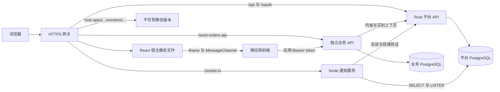
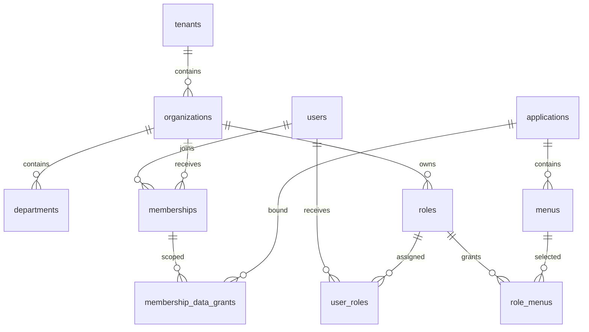
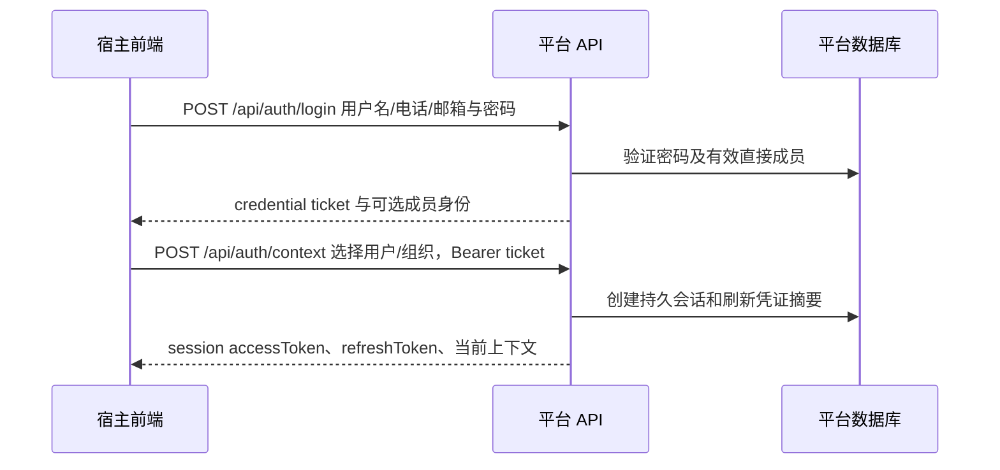

# Dante Cloud 系统架构与应用接入

本文是平台架构、身份与权限、微应用、业务后端、通知、发布和运行恢复的统一文档入口。整理日期为 2026-10-14，依据现有源码、配置与既有文档；历史测试结果单独标明日期，不代表本次重新执行或当前环境已部署。

当前实现优先于早期提案。接口字段以对应 Rust 路由及前端类型为准，数据库完整 DDL 以增量迁移为准，运行参数以配置解析器与部署模板为准。已完成阶段的设计结论已融入正文，旧的任务台账、阶段报告和分散说明不再单独维护。

## 阅读导航

| 主题 | 章节 |
| --- | --- |
| 系统整体与职责边界 | [系统总览](#overview)、[模块结构](#modules) |
| 用户、租户、组织和数据库 | [数据模型](#data)、[授权边界](#authorization) |
| 登录、会话与应用 token | [身份生命周期](#identity) |
| 后台验证 token、获取用户信息 | [业务后端接入](#backend-integration) |
| 不同框架的前端如何接入 | [微应用架构](#microfrontend)、[开发示例](#frontend-examples) |
| 上传、预检、激活和回滚 | [应用发布](#releases) |
| 持久通知与实时推送 | [通知架构](#notifications) |
| 平台配置、地区、地图与管理员 | [平台能力](#platform-capabilities) |
| 启动、生产配置和部署 | [运行部署](#deployment) |
| 日志、指标、备份与恢复 | [可观测性](#observability)、[备份恢复](#recovery) |
| 历史验收、限制和后续工作 | [验收与边界](#validation) |
| 维护与故障排查 | [维护规则](#maintenance)、[故障排查](#troubleshooting) |
| 管理 API 索引与发布协议细节 | [API 索引](#api-catalog)、[发布协议](#release-contract) |

<a id="overview"></a>
## 1. 系统总览

平台提供统一身份、租户与组织、角色与菜单、独立数据授权、OAuth、通知及微应用版本管理。业务应用通过明确的 API 和上下文契约接入，业务数据由独立业务服务持有。



### 1.1 可部署单元

| 单元 | 技术 | 职责 | 常用端口 |
| --- | --- | --- | --- |
| 宿主前端 | React 19、TypeScript、Vite 6、React Router | 登录、后台管理、授权导航、微应用编排 | 开发 3000；生产由网关服务 |
| 平台 API | Rust 2021、Axum 0.8、Tokio、SQLx 0.8 | 身份、授权、OAuth、发布、通知持久化、审计 | 3001 |
| 通知实时服务 | Node 24、Socket.IO | 已落库消息在线提示、连接身份验证 | 3003 |
| 工单业务 API | Node 24、pg | 独立数据库、业务规则与数据范围执行 | 3004 |
| 资源网关 | Caddy / Nginx | HTTPS、静态文件、API 和 WebSocket 反代 | 80 / 443 |
| 数据库 | PostgreSQL 17 | 平台库与业务库分别持有自己的数据 | 5432，按部署配置 |

端口是默认或示例值，不是服务发现协议。开发演练服务可能占用同一默认端口，应按实际配置调整。

### 1.2 信任与依赖边界

- 平台签名密钥只有平台后端持有；业务服务、通知服务和浏览器均不需要该密钥。
- 业务 API 调用平台 HTTPS 接口，不直接查询平台库来推导权限。
- 通知服务为 LISTEN 和收件读取连接平台库，但身份及每次实际投递由平台 API 验证。
- 前端上下文用于展示和请求，不能成为资源归属的权威依据。
- 默认 HTML 微应用隔离在 iframe；只有明确可信的第一方模块可在宿主页面执行。
- 发布版本与授权分开：上传、激活或回滚不会自动授权用户，也不会启动业务后端。

<a id="modules"></a>
## 2. 模块结构与代码入口

| 位置 | 内容与关键入口 |
| --- | --- |
| [backend/src/main.rs](../backend/src/main.rs) | 运行配置、数据库连接、迁移、种子、路由装配及退出 |
| [backend/src/routes/mod.rs](../backend/src/routes/mod.rs) | 平台 API 总路由与通用分页 |
| [backend/src/extractors.rs](../backend/src/extractors.rs) | 当前会话提取、权限检查、请求输入 |
| [backend/src/authorization.rs](../backend/src/authorization.rs) | 有效菜单及操作权限计算 |
| [backend/src/session.rs](../backend/src/session.rs) | 持久平台会话与刷新生命周期 |
| [backend/src/app_token.rs](../backend/src/app_token.rs) | 应用 token 实时有效性 |
| [backend/src/release_archives.rs](../backend/src/release_archives.rs) | 静态包解压与安全检查 |
| [backend/src/releases.rs](../backend/src/releases.rs) | 入口来源、资源和预检协议 |
| [backend/migrations](../backend/migrations) | 增量 DDL、数据补丁、约束与撤销触发器 |
| [frontend/src/App.tsx](../frontend/src/App.tsx) | 宿主页面路由 |
| [frontend/src/lib/api.ts](../frontend/src/lib/api.ts) | 平台 API 请求与会话刷新 |
| [frontend/src/components/micro](../frontend/src/components/micro) | 容器、iframe、可信 HTML 加载、沙箱与类型 |
| [frontend/src/micro-apps/registry.ts](../frontend/src/micro-apps/registry.ts) | 随宿主构建的 ESM 模块注册 |
| [examples/micro-app-sdk](../examples/micro-app-sdk) | iframe bridge、上下文请求和通知辅助组件 |
| [business-apps/work-orders](../business-apps/work-orders) | 真实 Vue 微应用、独立后端、业务迁移及部署工具 |
| [mini-services/notification-ws](../mini-services/notification-ws) | 实时服务、配置及测试 |
| [deploy](../deploy) | Compose/原生网关、监控、恢复和环境模板 |
| [tests](../tests) | 平台、浏览器、网关、契约与隔离测试 |

平台当前是一个 Rust 可执行 crate，不是多个业务微服务 crate 的集合。新增业务服务可使用 Rust、Java、Go、Node 或 Python，只需实现相同的 HTTP 接入契约。

<a id="data"></a>
## 3. 数据模型与持久化

### 3.1 身份和授权实体



用户是全局账号，可通过不同成员关系加入多个组织和租户。电话、邮箱可以重复，账号主键是 UUID，用户名保持唯一。组织归属一个租户，部门归属一个组织；角色归属明确组织。

### 3.2 表职责

| 领域 | 核心表 | 关键约束 |
| --- | --- | --- |
| 租户组织 | `tenants`、`organizations`、`departments` | 同租户组织父节点、同组织部门父节点、树无环、每租户唯一根组织 |
| 用户角色 | `users`、`memberships`、`roles`、`user_roles`、`role_menus` | 成员部门与组织一致，角色租户与组织一致 |
| 两级授权 | `tenant_applications`、`tenant_menus`、`organization_applications`、`organization_menus` | 组织授权不得超出租户上限 |
| 数据授权 | `membership_data_grants` | 当前直接成员、应用、资源、操作唯一绑定一个范围；缺失即拒绝 |
| 平台认证 | `platform_sessions`、`platform_session_refresh_tokens`、`users.session_version` | 持久撤销、账号版本、一次性刷新摘要 |
| OAuth | `oauth_clients`、`oauth_tokens`、授权请求、授权码、设备码表 | 客户端密钥哈希，token 摘要、受众、会话绑定和撤销 |
| 微应用 | `applications`、`menus`、`application_releases`、`application_deployments` | 应用身份稳定，版本定义不可变，部署指针可切换 |
| 通知审计 | `notifications`、`notification_publications`、`notification_prefs`、`audit_logs` | 收件归属、发布幂等、同事务通知、请求关联 |
| 平台配置 | `platform_settings` | 单行展示配置；平台租户名称仍保存在 `tenants` |
| 地区目录 | `region_versions`、`regions` | `(version, code)` 唯一，版本删除标记避免重导入 |

业务工单表和租户计数器位于独立业务数据库，包含真实 `tenant_id`、`organization_id`、`owner_user_id`、修订版本和软删除状态。业务服务不以平台演示数据代替业务记录。

### 3.3 迁移和升级

当前迁移编号到 `0039`，编号不等于文件数量，历史存在编号间隙。完整结构由已执行迁移的顺序与校验和确定，禁止将旧数据库设计文档中的初始 SQL 当作最新全量 DDL。

| 迁移范围 | 作用 |
| --- | --- |
| `0001`～`0012` | 核心身份/OAuth、通知、平台租户、菜单和早期微应用 |
| `0013` | 同租户/同组织复合外键、树无环与存量预检 |
| `0014`～`0015` | 平台持久会话、账号版本和状态失效 |
| `0016`～`0019` | 应用专用 token、会话绑定、撤销、旧 token 升级 |
| `0020` | 独立数据授权 |
| `0021`～`0023` | 独立发布、持久通知发布与请求审计关联 |
| `0024`～`0026` | 报表中心运行模式演进，最终随宿主 ESM 构建 |
| `0027`～`0031` | 租户/组织地点、地区版本及删除状态 |
| `0032`～`0036` | 品牌、五级地区、实体类型、联系人及管理员名称 |
| `0037`、`0039` | 平台会话刷新、品牌主题主色 |

存量关系先执行 [只读审计 SQL](./sql/tenant-relationship-audit.sql)。审计检测跨租户父节点、跨组织部门、成员部门、角色归属、环路和不一致授权；修复需单独审核事务，不自动删除异常关系。迁移失败时停止本次启动，不开放监听。

已执行迁移不能修改，包括文件中的历史文档引用注释。需要修复结构或回退约束时新增后续迁移。程序回滚不等于数据库回滚。

<a id="authorization"></a>
## 4. 授权边界

### 4.1 组织进入与管理上下文

- 只能进入用户拥有有效直接成员关系的组织，祖先成员身份不自动授予子组织登录权。
- 进入后，祖先角色可以贡献菜单和操作权限，但不扩大数据范围。
- 只有实际平台租户的根组织会话为平台管理上下文，`platformContext=true`。
- 平台子组织、普通租户及全局超管切换后的非平台根上下文，管理数据范围均为当前组织及有效子组织。
- 上级、平级、其它租户记录不在范围内；无法访问的资源 ID 通常按不存在返回 404。

`tenant.isPlatform` 只表示租户身份，不能替代平台根上下文检查。全局超级管理员可跳过用户角色层，但仍受租户和组织应用/菜单授权上限约束。

### 4.2 菜单和操作权限

普通用户有效菜单/操作权限按用户有效角色、当前组织菜单授权与租户菜单授权交集计算。应用必须同时在当前租户与组织启用授权。菜单可见、按钮权限和 API 操作授权使用相同服务端规则。

菜单路由不是任意子页面通行证。父菜单不自动授权全部子路径，动态页面应明确配置 `:参数` 或 `*` 模式。未授权用户直接输入地址也不能挂载应用。

全局应用、菜单、OAuth 客户端、全局监控等管理接口要求平台根上下文及对应操作权限；拥有同名菜单不能绕过平台上下文门禁。

### 4.3 独立数据授权

绑定键为当前组织的直接 `membership_id + application_id + resource + action`。角色变更不改写数据范围，祖先角色不继承 data grant，没有显式授权默认拒绝。

| 范围 | 业务 API 必须实现的含义 |
| --- | --- |
| `SELF` | 当前用户拥有的记录，叠加组织上限；工单按创建人/归属人判断，处理人不扩大范围 |
| `ORG` | 当前组织内的记录 |
| `ORG_SUBTREE` | 当前组织及平台确认的有效子组织集合 |
| `TENANT` | 本租户范围；非平台根上下文由平台收窄，仍须执行组织上限 |

`organizationScopeIds` 是硬上限。仅可信实时平台根上下文可明确返回 `null`；旧上下文缺少该字段时保守限制为当前组织。数据 grant 还须匹配当前用户和租户，列表、总数、详情、写入、导出执行相同规则。

当前独立数据 grants 没有公共管理写 API。工单部署工具生成可审阅的 SQL 草案，由 DBA 在核对精确对象后提交；不能假设角色菜单配置已授予数据范围。

### 4.4 关联维护与共享账号

用户成员、用户角色、角色用户的替换仅修改可管理子树内关联，保留范围外记录。当前成员保存采用差量删除和保留项 UPSERT，保留有效 membership UUID、数据授权和会话；旧部署说明中“保存成员必然重建全部 UUID”的描述不再作为当前行为。

删除成员仍会撤销对应会话并级联删除其数据 grants。共享账号还有范围外成员或角色时，子树管理员不能修改全局资料、状态、密码或删除账号，应由具备授权的平台根上下文处理。

<a id="identity"></a>
## 5. 身份生命周期

### 5.1 登录与选择组织



电话、邮箱可由多个账号共用，先验证密码，只返回验证通过账号的有效成员选择项；多账号票据为 `credential_multi`，组织选择同时提交明确 `userId`。普通票据或会话不能任意换用户。

credential 仅用于建立上下文，不能作为业务 token。有效期受配置限制；响应中的实际到期值为准，不使用早期文档固定数值作为协议常量。

### 5.2 平台会话与刷新

session JWT 带 `sid/ver`，每次请求查持久会话、账号版本、直接成员、租户与组织祖先有效性。登出当前设备、撤销本人设备、改密、管理员重置/踢出及成员/状态变更按规则立即失效；恢复启用或重加成员不会复活旧凭据。

组织切换事务创建新会话并撤销旧会话，前端在切换开始就停止旧微应用、旧请求和 socket，清理旧查询。多设备会话独立存在。

平台 refresh token 为一次性摘要凭证，调用 `/oauth/token` 的 `grant_type=refresh_token` 轮换；不附加 OAuth 客户端凭据或 scope。刷新保留会话 ID 和当前组织，绝对刷新截止时间不延长，重新核对版本、撤销与成员状态。前端合并并发刷新并仅重试一次原请求。

### 5.3 应用 token

宿主携带 session 调用 `POST /api/oauth/session-token`，body 为 `{"appCode":"orders"}`，取得专用应用 token。应用必须启用、关联可用机密客户端、获得两级授权，且用户持有有效会话和当前组织直接成员关系。

token 绑定用户、租户、组织、应用、客户端、平台会话，带独立 `aud/jti`，寿命最多 300 秒且不超过其它有效期。平台保存摘要及绑定/撤销元数据，不保存该 token 明文。运行模式、应用编码、客户端绑定和相关配置变更可撤销旧 token；普通静态版本激活不改变受众或授权。

平台 session、应用 token、OAuth 服务 token、refresh token 和 credential ticket 不可互换。业务后端只接收本应用用户 token；服务机器 token 不代表用户。

<a id="backend-integration"></a>
## 6. 业务后端验证 token 与获取用户信息

### 6.1 服务身份配置

业务服务使用自己的数据库，配置固定平台 HTTPS origin、本应用编码、实际机密客户端 ID/secret。客户端 ID 由平台生成，客户端名称不能当作 ID。客户端密钥仅保存在服务端环境或密钥管理系统。

```dotenv
PLATFORM_API_ORIGIN=https://saas.example.com
PLATFORM_CLIENT_ID=实际生成的客户端ID
PLATFORM_CLIENT_SECRET=服务端机密
```

浏览器调用业务 API 时发送 `Authorization: Bearer <本应用token>`。前端不传平台签名密钥或客户端 secret。

### 6.2 两个平台接口

第一步，后台使用机密客户端 Basic 认证调用 token 内省，body 按表单编码：

```http
POST /oauth/introspect
Authorization: Basic <Base64(clientId:clientSecret)>
Content-Type: application/x-www-form-urlencoded

token=<表单编码后的应用token>
```

检查 `active=true`、`aud=本应用编码`、`token_type=Bearer`、`exp` 未过期和有效 `sub/tenant_id/organization_id`。HTTP 200 可返回 `{"active":false}`，不能只判断状态码。

第二步，使用同一个应用 Bearer token 获取当前授权上下文：

```http
GET /api/apps/orders/context
Authorization: Bearer <同一个应用token>
```

响应契约为 `1.0`，包含 `appCode/contextVersion/expiresAt/application/user/tenant/organization/organizationScopeIds/roles/permissions/dataGrants/menus`。后台将其中用户、租户和组织 ID 与内省结果核对，拒绝过期或不一致上下文。

### 6.3 用户与授权示例

以下为结构示例，ID、哈希和日期须来自真实平台响应：

```json
{
  "contractVersion": "1.0",
  "contextVersion": "64位授权内容哈希",
  "expiresAt": "2026-10-14T08:00:30Z",
  "appCode": "orders",
  "application": {"id":"应用UUID","name":"订单应用"},
  "user": {"id":"用户UUID","username":"zhangsan","displayName":"张三"},
  "tenant": {"id":"租户UUID","code":"company-a","name":"A公司"},
  "organization": {"id":"组织UUID","name":"销售部","path":"组织路径"},
  "organizationScopeIds": ["组织UUID"],
  "roles": [],
  "permissions": ["order:read"],
  "dataGrants": [{
    "resource":"order","action":"read","scope":"ORG",
    "subjectUserId":"用户UUID","tenantId":"租户UUID",
    "organizationIds":["组织UUID"]
  }],
  "menus": []
}
```

后台可信当前用户是 `context.user`，不能采用浏览器 body 或 header 中自报的用户、租户和组织。创建业务记录的归属字段由后台填入。

### 6.4 中间件与数据库执行

```text
Bearer 提取
  → 机密客户端内省
  → 实时上下文与身份核对
  → 当前请求身份对象
  → 操作权限 + 对应 resource/action data grant
  → tenant + organization ceiling + grant 范围过滤
  → 业务查询/事务
```

每个受保护请求重新内省并读取上下文，不缓存正向授权。授权上下文最多有效 30 秒且不晚于 token 到期；长操作在关键写入前再次确认当前取得的授权未过期。

平台调用限制超时、响应容量和重定向。凭证失效返回 401，缺操作/数据授权返回 403，不可见记录返回 404，冲突返回 409；无法确认授权时停止操作并返回 503。不要在平台故障时依赖浏览器 props 或旧权限继续执行。

完整实现见 [工单 auth.mjs](../business-apps/work-orders/backend/auth.mjs) 的 `bearer/authorize/grantFor/scopeSql/assertFresh`；通用记录校验见 [authorize.mjs](../examples/app-backend/authorize.mjs)。移植到其它语言时保留校验语义，而非只解码 JWT。

### 6.5 CORS 与客户端请求

默认 iframe 不含 `allow-same-origin`，业务请求可能产生 `Origin: null`，即使 URL 在宿主同域也不能假定普通同源。业务 API 配置无 Cookie Bearer CORS、OPTIONS、实际方法和 Authorization/Content-Type/X-Request-Id，成功与错误响应都应正确返回 CORS。

允许 `null` 不能证明请求来自合法应用，后端仍靠 token 与授权判定。平台生产 CORS 只允许精确配置的 HTTPS origin，业务 opaque CORS 不应扩散到全部平台/OAuth 接口。

<a id="microfrontend"></a>
## 7. 微应用前端架构

### 7.1 接入方式

| 类型 | HTML + iframe | 第一方 ESM |
| --- | --- | --- |
| 独立 React/Vue/Angular/Svelte/Solid/jQuery | 推荐，自带运行时和样式 | 不作为独立上传方式 |
| 平台内部 React 模块 | 可以独立化 | 适合共享宿主 React/UI |
| 交付 | 单入口静态 ZIP/tar.gz | `frontend/src/micro-apps/{code}.tsx` |
| 生命周期 | iframe SDK `connect` | 模块导出 `__DANTE_MICRO_APP__` 或方法 |
| 更新 | 独立上传、预检、激活 | 重新构建发布宿主 |
| 默认信任 | `IFRAME`，opaque sandbox | `TRUSTED`，直接执行自有代码 |

新建页面选择 HTML 或 ESM，无需另选运行方式。SDK 采用自有契约，不要求 qiankun/Wujie/Module Federation。仅实现其它框架生命周期不能自动接入。

### 7.2 挂载与协议

宿主在 `/micro/{code}/*` 从个人授权应用列表取入口，申请 token 并取得有效上下文，两步成功才加载。HTML iframe sandbox 为 `allow-scripts allow-forms`，没有同源身份；专属 MessageChannel 传递 token 与 DTO，不将 token 放入 URL。

子应用复制 [iframe-bridge.js](../examples/micro-app-sdk/iframe-bridge.js)，通过 `DanteMicroIframe.connect` 声明 `appCode`、精确 `allowedHostOrigins`、容器和生命周期。来源包含协议/域名/端口，无路径；localhost 和 127.0.0.1 不是同一来源。直接打开子入口没有宿主上下文，等待是正常行为。

`mount/unmount` 必需，`update` 建议实现。生命周期可异步，Promise 在真实完成后结束；SDK 串行调用，但新上下文立即取消旧 signal。没有 update 则卸载后重挂，可能丢输入。

### 7.3 MicroProps 2.0

| 字段组 | 内容 |
| --- | --- |
| 应用路由 | `appCode/basePath/routePath` |
| 身份 | `user/tenant/organization/organizationScopeIds` |
| 授权 | `roles/permissions/dataGrants/menus` |
| token 与期限 | `token/tokenExpiresAt/expiresAt` |
| 内容与推送版本 | `contractVersion/contextVersion/contextEpoch` |
| 发布 | `deploymentVersion/entryVersionId`，可为空 |
| 展示与交互 | `theme/signal/onNavigate/onNotify` |

完整类型见 [types.ts](../frontend/src/components/micro/types.ts)。后端契约 1.0 经宿主映射为前端 2.0。signal/回调由 SDK 在 iframe 本地创建。

宿主约 20 秒刷新上下文并在 token 到期前续签；token、授权、身份、主题和子路由变化都会更新。收到更新必须替换当前 token/signal，组织或用户变化清理业务数据与身份草稿，权限撤销隐藏旧视图并失效相关缓存。

### 7.4 路由、主题、通知与请求

- 用户地址是 `/micro/orders/list`，静态入口是 `/sub-apps/orders/versions/1.0.0/index.html`，两者不能混用。
- 用 `routePath.slice(basePath.length) || "/"` 得内部路径，React/Vue 可用 memory router/history 与宿主同步。
- 用 `props.onNavigate(props.basePath + "/list")` 请求导航。iframe 只允许本应用范围，不能借回调进入别的应用或外部 URL。
- 当前 `routePath` 只有 pathname，没有 search/hash 字段。可刷新恢复的 ID 优先作为路径参数，不能假设 query/hash 随 props 回传。
- iframe 不继承宿主 CSS/字体/组件库，使用 `props.theme` 设置自己的主题。
- `onNotify` 是 Toast，不是持久站内通知。
- `bridge.requestJson` 自动带当前应用 token、取消与 `credentials:omit`，解析后复核上下文；只适用 JSON，非成功状态是通用 Error，没有 `error.status`。
- `bridge.current()` 无有效上下文时为 null，`dispose()` 当前不是可等待的卸载 Promise；不在自己的 unmount 中反复 dispose bridge。

自行封装请求必须同时保护 fetch、响应体解析和状态回写；AbortError 忽略结果，旧上下文请求即使不响应取消也不能更新新组织视图。全局监听、定时器、订阅和实例在卸载时清理。

### 7.5 下载与浏览器能力

CSV 先由业务 API 按范围过滤，再调用 `bridge.downloadCsv({resource,filename,content})`。宿主要求 `${resource}:export` 与同资源 export grant，检查当前上下文、消息序号和下载参数；最多 4 MiB UTF-8，仅安全 `.csv` 名称。成功表示发起下载，不代表保存完成。

默认 iframe 不增加下载、同源、弹窗权限。localStorage、IndexedDB、Service Worker、顶层导航和原生桥接不能假定可用；认证保存在内存，持久业务偏好通过业务 API 保存。支付、摄像头、剪贴板等能力需另行验证和受控适配。

### 7.6 ESM、可信 HTML 与 SSR

ESM 注册器仅发现当前目录 `./*.tsx`，文件名与编码一致，包含在宿主构建的 lazy chunks 中。`/src/micro-apps/{code}.tsx` 是注册标识，生产不需要公开 TSX 源文件。可共享宿主依赖，但不同 React root 的 Provider 要显式配置。

历史 TRUSTED HTML 通过 `window.__DANTE_MICRO_APP__` 暴露生命周期，加载器按 classic script 执行，拒绝 module/modulepreload；它主要用于自有历史集成。需要 eval 的可信 HTML 还须显式网关 CSP 决策，新标准 Vite 应用优先 iframe。

Next/Nuxt/Astro 能整理为单入口静态应用时按 HTML 接入；多 HTML 导出不能直接满足上传限制。SSR、Server Actions 或 Node API 要独立部署服务，静态包上传不会启动服务。H5 可以接入，小程序/原生 App 需其它客户端方案。

<a id="releases"></a>
## 8. 应用构建、发布与授权

### 8.1 构建约定

Vite 设置 `base:"./"`，Vue CLI 设置 `publicPath:"./"`，其它构建器核对最终相对资源地址。源码 HTML 可以含 Vite `/src/main.tsx`，上传必须使用 build 后产物。硬编码资源路径不会全部自动改写；API `/orders-api` 是有意使用的网关根路径。

包根含 index.html（可多包一层 dist），只有一个 HTML 入口，完整包含 JS/CSS/图片/字体/动态 chunk，不带 node_modules、.env、secret 或私有业务数据，许可文件随依赖要求保留。

| 限制 | 当前值 |
| --- | --- |
| 压缩包大小 | 20 MiB |
| 解压/资源总量 | 16 MiB |
| 单文件 | 4 MiB |
| 入口外资源数量 | 48 项 |
| URL 预检 | 单请求 4 秒，总计 30 秒，64 项检查，单资源最多 5 次 redirect |

### 8.2 常规接入步骤

1. 管理员创建 HTML 应用，使用稳定编码。
2. 快速接入生成 `/micro/{code}`、占位入口和首页 MICRO 菜单，不生成授权或客户端。
3. 关联已启用机密客户端并配置所需 scope，密钥交给业务后端。
4. 构建 ZIP/tar.gz，选择环境和新版本号上传并登记。
5. 检查 `validationStatus=PASSED`，再激活；上传不自动激活。
6. 菜单 path 填 `/micro/{code}` 或授权子路径，linkTarget=MICRO，linkUrl 留空。
7. 配置租户/组织应用与菜单授权、角色菜单与用户角色、独立数据 grants。
8. 用普通用户验证直达路由、业务接口、续期、撤权、切组织和卸载。

```powershell
# 在子应用目录，使用该项目锁文件与构建脚本。
npm ci
npm run build
Compress-Archive -Path ./dist/* -DestinationPath ./orders-1.0.0.zip
```

orders 是说明示例，仓库真实应用为 work-orders；替换编码、origin、API 与项目路径后实施。

### 8.3 应用、版本和部署指针

`applications.id` 稳定承载授权；`application_releases` 保存应用/环境/版本的不可变定义；`application_deployments` 保存 active/previous。相同应用与版本对应一份不可变文件，跨环境完全相同包可复用，不同内容必须换版本号。

上传写入 `MICRO_APPS_DIR/<code>/versions/<version>`，服务端生成资源清单并 HTTP 预检。PASSED 是服务端结果，前端不能自行声明。激活前再次预检；回滚也预检旧版本并切换指针，并发变化返回冲突。

保留历史目录，已挂载用户的旧 chunk 仍应可访问。宿主 profile/context 获得版本和运行模式变化后重新挂载；实时模式与缓存 profile 不一致时先停止执行并刷新，不能继续执行旧 TRUSTED 缓存。

### 8.4 预检、来源与网关

入口、资源、健康检查和每次 redirect 命中服务端精确 origin 白名单，生产 URL 必须 HTTPS；白名单不由上传者扩展。检查真实 MIME/非空文件，资源错误或 SPA fallback HTML 均失败。

iframe 原生模块及 crossorigin 资源要允许 opaque Origin:null 匿名加载；公开版本文件可返回 `Access-Control-Allow-Origin:*`，不允许 Cookie 凭据。iframe 入口的 X-Frame-Options/CSP frame-ancestors 必须允许实际宿主。预检不执行 JS，不代表运行时动态请求已完整验收。

更多发布管理路径、状态与 DTO 见 [发布协议](#release-contract)。

### 8.5 兼容命令行与独立服务

```powershell
# 仓库根目录：仅生成版本目录与 release.json。
node scripts/package-microapp.mjs --app orders --environment development --version 1.0.0 --input path/to/orders/dist
```

命令不自动登记数据库、预检或激活。常规发布用管理页面上传，旧 JSON 登记保留给自动化及受控外部服务。未版本化 `/sub/vue/`、`/sub/jquery/` 和 micro:sync 只作为开发/历史迁移，不是新生产发布路径。

<a id="notifications"></a>
## 9. 持久通知与实时推送

### 9.1 持久发布

应用调用 `POST /api/apps/{appCode}/notifications`，使用本应用 token，同时要求 `notification:publish` 和 `notification/publish` data grant。祖先角色和超管不代替数据 grant，也不新增同名 OAuth scope。

```json
{
  "idempotencyKey":"ticket:7301:reminder:v1",
  "target":{"kind":"USER","userId":"用户UUID","organizationId":"组织UUID"},
  "type":"INFO",
  "title":"工单待处理",
  "content":"请查看工单 7301",
  "link":"/micro/work-orders/tickets/7301"
}
```

目标为 USER（指定组织直接有效成员）、ORGANIZATION（该组织直接成员，不隐含子树）或 TENANT（当前租户的合规收件成员/组织），严格三选一。目标需在 grant 范围内并可访问该应用；不接受自报发布者/租户/应用。

幂等命名空间为租户、发布组织、应用、发布用户和键。同键同规范化内容复用首次记录，duplicate=true；同键不同内容返回 409。网络结果未知保留同键同正文重试，不能换键重复发送。每次重试重新验证当前权限和范围。

发布记录、收件行、审计与 NOTIFY 同事务提交。成功返回 publicationId、recipientCount（不同用户数）、deliveryCount（用户×组织数）、duplicate、createdAt。请求最多 64 KiB，单次最多 1000 条投递；键 1～128 位指定 ASCII 字符，标题 1～200、正文最多 8192、链接最多 300 且仅本应用路径，类型 INFO/SUCCESS/WARNING/SECURITY。

宿主 `POST /api/notifications` 使用 session 并额外提交 applicationId，仍执行相同发布授权；旧 userId/orgId/tenantId 发送 body 不再受理。

### 9.2 收件归属与实时恢复

列表、未读、已读和删除只作用于当前 user/tenant/org。APP 行还要求应用当前启用和两级授权；失权历史行保留但不可见。SYSTEM 按有效收件上下文读取。升级前无归属消息保留为 LEGACY，不猜测租户；仅平台根且 system:audit 可只读审计。

Socket.IO 使用 `/socket.io/`，初次 authenticate 只传 token。公开 authenticated 含 contractVersion/userId/tenantId/organizationId/expiresAt，不公开 sessionId/token。通知事件携带收件归属和内容，但 HTTP 已读状态仍由数据库 API 决定。

实时服务通过内部 `/api/notifications/socket-context` 取得并绑定 sessionId，在连接、每次实际投递及周期复验时检查；投递附 notificationId。消息特定 403/404 跳过该条；会话失效或身份变化断开，无法确认时停止投递。

LISTEN 断开后受控重连，不保证离线即时事件重放。宿主认证/重连立即补拉收件箱、未读数和偏好，离线历史不批量弹 Toast。数据库已提交与在线提示成功分别衡量，推送故障不换幂等键重发持久通知。

### 9.3 部署和权限

通知服务配置自己的 DB 读取/LISTEN 账号、固定平台地址、精确宿主 origin 白名单和独立指标 token。生产允许来源不接受 `*` 或 `null`，不读取平台 .env，不持有平台 JWT 密钥。公开网关同时保留 polling 和 WebSocket 路径。socket-context 使用有效 session Bearer 校验，服务端返回内部使用的会话字段；不要把它当作匿名公开身份查询。生产网关另行阻断 `/api/internal/*` 和私有指标路径。

<a id="platform-capabilities"></a>
## 10. 平台能力与工单试点

### 10.1 品牌与管理员初始化

品牌持久化于 platform_settings，公开 `/api/platform/branding` 提供名称、简介、Logo、登录标题/说明、页脚与 `primaryColor`。管理 `/api/platform/settings` 需要平台根上下文和 system:settings，额外返回平台租户名称和固定编码 `admin-tenant`；写入不能修改该编码。主题主色为六位十六进制，旧客户端省略保留。

新建租户在事务中生成根组织和内置管理员角色，维护联系人后创建或匹配首位用户，初始随机密码只返回一次；新建组织采用相应组织范围管理员角色。仅电话/邮箱相同但联系人不同不会自动合并账号。非平台根只可复用当前可管理子树内同一联系人的账号。

旧实体保存联系人不会自动初始化，需调用 `/api/tenants/{id}/initialize-administrator` 或 `/api/organizations/{id}/initialize-administrator`，检查所需 entity/user/role 权限。事务锁定组织并幂等处理，已初始化不重复创建、不替换已有管理员。

### 10.2 地区目录与地图

地区目录按版本提供省市县乡村五级选项，最新未删除且有数据版本为默认。内置 2023 从源文件去重后事务导入，后续不覆盖维护数据，删除标记阻止重导入。复制版本不等于获得新的官方地区数据。

父级变化清空下级，地图解析只在已确认父级内匹配，无法识别的下级留空人工选择；东莞/中山等可跳过县级。租户与组织持有地点字段。

`/api/maps/*` 固定代理瓦片、地点搜索、反查和可信访问者 IP 估算，前端不任意指定外部目标；IP 结果一般只到城市，不能自动写成精确门牌。开发 Vite 与生产 Rust 网关分别代理固定上游。

### 10.3 真实工单业务

工单前端 Vue 3，后端 Node 24，独立 PostgreSQL。支持列表、筛选、详情、创建、修订版本更新、软删除、CSV 和手动提醒。处理人必须是记录组织内有效直接成员，处理人身份不扩大 SELF。

状态 OPEN → IN_PROGRESS → RESOLVED，允许 RESOLVED → IN_PROGRESS 重开；更新/删除基于版本和行锁，旧版本返回 409。CSV 服务端过滤、公式前导字符中和、最多 1000 行及 4 MiB，不静默截断。

提醒使用独立幂等事件，不修改工单版本；先验证读工单，再验证 notification 发布授权，目标为处理人或未分配时创建人。处理人改变导致同键不同目标时返回冲突，由用户发起新的独立提醒。

<a id="deployment"></a>
## 11. 运行配置与部署

### 11.1 本地开发

使用 PostgreSQL 17、仓库 Rust 工具链和 Node 24。先配置独立开发凭据与可访问数据库，再分别启动平台和宿主：

```powershell
# 在 backend 目录，配置 DATABASE_URL、JWT_SECRET、BIND_ADDR 等。
cargo run --locked
```

```powershell
# 在 frontend 目录。
npm ci
npm run dev
```

宿主默认 BACKEND_PROXY_TARGET 为 http://127.0.0.1:3001；IPv6 开发可显式配置 http://[::1]:3001。版本目录默认读取 deploy/micro-apps，可用绝对 MICRO_APPS_DEV_DIR 覆盖；必须与后端 MICRO_APPS_DIR 对应。

新业务 API 需新增自己的代理/CORS，既有工单处理不会自动覆盖任意前缀。HMR 直连子 dev server 需要额外模块、WS 与入口策略，集成验收优先上传 development 构建版本。

### 11.2 配置优先级与生产门禁

系统/服务环境优先。生产不自动搜索 .env；需要文件时通过绝对 DANTE_ENV_FILE 明确加载。开发只加载当前工作目录 .env，文件不能隐式将环境变成生产。APP_ENV 或 APPLICATION_ENVIRONMENT 任一 production 即启用生产检查。

| 配置 | 生产要求 |
| --- | --- |
| DATABASE_URL | 明确平台数据库，业务库另配 |
| JWT_SECRET | 独立随机至少 32 字节，拒绝默认/占位/低熵值，仅平台持有 |
| METRICS_TOKEN | 与 JWT 独立，各服务分别配置随机 token |
| PUBLIC_APP_URL | 精确 HTTPS origin |
| MICRO_GATEWAY_ORIGIN / MICRO_ALLOWED_ORIGINS | 可达网关与最小精确 HTTPS 来源 |
| CORS_ALLOWED_ORIGINS | 精确 HTTPS 宿主，不允许通配或 null |
| MICRO_APPS_DIR | 持久绝对版本目录，后端可写，网关只读 |
| TRUSTED_PROXY_IPS | 精确代理 IP，无通配/CIDR，网关覆盖伪造代理头 |
| BOOTSTRAP_ADMIN_USERNAME/PASSWORD | 空用户表生产首次初始化必需；密码至少 12 字符 |
| OAUTH_AUTO_PURGE | 默认 false，不自动清理历史认证数据 |

生产配置在 DB 连接前检查。已有用户库不会重建管理员或根据 bootstrap 变量重置密码；启用账号/客户端发现已知演示凭据则拒绝启动，需要显式轮换或停用。AUTO_CREATE_DATABASE 默认 false，建库和迁移失败停止启动。

生产密码新增/重置/修改统一至少 12 字符，拒绝已知演示密码、控制字符和纯空白。正常证书与主机名验证保持开启；额外 CA 用 MICRO_CA_CERT_FILE 或 Node NODE_EXTRA_CA_CERTS，不关闭 TLS 检查。

### 11.3 网关路径和部署配置

| 路径 | 上游/处理 |
| --- | --- |
| /api/*、/oauth/* | Rust 平台 API，保留原路径 |
| /socket.io/* | 通知服务，polling 与 WebSocket Upgrade |
| /work-orders-api/* | 独立业务 API，保留前缀 |
| /sub-apps/{code}/versions/{version}/* | 独立版本目录，缺文件严格 404 |
| /micro/* 与其它宿主页面 | 宿主 SPA fallback |
| /api/internal/*、各私有 metrics | 生产公共网关拒绝访问 |

HTML no-cache，不可变版本资源可一年 immutable，错误 no-store。公开静态版本匿名 CORS，不能将其扩展为平台全局跨域规则。

当前 [frontend/Dockerfile](../frontend/Dockerfile) 使用 [Caddyfile.production](../deploy/Caddyfile.production)，PUBLIC_APP_URL 驱动正常 HTTPS，Compose 持久保存 /data 和 /config，并显式映射 443。旧 [Caddyfile](../deploy/Caddyfile) 为 HTTP/兼容示例，不代表当前生产镜像配置。

Compose 编排平台 PostgreSQL、backend、notification-ws、web，可选 work-orders API 与本地业务 DB profile。实际必填项来自 [compose.env.example](../deploy/compose.env.example) 和 [docker-compose.yml](../docker-compose.yml)。检查和运行是两项不同门禁：

```sh
docker compose --env-file /secure/dante.env config --quiet
docker compose --env-file /secure/dante.env --profile work-orders up -d --build
```

选用内置业务数据库时同时启用对应 local-db profile，否则配置外部独立业务库。版本目录预先存在，服务账号有明确 ACL；不能让重建宿主镜像清空历史目录。

### 11.4 原生部署与 CSP

[deploy/native](../deploy/native) 提供白名单干净构建、配置渲染、Nginx/Caddy 和 systemd 模板。构建锁依赖、拒绝 secret 和既有 node_modules/dist 混入；新输出目录不可覆盖旧产物。

```sh
node deploy/native/build.mjs --out-dir /srv/dante-builds/new-release --cargo /usr/bin/cargo
node deploy/native/render.mjs --config /srv/dante/deployment.json --out-dir /srv/dante/configuration
nginx -t -p /srv/dante/ -c /srv/dante/configuration/nginx.conf
```

按最小权限服务身份分离平台、通知、业务、网关，环境配置私有，平台签名密钥不交给其它服务。启动先保证平台迁移成功与 HTTPS 网关可达，再让通知探针收敛并启动已关联客户端的业务服务。

默认 CSP 不允许 unsafe-eval，iframe 来源与可信脚本来源分别批准。确需历史可信 HTML eval 时显式评审配置，不能自动放宽。CSP、SDK 父来源和服务端发布 allowlist 各自处理不同边界。

<a id="observability"></a>
## 12. 可观测性、健康与容量

| 服务 | live | ready | 私有 metrics |
| --- | --- | --- | --- |
| 平台 | /api/health/live | /api/health | /api/internal/metrics |
| 工单 | /work-orders-api/health/live | /work-orders-api/health | /work-orders-api/metrics |
| 通知 | /health/live | /health，公共映射 /notification-health | /metrics |

live 只说明进程，ready 核对实际依赖。业务探针检查业务表/字段与平台保护路由预期 401；通知还要求独立 LISTEN 就绪。健康不代表任何用户已授权，也不代表消息已收到。

X-Request-Id 使用合法 UUID 或生成新值，响应、平台调用和审计关联该 ID。日志使用静态路由、状态和时延，归属只在验证后记录；不记录 token、secret、数据库 URL、请求体、业务通知正文或动态查询内容。指标 label 不放用户、租户、组织或资源 ID。

Rust 指标包括 dante_http_requests_total/request_duration_seconds、鉴权/权限失败、数据库状态、受限微应用运行事件。Node 指标包括 saas_http_*、database/platform/health、通知连接、LISTEN 和提示丢弃；浏览器上报不是权威健康证明。

当前内省每客户端默认配额为 600 次/分钟，不是早期 30 次/分钟；另有 IP 总尝试、失败认证和并发认证门禁。返回 429 时遵循 Retry-After，容量需要结合每次业务请求的内省/上下文调用评估，不能通过正向缓存绕过即时撤销。

[deploy/monitoring](../deploy/monitoring) 提供私有 scrape、状态转移本地 DOWN/RECOVERED 告警与 Prometheus 模板。默认连续两次失败/恢复确认，稳定状态不重复发事件；本机演练只记录本地事件，实际外部接收渠道需部署方配置。

<a id="recovery"></a>
## 13. 加密备份与新库恢复

### 13.1 一致性与凭据

平台库和业务库分别备份，跨库一致性依赖共同停写窗口：停止全部写服务和任务、等未完成事务退出，再明确 BACKUP_WRITES_QUIESCED=true。该标志是运维确认，工具不能发现所有外部写入者。

[deploy/recovery](../deploy/recovery) 使用 Linux Node 24 与 PostgreSQL 17 客户端。配置为当前用户拥有普通 0600 文件，目录 0700，凭据不放入命令参数。密钥为独立 32 字节随机二进制文件，离线保管，不与密文位于同一故障域。

### 13.2 备份和校验

```sh
node deploy/recovery/pg-backup.mjs backup --env-file /etc/saas/recovery/backup.env
node deploy/recovery/pg-backup.mjs inspect --env-file /etc/saas/recovery/backup.env --backup-set /var/lib/saas-backups/SET
```

custom dump 直接流式 AES-256-GCM 加密，不落盘明文；集合含 platform.enc、work-orders.enc、manifest.enc。清单记录两份 dump 的 SHA-256、字节数、数据库版本和迁移校验和。两份密文认证后才发布完整不可变集合，失败保留 .incomplete 供调查。

备份包含历史记录和授权，不自动过滤软删除；不包含 JWT/客户端运行密钥、TLS 私钥、数据库角色定义、宿主与微应用静态版本，这些需独立托管与完整性校验。

### 13.3 恢复步骤

```sh
node deploy/recovery/pg-backup.mjs restore --env-file /etc/saas/recovery/restore.env --backup-set /var/lib/saas-backups/SET
```

1. 两份密文与清单完整认证通过后才进行 DB 操作。
2. 两个目标必须是未被服务引用且不存在的新数据库；拒绝保护/维护库、同库、已有目标，不使用 clean 覆盖。
3. 明文仅临时存在于权限受控 Linux tmpfs，空间不足失败，不降级磁盘明文；按运行要求处理 swap。
4. template0 建库，单事务 restore，检查迁移与校验和；角色/ACL 由 DBA 单独恢复。
5. 平台恢复后强制提升账号 session_version、撤销会话和全部 token、消费旧 code/request、过期 device code，追加恢复审计，避免 snapshot 复活身份。
6. 轮换 JWT 密钥，重新登录，验证旧凭据拒绝及关键业务/授权/通知；通过后才开放网关。

仅轮换签名密钥不能代替数据库认证重置。中途失败保留已创建目标并隔离，不自动删除，不将失败目标连接网关。

### 13.4 调度与恢复目标

systemd backup service/timer 模板每天服务器本地时间 02:15 执行，包含停写窗口与原 active 服务重启；OnFailure 接实际运维处理器。SIGKILL/断电需人工核对服务状态。模板存在不代表系统定时任务已安装或连续运行。

RPO 24 小时、RTO 1 小时是已确认的初版演练目标，不是商业 SLA。RTO 包含完整恢复、配置轮换、服务启动和登录后的关键验证，不只计算恢复 CLI 耗时。完整集合应异机复制后 inspect，密钥另存。

工单软删除、通知、审计、会话/IP/UA 历史不自动清理；正式保留期、容量与清理策略仍需产品/运维确认。

<a id="validation"></a>
## 14. 历史验收与当前边界

### 14.1 已记录的验证

下表是整合前记录中的历史结果，未在本次文档整理中重新运行：

| 日期/阶段 | 记录结果 | 范围与边界 |
| --- | --- | --- |
| 2026-09-30，关系与身份阶段 | 实际 PostgreSQL 17.6 约束、隔离、会话和应用 token 测试通过 | 只证明隔离库，不代表生产存量已审计 |
| 2026-10-02，上下文/发布 | 31 项上下文回归、11 浏览器场景；发布 8 项 PG/HTTP gate、iframe/网关等通过 | HTTP fixture、浏览器、真实数据库证据分别使用，不能互相替代 |
| 2026-10-02，通知 | 实际平台/PostgreSQL/Socket.IO 联合 9 项，0 skip | 部分组件测试使用协议 fixture，真实平台联合另行记录 |
| 2026-10-07，真实工单 | 16/16，0 fail/cancel/skip，596.846 秒 | 平台/业务双库、Vue、通知、CSV、授权和版本切换；宿主 100 文件哈希不变 |
| 2026-10-07，原生准生产 | 23/23，0 fail/skip，约 307 秒 | Linux 原生进程、私有测试 CA、真实 Nginx HTTPS、故障告警与双库恢复 |

原生验收干净构建记录 259 文件，源码清单 SHA-256 为 `58b92c9bc516960bbad32e1f54a3f10c55300fb842cc04de92373758187d20f3`。历史证据位于 Git 忽略的 target/phase12-runtime 中，不把当时源码哈希当作当前版本哈希。

历史备份 CLI 6.233 秒、恢复 CLI 10.054 秒、完整服务恢复 25.940 秒。容量探针 4 并发/40 读取约 3.70 请求/秒、p50 733 ms、p95 2138 ms，受当时 WSL/TCP 环境影响，不能外推现网吞吐。

### 14.2 未覆盖与后续目标

- 历史记录未执行 Docker 镜像实际构建/容器启动、系统级 unit/timer 安装、GitHub runner 和真实现网发布；Compose/Caddy 配置解析不等于这些目标通过。
- 现网域名、主机、证书/密钥托管、远端备份、告警接收人、保留期、容量/SLO 仍需目标环境配置和复测。
- 单数据库平台逻辑隔离和独立业务库已实现，不表示每个租户已有物理独立库方案。
- 授权缓存、灰度审批、任意下载 broker、SSR 服务启动和公共数据 grant 写 API 不属于当前已提供能力。
- 2026-10-07 的本机验收覆盖当时版本，后续品牌、地区、刷新等变更需按当前门禁验证，不能自动继承历史通过结论。

### 14.3 验证入口

```powershell
# 仓库根目录：纯契约/示例与资源打包。
node --test tests/micro-context-runtime.mjs tests/micro-sandbox-lifecycle.mjs tests/micro-iframe-protocol.mjs tests/package-microapp.mjs mini-services/micro-vue/smoke-test.cjs mini-services/micro-jquery/smoke-test.cjs
node --test tests/micro-release-gateways.mjs
node tests/micro-host-browser.mjs
```

```powershell
# 在 backend 目录。
cargo fmt -- --check
cargo check --locked
cargo test --locked
# 真实隔离数据库发布测试需 TEST_DATABASE_URL 和相关条件。
cargo test --locked release_tests -- --ignored --nocapture
```

```powershell
# 在 frontend 目录。
npm run build
```

其它模块 tests 和 package scripts 见各组件 README。真实数据库/浏览器测试缺少配置时的 skip 不算通过，不默认连接生产库。测试仅清理自己创建的数据库、进程和目录。

<a id="maintenance"></a>
## 15. 维护和架构变更规则

- 本文维护系统级约束，组件 README 保留可执行启动/测试说明，SQL/配置源码保留实际工具能力；不重新创建平行架构说明。
- 新平台能力修改路由、前端 API/types、页面路由与菜单权限；持久化变化新增迁移，禁止改已执行 SQL 校验和。
- 新业务应用先定义资源归属、操作权限和独立 grant，后实现 token/context 中间件、范围查询、前端与发布。
- 校验和权限在后端执行，前端不推导全局授权、不持久保存应用 token、不通过放宽 sandbox 解决兼容问题。
- 运行方式、来源、服务配置和发布协议变化同步维护本文及目标网关，不以历史报告替代当前验证。
- 凭据、私有运行证据、备份密文和用户数据不提交 Git；历史阶段详情可从版本历史追溯。

<a id="troubleshooting"></a>
## 16. 故障排查

| 表现 | 优先检查 |
| --- | --- |
| 应用不在导航 | 应用启用、两级应用/菜单授权、用户角色 |
| 应用 token 失败 | 客户端关联/启用、scope、直接成员、平台会话 |
| 内省 HTTP 200 但业务拒绝 | active、aud、token_type、exp、客户端归属 |
| 内省有效但业务 403 | 操作权限和独立 grant，不能只看角色名 |
| 内省 429 | 当前配额、失败认证/IP 限流、Retry-After；不绕过授权 |
| iframe handshake 超时 | SDK 资源/执行、appCode、精确父 origin |
| JS MIME 错误或首字符 `<` | 资源路径和宿主 fallback，缺资源须 404 |
| module/API CORS 错误 | Origin:null、OPTIONS、允许头与错误响应 CORS |
| 上传成功但预检失败 | 后端访问网关、实际目录、来源/HTTPS/MIME/CSP |
| 切组织仍有旧数据 | signal、迟到响应、缓存范围、socket scope |
| 续期丢输入 | update 实现、是否每次更新重建框架实例 |
| query/hash 无法恢复 | 当前 routePath 只提供 pathname |
| ESM 未找到 | 同目录同名 .tsx、宿主实际构建与发布 |
| CSV 被拒绝 | export 权限/grant、当前上下文、文件名/UTF-8 容量 |
| WS 不推送但数据库有通知 | 会话/投递授权、LISTEN、网关 WS/polling、重连补拉 |
| 生产启动失败 | 配置门禁、演示凭据、数据库/迁移日志，不跳过检查 |
| 恢复后旧登录失效 | 预期认证重置；轮换后重新登录 |

接入验收必须覆盖普通用户、直达路由、组织切换、token 续期/过期、授权撤销、重复挂载/卸载、业务 401/403/409、版本激活/回滚和真实资源 404。新应用测试不能只运行平台已有示例后就宣称业务完成。

<a id="frontend-examples"></a>
## 附录 A. 前端开发示例

以下代码保留独立应用开发的关键入口示例；orders 和 saas.example.com 是占位应用及域名，实施时替换。React/TypeScript 的 MicroProps 与 bridge 全局声明由应用建立完整契约，业务 App 由项目实现。示例解析验证不等于运行集成验收。

<a id="frontend-minimal"></a>
### A.1 原生 HTML/JavaScript 最小入口


以下示例只展示平台上下文，不调用假业务接口。将 SDK 与两个文件放在同一交付目录，即可通过平台上传后验证握手、主题、导航与卸载。

#### index.html

```html
<!doctype html>
<html lang="zh-CN">
  <head>
    <meta charset="UTF-8" />
    <meta name="viewport" content="width=device-width, initial-scale=1.0" />
    <title>订单应用</title>
    <style>
      body { margin: 0; padding: 24px; font-family: sans-serif; }
      :root[data-theme="dark"] { color-scheme: dark; }
    </style>
  </head>
  <body>
    <div id="app">等待平台提供授权上下文…</div>
    <script src="./iframe-bridge.js"></script>
    <script src="./app.js"></script>
  </body>
</html>
```

#### app.js

```js
let container = null
let currentProps = null
let unbindAbort = () => {}

function render(props) {
  unbindAbort()
  currentProps = props
  document.documentElement.dataset.theme = props.theme
  const title = document.createElement("h1")
  title.textContent = "订单应用"
  const identity = document.createElement("p")
  identity.textContent = `${props.user.displayName} / ${props.organization.name}`
  const route = document.createElement("p")
  route.textContent = `当前路由：${props.routePath}`
  const listButton = document.createElement("button")
  listButton.textContent = "订单列表"
  listButton.onclick = () => props.onNavigate(`${props.basePath}/list`)
  container.replaceChildren(title, identity, route, listButton)

  const abort = () => {
    if (currentProps !== props) return
    currentProps = null
    container.replaceChildren(document.createTextNode("上下文已更新或失效，等待平台…"))
  }
  props.signal.addEventListener("abort", abort, { once: true })
  unbindAbort = () => props.signal.removeEventListener("abort", abort)
  if (props.signal.aborted) abort()
}

const bridge = window.DanteMicroIframe.connect({
  appCode: "orders",
  allowedHostOrigins: ["https://saas.example.com"],
  container: document.getElementById("app"),
  lifecycle: {
    mount(element, props) {
      container = element
      render(props)
    },
    update(props) {
      render(props)
    },
    unmount() {
      unbindAbort()
      currentProps = null
      container?.replaceChildren()
      container = null
    },
  },
})
```

允许来源填写实际宿主 origin；本地开发可增加 `http://localhost:3000`。origin 只包含协议、主机和可选端口，不包含路径或结尾 `/`。`localhost`、`127.0.0.1`、不同端口均是不同 origin。

直接打开子应用 `index.html` 时没有宿主消息，停留在等待页面是正常行为。不要因此在生产入口中生成模拟 token 或自动绕过握手。

<a id="frontend-frameworks"></a>
### A.2 各框架生命周期适配


本节代码为入口适配示例，业务组件由应用自行实现。HTML iframe 方案中，每个应用自己打包框架及依赖，不依赖宿主全局 React、Vue 或 UI 库。

#### React + Vite

在 `public/iframe-bridge.js` 放置 SDK，在 `index.html` 中先加载 SDK，再加载应用入口：

```html
<div id="app"></div>
<script src="./iframe-bridge.js"></script>
<script type="module" src="/src/main.tsx"></script>
```

这里 `/src/main.tsx` 是 Vite 源码入口，仅存在于源文件；上传的是 `vite build` 处理后的 `dist`，不能直接上传源码 HTML。

入口示例：

```tsx
import { createRoot, type Root } from "react-dom/client"
import { App } from "./App"
import "./styles.css"

let root: Root | null = null
let detachAbort = () => {}

function renderContext(props: MicroProps) {
  detachAbort()
  document.documentElement.dataset.theme = props.theme
  root!.render(<App platform={props} />)
  const abort = () => root?.render(<p>授权上下文已失效，等待平台…</p>)
  props.signal.addEventListener("abort", abort, { once: true })
  detachAbort = () => props.signal.removeEventListener("abort", abort)
  if (props.signal.aborted) abort()
}

window.DanteMicroIframe.connect({
  appCode: "orders",
  allowedHostOrigins: ["https://saas.example.com"],
  container: document.getElementById("app")!,
  lifecycle: {
    mount(container: HTMLElement, props: MicroProps) {
      root = createRoot(container)
      renderContext(props)
    },
    update: renderContext,
    unmount() {
      detachAbort()
      root?.unmount()
      root = null
    },
  },
})
```

`MicroProps` 按仓库完整类型建立本应用的类型契约；`window.DanteMicroIframe` 需要在应用 `.d.ts` 文件中声明，不能把这个片段当成包含所有类型声明的独立项目。独立应用宜保留自有类型文件并在 SDK 升级时核对，不要形成对宿主构建目录的运行时依赖。

`App` 内通过 Context 或状态容器向业务组件提供 `platform`。请求副作用应依赖当前上下文并清理旧任务；不要将旧 props 永久保存在模块常量中。开发时使用 StrictMode，需要保证 effect 的注册与清理可重复执行。

#### Vue 3 + Vite

SDK 加载方式与 React 相同，入口模块按 Vue 项目实际文件替换。推荐用 `shallowRef` 整体替换上下文，避免深度代理 signal 和其它平台对象：

```js
import { createApp, shallowRef } from "vue"
import App from "./App.vue"
import "./styles.css"

const platform = shallowRef(null)
let app = null
let detachAbort = () => {}

function apply(props) {
  detachAbort()
  document.documentElement.dataset.theme = props.theme
  platform.value = props
  const abort = () => { if (platform.value === props) platform.value = null }
  props.signal.addEventListener("abort", abort, { once: true })
  detachAbort = () => props.signal.removeEventListener("abort", abort)
  if (props.signal.aborted) abort()
}

window.DanteMicroIframe.connect({
  appCode: "orders",
  allowedHostOrigins: ["https://saas.example.com"],
  container: document.getElementById("app"),
  lifecycle: {
    mount(container, props) {
      apply(props)
      app = createApp(App)
      app.provide("platform", platform)
      app.mount(container)
    },
    update: apply,
    unmount() {
      detachAbort()
      app?.unmount()
      app = null
      platform.value = null
    },
  },
})
```

页面通过 `inject("platform")` 读取 ref，`null` 时显示等待或失效状态。watcher 发起的业务请求也要绑定当前 signal；应用卸载不会代替你清理所有外部库订阅。

仓库 [独立工单前端](../business-apps/work-orders/frontend/README.md) 使用 Vue 3、真实 API 和 classic IIFE 产物，可作为完整实现参考。

#### Vue 2 / Vue CLI

可使用 `Vue.observable({ props: null })` 或 Vuex 保存上下文。`mount` 创建 Vue 实例并挂载到容器内的专用节点，`update` 替换 `state.props`，`unmount` 调用 `$destroy()` 后清空容器。

Vue CLI 构建通常设置 `publicPath: "./"`，并确认实际产物没有指向根路径的资源。Vue 2 的插件、document 事件和全局总线要单独退订；收到 signal 取消后立即隐藏旧数据。

#### Angular

将默认自动 bootstrap 改为由 SDK 的 `mount` 启动。上下文用服务、Signal 或 BehaviorSubject 传递，保留 bootstrap 返回的 `ApplicationRef` 或 `NgModuleRef`。

```text
mount(container, props)
  → 在 container 中建立 Angular 根元素
  → 启动应用，取得应用引用
  → 把 props 推送到 PlatformContextService

update(props)
  → 替换上下文与取消信号
  → 同步内部路由、主题和权限

unmount()
  → 终止业务订阅与后台任务
  → destroy 应用引用
  → 清空本应用容器
```

Angular 不同版本的 bootstrap 和销毁 API 存在差异，按项目版本选择 `bootstrapApplication` 或模块 bootstrap，不要把 Vue/React 的销毁调用套到 Angular。资源使用版本目录可用的相对地址；不要将 HTML `base href` 设成宿主 `/micro/orders/` 后导致资源请求落到业务路由。Angular Router 的 LocationStrategy 需要单独适配为由平台驱动的内部路由，默认浏览器 history 不能自动同步父页面。

#### Svelte、Solid 与 Web Components

- Svelte 5 使用框架 `mount/unmount` API；旧版本按组件构造与 `$destroy()` 适配。通过 store 或组件 props 接收平台上下文。
- Solid 使用 `render` 创建视图并保存 disposer，通过 signal 更新上下文，卸载时调用 disposer。
- Web Components 创建元素并通过属性传入上下文；移除节点时在 `disconnectedCallback` 清理订阅，外部资源仍需显式回收。

不同框架的入口只是生命周期适配差异，上下文、业务请求和发布约束一致。

#### jQuery 与原生 JavaScript

可以直接采用[最小入口示例](#frontend-minimal)的结构。jQuery 使用容器级事件委托，并加事件命名空间：

```js
$(container).on("click.orders", "[data-action='refresh']", refresh)
// unmount 中执行：
$(container).off(".orders")
```

不要在每次 `update` 中重复注册相同监听器。事件处理读取最新上下文；HTML 拼接使用转义或 `.text()`，避免把用户输入和接口字段直接拼入 `innerHTML`。

<a id="frontend-request"></a>
### A.3 自定义业务 JSON 请求


以下实现同时检查 fetch 前、响应体解析后以及当前上下文，适用于需要状态码的 JSON API：

```js
async function requestBusinessJson(url, options = {}) {
  const snapshot = bridge.current()
  const check = () => {
    if (!snapshot || snapshot.signal.aborted || bridge.current() !== snapshot ||
        Date.parse(snapshot.expiresAt) <= Date.now() ||
        Date.parse(snapshot.tokenExpiresAt) <= Date.now()) {
      throw new DOMException("上下文已失效", "AbortError")
    }
  }
  check()
  const headers = new Headers(options.headers)
  headers.set("Authorization", `Bearer ${snapshot.token}`)
  const response = await fetch(url, {
    ...options,
    headers,
    credentials: "omit",
    signal: options.signal
      ? AbortSignal.any([snapshot.signal, options.signal])
      : snapshot.signal,
  })
  check()
  const body = response.status === 204 ? null : await response.json()
  check()
  if (!response.ok) {
    const error = new Error(`业务请求失败：${response.status}`)
    error.status = response.status
    error.body = body
    throw error
  }
  return body
}
```

此例要求目标浏览器支持 `AbortSignal.any`；旧浏览器采用 SDK 内的 AbortController 与事件合并方式。API 返回非 JSON 错误页时，需额外根据 Content-Type 处理，不能把这个 JSON 示例当作任意接口封装。

CSV、上传和其它响应类型同样必须绑定 signal，并在 `response.text()`、`response.blob()` 或解析完成后再次检查上下文。

<a id="frontend-esm"></a>
### A.4 ESM React 模块


```tsx
import { createRoot, type Root } from "react-dom/client"
import type { MicroLifecycle, MicroProps } from "@/components/micro/types"

let root: Root | null = null
let detachAbort = () => {}

function render(props: MicroProps) {
  detachAbort()
  root!.render(
    <section>
      <h1>订单模块</h1>
      <p>{props.user.displayName} / {props.organization.name}</p>
      <button onClick={() => props.onNavigate(`${props.basePath}/list`)}>
        订单列表
      </button>
    </section>,
  )
  const abort = () => root?.render(<p>授权上下文已失效</p>)
  props.signal.addEventListener("abort", abort, { once: true })
  detachAbort = () => props.signal.removeEventListener("abort", abort)
  if (props.signal.aborted) abort()
}

export const __DANTE_MICRO_APP__: MicroLifecycle = {
  name: "orders",
  mount(container, props) {
    root = createRoot(container)
    render(props)
  },
  update: render,
  unmount() {
    detachAbort()
    root?.unmount()
    root = null
  },
}
```

也可直接导出 `mount/unmount/update`，形状见 `MicroEsmModule`。ESM 模块不调用 iframe SDK；业务请求可使用 [context-client.mjs](../examples/micro-app-sdk/context-client.mjs) 的 `createContextClient`，并在更新时替换上下文、卸载时 dispose。

<a id="api-catalog"></a>
## 附录 B. 平台 API 索引

以下按模块组织接口入口，完整必填字段、枚举和授权检查以 [路由实现](../backend/src/routes) 及 [前端类型](../frontend/src/api/types.ts) 为准。session、应用 token 和机密客户端凭据按正文分别使用。

| 模块 | 主要路径 | 凭据与边界 |
| --- | --- | --- |
| 登录和上下文 | POST /api/auth/login、POST /api/auth/context | 密码→credential→持久 session |
| 当前身份/导航 | GET /api/auth/profile、/menus、/permissions | session，实时授权范围 |
| 会话安全 | POST /api/auth/logout、PUT /api/auth/password、GET /api/auth/my-sessions、DELETE /api/auth/sessions/{id} | 本人会话或明确平台管理权限 |
| 租户 | /api/tenants、/{id}/authorizations、/{id}/initialize-administrator | 当前管理范围及所需权限 |
| 组织 | /api/organizations/tree、/{id}、/{id}/authorizations、/{id}/initialize-administrator | 当前组织子树，平台根才可跨租户 |
| 部门 | /api/departments/tree、/organizations、/{id} | 部门管理权限和子树 |
| 用户 | /api/users、/{id}/memberships、/{id}/roles、/{id}/reset-password | 子树关联、共享账号全局修改限制 |
| 角色 | /api/roles、/{id}/menus、/{id}/users | 角色组织及授权上限 |
| 应用/菜单目录 | /api/applications、/api/menus/tree、/api/menus/{id} | 平台根及 system:application/menu |
| 应用 token | POST /api/oauth/session-token | session 与 appCode，两级应用授权 |
| 应用身份与成员辅助 | /api/apps/{code}/context、/members 与 /members/{id} | 本应用 token、业务操作/grant |
| OAuth 管理 | /api/oauth/clients、/tokens、/device-codes | 平台根及 system:oauth |
| OAuth 协议 | /oauth/authorize、/token、/userinfo、/introspect、/revoke、/device/authorization | 端点规定的客户端/用户凭据 |
| 授权确认/设备 UI | /api/oauth/consent/{requestId}、/api/device/{userCode} 及 decision | session，已绑定授权请求 |
| 用户视图兼容 | /api/external/menus、/roles | 应用专用 token，不再提供服务 token 全量视图 |
| 通知 | /api/apps/{code}/notifications、/api/notifications | 应用 token/session，发布权限与 grant |
| 通知内部验证 | GET /api/notifications/socket-context | 私有实时服务 session 校验 |
| 品牌 | GET /api/platform/branding、GET/PUT /api/platform/settings | 匿名展示/平台根管理 |
| 地区 | /api/regions/versions、/options、/resolve 等 | 管理或表单选择按路由要求 |
| 地图 | /api/maps/tiles、/search、/reverse、/ip-location | 固定上游、可信来源 IP、限流 |
| 审计/监控/搜索 | /api/audit-logs、/api/monitor、/api/search | 功能权限与当前组织范围 |

通用分页 `{records,total,page,size}`，page 从 1 起，平台通用 size 为 1～200（具体业务接口可更小）。业务错误 `{code,message}`，OAuth 端点使用协议错误结构，CSV/图片/静态资源不是 JSON。ID 通常 UUID，时间按接口为 ISO8601 或 Unix 秒；token exp 为秒，勿误当毫秒。

OAuth 授权码支持 PKCE，授权请求持久化，确认绑定用户/租户/组织并生成短期 code；token 与 refresh 保存摘要。设备授权支持 PENDING/APPROVED/DENIED/EXPIRED 和 slow_down。普通 OAuth 服务流程不因此获得应用用户上下文，应用接入按第 5～6 节。

<a id="release-contract"></a>
## 附录 C. 发布管理协议

管理接口使用平台 session，要求实际平台根组织上下文及 system:application 权限。普通租户即使获授同名权限也不能发布。新上传只接受 HTML + IFRAME；旧 JSON ESM 注册保留作兼容。

### 版本注册

HTML 静态微应用使用 `POST /api/applications/{id}/releases/upload?environment=development&version=1.0.0&entryType=HTML&format=zip`。请求体直接是 ZIP 或 tar.gz 文件字节，分别传 `format=zip` 或 `format=tar.gz`；包须包含 `index.html`。服务端安全解压到 `MICRO_APPS_DIR`，自动生成入口和资源清单，随即执行 HTTP 预检，返回 `PASSED` 或 `FAILED` 发布行；不会自动激活。ESM 模块随宿主构建，此上传接口拒绝 ESM。后端容器须具有该目录的写权限，网关只读。文件上限和操作顺序见[独立版本部署](architecture.md#releases)。

下面的 JSON 登记接口保留给现有集成及已经自行托管的第三方 HTTP 服务；前端静态包不再通过管理页面手填入口和资源。

`POST /api/applications/{id}/releases`

```json
{
  "environment": "development",
  "version": "1.0.0",
  "entryType": "HTML",
  "entryUrl": "/sub/vue/1.0.0/index.html",
  "healthUrl": "/micro-services/vue/health",
  "resources": [
    {"url":"./assets/main.js","kind":"SCRIPT"},
    {"url":"./assets/main.css","kind":"STYLE"},
    {"url":"./assets/logo.svg","kind":"ASSET"}
  ]
}
```

`environment` 是 1–32 位小写字母、数字、下划线或中划线，首位为字母/数字。`version` 是 1–64 位字母、数字、点、下划线或中划线，首位为字母/数字，不能包含 `..`。应用、环境、版本组合唯一，重复注册返回 409。

入口 URL 的路径必须包含与 `version` 完全相同的目录段，例如 `/sub/vue/1.0.0/`。入口不接受 query/fragment；HTML/ESM 入口 redirect 必须仍在该版本目录内。HTML redirect 还须保持原始来源和入口所在目录，`base[href]` 也须保持相同资源目录，保证预检和宿主 HTML 加载器解析到相同 URL。同源脚本和样式必须保留在版本目录，避免加载 `/latest` 或被其它发布覆盖的可变资源。版本目录里的文件应作为不可变归档保存，发布新内容应使用新版本目录；平台数据库的不可变约束不代替文件存储的写入控制。

`entryType` 为 `HTML | ESM`，`healthUrl` 可省略或为 `null`，`resources` 可省略，显式清单最多 48 项；`kind` 为 `SCRIPT | STYLE | ASSET`。资源的相对 URL 和根路径按入口 URL/入口 origin 解析，顶层入口和健康检查的根路径按网关解析；资源保存为解析后的完整 URL。版本定义字段一经注册不可修改，数据库触发器也拒绝直接改写。API 不提供修改或删除版本的操作。

成功返回 200 及本附录后续内容的发布行，初始状态为 `DRAFT`。不合法 URL、来源、版本路径或枚举返回 400；该操作还不会访问入口网络。

### 列表与预检

`GET /api/applications/{id}/releases?environment=development` 返回发布行数组；省略环境则返回全部环境。每行结构如下：

```json
{
  "id": "release-uuid",
  "applicationId": "application-uuid",
  "environment": "development",
  "version": "1.0.0",
  "entryType": "HTML",
  "entryUrl": "/sub/vue/1.0.0/index.html",
  "healthUrl": null,
  "resources": [],
  "validationStatus": "DRAFT",
  "validationResult": {},
  "checkedAt": null,
  "active": false,
  "createdAt": "2026-10-02T00:00:00Z"
}
```

`POST /api/applications/{id}/releases/{releaseId}/preflight` 由平台服务端实际发起 HTTP GET。返回 200 及更新后的发布行；检查不通过也返回可诊断的 `FAILED` 发布行，便于管理界面展示并保存故障。此处 HTTP 200 只表示预检操作完成，必须检查 `validationStatus`。

检查 HTML/ESM 入口的状态和 MIME；通过真实 HTML 解析读取 `script[src]`、stylesheet、modulepreload、preload script/style，并按入口解析 URL。显式 resources 也逐个 GET。SCRIPT 接受 JavaScript/ecmascript MIME，STYLE 仅接受 `text/css`，ASSET 必须有非 HTML MIME。入口或资源为空、缺失文件 404、错误 MIME 或健康检查非 2xx 均失败。SPA fallback 返回的 HTML 不能冒充脚本/样式/其它静态资源。

TRUSTED 入口、脚本和样式通过宿主 fetch 或模块加载使用时，跨源响应还必须返回 `Access-Control-Allow-Origin: *` 或精确宿主网关 origin；预检发送对应的 `Origin` 并检查每一步响应，避免服务器可访问而浏览器被 CORS 拒绝。IFRAME HTML 顶层导航不要求宿主 fetch CORS。图片等 ASSET 只检查可用性和非 HTML MIME；它们的具体浏览器使用方式由应用决定。

TRUSTED HTML 的现有加载器以 classic script 方式执行脚本，预检会拒绝任何外部或内联 `type="module"` 以及原生 modulepreload；标准 Vite 模块产物应选择 IFRAME HTML，或经管理员明确信任后使用 ESM 入口。IFRAME 在不允许同源身份的 sandbox 中具有 opaque origin，原生模块、modulepreload、声明 crossorigin 的脚本/样式，以及模块文档的显式 SCRIPT 依赖清单必须支持 `Origin: null`，响应须允许 `Access-Control-Allow-Origin: *` 或 `null`。发现的普通 classic script 不额外强制 CORS。发布资源采用匿名获取，`crossorigin=use-credentials` 不在本接口的预检支持范围内。

IFRAME 入口的 X-Frame-Options 与所有生效 CSP frame-ancestors 策略须允许宿主网关 origin；DENY、来源不匹配以及后续 CSP 策略的拒绝均产生持久 FAILED 诊断。该检查验证配置的宿主来源，实际应用若另嵌在其它门户中，还需在部署时检验完整祖先来源链。

HTML 运行时动态 import、CSS 运行时引用及 ESM 的传递依赖须在发布时提供完整的显式 `resources` 清单，例如由构建 manifest 生成；预检不执行 JavaScript，也不声称能够发现运行时产生的任意请求。平台控制的源 allowlist 同样用于显式清单与 HTML 中发现的 URL。

每个请求最多 4 秒、响应体最多 4 MiB；整个预检最多 30 秒、总响应最多 16 MiB、最多 64 项检查，单资源最多 5 次 redirect。redirect 由平台手动处理，每一步在请求前校验 origin、HTTPS 和凭据规则，不跟随未经配置的来源。

`validationResult` 含 `passed`、`checkedAt`、`checks` 和限制信息。每个检查含 `url/kind/passed/statusCode/contentType/bytes/message`；策略失败或超时时可能仅含 URL、类型、是否通过和诊断消息。成功/失败及 `checkedAt` 保存于数据库，前端不能提交 PASSED 声明。

### 启用与回滚

`POST /api/applications/{id}/releases/{releaseId}/activate` 首先要求该版本已通过预检；DRAFT/FAILED 返回 409。启用前再次真实预检，失败时持久化诊断并保留当前部署。通过后原当前版本成为上一版本，新版本成为当前版本。重复启用当前版本保留原上一版本。

`GET /api/applications/{id}/deployments` 返回当前已部署环境的数组。启用及 `POST /api/applications/{id}/deployments/{environment}/rollback` 成功返回单个部署行：

```json
{
  "applicationId": "application-uuid",
  "environment": "development",
  "activeReleaseId": "current-release-uuid",
  "previousReleaseId": "previous-release-uuid",
  "version": "1.0.0",
  "entryType": "HTML",
  "entryUrl": "/sub/vue/1.0.0/index.html",
  "updatedAt": "2026-10-02T00:00:00Z"
}
```

首次启用的 `previousReleaseId` 为 `null`。没有部署时回滚返回 404，没有上一版本时返回 409。回滚重新预检上一版本，失败则保存诊断并保持当前版本。回滚成功交换当前与上一指针，可再次切回；并发部署在预检期间发生变化则返回 409，要求重新请求。

部署切换对应用行加锁，active/previous 通过复合外键保证属于相同应用和环境。部署指针和启用/回滚审计在同一事务提交。注册记录审计也与注册事务一致；预检保存结果并写入审计。

### 已登录用户的入口

`GET /api/auth/profile` 在当前租户及组织两级应用授权内，读取 `APPLICATION_ENVIRONMENT` 的活动版本，返回入口及 `deploymentVersion`、`entryVersionId`、`runtimeMode`。没有活动版本时返回存量应用定义入口，两个版本字段为 `null`，作为迁移期兼容。profile 不因发布而新增应用权限。

宿主刷新 profile 后发现版本 ID 变化，应卸载旧实例并用完整新入口重新挂载；旧版本目录须保留，使已挂载用户的后续资源请求仍命中同一版本。回滚同样只更换入口和版本 ID，不重建宿主，也不重写授权或应用专用 token 受众。

`GET /api/apps/{appCode}/context` 的 `application` 也逐请求读取 `runtimeMode/entryType/entryUrl/deploymentVersion/entryVersionId`，并在完成计算后再次确认 token 有效。宿主必须以实时上本附录后续内容核对缓存 profile 的运行模式，发现模式不一致先刷新 profile，阻止旧 TRUSTED 缓存继续执行。普通发布版本仍通过约 20 秒的 profile 刷新切换；已挂载实例在刷新之前继续使用自己的固定版本入口和资源。运行元数据与授权 hash 分离，版本切换本身不改变角色、菜单、权限、数据授权或 `contextVersion`。
