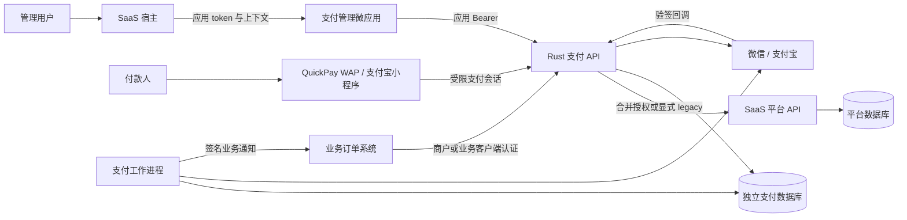
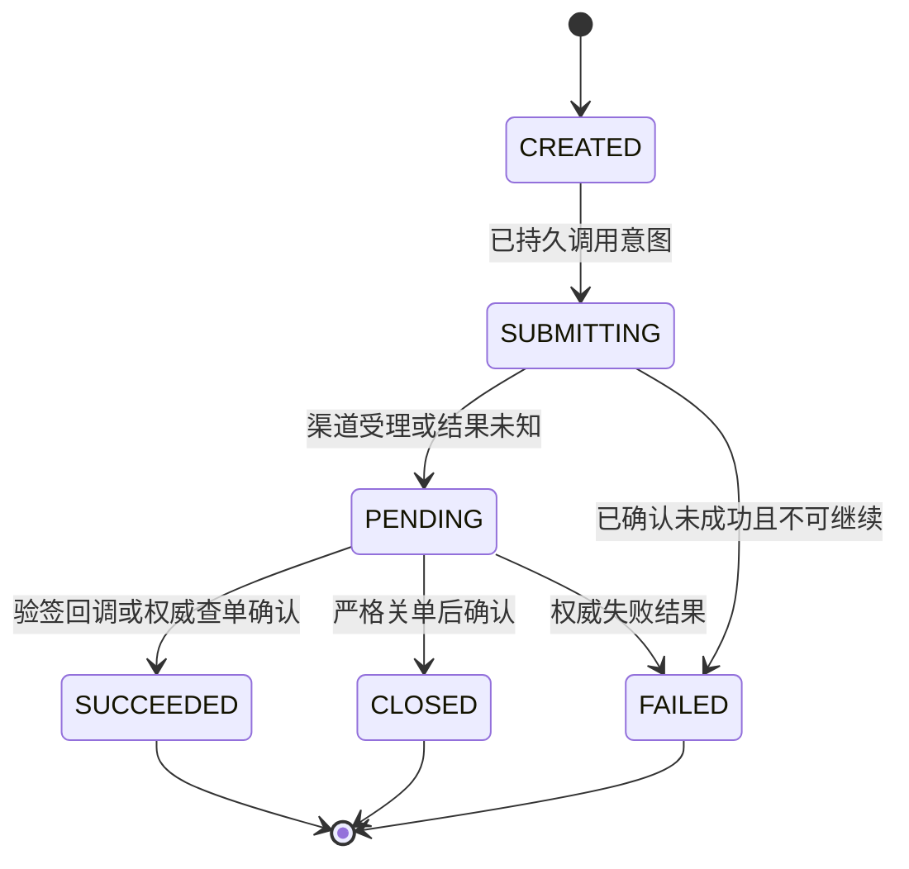

# 支付应用接入 SaaS 与 Rust 重构完整方案

> 版本：v1.0；编写日期：2026-10-19。本文是设计方案，尚未实施或验证支付功能。
>
> 适用项目：现有 Rust SaaS、`pfs-unifypay-monorepo`、`pfs-quickpay-monorepo`。现状依据源码静态核查；生产数据、外部订单服务和真实支付渠道尚未核实。文中的新表、新接口、新配置、目录及实施阶段均为建议，不代表已经存在。

## 1. 目标与核心决策

将 UnifyPay 的聚合支付能力与 QuickPay 的收银台客户端整合为一个独立支付业务应用，接入现有 SaaS 的用户、租户、组织、权限和应用发布体系，逐步将支付业务后端重构为 Rust。

建议应用编码统一为 `payments`，宿主管理路由为 `/micro/payments`。该编码在正式登记前核对唯一性；应用 UUID、机密客户端 ID 由平台实际生成，不将示例名称作为真实 ID。

核心决策如下：

1. **管理用户统一归 SaaS。** 账号、密码、登录、会话、组织成员和组织角色继续由平台维护。支付应用保存平台用户 UUID 与支付业务关联，不保留另一套可登录的管理用户体系。
2. **支付业务补齐租户与组织归属。** 旧支付模型没有租户、组织隔离。新支付商户、交易、退款、任务与审计均需明确归属；共享配置采用独立授权模型。
3. **一个应用，多个访问入口。** 管理后台作为 HTML/iframe 微应用接入；QuickPay WAP 使用独立公开收银台入口；支付宝小程序保留原生客户端。商户 API、渠道回调和内部任务分别认证。
4. **业务后端独立部署。** 支付服务使用自己的 PostgreSQL 数据库与专用账号，通过平台 HTTP 契约验证身份，不直查平台身份表，不依赖平台业务实现 crate。
5. **迁移支付规则，重新设计一致性。** 保留严格关单、重复收款裁决、原路退款等已有规则；重新实现多副本幂等、退款额度预占、可靠事件、回调收件与任务恢复。
6. **按真实场景分批交付。** 普通支付闭环先行；免押、支付分、转账付款、余额账务和完整对账分别设里程碑。延期能力及其存量订单须继续有明确处理方。
7. **先明确数据归属，再迁移流量。** 每个业务订单只能有一个权威写入引擎。灰度不向两个实现同时发送真实支付或退款。

本次文档交付只新增本文件，不变更业务代码、数据库、生产部署或现有架构优化台账。

## 2. 阅读导航与完成标准

| 关注点 | 章节 |
| --- | --- |
| 为什么需要改造、哪些能力已经存在 | 第 3、4 章 |
| 租户、组织、商户和管理用户如何结合 | 第 5—8 章 |
| 建议数据模型和服务接口 | 第 9、10 章 |
| QuickPay 缺失服务、公开付款和 OAuth | 第 11 章 |
| 支付、退款、回调、任务和渠道一致性 | 第 12—14 章 |
| Rust 结构、前端和部署接入 | 第 15—17 章 |
| 旧数据迁移、灰度、回退 | 第 18 章 |
| 阶段交付、验收、风险及待确认事项 | 第 19—22 章 |
| 源码依据 | 第 23 章 |

首期完成必须同时具备：管理用户统一、租户与组织隔离、明确业务订单来源、选定场景支付/查单/关单/退款/回调闭环、可靠通知与补偿、真实客户端联调、存量处理策略、可核对的灰度与回退证据。页面可打开、Rust 可编译或渠道下单成功，均不能单独视为项目完成。

## 3. 现状与差距

### 3.1 三个项目的实际职责

| 项目 | 已核实的实际能力 | 与目标的主要差距 |
| --- | --- | --- |
| Rust SaaS | 全局用户、组织成员、组织角色；租户/组织两级应用与菜单授权；独立 data grant；应用 token；微应用 SDK；静态版本发布；独立 Rust 业务应用案例 | 尚无支付域、支付商户范围、收银台会话、渠道回调和支付补偿；支付入口与交付模板需新增 |
| UnifyPay | Spring Boot/Java、React 管理后台；支付、退款、查关单、商户/渠道/场景配置；转账、付款、充值、流水；支付宝免押和微信支付分等 | 无 SaaS 租户/组织隔离；独立 Sa-Token 用户；业务锁明确只支持单实例；无 QuickPay 所需收银台 API |
| QuickPay | React/Vite WAP、原生支付宝 TypeScript 小程序、支付宝发布脚本 | 没有业务后端；依赖外部 `/channel/open/*`；身份、订单解析及结果确认需衔接 |

UnifyPay 静态计数约为 25 个实体 Java 文件（含基类）、39 个 Controller、37 个 service/impl 文件、97 个 adapter Java 文件、23 个 Java 测试文件，以及 MySQL/PostgreSQL 各三份 Flyway SQL。该计数只说明范围，不能换算为实现完成度或可靠工期。

### 3.2 用户与权限现状

旧 `User` 包含邮箱、密码、状态和单个 `role` 字符串。权限提供器返回空权限列表，角色检查读取该字符串；后台通用拦截主要检查登录，少量用户/通知接口检查 `admin`。没有发现独立用户商户关联。

旧管理前端有自己的登录、注册、找回密码、localStorage token、用户信息请求和登录守卫，并存在角色缺失时默认 `admin` 的展示逻辑。迁入后这些入口应由平台身份生命周期替代，所有支付业务接口增加逐操作权限与数据范围验证。

### 3.3 支付实现与宣传能力的区别

当前路由按支付商户与交易场景选择绑定，实际适配微信、支付宝。没有发现完整 TCC/Seata、成本或成功率加权智能路由、银联适配器实现。账单页面读取账户流水，另有渠道账单下载；这不能视为完整对账和差错处理系统。

支付宝免押、微信支付分已有真实调用与业务编排，不是占位功能。若暂缓迁移，必须保留旧引擎处理其存量生命周期，并明确新业务是否停止受理。

### 3.4 两个支付仓库之间缺少的契约

QuickPay 使用订单读取、跳转生成、付款人授权、下单和结果查询五类 `/channel/open/*` 接口。给定 UnifyPay 的 Java 路由没有这些接口，也没有该收银台依赖的订单链接解析和租户组织字段。

UnifyPay 实际支付入口是 `POST /api/v1/transaction/payments`，商户来自 HMAC 认证上下文；支付 DTO 包含业务单号、整数分金额、交易场景和通知地址。因此，不能将 QuickPay 的 API 地址直接切到 UnifyPay。

实施前须确定：业务订单由哪个系统生成、如何取得权威应付金额、谁有权创建付款链接、支付结果通知哪个业务系统。现有门店营业日报也不是该订单服务。

## 4. 目标架构与职责边界



| 单元 | 所有权与职责 |
| --- | --- |
| SaaS 平台 | 用户、密码、会话、租户组织、成员角色、应用和菜单授权、data grant、微应用发布 |
| 支付管理前端 | 支付领域页面、表单、权限展示、当前组织下的操作与结果恢复 |
| 收银台客户端 | 展示受控订单、付款人渠道授权、调起支付、查询服务端结果 |
| 支付 API | 管理操作鉴权、商户 API、支付会话、支付与退款编排、回调持久收件 |
| 支付工作进程 | 处理已受理的持久意图、查补、商户通知、重试和对账任务 |
| 支付数据库 | 支付资源及隔离、交易状态、幂等记录、任务、业务审计和历史映射 |
| 业务订单系统 | 商品/服务及应付金额事实、履约状态、订单是否允许付款 |

应用登记与静态版本激活不会自动创建后端、配置网关、授予用户权限或建立业务数据库。现有平台不是 Docker 控制面，也没有现成按租户订阅计费或独立支付实例管理。

## 5. 租户、组织与支付商户模型

### 5.1 语义与基线

- **租户**：使用平台的一家客户企业，是支付业务数据的硬隔离边界。
- **组织**：该客户内部的管理和业务归属结构，不预设为门店或某一种法人单位。
- **支付商户**：支付域中的收款主体或业务商户，不等同于平台租户或组织。
- **渠道商户/渠道应用**：微信、支付宝侧身份及配置，和支付商户通过场景路由绑定。
- **管理用户**：平台全局用户，通过直接组织成员关系和角色进入当前业务上下文。

首版建议一个支付商户只有一个明确的租户归属。同租户内，组织与商户允许多对多关联。跨租户共用渠道服务商配置属于显式共享能力，不通过空 `tenant_id` 或取消租户过滤实现。

### 5.2 管理归属、使用授权与交易归属分别建模

建议支付商户保存 `tenant_id` 和明确的管理归属组织；另建组织商户关联，区分 `USE` 与 `MANAGE`。具备 `USE` 可按策略为本组织业务选择该商户，具备 `MANAGE` 才能结合平台操作权限维护该商户；两者均不自动授予其他组织交易读取权。

商户级公共配置与组织级路由覆盖分别管理。组织级覆盖以 tenant/org/merchant/scene 定位，明确是否允许覆盖以及与商户默认的优先规则；修改某组织默认路由或费用策略，不隐式改变其他组织行为。变更共享默认配置时展示影响范围，校验配置管理权并审计。

例如甲公司总部、华东、华南三个组织共用一个收款商户：

| 业务对象 | 租户 | 组织归属 | 收款商户 |
| --- | --- | --- | --- |
| 华东支付订单 | 甲公司 | 华东 | 甲公司统一收款商户 |
| 华南支付订单 | 甲公司 | 华南 | 甲公司统一收款商户 |
| 总部查看汇总 | 甲公司 | 以总部当前授权范围计算 | 不因拥有商户配置权而自动获得交易读权 |

华东订单始终属于华东；新增华南与商户的使用关联不会使华南看见华东历史订单。订单查询不能仅凭 `merchant_id IN (...)` 授权。

### 5.3 归属的取得与不可变性

| 入口 | 归属权威来源 |
| --- | --- |
| 管理端创建/变更资源 | 平台已验证上下文；指定目标组织时验证其在组织硬上限、用途 grant 和业务范围内 |
| 业务系统创建支付意图 | 已认证业务客户端与服务端批准的租户、组织、商户、来源应用绑定 |
| 公开付款 | 服务端签发并保存的支付会话及其关联意图 |
| 退款、关单、查询任务 | 原支付意图、支付尝试和授权用途；不接受另行改写归属 |
| 渠道回调 | 验签后的渠道身份、渠道交易号和已登记本地交易 |

交易租户、来源组织、来源业务系统和已发生渠道交易号一经受理即不可通过普通编辑修改。组织商户关系调整只作用于后续准入，不重写历史记录。

解除组织对商户的 USE 不取消已有交易的回调、查询补偿或原路退款义务。历史管理访问以交易原组织、当前平台权限与明确业务范围判断，不额外要求原 USE 仍有效；用户级商户访问范围本身被撤销则按当前策略收窄访问。

跨租户迁移商户不能直接修改 `tenant_id`；需另行设计业务主体迁移、未结清订单处理、凭据重绑和历史数据保留。

### 5.4 共享渠道配置与跨租户运营

首版以租户专属配置作为默认。若现网存在多个客户共用一个服务商应用或签名密钥，必须在迁移前选择：由集中密钥设施提供租户级授权引用，或先实现平台共享配置目录、租户分配、用途限制和版本审计，再承载该流量。

共享目录与租户业务表分开读取，支付调用仍绑定一个确定租户、组织及商户。配置共享不授予交易可见性。

平台根上下文的租户仍是平台租户。跨租户支付运营建议首版通过正式成员关系切换到目标业务组织；全局运营控制台作为独立能力设计，要求明确运营身份、目标租户、用途、商户范围和审计。禁止仅因用户名为 admin 或平台 super 标志而关闭租户过滤。

## 6. 管理用户与身份生命周期接入

### 6.1 平台统一管人

平台维持全局 `users`、组织 `memberships`、组织角色和 `user_roles`。支付库不复制密码、Sa-Token 会话或角色权威，只保存平台用户 UUID、必要名称快照和业务关联。

用户创建、禁用、密码重置、组织成员和角色维护继续使用宿主现有页面。现有 `/api/users`、`/memberships`、`/roles` 管理接口使用平台 session 和相应系统权限；支付应用 token 不能直接调用这些通用管理接口。

如未来要求在支付页面中管理平台账号，应单独设计宿主授权入口与系统级管理流程；不得在支付后端保存一个长期平台管理员 session 代操。

### 6.2 当前应用授权协议

本方案以最新[应用授权与受控成员协议](../application-authorization-contract.md)和实际路由为准。建议新支付服务优先评估合并模式：

```text
管理用户登录 SaaS 并选择组织
  → 宿主 POST /api/oauth/session-token，appCode=payments
  → 微应用 SDK 接收应用 token 和展示上下文
  → 支付前端携带应用 Bearer 请求支付管理 API
  → 支付 API 使用自己的机密客户端 Basic：
      POST /api/apps/payments/authorize
      form: token、resource、action
  → 验证返回 introspection 与 context
  → 将可信身份、平台范围与支付业务范围落实到 SQL 和事务
```

合并接口返回 `contractVersion:1.0`、`introspection`、`context`。平台检查客户端与应用绑定、当前身份、资源动作登记、功能 permission 和独立 grant。支付消费者仍需校验合同版本、`active`、`aud=payments`、用户/租户/组织一致性、到期时间、权限、grant 主体及组织硬上限。

保留显式 `legacy` 兼容方案时，先 Basic 调用 `/oauth/introspect`，再用同一应用 Bearer 调用 `/api/apps/payments/context`。`combined` 与 `legacy` 必须分别回归；失败不自动降级。当前工单默认 combined、门店默认 legacy，支付默认值由自身契约及同负载验证决定，不能把模式选择写成已经通过的性能结论。

机密客户端 ID 和 secret 仅保存在服务端；平台签名密钥不交给支付服务。每个受保护新请求重新取得授权，不缓存正向权限。平台故障且无法确认授权时，管理请求安全拒绝。

### 6.3 业务人员选择与商户范围

负责人、商户管理员关联或审批人员选择使用：

- `GET /api/apps/payments/members`；
- `GET /api/apps/payments/members/{userId}`。

用途携带 `resource、action、organizationId`，并在平台启动策略 `applications[].memberLookups` 显式登记。返回的是有效直接成员的必要字段，不提供全量用户管理能力。内部方法名或文档描述中的 assignmentMembers 不作为实际 JSON 字段。

新关联先验证目标成员，再进入支付业务短事务复核范围与版本；不在持有业务行锁时调用平台。平台与支付库没有共同事务，最后验证至提交仍有竞态，必须明确见证期限并在后续请求重新验证。

关联某人为审批人不自动授予审批权限；其执行审批时仍须具备当前平台权限和对应业务范围。首版相关用途不登记 SELF，与第 7.2 节的首版资源范围一致，支付消费者拒绝未支持的 SELF grant。现有平台 SELF 成员查询限定当前组织，列表可以包含该组织其他有效直接成员；业务记录访问仍须另按可信 owner 校验，选择成员不扩大 SELF 数据范围。

### 6.4 停用、撤权与历史保留

| 变化 | 管理侧行为 | 交易处理行为 |
| --- | --- | --- |
| 用户停用、退出、会话撤销 | 下一受保护请求重新校验并拒绝；前端清理旧服务端视图 | 已受理交易继续验签回调和查补 |
| 成员移除、组织切换 | 旧上下文失效；旧组织响应不得回填新组织 | 原交易归属保持不变 |
| 菜单、角色、grant 撤销 | 后端逐操作拒绝；前端对应入口停用 | 已提交渠道动作不可由取消 HTTP 撤回 |
| 租户到期或支付开通撤销 | 拒绝新的受保护受理；机器准入按明确策略执行 | 持续接收存量结果与保留对账依据；新增人工退款仍需获准身份 |

支付审计引用外部用户 UUID，不建立跨数据库物理外键，不因平台用户删除而级联删除交易或审计。平台账号停用不自动消灭支付域尚未完成的财务义务。

### 6.5 四类非管理身份

| 身份 | 认证依据 | 允许边界 |
| --- | --- | --- |
| 商户/业务客户端 | 版本化 API 凭据、签名、nonce/时间窗及服务端资源绑定 | 仅该客户端获准租户、组织、商户、来源应用和动作 |
| 收银台付款人 | 受限支付会话；渠道 OAuth 证明付款人 | 仅关联订单的展示、授权、付款和结果读取 |
| 渠道回调 | 原始报文验签/解密、渠道账户与交易核验 | 更新已登记交易事实，不获得管理权限 |
| 工作进程 | 私网部署身份、数据库角色、持久且已批准的执行意图 | 只执行记录中限定的动作、金额、目标和幂等标识 |

平台 `client_credentials` 不自带用户、租户、组织业务上下文，不能自动取得用户型应用 context。机器支付准入还需定义支付业务客户端启停、应用开通与租户状态的权威校验/同步方式，以及失联时拒绝新受理的规则；现有平台没有已核实的通用机器租户授权接口可直接替代这项设计。

工作进程不保存用户 token。受理时的授权证据、审批结果、配置版本和执行期限形成持久意图；超出受理政策、意图过期或发生新的资金决策时需重新批准。已发起渠道动作的未知结果优先查明，不假造管理员身份再次受理。

## 7. 功能权限、数据 grant 与商户访问

### 7.1 权限登记原则

现有合并授权与成员协议使用精确 `resource:action`。建议资源以 `pay-` 前缀命名，分别登记 resource、action；例如 `pay-order` / `read` 对应 `pay-order:read`。不使用无法由该二元协议推导的 `pay:order:read`。

以下是建议能力清单，实施时按实际页面和 API 裁剪并维护同一份清单：

| 资源 | 动作 | 说明 |
| --- | --- | --- |
| `pay-merchant` | read、create、update | 支付商户资料与管理归属 |
| `pay-merchant-org` | read、assign、unassign | 组织商户使用/管理授权 |
| `pay-merchant-member` | read、assign、unassign | 额外用户商户范围 |
| `pay-channel` | read、create、update | 渠道配置和启停；读取接口只返回脱敏信息 |
| `pay-route` | read、update | 商户场景绑定与路由版本 |
| `pay-order` | read、close、export | 支付查询、关单、范围内导出 |
| `pay-refund` | read、create、approve、reject | 退款申请与复核 |
| `pay-notification` | read、retry | 商户通知状态及受控重放 |
| `pay-audit` | read | 支付业务审计 |
| `pay-reconciliation` | read、run、resolve | 扩展阶段的账单、任务和差异处置 |

首版管理后台不默认提供任意金额手工建支付单。若确需该能力，另登记 `pay-order:create` 并限定订单来源和金额规则。商户开放 API 的下单权限由业务客户端准入控制，不借用某个管理用户 grant。

### 7.2 授权交集

一次管理操作必须满足：

```text
有效平台身份与 payments 应用绑定
∩ 租户/组织两级应用及菜单授权
∩ 当前操作 permission
∩ 当前直接 membership 的 resource/action data grant
∩ context.organizationScopeIds 硬上限
∩ 支付资源自己的租户、组织和商户访问策略
∩ 交易状态、版本、金额和审批约束
```

平台组织硬上限的缺失、null、有限数组三种语义须按当前协议解释；普通组织下 TENANT grant 也不能突破硬上限。scope 不是可简单排序的权限等级。

首版交易、退款、渠道等主要资源建议仅登记 ORG、ORG_SUBTREE、TENANT。自动创建交易没有天然的“管理用户 owner”，因此不默认开放 SELF。将来需要 SELF 时，逐资源定义不可变 owner、历史迁移办法及成员用途，不能用付款人 openid、商户负责人或最后操作人替代 owner。

支付消费者显式检查本资源支持的 scope；策略登记不包含 SELF 不代表所有历史 SELF grant 已被平台运行时消除。收到未支持的 scope 应拒绝，不能按 ORG 或 TENANT 解释。

用户商户关联是进一步收窄访问的业务条件，不自行授予动作。某类主体是否采用明确的组织级全商户模式，需在业务策略中登记并审计；不以“没有关联记录”默认全量开放。

### 7.3 SQL 与 API 必须一致

列表、count、详情、导出、汇总和写入均使用相同租户及组织范围。交易查询首先限定交易来源组织，再应用适用商户约束；商户配置查询使用该资源自己的管理归属和 MANAGE 策略，不能机械照搬订单组织字段。

不可见记录返回 404；已确认缺少操作权限或 grant 返回 403。查询在数据库中参数化过滤，不先读全集再内存筛选。导出需要独立 export permission/grant，使用既有 SDK 下载能力时还遵守宿主容量与格式合同。

### 7.4 平台授权配置的落地次序

1. 登记 `payments` 应用与关联机密客户端。
2. 登记精确 MENU、BUTTON 和相应 permission；详情/创建等路由按平台规则显式登记。
3. 在服务端 `DATA_GRANT_POLICY` 登记实际应用 UUID 的 capabilities、必要 memberLookups 和受控管理范围。
4. 为租户开通应用与菜单，再为组织授予其上限内的应用与菜单。
5. 建立/保留用户 membership，分配组织角色与角色菜单。
6. 通过正式 grant 管理流程，给该直接 membership 授予对应 resource/action 范围。
7. 配置组织商户、用户商户业务范围，以普通用户验证允许与拒绝路径。

不通过直接写平台权限表完成日常接入；不能先删除重建 membership 再期望旧 grant 保持，因为 grant 绑定 membership UUID。

## 8. 旧账号整合方案

| 旧内容 | 目标处置 |
| --- | --- |
| 旧用户名、邮箱、电话、姓名 | 用于候选核对；平台邮箱/电话允许重复，不能据此自动合并 |
| 旧用户 ID | 建立 `(source_system, legacy_user_id) → platform_user_id` 映射 |
| 旧 password、Sa-Token session、首次注册 admin 规则 | 不迁为新管理身份来源；通过平台账号开通或重置流程处理 |
| 旧 `admin/user` | 按实际职责重新分配支付角色、菜单、grant 和商户范围 |
| 历史日志中的 userId/username | 保留来源 ID 和名称快照；确认映射后附加平台用户引用 |
| 渠道 payer/payee 用户 ID、openid | 保留支付业务语义，不映射为 SaaS 管理用户 |

迁移顺序为：账号核对 → 全局用户映射 → 租户组织与 membership → 应用和角色授权 → data grant → 商户业务范围 → 普通用户验收。

已在范围外租户存在的全局账号，不由普通组织管理员任意认领。当前没有已核实的邀请/接受公开 API；跨管理范围的账号协调由有权平台管理员处理，或先实现明确邀请流程。

无法确认身份的旧账号保留为历史来源，不自动创建活跃管理员。旧系统并未普遍保存交易创建者，不能以导入执行人补造历史 owner。

## 9. 建议支付数据模型

### 9.1 标识、时间与金额

- 平台用户、租户、组织及应用引用使用 UUID。支付域新主键可用 UUID，外部业务单号、渠道交易号、原支付/退款号作为稳定字符串保存。
- 保留旧雪花 Long ID 的来源映射，面向浏览器以字符串传输，避免 JavaScript 数字精度丢失。
- 支付金额采用校验过的整数最小货币单位，并保存币种；首版限定 CNY 时在合同中明确。费率使用十进制定点或明确整数比例，冻结舍入方式，不用 f64 计算资金。
- 新系统事件时间统一按 UTC 瞬时记录，业务账单日显式采用业务时区。旧 LocalDateTime 没有时区，迁移前确认其来源时区，不能直接加 UTC 标记。
- 不可变归属、单调 version、唯一键、复合外键及状态检查由数据库与业务共同保护。平台实体通过 API 验证，不建立跨库外键。

### 9.2 首期概念表

以下是概念模型，不是最终 DDL；合并或拆分必须保留不变量。

| 建议表 | 主要内容 | 关键约束 |
| --- | --- | --- |
| `pay_merchants` | 租户、管理归属组织、商户号、状态 | 租户/商户标识唯一；归属不可普通编辑 |
| `pay_merchant_organizations` | 同租户组织对商户的 USE/MANAGE 关系 | tenant/merchant/org/relation 有效唯一；跨租户拒绝 |
| `pay_merchant_members` | 用户在组织上下文中的商户范围 | tenant/org/merchant/user 有效唯一；无本地登录角色 |
| `pay_channel_accounts` | 渠道账户身份、租户归属、当前状态 | 共享账户走独立明确模型；API 不回传秘密 |
| `pay_channel_config_versions` | 不可变配置版本、密钥引用及轮换元数据 | 历史版本可定位；秘密不明文散落订单 |
| `pay_merchant_bindings` | 商户/场景默认及获准组织级覆盖到渠道账户、版本的绑定 | 同生效范围与场景唯一；优先规则明确；变更留版本 |
| `pay_business_clients` | 来源应用、租户组织商户绑定、动作和凭据版本 | 准入、限额、启停和密钥轮换独立审计 |
| `pay_payment_intents` | 权威订单摘要、归属、金额、币种、商户选择策略、有效收款引用 | 默认 tenant/source/business_order_id 唯一；不以商户/渠道分裂意图 |
| `pay_payment_attempts` | 实际收款商户、多次渠道尝试、场景、账户/路由版本、渠道请求号和结果 | 渠道请求号在其唯一域内唯一；与意图同租户组织 |
| `pay_refund_requests` | 人工退款申请、理由、申请人与复核决定 | 金额和目标在审批后不可任意变更；版本与事件键 |
| `pay_refunds` | 实际退款意图、预占金额、原渠道引用与结果 | 业务退款号按来源域唯一；绑定原成功尝试 |
| `pay_cashier_sessions` | 不透明会话摘要、意图、能力、到期和状态 | 仅受限用途；原始能力值不持久明文保存 |
| `pay_oauth_states` | 渠道授权 state、会话/渠道应用绑定、期限和消费状态 | 一次性条件消费；多副本共享持久状态 |
| `pay_callback_inbox` | 验签收件摘要、渠道事件标识、处理状态 | 渠道/账户/事件去重；敏感原文按必要性加密限期留存 |
| `pay_outbox` | 交易变更同事务产生的事件 | 事件 ID 唯一；载荷不可被重试任意改写 |
| `pay_merchant_notifications` | 目标、事件、签名版本、次数、下次时间、租约 | 事件/目标唯一；租约可恢复；人工重放另留审计 |
| `pay_jobs` | 查补和内部补偿意图、租约、进度 | 业务任务键唯一；过期领取可回收 |
| `pay_audit_events` | actor 类型、归属、动作、资源、前后安全摘要 | 与业务变更同事务；追加式保留 |
| `pay_legacy_mappings` | 来源实体/旧 ID/新 ID/归属/核对状态 | 同来源与实体旧 ID 唯一；映射变更审计 |

工作进程是否独立进程不改变这些业务数据的所有权。outbox 和 jobs 分别承担领域事件与执行调度，避免同一意图出现两个无协调的权威状态。

### 9.3 多组织共用商户时的数据库约束

每次支付尝试通过 `(tenant_id, merchant_id)` 引用实际商户，不要求意图的来源组织等于商户管理归属组织。受理时验证组织商户 USE 关系。意图保存商户选择策略或初始偏好；变更收款商户若获业务允许，也必须在同一意图下严格关闭/核实旧尝试，再创建新尝试，保留每次实际商户与渠道信息。

首版若未实现获准的跨商户重试，商户不匹配直接返回冲突。启用该能力前校验来源组织对新商户的 USE 授权；退款与有效收款始终定位实际成功尝试，不采用意图当前偏好商户。

退款通过含 tenant、organization 的复合键绑定原支付记录，禁止“退款属于组织 A、原支付属于组织 B”。组织商户关联的两端必须同租户。删除组织授权不能级联删除历史支付。

一个业务订单允许多个支付尝试，但只能有一个有效收款裁决。数据库保存有效尝试引用与版本，裁决在同一意图锁下完成；不能靠软删除后重建业务订单绕过该规则。

### 9.4 扩展模型

转账、充值、付款、余额/冻结余额、账户流水、免押、支付分及账单差异分别设计独立状态和约束。若引入资金账本，采用追加式分录、币种一致及可核对的余额变化，不把门店日报汇总或旧余额字段当作已经完成的支付账务系统。

## 10. 服务入口与契约设计

### 10.1 建议入口分组

| 入口 | 建议路径 | 身份依据 |
| --- | --- | --- |
| 管理 API | `/payments-api/admin/*` | 当前 payments 应用 Bearer 与逐操作授权 |
| 业务开放 API | `/payments-open/v1/*` | 业务客户端/商户签名及资源绑定 |
| 公开收银台 API | `/cashier-api/v1/*` | 受限支付会话、渠道 OAuth 状态 |
| 渠道回调 | `/payments-webhooks/v1/*` | 渠道原文验签、账户及交易核验 |
| 健康/私有运维 | 明确 live、ready、私有 metrics 路径 | 健康公开范围有限；metrics 不经公开入口暴露 |

这些路径均为建议，需与现有网关冲突检查后冻结。可以由一个 Rust 服务承载，采用独立路由和中间件；不得通过“公开前缀免鉴权”让管理 handler 意外暴露。

首期管理 API 覆盖商户、组织/用户商户关联、渠道/路由、订单列表详情、关单、退款申请/复核、通知状态和业务审计。业务 API 覆盖意图创建、查单、关单、收银台会话和按批准策略退款。

### 10.2 写入幂等与并发

新建支付意图、退款申请、退款执行及重要任务各自定义稳定事件键。支付创建建议使用 `Idempotency-Key` 与规范请求摘要，限定 tenant/稳定来源主体/operation/key 域；管理申请再绑定操作者或受控资源域。商户、组织、金额等正文参数纳入摘要比对，不通过更换商户或渠道获得同一事件的新幂等域。同键同请求返回原受理结果，同键不同请求返回 409。业务订单唯一约束独立于请求键，换一个请求键仍不能重复创建同一逻辑订单。

管理 PATCH/审批使用 version 与状态条件更新。requestId 只关联追踪，不充当业务幂等键。数据库提交确认丢失、HTTP 取消或渠道超时均可能形成未知结果；客户端保留原事件键和正文，通过受权查询或同键协议恢复，不生成新业务单重试。

### 10.3 响应语义

| HTTP/业务结果 | 语义与客户端处理 |
| --- | --- |
| 200/201 | 按合同完成读取或本地资源受理，不当然代表渠道已支付/退款成功 |
| 202 | 已持久受理、仍需渠道执行或确认；返回稳定操作/查询标识 |
| 400 | 参数或协议无效，修正请求 |
| 401 | 管理身份失效，停用旧上下文；公开入口使用其自身会话错误合同 |
| 403 | 已知缺少权限/grant或用途被拒；停用对应动作 |
| 404 | 记录不存在或不在当前可见范围，不泄露跨租户存在性 |
| 409 | 幂等正文冲突、版本/状态冲突、退款额度不足等明确冲突 |
| 429 | 限额或速率预算，遵循受控 Retry-After，不另建资金事件 |
| 503/超时 | 区分未受理和结果未知；以稳定错误码及查询标识恢复 |

计划区分 `OPERATION_RESULT_UNKNOWN`、`CHANNEL_RESULT_PENDING` 等业务码；最终错误字典随接口合同冻结。错误和响应日志不回显 token、签名、密钥、完整回调正文或上游原始错误。

### 10.4 商户签名与版本兼容

保留旧调用方时，冻结其 `UNIFYPAY-SHA256` 认证头、canonical request、URL/query 编码、原始正文及通知签名规则，使用脱敏向量验证。新版本凭据绑定稳定业务来源、租户、组织范围、商户范围和动作，不将平台机密客户端 secret 兼作商户 API 密钥。

签名时间窗、nonce 容量/保留期、服务端时钟容差和速率预算随合同明确，防重放状态须适用于多副本。nonce 防重放与资金幂等分别设计：获准重试使用新认证 nonce，但仍使用原业务幂等键与请求号；重放拒绝不允许客户端另建资金事件绕过未知结果。凭据轮换保留明确版本和受控重叠窗口。

## 11. QuickPay 与公开收银台改造

### 11.1 原有接口兼容与缺失服务

| QuickPay 当前接口 | 新服务应提供的权威能力 |
| --- | --- |
| `GET /channel/open/payment/order` | 验证付款链接/会话，读取权威订单与允许场景，返回必要展示信息 |
| `POST /channel/open/redirect/generate-url` | 从服务端允许配置生成渠道授权/返回地址，并保存一次性 state |
| `POST /channel/open/payment/authorize` | 验证会话与 state，按正确渠道应用换取付款人标识 |
| `POST /channel/open/payment` | 依据原意图金额、归属和允许场景，创建或恢复稳定支付尝试 |
| `GET /channel/open/payment/result` | 以会话或受限结果凭据读取服务端状态，不能只凭订单号/tenant/org 查询 |

可在明确兼容期限内保留旧路径作为适配层，内部统一调用新支付用例。客户端传来的 tenantId/orgId 只能是与已验证会话比对的提示，不能作为访问凭据。旧 `s` 的安全性无法从客户端判断，必须核实原生成和解码服务。

### 11.2 付款链接与订单服务

1. 业务订单系统通过获准客户端提交或确认订单，支付服务保存来源、业务单号、归属、应付金额、币种、有效期及订单修订。
2. 支付服务签发高熵、不透明、有期限的付款能力；数据库保存摘要和绑定。链接展示所需能力与后续 API 能力可交换为更窄的短期凭据。
3. WAP/小程序只读取该会话对应的最少订单信息，不自行提交金额、租户、组织或通知目标决定交易。
4. 下单前依据冻结合同校验订单仍可支付；订单已变价或取消时返回明确冲突，不能静默采用前端缓存金额。
5. 一个逻辑订单的多个付款页面共用支付意图与重复收款裁决，签发新会话不新建另一套资金事实。

业务订单 HTTP 由服务端配置固定 origin、认证、超时和容量；不能任意抓取客户端提交的 URL。支付链接能力避免进入日志与分析系统，配置 no-referrer/no-store，限制第三方资源，明确过期、撤销、重复打开和支付后的读取策略。

### 11.3 渠道 OAuth 与返回地址

微信/支付宝付款人 OAuth 与 SaaS 管理登录是两套用途。state 必须绑定收银台会话、渠道应用、场景、回调地址和到期，持久保存并原子一次性消费。code、openid 不能决定租户归属。

`targetUrl`、`redirect_url`、结果页地址由服务端精确允许清单生成；不接受任意外部跳转。微信 H5 客户端 IP 从可信代理链取得，不相信客户端自报 payerClientIp。根据渠道实际合同处理 URL 编码、浏览器桥接和小程序返回路径。

### 11.4 客户端保留与修正

- WAP 保留 React/Vite；支付宝小程序保留原生 TypeScript；发布脚本作为构建工具使用，生产业务后端保持 Rust。
- 首期候选场景按当前客户端真实调用列为 WECHAT_JSAPI、WECHAT_H5、ALIPAY_WAP、ALIPAY_LITE。最终上线子集由实际开通和验收决定，不按枚举计为全部支持。
- WAP 增加待支付、处理中、结果待确认、成功、关闭及明确失败状态；使用有上限的状态查询和显式恢复。
- 小程序收到 `my.tradePay` 成功返回后向服务端查询；浏览器 bridge 回调、URL status、Base64 state 均不作为交易成功凭证。
- 小程序 API 域名改为环境化构建配置并配置渠道域名白名单；WAP 同步处理 base、路由、OAuth 返回地址与公开域名。
- 原代码只消费支付链接，没有已核实的二维码生成/摄像头扫码能力；如需二维码入口，单独实现付款链接生成与展示。

## 12. 支付与退款一致性设计

### 12.1 一个意图、多次尝试、一个有效收款

业务唯一键建议默认采用 `(tenant_id, source_application, business_order_id)`，对应一个 payment intent，子级保存每次渠道尝试。source_application 是登记的稳定订单来源，不因客户端凭据轮换而变化；组织、金额、币种等作为不可变/受控属性参与冲突校验。同来源同业务单换组织或商户不能获得第二个意图。

如果权威来源确认业务单号只在组织或其他业务命名空间内唯一，则在 P0 显式冻结包含该服务端确定命名空间的唯一键，并验证源订单真实归属。不得由客户端任意传一个新 namespace 绕过唯一性，也不得把 merchant/channel 纳入逻辑订单身份。最终唯一键须同步用于导入映射、查询、幂等恢复和 owner_engine 判定。

新尝试前查明旧尝试；旧单可能支付时，执行查单、关单、再次查单，无法确认关闭则阻止新尝试。渠道已成功的事实必须落库，不能随着“禁止重付”业务错误一起回滚。

持久化渠道调用意图和稳定渠道请求号，再释放短事务调用渠道，之后用条件更新写回。进程崩溃后用原请求号查询；若渠道不支持安全幂等重发，则保持待确认并查补/人工处置，不重新生成请求号。

意图锁或版本 CAS 负责裁决有效收款。确有第二笔成功收款时，保留两笔真实事实，只对有效收款发布业务成功；另一笔建立唯一的原路退款义务与告警。自动重复退款沿用稳定事件键和退款号；退款失败/关闭时进入人工差异处理，不把“已产生意图”展示为“资金已退回”。免押扣费使用自己的生命周期，不机械并入普通订单重复收款规则。

### 12.2 状态表达



这是建议归一状态，不替换渠道原始状态。保存渠道事件和查单事实；成功不得被迟到 pending/failed 覆盖。关闭后发现迟到真实成功时，进入受控纠偏/收款裁决，而非丢弃资金事实。退款进度独立表示，不通过把支付成功改为“未支付”表达退款。

### 12.3 退款申请、复核与额度

建议管理端人工退款采用申请与复核，申请人不得自审。平台提供动作权限，支付域提供本地审批状态、版本、限额和目标绑定。机器退款是否直接执行或进入审批，由客户端与商户退款策略明确批准；未配置不默认开放。

申请阶段不承诺占款。批准时在原成功支付尝试的短事务内，计算可退余额、创建执行意图并预占额度：

```text
可退金额 = 原成功收款金额 - 已成功退款金额 - 尚未解除的处理中/未知退款预占
```

不同退款号并发也要竞争原支付维度的同一额度约束。批准提交后再向渠道发送，稳定退款号贯穿超时、重试和回调。只有已证明失败且渠道不会继续执行时才释放预占；超时或未知不释放。

原退款执行目标为实际成功支付尝试及原渠道账户。人工退款、业务 API 退款、重复收款自动退款共用金额防线，但保留各自审批/系统处置依据。批准记录不能在执行时被换金额、换支付单或换收款目标。

### 12.4 金额和渠道配置

回调与查单核验渠道交易号、原商户/子商户、应用、金额、币种和允许状态迁移。渠道账户版本在尝试创建时固定；后续查单、关单、退款使用原账户身份及合法的当前密钥轮换能力，不重新按最新商户场景绑定选择另一收款账户。

版本固定的是业务配置和账户身份引用，不要求永久使用失效证书。证书/公钥轮换、历史通知验签窗口和秘密保留策略必须单独支持。

## 13. 回调、商户通知与后台任务

### 13.1 渠道回调收件

处理链为：限制报文大小/时间 → 按账户候选选择验证配置 → 保留原始字节验签解密 → 校验渠道与本地交易关联 → 去重并持久收件 → 按渠道规定 ACK → 可恢复地推进状态/后续事件。

ACK 前至少保证必要身份与交易核验及可靠收件。若采用先收件后业务处理，业务事件必须可以从 inbox 重放，不能以 ACK 代替交易成功。未知交易按明确隔离和告警策略处理，不据报文新建有权交易。

回调 URL 中 merchant/tenant/account 参数只用于定位候选，不作为信任证明。允许无 Origin 只解决传输，验签与 CORS 无关。平台管理授权服务不可用时，已登记渠道回调仍通过自己的验证链处理。

### 13.2 事务 outbox

交易状态、退款状态及对应 outbox 事件在同一个支付库事务提交。事件内容固定，携带事件 ID、归属、业务单/交易/退款标识、状态、金额和时间。

消费者至少一次投递，通过事件 ID 和业务唯一键幂等，不承诺跨数据库与渠道的全局 exactly-once。业务通知受理方也必须去重。

### 13.3 任务领取与恢复

建议 PostgreSQL 原子 claim、租约和版本 fencing；可用 SKIP LOCKED 实现有界并发领取。领取事务结束后才执行外部 HTTP，完成时核对租约所有权和版本，租约到期可回收。

fencing 不能单独撤销已发出的渠道请求；防止重复资金动作仍依靠稳定渠道幂等标识、权威查单和本地金额约束。工作进程优雅退出、失联、重复领取和旧 worker 迟到完成均需验证。

### 13.4 商户通知与平台通知的区别

商户支付结果通知是支付业务协议，固定登记目标、签名版本、事件、重试次数、退避、结果与人工重放审计。目标变更不静默改写已受理事件；重新发送需要明确事件/交付关系。

通知 HTTP 禁止随意重定向和任意 URL，按客户端登记目标及受控网络策略防止访问内部未批准地址。通知签名覆盖稳定事件标识，接收方返回合同规定的确认。

平台站内通知用于人员提示。现有通知发布接口依赖当前应用用户 token，不能由后台保存已过期用户 token 长期调用。首期可靠性以支付库和商户通知为准；异步站内通知若为必需，需另外定义受控机器发布能力或获准的用户触发流程。

## 14. 渠道适配与业务能力覆盖

### 14.1 Rust 渠道迁移办法

旧项目微信、支付宝主要是自写 HTTP、签名、证书和解密逻辑，没有发现必须保留 Java 的闭源渠道 SDK。Rust 实现复用明确的渠道合同，不直接逐文件翻译 Spring 实现。

必须覆盖：签名原文与换行、URL/query 编码、请求体原字节、RSA/RSA2、证书序列号、微信平台证书/公钥模式、APIv3 解密、证书轮换、金额单位、错误码和未知结果。

使用脱敏请求响应、签名验证向量及受控测试密钥做黄金样本。Java/Rust 可以离线比较签名串、解析和状态映射；线上影子只允许获准读取或本地计算，不同时发送两笔真实资金请求。

### 14.2 能力覆盖与交付批次

| 能力 | 旧实现情况 | 新服务交付建议 |
| --- | --- | --- |
| 商户、渠道账户、场景绑定 | 已有 | 首期重建归属、脱敏配置与版本 |
| 普通支付、查单、严格关单 | 已有 | 首期，按确认场景逐项验证 |
| 部分退款、重复收款原路退款 | 已有 | 首期，补审批政策、额度预占和多副本幂等 |
| 回调、商户通知、查询补偿 | 已有 | 首期，改为持久 inbox/outbox 和可恢复任务 |
| QuickPay 订单/会话/跳转服务 | 给定仓库缺失 | 首期补齐或接回已核实的外部服务 |
| APP、Native、付款码等其他场景 | 需按适配方法逐项核对 | 后续扩展；枚举不算已验收 |
| 转账、付款、充值、余额和流水 | 已有相关实体与流程 | 独立资金能力批次，迁移前核对余额与在途义务 |
| 商户进件、授权、发货同步 | 已有相关实现 | 按实际使用独立交付 |
| 支付宝免押、微信支付分 | 已有真实实现 | 独立生命周期里程碑；存量由明确引擎处理 |
| 渠道账单下载 | 已有 | 按需迁移 |
| 全面对账、差错闭环、智能路由 | 未核实为完整实现 | 新能力设计，不计作等价代码搬运 |

微信支付分现有实现明确不支持多次部分扣费，部分释放/关扣费操作为 UNSUPPORTED。扩展不得宣称完整支持所有渠道能力。

## 15. Rust 工程结构与数据库选择

### 15.1 建议目录

```text
business-apps/payments/
├── frontend/                 # 独立 Vite 管理前端
├── cashier/                  # 迁入或受管构建的 QuickPay WAP
├── miniapp-alipay/           # 原生支付宝客户端
├── backend/
│   ├── Cargo.toml
│   ├── Cargo.lock
│   ├── migrations/
│   ├── src/
│   │   ├── main.rs           # 配置、装配和启动
│   │   ├── lib.rs            # 最小公共出口
│   │   ├── domain/           # 资金类型、状态机、不变量
│   │   ├── application/      # 支付/退款/回调等用例编排
│   │   ├── authorization/    # 平台合同与业务范围见证
│   │   ├── adapters/         # 渠道、数据库、订单系统等实现
│   │   ├── http/             # 按身份分类路由和DTO
│   │   └── jobs/             # outbox、查补和通知调度
│   └── tests/                # 公共行为、数据库和渠道合同
└── deploy/                   # 应用、菜单、能力及部署清单
```

这是职责建议，不要求一次性复制目录或拆大量 crate。先用独立单 crate、薄入口与厚库；工作进程若有独立部署需要，可在同一包增加薄 bin，仍由支付域拥有数据库。只有出现稳定复用/编译/团队边界后再考虑 workspace。

domain 不依赖 Axum、SQLx 或具体渠道客户端。用例消费由自身需求定义的 trait，外部适配器在入口装配。支付服务不依赖平台、门店或工单的业务实现 crate。

### 15.2 技术选择

HTTP/异步/持久化优先与现有系统一致，采用 Axum、Tokio、SQLx、Reqwest、Serde、Tracing。加密库、密钥管理和定点数依赖按实际需求审查后确定，本文不伪造已经选定的第三方支付 SDK。

新支付库建议 PostgreSQL 17，与现有平台部署基线一致。旧项目明确支持 MySQL 与 PostgreSQL，旧系统维护期继续遵守双库规范；新 Rust 服务是否也必须双库由既有客户合同决定。若存在该要求，须在建模前冻结双库实现与测试矩阵，不能实施到一半再发现。

新库维护自己的 SQLx 迁移，不将 Flyway 元数据直接登记为新 schema 已迁移。已执行迁移不可改写。首次实施前冻结仓库实际工具链版本与依赖锁，本方案不额外升级平台工具链。

## 16. 管理前端接入与交互恢复

优先保留 UnifyPay 的 React/MUI 支付业务页面与现有视觉资产；改为独立 Vite 微应用，使用登记 SDK。无需为了后台 Rust 化将前端改写为 Rust，也无需强制共享宿主 React 运行时。

主要改造项：

1. 移除独立登录、注册、找回密码及本地 token 权威，账号入口回到宿主。
2. 使用 MicroIframe 生命周期与当前 props；内存路由同步宿主 `/micro/payments/*`。
3. 子路由按当前 SDK 的 pathname 合同设计，不能假设 query/hash 自动随宿主传递。
4. 用平台 permission 控制菜单/按钮展示，后端保持独立鉴权；缺少权限时不默认 admin。
5. 业务请求使用当前应用 Bearer、credentials:omit；兼容 opaque iframe 的 Origin:null CORS。
6. 组织或身份变化清理旧服务端视图、取消读取并拒绝迟到响应；纯主题变化不重新发资金请求。
7. 草稿按 app/tenant/org/user 分区。写入发送后保留原事件键、正文与未知状态；取消界面不等于撤回交易。
8. 资金受理后的恢复以服务端持久意图为准，刷新/销毁 iframe 后可重新受权查询；不只依赖内存草稿保存退款执行事实。
9. 401 停用当前上下文；403 停用对应动作；409 保留输入并要求重读；已发送写的网络/5xx未知先核对原事件。

管理端静态入口、资源路径和动态 chunk 使用版本内相对地址；前端产物只包含公开 API 地址、版本和精确宿主 origin，不包含客户端 secret、平台 session、DSN 或渠道密钥。

## 17. 平台接入、部署与运行

### 17.1 需要复用与新增的内容

| 项目 | 当前能力 | 支付接入工作 |
| --- | --- | --- |
| 应用/菜单 REST | 通用登记与授权已有 | 登记 payments、精确菜单及机密客户端 |
| capabilities/memberLookups | 服务端显式策略已有 | 合并支付资源与受控管理边界，不覆盖已有应用 |
| 静态版本与外部 URL | 已有 | 独立支付静态镜像/版本和公开 URL 预检 |
| 管理 CLI | KnownApp 仅内置 work-orders/stores | 新增支付支持或有边界地通用化；也可先用正式 REST |
| API 网关生成 | 业务 upstream 当前固定工单/门店 | 增加支付管理、收银台、开放 API、回调路由及来源策略 |
| 业务镜像/Compose/CI | 当前示例有固定入口 | 补支付构建、工作进程、密钥、迁移和验收清单 |
| 数据库 | 平台与已有业务独立 | 新增支付库与专用最小权限账号 |

### 17.2 部署拓扑

生产建议 Nginx 提供宿主和支付静态资源，Rust API 与 worker 位于私网。管理应用、公开收银台可使用不同域名；微信/支付宝配置分别登记精确授权回调、支付域名和通知地址。

管理 iframe 维持现有沙箱，不为调起公开付款放宽同源、顶层导航或弹窗权限。收银台使用适合渠道要求的顶层页面或小程序。

API、worker 共享支付域库但使用适当数据库角色；迁移账号与运行账号分离作为生产目标。渠道回调必须到达权威处理引擎，并保留验签所需原始报文。设置明确的代理信任链、正文和连接期限，不任意改写签名覆盖内容。

### 17.3 运行配置与秘密

建议沿用 `PLATFORM_API_ORIGIN`、实际机密客户端 ID/secret、授权模式、HTTP/DB预算等命名习惯；支付专属配置使用明确 PAY 前缀，最终键随配置模块合同冻结。新支付程序目前不存在，本文参数类别不代表可直接运行的环境模板。

渠道密钥使用秘密管理设施或带主密钥分离的加密存储；配置 API 返回脱敏状态。版本记录指向密钥引用，轮换可审计且兼顾在途交易。支付链接能力、OAuth code、签名、token 不进入构建产物或普通日志。

支付 HTTP、平台授权、订单查询、渠道调用、业务通知、数据库池/锁/语句、worker 并发与队列均设容量和绝对期限。通用 HTTP 自动重试不得覆盖未知资金写入。

### 17.4 可观测性与恢复目标

追踪使用安全 requestId 及支付事件标识，指标按静态路由、渠道类别和状态聚合，不使用用户/租户/订单 ID 作为高基数 label。关键指标包括待确认交易、回调处理延迟、outbox积压、通知失败、过期租约、退款预占异常、重复收款和对账差异。

live 只表示进程存活；ready 验证必需配置、支付库和 schema。平台故障对管理访问与存量回调分别处理，不用一个全局健康开关无限重启可处理回调的进程。

备份覆盖支付数据库、归属映射、路由版本、必要加密数据及其密钥恢复链。RPO/RTO、备份频率、恢复权限与留存期在上线前确定并演练，不能从现有未完成的全仓恢复目标推定已经可用。

## 18. 数据迁移、灰度与回退

### 18.1 先做归属清单

必须输出四类映射：旧支付商户→租户；旧订单来源/门店/业务单→组织；旧用户→平台用户；旧渠道账户/绑定→新账户与配置版本。

若旧系统只服务一个企业，可先迁入一个业务租户，再按真实组织划分。若服务多个客户，逐客户和商户核对。一商户多组织时不能仅凭商户号分配历史订单，需订单来源、外部账单或已批准映射。

无法确定租户/组织的记录进入隔离迁移暂存区，保留来源和核对状态，不进入已开放的业务查询。未归属记录不通过填平台根租户或当前导入组织强行上线。

### 18.2 迁移范围与数据校验

迁移清单覆盖商户与场景、渠道账户/凭据引用、支付尝试及有效收款关系、退款、通知、查补任务、历史日志，以及实际使用的余额、冻结余额、转账、付款、充值和免押义务。

外部已识别的支付号、退款号、业务单号保持稳定。记录导入批次、来源主键、数据摘要、时间区间、归属、修订和校验结果。旧 MySQL→PG 脚本只能作为同构搬运参考，不能自动完成新租户映射或状态机转换。

按租户/组织/商户/日期/币种核对数量与金额，并核对成功支付、累计退款、处理中退款预占、未确认渠道交易、余额/冻结余额及未结清义务。所有校验条件使用原始导出或权威渠道来源，不能只比较两个新系统页面。

旧 LocalDateTime、软删除、生成列、雪花 ID、状态枚举和费率舍入分别验证。Flyway/SQLx 历史与实际 schema 先在副本核对，不直接复制迁移版本作为正确性证据。

历史订单原渠道账户/配置版本需要证据等级：原配置备份、变更记录、渠道商户号和权威渠道查询相互核对，确认后登记已验证映射。旧单未保存完整路由版本时，不能仅凭当前场景绑定伪造历史配置。无法确认原账户的单据不接管新的资金动作，保留经核实可正确处理该单的旧引擎或进入人工渠道核查，直至身份与处置责任明确。

### 18.3 存量单与唯一写入引擎

建议先采用“旧单旧引擎，新单按确定切换域进入新引擎”。切换域为租户/商户/来源/时间边界的明确组合，并保存可查询的 owner_engine；查询、退款和回调都按原单 owner 路由。

渠道只允许一个固定回调地址时，需要兼容分发入口。共享账户可能同时有新旧交易；微信 v3 等回调的交易号位于密文中，不能仅凭 URL 明文或账户盲选引擎。分发边界先完成必要验签/解密以可信取得稳定交易标识，再查 owner_engine，持久保存分发意图并可靠转交原始报文由目标复验，或使用具备明确签名和身份绑定的内部验证封装。ACK 仍须满足可靠收件要求。秘密与解密能力的归属须在部署设计中明确；无法建立可信分发时，应采用渠道支持且已演练的专用入口/账户隔离方案。不得在两个引擎间无条件广播。变更回调配置可能影响旧单，必须按渠道实际规则演练。

只有旧引擎可停止某域新受理、排空/登记在途请求并将任务及幂等状态转交后，新引擎才能接管同域写入。按时间切换也要处理切换前发出、切换后才确认的请求，不能只看记录创建时间。

临时保留 Java 支付内核时，可由 Rust 边界层做受控衔接，但旧 Java 没有租户 SQL 隔离，不能仅靠传 tenant header 宣称已经支持多租户。过渡仅在单个已隔离业务域，或经过验证的实例/库隔离及接口资源范围下开展；全局商户凭据不向各租户浏览器暴露。

### 18.4 灰度步骤

1. 从隔离副本完成导入、恢复与核对演练。
2. 离线比较 Java/Rust 解析、签名向量、路由与状态映射。
3. 验证普通用户、跨租户拒绝、多组织共商户及渠道沙箱/获准测试场景。
4. 选择明确租户/商户子集，冻结唯一写入归属与回调分发配置。
5. 新单进入新引擎；旧单维持原引擎，持续核对待确认和在途退款。
6. 达到约定观察窗口与差异阈值后扩大范围；窗口及阈值上线前确定，不在方案中虚构已通过结果。

### 18.5 回退边界

前端回退只能切静态版本；后端回退需使用理解当前 schema、状态与幂等记录的兼容构建。新引擎已经发出的资金动作、渠道单号和回调归属不能通过回退镜像撤销。

若灰度异常，先停止受影响域的新受理，保留新引擎处理已有订单、回调与查补；后续新单可按已演练策略回到旧引擎。反向迁移新引擎在途单必须另有完整接管方案，不能直接把库快照覆盖回去。

保留已执行迁移和幂等记录，不删除 checksum 绕过启动校验，不回放同一资金事件生成新渠道号。回退成功的证据包括停受理边界、渠道事实、owner_engine、未结清任务和恢复后的金额核对。

## 19. 实施阶段与交付依赖

本章是方案分解，不是对现有架构台账的执行指令。所有支付实现均未开始；后续可据此另建支付执行台账。以下 P 编号只在本方案内使用，不复用全仓 Phase 编号。

| 阶段 | 范围与依赖 | 预期交付 | 完成判据 |
| --- | --- | --- | --- |
| P0 契约与归属冻结 | 无；收集第22章输入 | 订单来源、租户组织商户映射、场景子集、旧单owner策略、接口和退款政策 | 关键输入明确；未确认项有范围隔离；不带未知归属上线 |
| P1 支付库与隔离基础 | P0 | 独立crate/库/迁移、金额/身份类型、核心主数据与范围查询、schema约束 | 空库/重复启动/坏schema、跨租户和多组织共商户数据库测试通过 |
| P2 管理身份与权限接入 | P1 | combined及所需legacy消费者、应用/菜单/能力清单、成员关联 | 普通用户允许/拒绝、撤权、成员失效、显式模式和范围SQL通过 |
| P3 普通支付与渠道合同 | P1—P2 | 意图/尝试、稳定渠道号、所选适配器、严格查关单 | 幂等冲突、超时后查单、并发重付、原配置版本恢复通过 |
| P4 回调与可靠任务 | P3 | inbox/outbox、查补、商户通知、lease恢复、兼容回调分发合同 | 重复/乱序回调、worker崩溃/接管、延迟完成、通知未知结果、共享账户加密回调owner定位通过 |
| P5 退款与收款裁决 | P3—P4 | 人工申请复核、额度预占、部分退款、重复收款义务 | 不同退款号并发、未知预占、禁止自审、固定退款号及差异处理通过 |
| P6 收银台服务与客户端 | P3—P5；明确订单系统 | 付款会话、渠道OAuth、旧路径兼容、WAP及小程序 | 所选场景端到端；篡改归属/金额、state重放、待确认结果通过 |
| P7 管理前端与交付 | P2后可启动；完整验收依赖P3—P6；测试域名/入口先于P6真实联调交付 | 管理微应用、页面权限与恢复、镜像/网关/CI清单 | 生命周期、组织切换、普通用户、CORS/CSP、独立镜像交付通过 |
| P8 存量演练与首期灰度 | P0—P7 | 导入校验、owner分发、备份恢复、切换/回退证据 | 存量义务明确；获准渠道验证、金额核对和灰度观察达到冻结标准 |
| P9 扩展资金与运营能力 | 首期稳定且有真实需求 | 转账/付款/充值/账务、进件/发货/其他场景，各自子计划 | 每项状态机、余额义务及渠道合同独立验收，不能合并宣称完成 |
| P10 免押、支付分与完整对账 | 依赖对应渠道/业务能力 | 免押生命周期、服务商同步、账单差异处置；智能路由另按需求 | 在途义务迁移、授权/扣费/取消/退款、差异闭环及渠道限制验证 |

P9/P10 为完整覆盖路线，不阻塞普通支付首期，但其未迁移存量必须在 P8 前明确保留引擎和运行责任。每阶段继续细分到可独立审阅的实现任务，不以本表替代具体接口、DDL和测试设计。

不按 Java 文件数量给出精确工期。排期输入包括上线场景数、是否保留双库、历史数据量、跨租户共享配置、渠道测试条件、审批规则与扩展业务范围；P0 输出冻结后再按任务估算。

## 20. 验收矩阵与验证方式

| 类别 | 必需场景 | 证据 |
| --- | --- | --- |
| 用户整合 | 旧账号映射、已有全局账号、重复邮箱/电话、无旧admin自动继承、历史日志追溯 | 映射审阅及普通平台用户实测 |
| 平台身份 | 错aud、错客户端、过期/撤销、停用成员、缺permission/grant、combined/legacy无自动回退 | 真实平台合同及拒绝路径 |
| 租户组织 | 跨租户ID、同租户不同组织、总部子树、TENANT与硬上限、商户共用不共享订单 | 列表/count/detail/export/write SQL及API证据 |
| 商户人员 | 用途登记、目标成员失效、支付消费者拒绝首版未支持SELF、候选组织不突破硬上限、关联不授予额外动作 | 成员HTTP与短事务并发测试 |
| 支付幂等 | 同键同体、同键异体、多worker/多副本、同业务单跨来源合同、换商户/组织不绕过唯一键 | 数据库并发和合同测试 |
| 渠道未知 | 已受理响应丢失、数据库提交确认丢失、服务崩溃、旧单关闭不明 | 可控故障注入与稳定请求号核对 |
| 回调 | 错签名/账户/金额/币种、重复乱序、ACK前后崩溃、未知交易 | 原文黄金样本、inbox及状态证据 |
| 退款 | 不同退款号并发、处理中预占、部分退款、自审拒绝、批准后篡改、重复自动退款 | 金额不变量及渠道结果核对 |
| 任务与通知 | claim竞争、lease过期、旧worker迟到、超时重放、目标变更、重定向拒绝 | 持久任务/事件与受控接收方 |
| 配置轮换 | 变更当前绑定后旧单查/关/退、证书轮换后历史验签 | 原渠道账户引用及版本证据 |
| 收银台 | 会话猜测/篡改/过期、OAuth state重放、订单变价、渠道回跳、客户端假成功 | WAP/小程序真实场景与服务端查单 |
| 前端隔离 | 切组织、迟到响应、401/403、409草稿、刷新后未知事件查询、iframe卸载 | 现有浏览器清单对应实测 |
| 迁移与回退 | 无归属隔离、旧ID与时区、金额/余额/在途校验、旧新owner、加密回调可靠分发、原账户无法确认的接管阻断、兼容构建恢复 | 迁移/恢复演练与差异报告 |
| 部署与容量 | 固定镜像、网关路由、CORS/CSP、秘密不入产物、限流/超时/队列满载 | Linux交付、浏览器、负载与配置扫描 |

Rust 验证使用真实 package manifest，执行 fmt/check/clippy/test/doc 及数据库、协议测试；前端执行其独立锁依赖构建、类型检查和必要浏览器流程。不要在不存在虚拟 workspace 根测试发现的前提下写成已可执行的根命令。

优先用 fake、受控 HTTP 服务、私有测试数据库和签名向量验证。真实渠道只在明确获准的沙箱/测试账户与场景运行，并记录实际额度、渠道模式和结果；模拟通过不代表现网认证通过。本文没有执行上述支付测试。

## 21. 风险与应对

| 风险 | 影响 | 应对与进入下一步的条件 |
| --- | --- | --- |
| 旧支付缺少tenant/org | 归属错误、跨客户泄露 | 先冻结映射和隔离暂存，不明数据不开放 |
| QuickPay后端缺失 | 无法取得权威订单与安全会话 | 找回外部服务或补齐订单桥接合同后再实现客户端联调 |
| 仅替换登录 | 业务接口仍全局可见 | 每个资源动作接permission/grant与SQL范围 |
| 一商户多组织 | 关联扩大历史交易访问 | 交易来源组织与商户使用/管理关联分别验证 |
| 单实例锁被照搬 | 多副本重付、并发退款窗口 | 数据库不变量、稳定渠道号与可恢复意图 |
| 事件或任务丢失/悬挂 | 成功未通知、补偿不执行 | inbox/outbox、原子claim、租约及积压告警 |
| 运行中改渠道绑定 | 旧单查询、退款路由错误 | 固定账户/配置版本与合法密钥轮换 |
| 误把客户端回调当成功 | 结果展示和履约错误 | 服务端验签回调与权威查单收敛 |
| 原系统资金业务遗漏 | 余额/免押等义务失去处理方 | 全量义务清单；扩展迁移前保留原引擎 |
| 机器租户准入不明确 | 到期后继续新受理或依赖假用户 | 明确机器客户端生命周期与权威状态校验，未知拒绝新受理 |
| 数据库合同未冻结 | 后期返工双库、迁移失败 | P0确定PG单库或双库合同及验证矩阵 |
| 并行改造改变平台合同 | 方案过期、授权不兼容 | 实施开始重新读取当前专门协议与源码，固定消费者版本 |

## 22. 待确认事项与建议默认

这些事项属于实施输入，不影响当前方案文档交付；在依赖它们的工作开始前解决，不把缺失信息补写成事实。

| ID | 待确认事项 | 建议默认/处理 | 影响阶段 |
| --- | --- | --- | --- |
| Q01 | 旧系统服务一家还是多家企业，商户如何归属 | 一商户一租户；逐来源确定订单组织；不明数据隔离 | P0/P1/P8 |
| Q02 | QuickPay原 `/channel/open/*` 后端及链接生成服务在哪里 | 先定位原服务；缺失则新建受控订单桥接与会话 | P0/P3/P6 |
| Q03 | 哪个系统提供订单、金额、取消/变价与履约事实，业务单号在哪个命名空间唯一 | 明确权威来源、稳定来源编码、版本合同和唯一键；支付不自行虚构订单 | P0/P3/P6 |
| Q04 | 首期实际需要哪些支付场景，直连还是服务商模式 | 以WAP/小程序实际四场景为候选，逐项开通与验收 | P0/P3/P6 |
| Q05 | 是否要求新Rust仍支持MySQL与PostgreSQL | 建议新支付PG17，旧系统维护期继续双库；合同优先 | P0/P1 |
| Q06 | 服务商密钥/渠道应用是否跨客户共享 | 默认租户专属；共享需求先有明确目录与租户授权模型 | P0/P1/P3 |
| Q07 | 管理员能否跨租户运营和统一对账 | 首版通过获准membership切换；全局运营另建能力 | P0/P2/P7 |
| Q08 | 人工与机器退款的复核、额度和批准有效期 | 人工申请复核、禁止自审；机器按明确策略准入 | P0/P5 |
| Q09 | 机器新受理如何校验租户与应用开通状态 | 明确权威查询/同步、时效和故障拒绝规则；不借用户token | P0/P3 |
| Q10 | 存量余额、转账、免押、支付分和未结清订单量 | 全量义务清单；未迁移能力保留原处理引擎 | P0/P8/P9/P10 |
| Q11 | 原单回调地址能否迁移，如何定位旧新owner | 稳定入口按账户/交易分发，按渠道配置限制演练 | P0/P4/P8 |
| Q12 | 旧账号与现有用户如何核对，是否需要邀请 | 受控映射与平台账号流程；邀请不假定已有 | P0/P2/P8 |
| Q13 | 新域名、渠道白名单、证书和获准测试条件 | 部署前登记精确origin/回调，禁止通配开放 | P0/P6/P7 |
| Q14 | RPO/RTO、保留期、灰度观察窗与差异阈值 | 按业务资金恢复要求冻结并演练，不虚设通过值 | P0/P7/P8 |
| Q15 | 旧API调用方是否要求原HMAC合同与退款行为兼容 | 建立调用方清单、合同版本及兼容期限 | P0/P3/P5/P8 |

## 23. 依据与现状核查定位

### 23.1 当前 SaaS 仓库

| 依据 | 用途 |
| --- | --- |
| [系统架构与应用接入](../architecture.md) | 当前平台、数据边界、身份、SDK和部署总体合同 |
| [应用授权与受控成员协议](../application-authorization-contract.md) | 当前combined/legacy授权、成员协议、预算和一致快照 |
| [合并授权路由](../../backend/src/routes/app_authorize.rs) | Basic、应用绑定、resource/action、permission/grant与返回格式 |
| [数据授权策略](../../backend/src/data_grants/policy.rs) | scopes、capabilities和实际memberLookups字段 |
| [用户管理接口](../../backend/src/routes/users.rs) | 全局账号、成员、角色与系统管理权限 |
| [受控成员接口](../../backend/src/routes/app_members.rs) | 当前应用用途、目标组织及成员必要字段 |
| [数据授权管理](../data-grant-management.md) | 管理边界、配置、preview/version及正式保存 |
| [微应用SDK](../../examples/micro-app-sdk/README.md) | 登记SDK、生命周期与iframe通信 |
| [门店后端](../../business-apps/stores/backend/README.md) | 独立库、HTTP授权、范围SQL、成员见证与精确金额案例 |
| [工单Rust基线](../work-orders-rust-baseline.md) | 幂等、未知写入恢复、业务通知意图案例 |
| [业务镜像交付](../../deploy/microapps/README.md) | 独立镜像、URL登记、持久发行与部署边界 |
| [网关生成](../../deploy/gateway/render.mjs) / [网关策略](../../deploy/gateway/policy.mjs) | 现有静态版本能力与固定业务upstream限制 |
| [平台管理CLI合同](../../tools/platform-admin/src/contract.rs) | 当前KnownApp仅工单/门店的接入限制 |

### 23.2 外部源仓库定位

下列路径相对于对应源仓库根目录，用于后续核查；行号和实现会随源仓库变化，实施时重新确认。

| 仓库 | 文件或目录 | 支撑结论 |
| --- | --- | --- |
| UnifyPay | `backend/pom.xml` | Java/Spring、数据库与加密依赖 |
| UnifyPay | `backend/src/main/java/com/unify/pay/entity/User.java`、`backend/src/main/java/com/unify/pay/security/StpPermission.java` | 独立用户与单字符串角色、空权限列表 |
| UnifyPay | `backend/src/main/java/com/unify/pay/controller/AuthController.java`、`backend/src/main/java/com/unify/pay/config/WebMvcConfig.java` | Sa-Token登录与后台/商户API/回调不同认证链 |
| UnifyPay | `frontend/src/auth/context/auth-provider.tsx`、`frontend/src/lib/request.ts` | localStorage独立身份、请求与旧登录生命周期 |
| UnifyPay | `backend/src/main/java/com/unify/pay/controller/PaymentController.java`、`backend/src/main/java/com/unify/pay/dto/PaymentDTO.java` | 实际支付路由、整数分与商户身份 |
| UnifyPay | `backend/src/main/java/com/unify/pay/routing/TradeRoutingEngine.java` | 商户/场景绑定，仅微信和支付宝 |
| UnifyPay | `backend/src/main/java/com/unify/pay/lock/BusinessOrderLockRegistry.java` | 明确进程内锁和单实例边界 |
| UnifyPay | `backend/src/main/java/com/unify/pay/service/impl/PaymentServiceImpl.java`、`backend/src/main/java/com/unify/pay/service/impl/PayOrderServiceImpl.java` | 创建、查关单与渠道状态处理 |
| UnifyPay | `backend/src/main/java/com/unify/pay/service/impl/DuplicatePaymentGuard.java` | 有效收款裁决、稳定自动退款意图；免押另有生命周期 |
| UnifyPay | `backend/src/main/java/com/unify/pay/service/impl/RefundServiceImpl.java` | 按业务退款号锁与仅统计成功退款的额度窗口 |
| UnifyPay | `backend/src/main/java/com/unify/pay/event/TradeEventListener.java`、`backend/src/main/java/com/unify/pay/service/impl/NotificationServiceImpl.java` | 异步事件与当前通知领取方式需可靠性重设计 |
| UnifyPay | `backend/src/main/java/com/unify/pay/adapter/alipay/`、`backend/src/main/java/com/unify/pay/adapter/wechat/` | HTTP签名、验签、证书、免押及支付分真实实现 |
| UnifyPay | `backend/src/main/resources/db/migration/`、`scripts/db-migration/` | 双库Flyway和同构搬运工具，不能自动建立租户归属 |
| QuickPay | `quick-pay-wap/src/lib/paths.ts`、`quick-pay-alipay/lib/paths.ts` | 缺失的五类收银台服务合同 |
| QuickPay | `quick-pay-wap/src/utils/objects.ts`、`quick-pay-wap/src/pages/result/index.tsx` | 客户端Base64结果上下文与SUCCESS判断 |
| QuickPay | `quick-pay-wap/src/hooks/use-wechat-auth.ts`、`quick-pay-wap/src/hooks/use-wechat-pay.ts`、`quick-pay-wap/src/hooks/use-alipay.ts` | 实际OAuth及支付调起场景 |
| QuickPay | `quick-pay-alipay/pages/index/index.ts`、`quick-pay-alipay/pages/result/index.ts` | 小程序调起与依赖客户端回调的结果展示 |
| QuickPay | `quick-pay-alipay/lib/request.ts`、`quick-pay-scripts/miniapp.js` | 环境域名与发布工具边界 |

## 24. 文档维护约定

本文描述目标方案和已核实现状。实施时先核对第22章输入和最新平台合同，再形成具体任务及验收证据；不得将本文建议表、路径或阶段直接标记为已实现。

支付实施状态以后续专用执行台账和真实验证记录为准。平台/旧支付维护中的变化若影响本方案，应更新版本、日期、关键决策和受影响合同；不要重写历史验证结果为本次通过。

| 版本 | 日期 | 变更 |
| --- | --- | --- |
| v1.0 | 2026-10-19 | 基于三个项目源码分析建立完整方案，重点明确平台用户统一、旧支付租户组织补齐、多组织商户边界、Rust重构与迁移验收；未实施业务改动 |
